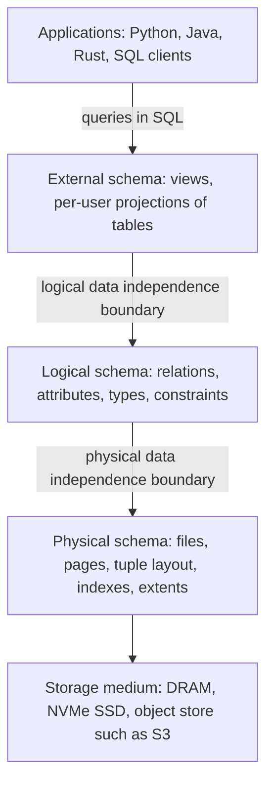
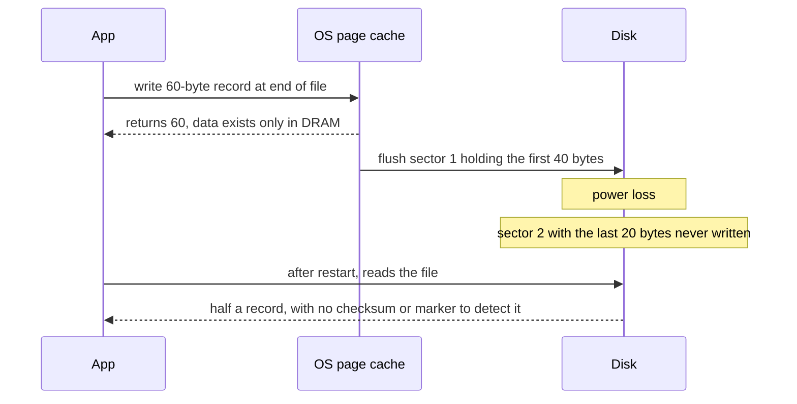
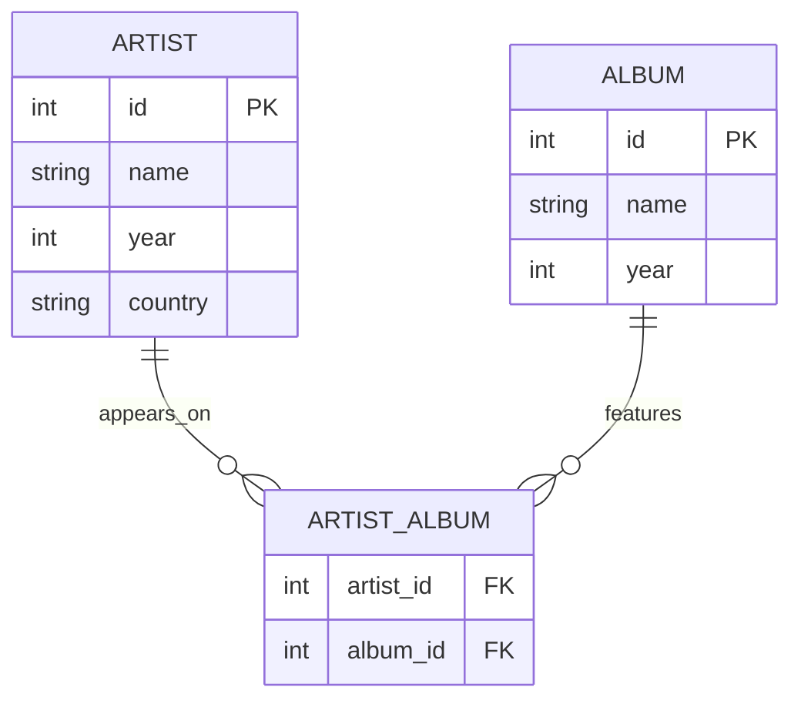
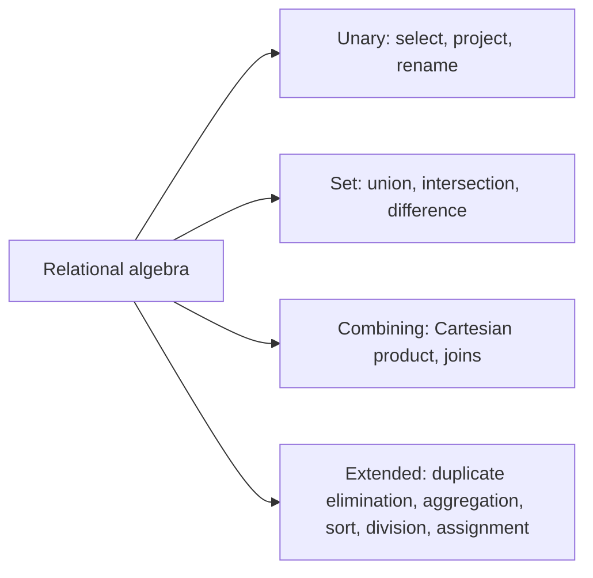
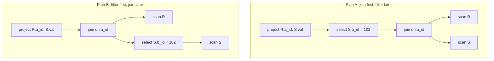
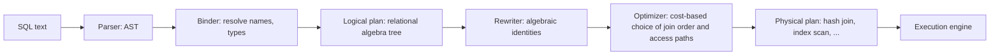
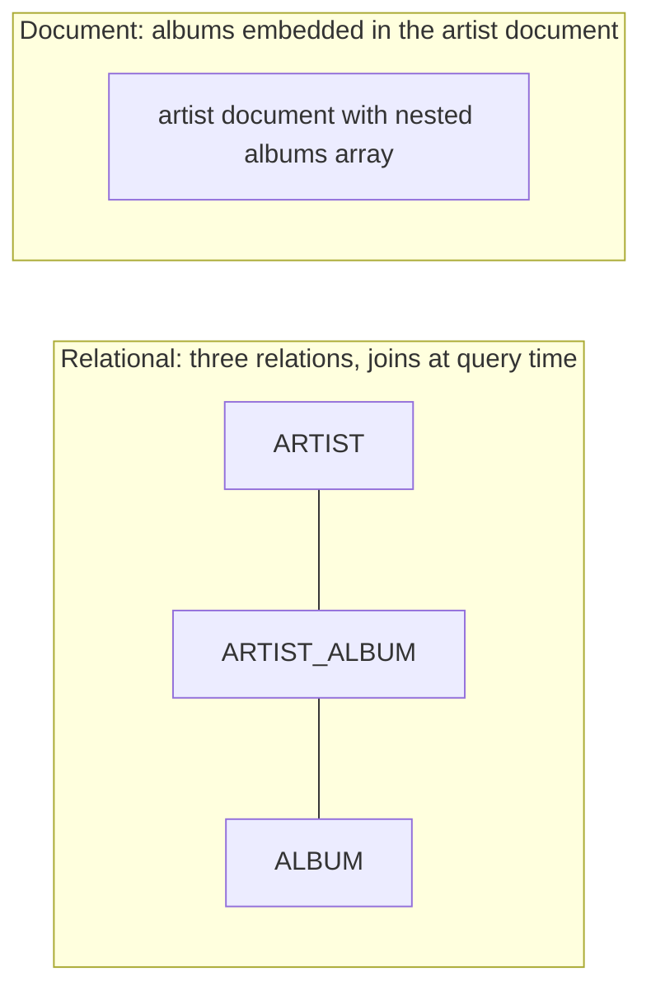
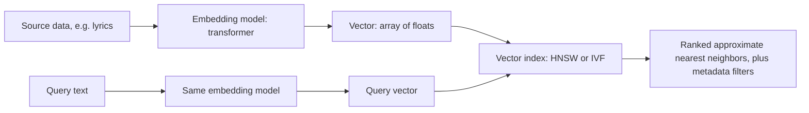

# Module 1 · 1.1 Theory: The Relational Model and Relational Algebra

*Source: CMU 15-445/645, Lecture 1 (Fall 2024), Relational Model & Relational Algebra. This is a conceptual lecture with no data structure or concurrency component, so under our conditional rule I'm delivering theory only. There is no practical part (1.2) for this module, and it fits in a single response, so I haven't split it.*

**Transcript fidelity notes.** I omitted logistics, banter, and career opinions, and kept all the technical content, including the technical Q&A. Auto-captions garbled several terms, and I read them as follows:

| Transcript says | I read it as |
|---|---|
| "kodil", "Cobalt" | CODASYL, COBOL |
| "IDs" | IDS (Integrated Data Store) |
| "Ingress" | Ingres |
| "Seagle", "SQL light" | SQL, SQLite |
| "we8" | Weaviate (likely) |
| "Rocket" | Rockset (OpenAI acquired it in 2024) |
| "Spotify noi" | Annoy |
| "Ed two-phase locking" | Jim Gray et al. (a later module covers 2PL) |

**One substantive error in the transcript:** the Q&A says SQL `UNION` keeps duplicates and `UNION ALL` removes them. This is inverted. `UNION` removes duplicates (set semantics) and `UNION ALL` keeps them (bag semantics). I use the correct form below.

---

## 1. Executive Summary & Mental Model

**Definitions**
- A **database** is an organized collection of related data modeling some aspect of the real world. A contact list, a dictionary, and IMDb are all databases.
- A **DBMS** is the software that lets applications store, query, and analyze that data. ClickHouse, PostgreSQL, and SQLite are DBMSs.
- A **data model** is the abstract vocabulary for describing data and its relationships: relational, document, graph, and so on.
- A **schema** is a specific description, in terms of a data model, of what one database contains: these relations, these attributes, these types.

**Codd's bargain.** Before 1970, application code knew the physical layout of the data: pointers, record chains, and whether a table was a hash table or a tree. Codd's relational model says the application sees only relations (sets of tuples) and states what it wants declaratively. The DBMS owns the physical representation and the execution strategy. This produces three properties:

1. **Physical data independence.** Changing storage format, indexes, or even the storage medium does not change the application.
2. **Declarative access.** You specify the answer, not the algorithm.
3. **Value-based relationships.** Rows are linked by equal values (foreign keys), never by pointers visible to the application.

**The flat-file strawman as a requirements document.** Each failure of the CSV-files-plus-Python design is a feature the DBMS must provide, and each feature maps to a part of this course:

| Flat-file failure | DBMS answer | Where we study it |
|---|---|---|
| O(N) scan and parse for every lookup | Indexes, storage layout, query execution | Storage, indexes, execution modules |
| Adding a field means rewriting app code | Logical schema, data independence | This module |
| Reordered fields or wrong-typed values corrupt reads | Types and constraints | This module |
| Typo in a repeated name ("Wu-Tang" vs "Wu-Tang Claw") | Single source of truth, keys, foreign keys | This module, normalization |
| Many artists on one album (mixtape) | Cross-reference relation | This module |
| Deleting an artist leaves dangling albums | Foreign keys, referential actions | This module |
| Second app or language must re-implement parsing | DBMS as a shared service, SQL | Modern SQL (next) |
| App runs on many machines | Distributed access | Later modules |
| Two writers at once | Concurrency control | Concurrency control modules |
| Crash mid-write leaves half a record | Atomicity, durability, logging and recovery | WAL and ARIES modules |
| Machine failure means downtime | Replication, high availability | Later modules |

---

## 2. Architectural Diagrams

### 2.1 Three-level schema architecture (data independence)



### 2.2 Why a file append is not a transaction (torn write)



### 2.3 Music-store schema (many-to-many resolved with a cross-reference relation)



### 2.4 Lineage of data models

```mermaid
flowchart LR
    A["1965-66 IDS at GE, Bachman, network model"] --> B["1966-68 IMS at IBM, hierarchical, Apollo program"]
    B --> C["Late 1960s CODASYL DBTG standard"]
    C --> D["1969 Codd IBM report, 1970 CACM paper"]
    D --> E["1974 Michigan workshop, CODASYL vs relational debate"]
    E --> F["Mid 1970s System R at IBM San Jose and Ingres at Berkeley"]
    F --> G["SQL standardized: ANSI 1986, SQL-92"]
    G --> H["1980s-90s object-oriented DBMSs, XML databases"]
    H --> I["2000s-2010s NoSQL, JSON, NewSQL"]
    I --> J["2020s vector search, SQL:2023 property graphs and arrays"]
```



### 2.5 Operator taxonomy



### 2.6 Same query, two logical plans



### 2.7 From SQL to execution (where relational algebra lives)



### 2.8 Document model vs relational model



### 2.9 Vector database pipeline



---

## 3. Deep-Dive Mechanics & Invariants

### 3.1 Model vs schema vs instance

- **Data model:** the type system of the whole paradigm. In the relational model it provides relations, attributes, domains, keys, and constraints.
- **Schema:** the declarations for one database, such as `artist(id, name, year, country)`.
- **Instance:** the actual tuples at a given moment.

The lecture offers a class-vs-object analogy and then retracts it, and the retraction is right. A closer analogy is that the data model is the language's type system, the schema is your class declarations, and the instance is the live objects.

**Why a schema matters.** Take a log file of timestamp, event code, and message text. Without a declared structure it is an opaque byte stream and you can only `grep`. Once you declare that each entry has a timestamp, an integer code, and a string, you can query it, index it, and validate it. A DBMS where "schema-less" is a feature still imposes structure, either at write time (schema-on-write) or at read time (schema-on-read).

**A general-purpose DBMS** accepts any schema (within limits) and any query (not hardcoded to one lookup), expressed against a data model.

### 3.2 The flat-file strawman, examined at the systems level

**Lookup cost.** A three-line file sits in L1 and nothing matters. Scale it to 10⁹ records of about 100 bytes, which is roughly 100 GB. The numbers below are order-of-magnitude figures:
- Reading 100 GB at about 3 GB/s from NVMe takes roughly 30 seconds of I/O alone.
- Parsing text is usually CPU-bound. An optimized parser might reach a few hundred MB/s to 1 GB/s per core, and naive Python is far slower, so you are in the tens of minutes to an hour range.
- With a B+Tree index of fanout a few hundred and 8-16 KB pages, 10⁹ keys need about 3-4 page touches, with the upper levels cached.

**Positional coupling.** The Python code `fields[0] == "GZA"` hard-codes column order, so a text editor that swaps two columns silently breaks every reader. The schema lives in code, not in the data. A DBMS stores the schema in a catalog and resolves names against it.

**Integrity.** Nothing stops `1990` from becoming a phone number, or "Wu-Tang Clan" from becoming "Wu-Tang Claw" in one of three repeated copies. Relationships expressed as repeated strings are unchecked. The anomalies are:
- **Update anomaly:** changing one copy leaves the others stale.
- **Insert anomaly:** you cannot record an artist without an album.
- **Delete anomaly:** deleting the last album erases the artist.

The fix is to store each fact once and refer to it by key, with the DBMS verifying the reference.

**Cardinality.** The one-artist-per-album design cannot express a mixtape. This is why the cross-reference relation (§2.3) exists.

**Dangling references.** Delete an artist row and the album file still names that artist. It is a dangling pointer, except the "pointer" is a string, so no tool can even detect it.

**Concurrency, and the OS as frenemy.** The lazy fix is OS file locking (`flock` is whole-file and advisory, `fcntl` locks byte ranges). SQLite does essentially this, which suits a phone. In rollback-journal mode, readers and writers exclude each other. In WAL mode, readers do not block the single writer, but there is still only one writer at a time. That does not scale to a 64-core server. The deeper point is that the OS is hostile to DBMS needs in several ways, and we revisit each in the buffer pool module:
- The page cache's eviction policy knows nothing about query access patterns, so a large scan can evict hot pages.
- The OS can flush dirty pages in any order. A DBMS needs the log record on disk before the data page it describes (write-ahead logging).
- `fsync` semantics and error reporting are subtle. In PostgreSQL's 2018 "fsyncgate", a failed `fsync` cleared the dirty flag and data was silently lost.
- With `mmap`, a page fault blocks the thread invisibly, I/O errors surface as `SIGBUS`, and TLB shootdowns limit scalability. See Crotty, Leis, and Pavlo's CIDR 2022 paper "Are You Sure You Want to Use MMAP in Your Database Management System?"

> **Foundations refresher (skippable): why `write()` is not atomic or durable.**
> `write()` returns once data is in the page cache, not on the device. `fsync`/`fdatasync` asks the kernel to flush, and even then you rely on the device honoring flush semantics. Devices guarantee atomicity at the sector level (512 B legacy or 4 KB). DBMS pages are bigger: PostgreSQL uses 8 KB, InnoDB 16 KB, and SQLite 4 KB by default. A page write therefore spans several sectors and can tear. Production defenses:
> - PostgreSQL's `full_page_writes` logs a full page image after each checkpoint.
> - InnoDB uses a doublewrite buffer.
> - SQLite uses a rollback journal or WAL.
>
> The WAL and ARIES modules go through all of these.

**Durability and availability.** A crash with no recovery protocol leaves unknowable state. Surviving a machine loss needs replication and failover, which the strawman would push into application code.

**When flat files are fine.** For small, single-writer, read-mostly data such as config, flat files are fine. Immutable analytical data in Parquet is also fine, but note that Parquet carries a typed schema and is queried by a real engine (DuckDB, for example, scans CSV and Parquet directly). The lesson is not "files are bad" but "don't rebuild a DBMS inside your app".

### 3.3 Data model survey

| Family | Idea | Examples | Notes |
|---|---|---|---|
| Relational | Relations of tuples, queried declaratively | PostgreSQL, MySQL/InnoDB, SQLite, DuckDB, Oracle | Subject of this course |
| Key-value | Opaque value per key; the app gives it meaning | RocksDB, LevelDB, Redis, DynamoDB's origins | Caches, simple apps, storage engines underneath other systems |
| Document | Nested, self-describing records (JSON, XML) | MongoDB, Couchbase | Targets object-relational impedance mismatch |
| Wide-column / column-family | Rows with dynamic column families | Bigtable, Cassandra, HBase | The lecture groups this under document stores. Many texts list it as its own family. |
| Array / matrix / tensor | N-dimensional arrays as first-class | SciDB, TileDB | Awkward in a pure relational model. SQL:2023 added multidimensional arrays (SQL/MDA). |
| Graph | Vertices and edges, path queries | Neo4j | SQL:2023 added SQL/PGQ (property graph queries) |
| Hierarchical / network / semantic / entity-relationship | 1960s-80s models | IMS, IDS, CODASYL systems | Historical |
| Vector | Float arrays plus similarity search | Weaviate, Pinecone; pgvector in PostgreSQL | A data type plus an index, not a new paradigm |

**Convergence.** "NoSQL" went from "no SQL" to "not only SQL". DynamoDB added PartiQL (a SQL-compatible language), and document stores gained SQL-like interfaces. PostgreSQL and others gained `jsonb`, SQL:2016 and SQL:2023 added JSON support, and nearly every relational system has added vector indexes. The lecture's historical claim is that every decade someone announces the relational model is obsolete, and the field returns to it. Graph databases today make the arguments the CODASYL camp made in the 1970s (SQL/PGQ is the relational answer).

### 3.4 History and why it matters

- **IDS** (Charles Bachman, GE, 1964-66) is a network model with record-at-a-time pointer navigation. Bachman won the 1973 Turing Award.
- **IMS** (IBM, late 1960s) is hierarchical, built to manage bills of materials for the Apollo program. Programmers chose the access method at definition time, for example hash-based (HDAM) or index-based (HIDAM). The lecture's example holds up: choose hashing, later need range scans, and you must unload the data, reload it as a tree, and rewrite every program, because the API changed.
- **CODASYL** (DBTG) standardized the network model. The application navigated *sets* by following pointers. It is dead today.
- **Codd** (mathematician, IBM Research) wrote an internal report in 1969 and the 1970 CACM paper "A Relational Model of Data for Large Shared Data Banks". The paper is pure mathematics, with no SQL and no query language. Codd later proposed a calculus language, **Alpha**, which was never implemented.
- **IBM initially ignored it**, since IMS was very profitable. A San Jose team built **System R**, which produced SEQUEL and then SQL. An early language called SQUARE needed a keyboard with subscripts that did not exist. At Berkeley, **Stonebraker** built **Ingres** with the language **QUEL**. Postgres descends from Ingres. SQL won.
- **The 1974 workshop** (Ann Arbor, Michigan) put the CODASYL camp (Bachman) and the relational camp (Codd) in one room. Four database-related Turing Awards exist in the lecture's telling: Bachman, Codd, Gray, Stonebraker.

**The economics.** In the 1960s-70s machines were expensive and programmers were cheap. Today it is reversed. The relational and declarative approach trades machine cycles for programmer time and flexibility, and it needed a good optimizer to be viable. Critics said no program could beat a human at writing query plans, the same objection once made against C compilers vs hand-written assembly, and the System R optimizer (Selinger et al., 1979) answered it.

**Why the debate matters.** CODASYL-style navigation makes the application brittle: any physical change breaks callers, and the programmer is the query optimizer. The relational model removes both problems.

### 3.5 The relational model, formally

Three components:
1. **Structure:** relations and their attributes.
2. **Integrity:** constraints that define valid states.
3. **Manipulation:** the language for reading and changing data (relational algebra, then SQL).

**Relations and tuples**
- A relation over attributes A₁…Aₙ with domains D₁…Dₙ is a **set** of tuples, a subset of D₁×…×Dₙ. "Relation" and "table" are used interchangeably, though pedantically it is relation, tuple, and attribute, not table, row, and column. The lecture avoids "row" because "row" implies row-oriented physical storage, and a column store has no rows.
- **Arity** (degree) is the number of attributes. **Cardinality** is the number of tuples. An n-ary relation is roughly a table with n columns.
- In the original model there is **no order** among tuples or attributes and **no duplicates** (set semantics).
- Original attribute values were **atomic**. Lists and nested documents were not allowed. This is first normal form. The SQL standard and most systems have relaxed it with arrays and JSON, but keep it as the default design instinct.

**NULL.** NULL marks an unknown or missing value. This is a supplement beyond the lecture, but you need it for correctness.

> **Foundations refresher (skippable): three-valued logic.**
> Comparisons involving NULL yield UNKNOWN, not FALSE. `NULL = NULL` is UNKNOWN. `WHERE` keeps only rows where the predicate is TRUE, so UNKNOWN rows are dropped. `NOT IN (subquery containing NULL)` therefore returns nothing, which is a classic bug. Aggregates other than `COUNT(*)` ignore NULLs. `DISTINCT` and `GROUP BY` treat NULLs as equal to each other, and `UNIQUE` in most systems allows multiple NULLs.

**Keys**
- A **superkey** is any attribute set that uniquely identifies tuples. A **candidate key** is a minimal superkey. A **primary key** is the chosen one.
- You do not need a declared primary key in most systems. The lecture's examples of the DBMS creating one anyway:
  - **SQLite** keeps its own monotonic `rowid`, and a declared primary key becomes a unique constraint (except `INTEGER PRIMARY KEY`, which aliases rowid).
  - **InnoDB** clusters the table on the primary key. If none exists and there is no unique non-null index, it creates a hidden 6-byte `DB_ROW_ID`.
  - **PostgreSQL** does not cluster. Each tuple has a physical locator `ctid` (block, offset), which is not a stable identity.
- **Natural vs surrogate keys.** Using the artist name as a key is wrong because names collide. Use a **surrogate key**: the SQL standard says *identity column*, Oracle and PostgreSQL also have *sequences*, and MySQL says `AUTO_INCREMENT`.
- **Physical consequences (preview).**
  - In InnoDB, every secondary index stores the primary key, so a wide primary key bloats all indexes.
  - Random UUIDv4 keys scatter inserts across a B+Tree and cause page splits and poor cache locality. Monotonic IDs or time-ordered UUIDs (v7) append at the right edge.

**Foreign keys.** A foreign key is a set of attributes in one relation that must match a key in another. The link is by value, where CODASYL used pointers.
- **Referential actions** on delete or update of the parent: `RESTRICT`/`NO ACTION`, `CASCADE`, `SET NULL`, `SET DEFAULT`.
- The lecture says an index is needed on the referenced side to check existence quickly. That is the primary key index, which exists automatically. The referencing column is the one that often lacks an index:
  - **PostgreSQL** does not auto-index referencing columns, so a cascading delete or a join can scan the child table. Add the index yourself.
  - **InnoDB** requires an index and creates one if missing.
- **SQLite** parses foreign keys but does not enforce them unless `PRAGMA foreign_keys = ON`.

**Constraints.** They define what data may look like.
- *Attribute-level:* type, `NOT NULL`, `CHECK (year > 1900)`.
- *Tuple-level:* `CHECK` across columns of one row.
- *Relation-level:* `UNIQUE`, `PRIMARY KEY`.
- *Cross-relation:* foreign keys.

SQL-92 defined `CREATE ASSERTION` for arbitrary global constraints, and effectively nobody implements it. The reason is cost. A naive implementation reruns a query over the whole database on every modification, which is O(N) per write at 10⁹ tuples. Constraints that are checkable with an index probe or from the row itself are practical (unique and foreign key checks are O(log N); `CHECK` is O(1)). The practical substitute for global constraints is triggers or application logic.

```sql
CREATE TABLE artist (
  id      INTEGER GENERATED ALWAYS AS IDENTITY PRIMARY KEY,
  name    VARCHAR(256) NOT NULL,
  year    INT CHECK (year > 1900),
  country CHAR(2)
);
CREATE TABLE artist_album (
  artist_id INT REFERENCES artist(id) ON DELETE CASCADE,
  album_id  INT REFERENCES album(id)  ON DELETE CASCADE,
  PRIMARY KEY (artist_id, album_id)
);
```

**Data independence, in depth**
- *Physical independence:* the application sees relations. Page layout, file organization, extent packing, whether the table is a heap or a tree, and whether storage is disk, memory, or S3 are the DBMS's concern. Swapping them changes performance, not results.
- *Logical independence:* the **external schema** (views) lets different users see different projections of the same tables. Accounting sees SSNs and not grades, the registrar the reverse. A view is a stored query that is expanded in the logical plan.
- **The honest caveat.** The lecture says "in theory", and means it. Correctness is portable between systems only to the extent they follow the SQL standard, and nobody does so exactly. PostgreSQL's parser and dialect are a de facto reference. **Performance is not independent.** Dropping an index changes a query from milliseconds to minutes while returning identical results. Independence is semantic, not a performance guarantee.

**Procedural vs declarative; relational calculus**
- *Procedural:* you specify the steps. Relational algebra is procedural, though mathematical.
- *Declarative:* you specify the result. SQL is mostly declarative and its theoretical ancestor is **relational calculus** (tuple and domain flavors), which states a set by predicate: {t | t ∈ R ∧ t.a = 'a2'}.
- **Codd's theorem:** relational algebra and *safe* relational calculus have equal expressive power (relational completeness). The course does not use calculus, and it matters mainly to query-optimizer researchers.

### 3.6 Relational algebra, operator by operator

We use **set semantics** unless stated. Example relations (R and S share the same schema, so the set operators apply):

- R(a_id, b_id) = {(a1,101), (a2,102), (a3,103)}
- S(a_id, b_id) = {(a3,103), (a4,104), (a5,105)}

**Selection σ.** σ_predicate(R) keeps tuples where a Boolean predicate (first-order logic over attributes) is true. Output schema equals input schema.
- Example, on R′ = {(a1,101), (a2,102), (a2,103), (a3,104)}: σ_{a_id='a2' ∧ b_id>102}(R′) = {(a2,103)}.
- SQL: `WHERE`. Mnemonic: σ is Sigma for Select.
- Cost: O(n) scan, or O(log n + k) with an index. Predicates combine with ∧ and ∨.

**Projection π.** π_{expr₁,…,exprₖ}(R) chooses output attributes, reorders them, and may compute expressions.
- Example: π_{b_id−100, a_id}(σ_{a_id='a2'}(R′)) = {(2,a2), (3,a2)}.
- SQL: the `SELECT` list. In set semantics, projection can create duplicates that must be removed. SQL keeps them unless `DISTINCT`.

**Union ∪.** All tuples in either input. Inputs must be **union-compatible** (same arity and compatible types).
- R ∪ S = {(a1,101), (a2,102), (a3,103), (a4,104), (a5,105)}. The duplicate (a3,103) appears once.
- SQL: `UNION` is set union, so it deduplicates. `UNION ALL` is bag union, so it keeps duplicates and is cheaper because it needs no hash or sort. The transcript states this backwards.

**Intersection ∩.** R ∩ S = {(a3,103)}. SQL: `INTERSECT`.

**Difference −.** Tuples in the first and not the second.
- R − S = {(a1,101), (a2,102)}. S − R = {(a4,104), (a5,105)}, so difference is **not commutative**.
- SQL: `EXCEPT` (Oracle: `MINUS`).

**Cartesian product ×.** All pairs, so |R × S| = |R|·|S|, which is 9 here. The output schema is the concatenation. Clashing attribute names must be qualified or renamed (R.a_id, S.a_id).
- SQL: `CROSS JOIN` or a comma list in `FROM`.
- It is rarely wanted directly (exhaustive test combinations are one use) and is never materialized in practice. Its importance is theoretical: **join = product + selection**.

**Join ⋈.** Combine tuples from two relations that agree on some condition.
- **Natural join** matches on all attributes with the same name and keeps one copy of each. With S′(a_id, b_id, val) = {(a3,103,'x'), (a4,104,'y'), (a5,105,'z')}: R ⋈ S′ = {(a3,103,'x')}. On identical schemas, as with R ⋈ S, natural join degenerates to intersection.
- **θ-join** uses an arbitrary condition. **Equi-join** uses equality only.
- SQL spellings:
  - `NATURAL JOIN`: discouraged. It infers the join columns from names, so adding a same-named column to either table silently changes the query.
  - `JOIN … USING (a_id, b_id)`.
  - `JOIN … ON R.a_id = S.a_id AND R.b_id = S.b_id`: preferred, because it is explicit and robust to schema evolution.
- Variants: inner, left/right/full outer, semi-join, anti-join (next lecture). Join processing is where a DBMS spends most of its execution time, and we study the algorithms (nested loop, hash, sort-merge) and join ordering in detail later.

**Which operators are primitive.** The lecture calls them "seven primitives", but strictly the minimal complete set is σ, π, ×, ∪, − (plus rename ρ). The others are derived:
- R ∩ S = R − (R − S)
- R ⋈_θ S = σ_θ(R × S) (then project away the duplicate columns for a natural join)

**Extended operators** (added after Codd's original paper):

| Operator | Symbol | Meaning | SQL |
|---|---|---|---|
| Rename | ρ | Rename a relation or attribute | `AS` |
| Assignment | ← | Name an intermediate result | `WITH` (CTE) |
| Duplicate elimination | δ | Set semantics from a bag | `DISTINCT` |
| Aggregation | γ | Group and aggregate | `GROUP BY` and aggregates |
| Sorting | τ | Impose an order | `ORDER BY` |
| Division | ÷ | R(A,B) ÷ S(B) = {a : ∀b∈S, (a,b)∈R}, the "for all" query | None. Use double `NOT EXISTS` or `GROUP BY … HAVING COUNT(*) =` |

**Order is undefined, and that is a feature.** A relation is unordered. Consequences:
- The DBMS may physically rearrange tuples at will: background garbage collection, compaction, re-clustering, or an index scan returning a different order than a heap scan. PostgreSQL's synchronized sequential scans can even start a scan mid-table.
- Without `ORDER BY`, result order is not guaranteed, and `LIMIT` without `ORDER BY` is nondeterministic.
- This freedom is an optimization opportunity: a join may emit tuples in whatever order its algorithm produces.

**Set vs bag semantics.** Codd's algebra is set-based. SQL is **bag-based**, because deduplication costs real work (a hash or a sort), so the default is to skip it. When translating between them, remember that duplicates may appear in SQL where the algebra has none.

**Algebraic identities the optimizer uses**
- Selection cascade: σ_{p∧q}(R) = σ_p(σ_q(R)).
- Selection pushdown: σ_p(R ⋈ S) = R ⋈ σ_p(S) when p references only S's attributes.
- Projection pushdown: drop columns not needed upstream as early as possible.
- Inner joins are commutative and associative. N joins admit many orderings, which is why join ordering is hard.
- σ distributes over ∪. Difference and outer joins do **not** reorder freely.

**Why procedural algebra is a problem for users.** In the lecture's example, joining R and S then filtering on S.b_id (Plan A in §2.6) and filtering S first then joining (Plan B) are equivalent. Take |R| = |S| = 10⁹ and a predicate that matches 10³ tuples of S, joined on a key. These are illustrative figures. Plan A produces an intermediate result near 10⁹ tuples before filtering. Plan B probes the join with only 10³ tuples. The cost ratio is on the order of 10⁶. If the user writes the algebra, they must choose. If they write SQL, the optimizer chooses, and it can re-choose when indexes, data sizes, or hardware change. That is the declarative payoff, and the reason "no one writes query plans by hand anymore".

**Keys and relational algebra (a Q&A point).** Relational algebra operators don't use primary keys. Keys are constraints on valid instances, enforced by the DBMS. They matter indirectly, though, because optimizers use key and foreign-key information for cardinality estimation (a PK-FK join has at most |child| output tuples) and for eliminating redundant joins.

### 3.7 The document model, in depth

**What it is.** Collections of self-describing, nested records, typically JSON (earlier XML). The motivation is the **object-relational impedance mismatch**: application code works with nested objects, relational storage with flat relations, and mapping between them (ORMs) is cumbersome. Object-oriented databases in the late 1980s-90s tried to store C++/Java objects directly and never reached mainstream use.

**The embedding design.** Instead of ARTIST, ARTIST_ALBUM, ALBUM and a join, store an artist document with a nested `albums` array. The lecture's students identify the costs:

1. **You must predict your queries.** The structure serves "albums of this artist" well and "artists of this album" badly.
2. **Duplication.** An album with several artists is copied into each artist document, so updates and deletes must touch all copies (the anomalies from §3.2 return).
3. **Application-embedded layout.** Which fields nest where is now implicit in application code, which is the coupling the relational model removed. Secondary indexes on nested fields help lookups, though not the coupling.

**When embedding wins:** data always accessed together, a containment (1:few) relationship, and document-level atomic updates. Many relational systems now offer this too (`jsonb` in PostgreSQL, SQL/JSON), so you can embed where it fits and keep relations elsewhere.

### 3.8 Vector databases, in depth

**What it is.** A document or relational store plus an **embedding** column (a float array, often hundreds to thousands of dimensions) and an index for **approximate nearest-neighbor (ANN)** search. The transformer's "magic" is that semantic similarity of the source data becomes geometric closeness of the vectors. The standard similarity measures are L2 distance, cosine similarity, and inner product.

**The pipeline** (§2.9). Embed each record at ingest, once. At query time embed the query with the same model, then search the index. The embedding step costs milliseconds per item, and it is not the bottleneck. Ingest can batch it, and queries pay it once. Semantic queries ("albums like Liquid Swords", or "slinging rocks" matching drug-dealing themes) can then match meaning rather than exact words. Metadata filters can be combined ("…released after 2012").

**Indexes**
- **Exact kNN** is O(N·d) per query, which is too slow at scale.
- **HNSW** (hierarchical navigable small worlds) is a layered proximity graph with greedy descent. Tuning parameters include `M`, `efConstruction`, and `efSearch`.
- **IVF-flat** (inverted file) clusters vectors around centroids and searches only the nearest `nprobe` clusters.
- Libraries include Meta's Faiss and Spotify's Annoy.
- ANN trades **recall** against latency and memory. Filtered search is a hard problem, because filters interact badly with graph traversal.

**Hardware implications.** At 1,536 float32 dimensions, a vector is 6 KB. 100 M vectors is about 600 GB, so memory capacity dominates the design. Quantization (scalar, product, or binary) shrinks vectors at some recall cost. Distance computation is a tight SIMD loop. Graph traversal is pointer-chasing with poor locality, so it is bound by cache and memory latency, and later hardware-conscious modules revisit this.

**Not a new paradigm.** pgvector adds an `embedding` type with HNSW and IVFFlat indexes to PostgreSQL (`ORDER BY embedding <=> $1 LIMIT 10`), and Oracle and others have followed. The SQL standard has no vector search yet. The lecture's claim, which I'd endorse, is that nothing in vector search requires abandoning relational architecture.

**Q&A: could we already do "fuzzy search" in a relational system?** Yes, with `LIKE`, trigram, or full-text indexes and inverted indexes, but those match text, not meaning. Whether the transformer step is slower than an inverted-index lookup depends on memory, workload, and quality requirements. For queries needing semantic understanding, text matching cannot compete.

---

## 4. Algorithmic Trade-offs & Comparisons

### 4.1 Data models

| Model | Strengths | Weaknesses | Typical fit |
|---|---|---|---|
| Relational | Data independence, ad hoc queries, integrity, mature optimizers | Impedance mismatch, rigid up-front schema | General-purpose OLTP/OLAP |
| Key-value | Simple, very fast, easy to shard | No query beyond key, no integrity | Caches, session stores, storage-engine layer |
| Document | Natural for nested objects, locality of related data | Duplication, query-pattern lock-in, weak cross-document integrity | Content, catalogs, evolving schemas |
| Graph | Multi-hop traversals | Narrow scope | Social, fraud, recommendations |
| Vector | Semantic similarity | Approximate, memory hungry, not a full database alone | Retrieval, recommendation |

### 4.2 Relational algebra operators and their cost (conceptual)

| Operator | Naive cost | With help |
|---|---|---|
| σ | O(n) scan | O(log n + k) with an index |
| π | O(n) | Free when columns are pushed into storage (column stores) |
| ∪, ∩, − (set) | O(n log n) sort or O(n) expected hash | `UNION ALL` is O(n) with no dedup |
| × | O(\|R\|·\|S\|) | Never materialized |
| ⋈ | O(\|R\|·\|S\|) nested loop | O(\|R\|+\|S\|) expected hash, sort-merge, or index nested loop |
| δ, γ | O(n log n) sort or O(n) hash | Memory and spill behavior matter |

### 4.3 Key design choices

| Choice | Pro | Con |
|---|---|---|
| Natural key | No extra column, meaningful | Collisions, changes over time, wide keys bloat indexes (InnoDB) |
| Auto-increment surrogate | Narrow, monotonic, append-friendly in B+Trees | Hot right edge under heavy concurrent insert; leaks insert order and counts |
| Random UUIDv4 | Generated anywhere without coordination | Scattered inserts, page splits, poor cache locality |
| Time-ordered UUID (v7) | Distributed generation plus mostly sequential inserts | Larger than integers |

### 4.4 Constraint enforcement cost

| Constraint | Typical cost per write | Notes |
|---|---|---|
| `NOT NULL`, `CHECK` | O(1) | Evaluated on the row |
| `UNIQUE` / PK | O(log N) index probe | Needs a unique index |
| Foreign key, insert into child | O(log N) probe of parent PK index | Automatic |
| Foreign key, delete in parent | O(log N) with an index on the child column, else O(N) scan | PostgreSQL does not auto-index the child column |
| `CREATE ASSERTION` (naive) | O(N) or worse | Why almost nobody implements it |

### 4.5 Production systems at a glance

| System | Relevant points from this module |
|---|---|
| PostgreSQL | Heap with `ctid`, no clustering by PK, sequences and identity columns, `jsonb`, pgvector, no `CREATE ASSERTION`, parser as de facto dialect reference |
| MySQL/InnoDB | Clustered index on PK or hidden 6-byte `DB_ROW_ID`, secondary indexes embed the PK, `AUTO_INCREMENT`, required index on FK columns, doublewrite buffer |
| SQLite | Embedded, single writer (WAL allows concurrent readers), `rowid`, FK enforcement off by default |
| DuckDB | Embedded analytical engine that can query CSV and Parquet directly with a real optimizer |
| MongoDB | Document model, `$lookup` for join-like queries |
| RocksDB | Key-value engine, often the storage layer beneath other systems |

### 4.6 Declarative vs procedural

- **Declarative gain:** portability across physical changes, optimizer improvements apply to old queries for free, and less code.
- **Declarative cost:** you depend on the optimizer. Bad cardinality estimates can produce bad plans, plans can change unexpectedly after statistics updates, and you sometimes need hints. Procedural gives control and predictability, with brittleness as the price.
- The lecture's practical advice for choosing a database in a design discussion: default to PostgreSQL unless there is a specific reason not to, and spend your effort on the application. It is solid, feature-rich, and a poor choice only at scales most projects never reach.

---

## Theory self-check (conceptual, no code)

1. For each flat-file failure in §1, name the DBMS feature that addresses it.
2. Show that R ∩ S = R − (R − S) and that R ⋈ S = π(σ(R × S)) for a natural join.
3. Why does `NOT IN (subquery)` misbehave when the subquery returns a NULL?
4. Why can a PK-FK join never produce more tuples than the child relation, and why does the optimizer care?
5. Explain why a 16 KB InnoDB page write can tear, and name the defense.
6. Give a case where embedding albums in an artist document is the right call, and one where it isn't.

---

**Next.** Module 2 (Modern SQL) covers the SQL you'd actually write: window functions, CTEs, lateral joins, and where the standard and the real systems diverge. Send that transcript when you're ready. Module 2 is also conceptual, so I expect theory only there as well. If you'd rather have this module's material extended (for example a deeper dive on relational calculus, or a hands-on relational algebra evaluator in C++ with tests and benchmarks), say so and I'll add it as an extra part.
