# Module 2 · 2.1 Theory: Modern SQL

*Source: CMU 15-445/645, Lecture 2 (Fall 2024), Modern SQL. This lecture is about the application-level language and contains no storage or concurrency component, so under our conditional rule I'm delivering theory only. There is no practical part (2.2), and it fits in one response, so I haven't split it.*

**Transcript fidelity notes.** I dropped the logistics, banter, the rap lyrics at the start and end of the audio, and the stretches of live-demo debugging. I kept every technical point, including the technical Q&A.

| Transcript says | I read it as |
|---|---|
| "seal", "seagull", "SQ L" | SQL; the original spelling was SEQUEL |
| "Peter Lee relational test vehicle" | Peterlee Relational Test Vehicle (PRTV), IBM UK |
| "Square" | SQUARE (Boyce, Chamberlin et al., 1973) |
| "system 38", "SQL DS" | System/38, SQL/DS |
| "anti standard" | ANSI standard |
| "Alpa control and redirection" | output control and redirection |
| "Dr B", "duct DB" | DuckDB |
| "Umbra … Cedar DB" | Umbra, commercialized as CedarDB |
| "Unix Tim stamps" | Unix timestamps |

**Corrections and caveats on what the lecture says**

1. **"Julian calendar = days since Julius Caesar's birthday."** This is wrong. The Julian *day number* (what SQLite's `julianday()` returns) counts days from noon UTC, 1 January 4713 BC (proleptic Julian calendar). It has nothing to do with Caesar's birthday. The banking point is also a conflation: banks computed interest with *day-count conventions* such as 30/360, which assume 30-day months. That is a separate concept from the Julian calendar. I treat the Stonebraker/Ingres anecdote as the lecturer's recollection.
2. **"Rewrite `IN (subquery)` as a join."** The correct rewrite is a *semi-join*. A plain inner join would duplicate outer rows whenever the inner side has several matches (§3.8).
3. **"You couldn't do second-highest-per-group without a window function."** That overstates it. You can with correlated subqueries or `LATERAL … LIMIT`. Window functions are the clean way.
4. **Demo failures** for window functions in MySQL and Oracle. Both systems support window functions (MySQL 8.0+, Oracle since 8i). The failures were most likely dialect issues in the demo query, such as Oracle rejecting `AS` before a table alias, or an old server version. Likewise, some "no such function" results (`NOW()`, `LATERAL`) depend on version. I give documented behavior below rather than reproducing the demo's outcomes. The lecturer also deferred a demo about nested queries returning different answers (suspected cause: a stale extra row in his table), and I can't reconstruct what he planned to show.
5. **PostgreSQL `SELECT INTO`** creates a *regular* table unless you write `SELECT … INTO TEMP`. The lecture implies it is temporary.
6. **`COUNT(login)` vs `COUNT(*)`.** The lecture says they're interchangeable. They are only when `login` has no NULLs (§3.3).
7. **Dialect facts** reflect my knowledge of mainstream versions. These things change between releases, so verify against your exact version.

---

## 1. Executive Summary & Mental Model

**The core idea.** SQL is a *declarative*, bag-based query language layered on the relational model. You describe the result, and the DBMS chooses the algorithm. Modern SQL is the part of the language that lets you do more of your computation *inside* one query instead of shuttling data to application code:

| Feature | What it buys you |
|---|---|
| Aggregation and `GROUP BY` | Derive new facts from many tuples |
| Window functions | Aggregates and rankings that keep every input row |
| Nested queries | Express "for some / for all / the max of" logic |
| `LATERAL` joins | A for-each loop inside SQL: later items may reference earlier ones |
| CTEs | Name intermediate results; recursion |
| String, date, time functions | Where portability dies |
| Output control and redirection | Sort, page, and store results |

**A mental model for reading any SQL query.** Ignore the textual order. SQL is *written* `SELECT … FROM … WHERE … GROUP BY …` but *logically evaluated* in a different order (§2.2). Most beginner errors, such as aliases not visible in `WHERE` or aggregates not allowed in `WHERE`, come from forgetting this.

**The portability thesis.** The standard exists (ISO/IEC 9075), yet every system deviates. Simple queries move between systems, and anything involving dates, strings, null ordering, or newer features does not. In the lecture's demos, even "days since January 1st" needs a different spelling in each system. The practical rule is to write to the standard when you can, isolate dialect-specific code, and test on your target system.

**Why this lecture comes before the internals.** Everything in the later modules (parsing, planning, join algorithms, aggregation operators, window operators, decorrelation) exists to execute these constructs fast. When we later build a hash aggregator or a join, this is the semantics it must implement.

---

## 2. Architectural Diagrams

### 2.1 SQL history and standards

```mermaid
flowchart LR
    A["1970 Codd, relational model, no language"] --> B["1973 SQUARE, PRTV in the UK"]
    B --> C["1974 SEQUEL, Chamberlin and Boyce, IBM System R"]
    C --> D["Renamed SQL after a trademark dispute"]
    D --> E["1981 SQL/DS, 1983 DB2"]
    E --> F["1986 ANSI SQL-86, 1987 ISO"]
    F --> G["1992 SQL-92, the baseline to claim SQL support"]
    G --> H["1999 recursion, triggers, LATERAL"]
    H --> I["2003 window functions, XML, identity columns"]
    I --> J["2016 JSON, row pattern matching"]
    J --> K["2023 property graph queries, multidimensional arrays"]
```

### 2.2 Logical query processing order

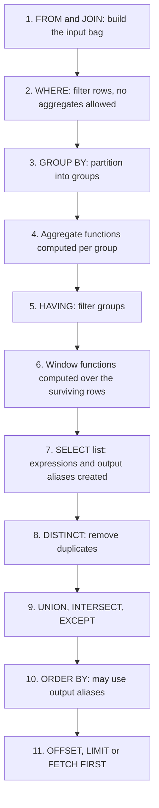

### 2.3 GROUP BY as bucketing

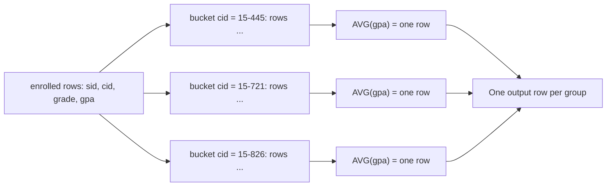

### 2.4 Aggregate vs window function

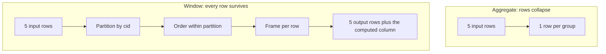

### 2.5 Window frame for one current row

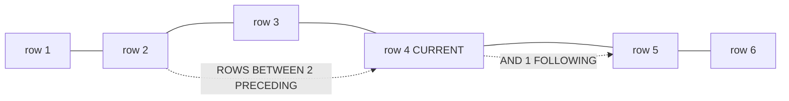

### 2.6 Nested-query scoping and correlated execution

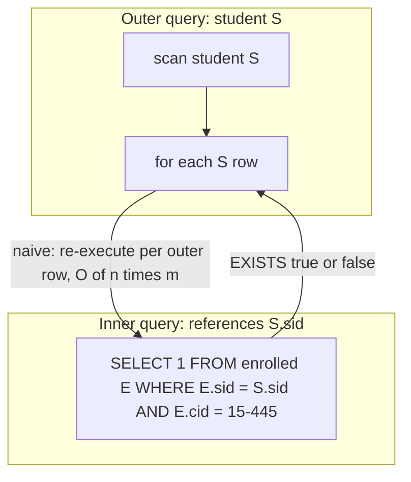

### 2.7 Decorrelation (what a good optimizer does instead)

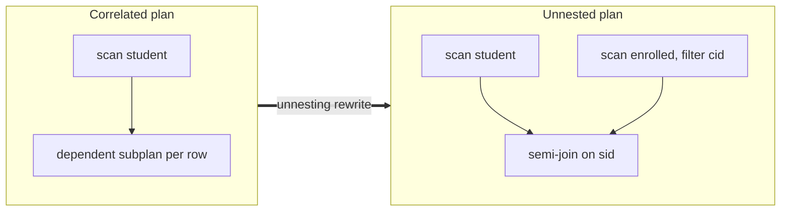

### 2.8 LATERAL as a for-each loop

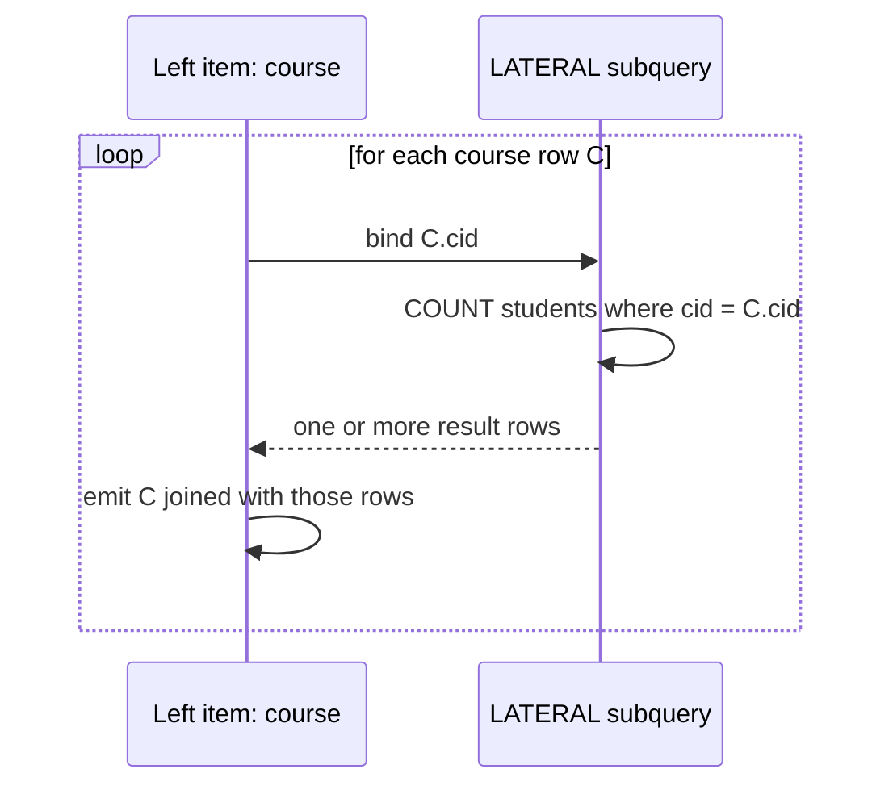

### 2.9 CTE dependency graph

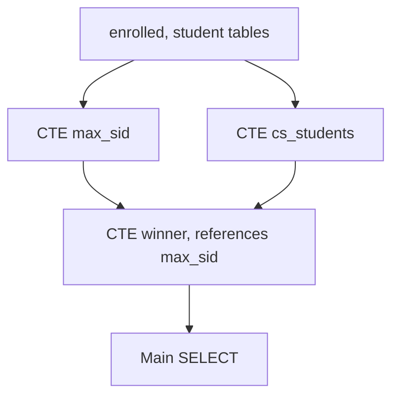

### 2.10 Recursive CTE as fixpoint iteration

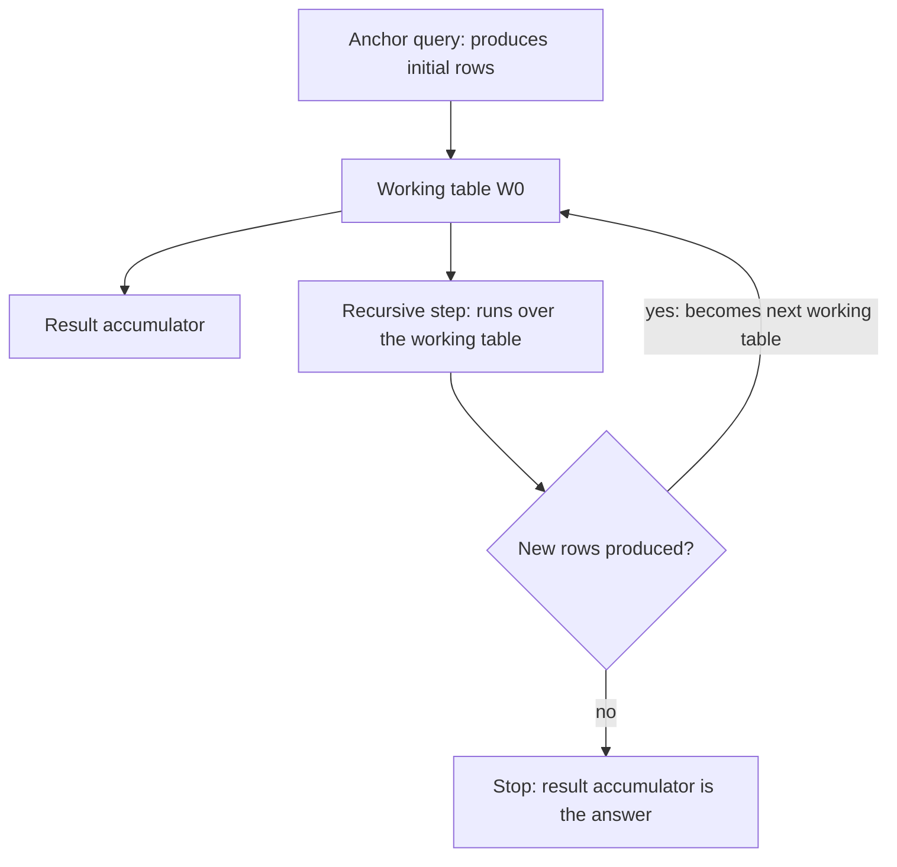

### 2.11 EXPLAIN: one SQL query, many plan shapes

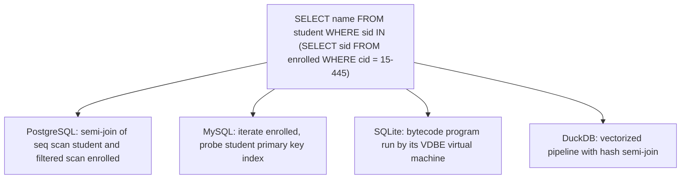

---

## 3. Deep-Dive Mechanics & Invariants

### 3.1 History, standards, and structure of the language

**Origins.** Codd's 1970 paper had no language. In the UK, IBM's Peterlee Relational Test Vehicle implemented **SQUARE**, a notation written with subscripts and superscripts that nobody could type. Chamberlin and Boyce then designed **SEQUEL** (Structured English Query Language), implemented in IBM's **System R**. A trademark dispute forced the shortening to **SQL**. System R gave the field many foundational ideas (cost-based optimization, two-phase locking), which later modules cover. IBM did not rush to commercialize it because IMS was extremely profitable (and still is: banks, insurers, and government agencies still run on IMS). IBM shipped SQL/DS (1981) and DB2 (1983) after Oracle (then Relational Software) had already shipped SQL.

**Standards.** ANSI standardized SQL in 1986, ISO followed in 1987, and it has been revised repeatedly. Each revision tracks how applications were being written:

| Revision | Notable additions |
|---|---|
| SQL-86/89 | Core query language, basic integrity constraints |
| SQL-92 | The baseline for claiming "SQL support": joins, subqueries, set operators, `CASE`, `CAST`, date/time types, aggregates |
| SQL:1999 | Recursive CTEs, triggers, `LATERAL`, user-defined types, boolean type |
| SQL:2003 | Window functions, XML, sequences/identity columns, `MERGE` |
| SQL:2011 | Temporal tables |
| SQL:2016 | JSON, row pattern recognition |
| SQL:2023 | Property graph queries (SQL/PGQ), multidimensional arrays, JSON improvements |

The lecturer's observation is that each major data fad (XML, JSON, graph) got absorbed. As of the lecture, Oracle was the only system with SQL/PGQ, and I'd verify that today. A system that claims "SQL support" at minimum means SQL-92 core. The standard is conformance-based (mandatory *core* features plus a large menu of optional ones), and the document costs money.

**Persistent predictions of SQL's demise.** The lecture mentions natural-language interfaces and a recent Google paper proposing *pipe syntax* (SQL extended with a `|>` operator for a more linear dataflow style, "SQL Has Problems. We Can Fix Them: Pipe Syntax in SQL", VLDB 2024). Both reduce to a surface syntax over the same relational operators. The lecturer's view is that LLMs are a good way to get a first draft, but you must still verify that the query returns what you meant. I add one practical point: use `EXPLAIN` to verify that it *executes* sensibly too.

**Three sub-languages.**
- **DML**: `SELECT`, `INSERT`, `UPDATE`, `DELETE`, `MERGE`
- **DDL**: `CREATE/ALTER/DROP TABLE|INDEX|VIEW`
- **DCL**: `GRANT`, `REVOKE`, and in some systems row- and column-level access control
- (Transaction control, `BEGIN/COMMIT/ROLLBACK`, is usually listed separately.)

**Bags, not sets.** Module 1 introduced this. A set has no duplicates and no order, a list has order and duplicates, and a **bag** has duplicates and no order. SQL tables and results are bags. Running the same query twice can return a different order if storage was reorganized in between (background vacuum, different scan strategy, parallel workers). That is correct SQL behavior. Order is guaranteed only with `ORDER BY`, and duplicates are removed only with `DISTINCT` or `UNION`.

**The sample schema used throughout the lecture.**

```sql
CREATE TABLE student  (sid INT PRIMARY KEY, name VARCHAR(32), login VARCHAR(32),
                       age INT, gpa FLOAT);
CREATE TABLE course   (cid VARCHAR(32) PRIMARY KEY, name VARCHAR(32));
CREATE TABLE enrolled (sid INT REFERENCES student(sid),
                       cid VARCHAR(32) REFERENCES course(cid),
                       grade CHAR(1));
```

### 3.2 Logical vs physical evaluation order

The pipeline in §2.2 is *semantics*. The optimizer may reorder anything as long as the result is the same. Consequences you must know:

- Aliases defined in `SELECT` are not visible in `WHERE`, `GROUP BY` (standard), or `HAVING` (standard), but are visible in `ORDER BY`. PostgreSQL allows aliases in `GROUP BY` and MySQL in `HAVING`, which the lecture demonstrates, but this is non-portable.
- **Aggregates cannot appear in `WHERE`**, because the grouping happens after `WHERE`. Use `HAVING`.
- **Window functions cannot appear in `WHERE`** either (they are computed after it), which is why the second-highest example uses a nested query (§3.6). Snowflake, BigQuery, Teradata, and DuckDB offer a `QUALIFY` clause to filter on window results directly.
- Prefer `WHERE` for row filters and `HAVING` only for conditions on aggregates. `WHERE` filters before grouping, so it does less work.

### 3.3 Aggregation and GROUP BY

**Standard aggregates:** `MIN`, `MAX`, `COUNT`, `SUM`, `AVG`. Systems add standard deviation, geometric mean, percentiles, `STRING_AGG`, `ARRAY_AGG`, and others. Some let you define **user-defined aggregates**. PostgreSQL's design from the 1980s (extensible types, operators, and aggregates) is why it does this well. You write a state-transition function and an optional final function.

**Semantics and edge cases.**
- `COUNT(*)` counts rows. `COUNT(expr)` counts rows where `expr` is not NULL. `COUNT(1)` equals `COUNT(*)`. `COUNT(DISTINCT x)` counts distinct non-NULL values. The lecture's `COUNT(login)` vs `COUNT(*)` equivalence holds only when `login` has no NULLs.
- Other aggregates **ignore NULLs**. `AVG` of an all-NULL column is NULL.
- **No `GROUP BY`** means the whole input is one group, so an aggregate over *empty* input returns **one row** (`COUNT` gives 0, `SUM/AVG/MIN/MAX` give NULL). With `GROUP BY` and empty input you get **zero rows**.
- **NULLs form a single group** under `GROUP BY`, even though `NULL = NULL` is not true.
- `AVG` over an integer column in some systems returns a truncated integer (SQL Server) and in others a decimal. Cast when it matters.
- Combining aggregates over different filters:
  ```sql
  SELECT COUNT(*) FILTER (WHERE grade = 'A') AS a_count,      -- SQL:2003 FILTER
         COUNT(*) AS total
  FROM enrolled;
  ```
  Other systems use `SUM(CASE WHEN grade='A' THEN 1 ELSE 0 END)`.

**The bare-column problem** (the lecture's first query).

```sql
SELECT AVG(s.gpa), e.cid          -- cid is neither aggregated nor grouped
FROM enrolled AS e JOIN student AS s ON e.sid = s.sid;
```

Mathematically this is meaningless: `AVG` collapses all rows into one, and then `cid` has no single value. Systems differ:

| System | Behavior |
|---|---|
| PostgreSQL, DuckDB, SQL Server, Oracle, ClickHouse | Error (DuckDB helpfully suggests `any_value`) |
| MySQL | Depends on `sql_mode`. `ONLY_FULL_GROUP_BY` (default in 5.7.5+) rejects it, but the lecture's instance allowed it |
| SQLite | Allows it. The bare column comes from an arbitrary row (with a single `MIN`/`MAX` aggregate, from the row that achieved it) |

The portable escape hatch is `ANY_VALUE(cid)` (MySQL 5.7+, DuckDB, PostgreSQL 16+). The correct fix, when you really want per-course averages, is `GROUP BY`:

```sql
SELECT e.cid, AVG(s.gpa) AS avg_gpa
FROM enrolled AS e JOIN student AS s ON e.sid = s.sid
GROUP BY e.cid;
```

**Rule:** every non-aggregated expression in the `SELECT` list must appear in `GROUP BY`. One refinement: SQL:1999 allows columns that are *functionally dependent* on the grouped columns (for example, grouping by a primary key lets you select that table's other columns), and PostgreSQL implements that.

**MySQL's `sql_mode`.** MySQL has historically accepted questionable SQL, and `SET sql_mode='ANSI'` (or adding strict flags) makes it follow the standard more closely. Enterprise systems offer *compatibility levels* (SQL Server's compatibility level, Oracle's `OPTIMIZER_FEATURES_ENABLE` and compatibility settings) so you can upgrade the engine without rewriting applications. PostgreSQL ships a major release yearly and does not offer a general compatibility mode.

**`HAVING`** filters groups after aggregation:

```sql
SELECT e.cid, AVG(s.gpa) AS avg_gpa
FROM enrolled AS e JOIN student AS s ON e.sid = s.sid
GROUP BY e.cid
HAVING AVG(s.gpa) > 3.9;          -- portable
-- HAVING avg_gpa > 3.9 works in MySQL, not in the standard or PostgreSQL
```

The engine should compute the repeated `AVG` only once (common subexpression elimination). `HAVING` without `GROUP BY` filters the single whole-table group.

**Multi-dimensional grouping (standard, beyond the lecture).** `GROUP BY GROUPING SETS (...)`, `ROLLUP`, and `CUBE` compute several groupings in one pass.

**Execution preview.** Aggregation is executed by *hash aggregation* (a hash table keyed by group columns holding partial states) or *sort aggregation* (sort, then stream). With parallelism, workers compute partial aggregates that are then merged, which is why aggregates are defined by a combine step. Spilling to disk when the group count exceeds memory is covered in the execution modules.

### 3.4 Strings

**Semantics by the standard.** String comparison is **case sensitive**, and string literals use **single quotes**. Double quotes delimit *identifiers* (for example a column named with a space).

| Behavior | Standard | PostgreSQL | MySQL | SQLite | SQL Server | Oracle |
|---|---|---|---|---|---|---|
| `=` case sensitive | yes | yes | no (default collation) | yes | no (default collation) | yes |
| Single-quoted literals | yes | yes | yes | yes | yes | yes |
| Double quotes for strings | no | no | yes (unless `ANSI_QUOTES`) | accepted as a legacy misfeature, now disableable | no | no |
| Concatenation | `||` | `||` | `CONCAT()` (`||` is OR unless `PIPES_AS_CONCAT`) | `||` | `+` (and `CONCAT`) | `||` |

Notes:
- In SQL Server and MySQL, case sensitivity is a property of the **collation** (default case-insensitive), not a global rule. Case-insensitive comparison in PostgreSQL is usually `ILIKE`, `lower(a) = lower(b)`, or a case-insensitive collation or `citext`.
- SQLite's `=` is case-sensitive but its `LIKE` is case-insensitive for ASCII by default. This explains some surprising demos.
- The lecture's demo showed SQLite rejecting double-quoted string literals after an upgrade, which is the "disable legacy double-quoted strings" build option taking effect.
- **NULL and concatenation:** `'a' || NULL` is NULL in the standard, but `CONCAT()` in PostgreSQL and SQL Server skips NULLs, and **Oracle treats the empty string as NULL**.

**`LIKE` wildcards.** `%` matches any sequence of **zero or more** characters (the lecturer says "one or more, including none", which means zero or more). `_` matches **exactly one** character. Escape with `LIKE 'a\%b' ESCAPE '\'`. Richer matching comes from `SIMILAR TO`, `LIKE_REGEX`, and system-specific regex operators (`~` in PostgreSQL, `REGEXP` in MySQL).

**Functions** (names vary): `UPPER`, `LOWER`, `SUBSTRING`, `POSITION`, `TRIM`, `CHAR_LENGTH` vs `OCTET_LENGTH`, `REPLACE`, `OVERLAY`. Note character vs byte length with UTF-8. `CHAR(n)` is blank-padded and has comparison quirks, so prefer `VARCHAR`/`TEXT`.

**Index implications (production insight).**
- `WHERE login LIKE '%@cs'` (leading wildcard) cannot use a B+Tree index and is a scan. The lecture's `like '%@cs'` query behaves this way.
- `WHERE login LIKE 'abc%'` (anchored prefix) can use a B+Tree index if the collation or operator class allows it (in PostgreSQL, `text_pattern_ops` or the `C` collation).
- `WHERE UPPER(name) = 'TUPAC'` defeats a plain index on `name`. Use a functional (expression) index, or a case-insensitive type or collation.
- For infix matching use trigram indexes (`pg_trgm`) or full-text search.

### 3.5 Dates and times

**Standard types:** `DATE`, `TIME [WITH/WITHOUT TIME ZONE]`, `TIMESTAMP [WITH/WITHOUT TIME ZONE]`, `INTERVAL`. Literals are `DATE '2024-08-28'`. **The current time** is a *keyword* in the standard (`CURRENT_TIMESTAMP`, `CURRENT_DATE`, no parentheses), while `NOW()` is common but **not standard**.

**Time zones (the lecture's Q&A).** Types without a zone store a wall-clock value. Types with a zone store an unambiguous instant. PostgreSQL's `timestamptz` stores UTC and displays in the session time zone. If you don't specify, the system default (server or session setting) is used. MySQL's `TIMESTAMP` converts to UTC internally (with a 2038 range limit), while `DATETIME` does not. Rule of thumb: store instants in UTC with a zone-aware type, and convert at the edges.

**The lecture's task: days from 1 January to 28 August 2024.** Jan 31 + Feb 29 (leap year) + Mar 31 + Apr 30 + May 31 + Jun 30 + Jul 31 = 213, plus 27 days is **240**.

| System | Idiom for the difference in days |
|---|---|
| PostgreSQL | `DATE '2024-08-28' - DATE '2024-01-01'` gives an integer 240. `EXTRACT(DOY FROM d)` gives **241**, because day-of-year is 1-based. `'2024-08-28'::date` is PostgreSQL's cast shorthand (also in DuckDB) |
| MySQL | `DATEDIFF('2024-08-28','2024-01-01')` gives 240 (**later date first**) |
| SQL Server | `DATEDIFF(day, '2024-01-01', '2024-08-28')` gives 240 (**start date first**, which is why the lecture got a negative number) |
| SQLite | `CAST(julianday('2024-08-28') - julianday('2024-01-01') AS INTEGER)` |
| Oracle | `TO_DATE('2024-08-28','YYYY-MM-DD') - TO_DATE('2024-01-01','YYYY-MM-DD')` gives a number of days |
| DuckDB | PostgreSQL style, or `date_diff('day', …)` |
| ClickHouse | `dateDiff('day', toDate('2024-01-01'), toDate('2024-08-28'))` |

**Traps the lecture exposes**
- **MySQL numeric coercion.** Subtracting a date literal string from `NOW()` makes MySQL coerce both to numbers (in the style `20240828` and `20240101`), giving a meaningless value such as 727, which is where the lecture's "7 months, 27 days" came from.
- **`DATEDIFF` semantics differ** (argument order and units). SQL Server's `DATEDIFF` counts *boundary crossings*, not elapsed time.
- **No `FROM` clause in Oracle (before 23ai).** `SELECT CURRENT_TIMESTAMP` fails, and you write `FROM DUAL`, a built-in one-row table. PostgreSQL, MySQL, SQLite, DuckDB, and SQL Server allow `SELECT 1+1`. (Oracle 23ai relaxed this.)
- **Unix timestamps** (seconds since 1970-01-01 UTC) give a portable-looking approach, but the conversion function differs per system, and there is no universal spelling either.
- **SQLite has no true date type.** It stores dates as text, real (Julian day number), or integer (Unix time) and uses functions such as `julianday()` and `datetime('now')`.

**Julian day number (corrected).** The Julian day number is a continuous day count from a fixed epoch, which makes day arithmetic trivial. SQLite exposes it, and PostgreSQL has a `J` formatting option. As noted above, it is unrelated to Caesar's birthday or bank interest rules.

### 3.6 Window functions

**Idea.** A window function computes a value *per row* from a set of related rows, and **keeps every input row**. The general form is `function(args) OVER (PARTITION BY … ORDER BY … frame)`.

**Functions**
- *Aggregates as window functions:* `SUM`, `AVG`, `MIN`, `MAX`, `COUNT`
- *Ranking:* `ROW_NUMBER()`, `RANK()`, `DENSE_RANK()`, `NTILE(n)`, `PERCENT_RANK()`, `CUME_DIST()`
- *Navigation:* `LAG`, `LEAD`, `FIRST_VALUE`, `LAST_VALUE`, `NTH_VALUE`

**`OVER` clause**
- `PARTITION BY`: independent groups (like `GROUP BY` but without collapsing). Without it, the whole input is one partition.
- `ORDER BY`: order *within* the partition, which gives ranking and running computations meaning. Bags have no row positions, so `ROW_NUMBER()` is only deterministic with a total ordering (add a tiebreaker).
- **Frame:** the subset of the partition used for each row's aggregate: `ROWS | RANGE | GROUPS BETWEEN <start> AND <end>`, with bounds `UNBOUNDED PRECEDING`, `n PRECEDING`, `CURRENT ROW`, `n FOLLOWING`, `UNBOUNDED FOLLOWING`.

**Frame gotchas (beyond the lecture, essential in practice)**
- If you give `ORDER BY` and no frame, the default is **`RANGE BETWEEN UNBOUNDED PRECEDING AND CURRENT ROW`**, which includes *peer rows* (ties). A "running total" over ties therefore jumps in lumps. Use `ROWS` for row-by-row running totals.
- `LAST_VALUE` with the default frame returns the *current* row's value (the frame ends at the current row), not the partition's last. Give it `ROWS BETWEEN … AND UNBOUNDED FOLLOWING`.

```sql
SELECT cid, sid, grade,
       ROW_NUMBER() OVER (PARTITION BY cid)                         AS rn,
       RANK()       OVER (PARTITION BY cid ORDER BY grade ASC)      AS rk,
       DENSE_RANK() OVER (PARTITION BY cid ORDER BY grade ASC)      AS drk,
       SUM(1)       OVER (PARTITION BY cid ORDER BY sid
                          ROWS BETWEEN UNBOUNDED PRECEDING
                                   AND CURRENT ROW)                 AS running_n
FROM enrolled;
```

**The lecture's example: the student with the second-highest grade per course.**

```sql
SELECT *
FROM (SELECT *, RANK() OVER (PARTITION BY cid ORDER BY grade ASC) AS rnk
      FROM enrolled) AS ranking
WHERE ranking.rnk = 2;
```

Points to understand:
- `ASC` on letter grades puts `'A'` first, so rank 1 is the best grade. (Lexicographic order depends on collation. Letter grades with `+`/`-` need care.)
- **Why the nested query:** window functions are computed after `WHERE`, so you cannot filter on them in the same query level. The outer query filters on the computed column. Derived tables need an alias in MySQL and the standard, and Oracle rejects `AS` before a table alias, so those two lecture-demo failures are dialect syntax.
- **Ties:** with two A's in a course, `RANK` yields 1, 1, 3 and **there is no rank 2** for that course. `DENSE_RANK` yields 1, 1, 2. `ROW_NUMBER` yields 1, 2, 3 and arbitrarily breaks the tie. "Second highest" is ambiguous: second *student* (`ROW_NUMBER`), second *grade position* (`RANK`), or second *distinct grade* (`DENSE_RANK`). Decide which you mean.

**Use cases:** top-N per group, running totals, moving averages, time-series analysis (lag/lead for deltas), percentiles, deduplication (`ROW_NUMBER() … = 1`).

**Execution preview.** A typical window operator hash-partitions or sorts by (partition keys, order keys), then streams through each partition maintaining the frame, with incremental aggregates or a segment tree for sliding frames. The cost is dominated by the sort, O(n log n). Multiple window functions with different `OVER` specs force multiple sorts.

### 3.7 Output control, redirection, ordering, pagination

**Redirecting results into a table** instead of returning them to the client:

| Syntax | Where | Note |
|---|---|---|
| `CREATE TABLE t AS SELECT …` | Standard (CTAS), PostgreSQL, MySQL (also `CREATE TABLE … SELECT`), Oracle, DuckDB, SQLite | Schema inferred from the query |
| `SELECT … INTO t FROM …` | PostgreSQL, SQL Server | Creates a new table. PostgreSQL: regular unless `INTO TEMP`. MySQL's `SELECT INTO` is for variables and files |
| `INSERT INTO t SELECT …` | Everywhere | Table must already exist |

This works because SQL is declarative: the system knows the output types statically.

**Ordering**
- Without `ORDER BY`, order is undefined, and this holds even if it "looks sorted" in testing.
- `ORDER BY` accepts multiple keys, `ASC`/`DESC`, expressions, output aliases, and ordinal positions (`ORDER BY 2`, which is fragile).
- **NULL ordering differs**: PostgreSQL and Oracle treat NULL as larger than any value (last in `ASC`). MySQL, SQLite, and SQL Server treat NULL as smallest (first in `ASC`). Standard `NULLS FIRST|LAST` (not supported everywhere) makes it explicit.

**Deduplication:** `SELECT DISTINCT …` (PostgreSQL also has `DISTINCT ON (key)`, which keeps one row per key according to `ORDER BY`).

**Limiting and paging**
- Standard: `OFFSET n ROWS FETCH FIRST m ROWS ONLY` (add `WITH TIES` to include rows tied with the last one).
- Common: `LIMIT m OFFSET n` (PostgreSQL, MySQL, SQLite, DuckDB), `TOP m` (SQL Server), `ROWNUM` and later `FETCH FIRST` (Oracle).
- **`OFFSET` pagination costs O(offset)** per page because skipped rows must still be produced. For deep pages use **keyset pagination**: `WHERE (sort_key, id) > (:last_key, :last_id) ORDER BY sort_key, id LIMIT 10`.
- Pagination needs a deterministic total order: add a unique tiebreaker, otherwise the same row can appear on two pages or none.

### 3.8 Nested queries (subqueries)

**Placement.** A subquery may appear in:
- `SELECT` list (a **scalar subquery**: must return one column and at most one row. More than one row is a runtime error, and zero rows yields NULL)
- `FROM` (a **derived table**, treated like a temporary relation)
- `WHERE` / `HAVING` with `IN`, `EXISTS`, `ANY/SOME`, `ALL`
- Even `ORDER BY` (legal, usually pointless: `ORDER BY (SELECT MAX(sid) FROM enrolled)` has one value for every row)

**Scoping rules.** The *inner* query can see columns of the *outer* query, and the outer query cannot see inside. Names resolve to the innermost scope first, so in the lecture's `IN` example `sid` inside the subquery means `enrolled.sid`, while outside it means `student.sid`. Qualify names to avoid mistakes.

**Quantified predicates**

| Predicate | Meaning | Edge cases |
|---|---|---|
| `x IN (subq)` | `x = ANY (subq)` | `NOT IN` ≡ `<> ALL` |
| `x op ANY (subq)` | true if `op` holds for **at least one** row | `ANY` over empty set is **false** |
| `x op ALL (subq)` | true if `op` holds for **every** row | `ALL` over empty set is **true** |
| `EXISTS (subq)` | true if the subquery returns at least one row | Ignores the select list (`SELECT 1` is conventional); short-circuits |

**The NULL trap** (from Module 1). `x NOT IN (subquery)` returns no rows if the subquery produces any NULL, because `x <> NULL` is UNKNOWN. Prefer `NOT EXISTS`, which does not have this problem.

**Lecture examples**

```sql
-- names of students enrolled in 15-445
SELECT name FROM student
WHERE sid IN (SELECT sid FROM enrolled WHERE cid = '15-445');

-- the student with the highest id among those enrolled in any course
SELECT sid, name FROM student
WHERE sid IN (SELECT MAX(sid) FROM enrolled);
```

(The transcript says "equals any" for the second, which is equivalent to `IN`.) The lecturer's method for writing such queries is useful: *write the outer query's shape first, express the filter in plain English, then fill in the inner query and the matching condition.*

**Correlated vs uncorrelated**
- **Uncorrelated** subqueries do not reference the outer query. They can be evaluated once.
- **Correlated** subqueries reference outer columns and are *conceptually* re-evaluated per outer row (§2.6).

```sql
SELECT name FROM student S
WHERE EXISTS (SELECT 1 FROM enrolled E WHERE E.sid = S.sid AND E.cid = '15-445');
```

**Execution reality and optimizer work**
- The naive plan is nested iteration, O(|outer| × |inner|). Older MySQL (before 5.6) executed many `IN` subqueries this way, as "dependent subqueries".
- Good optimizers **unnest** (decorrelate) subqueries into joins:
  - `IN`/`EXISTS` becomes a **semi-join** (keep each outer row at most once). A plain inner join would duplicate outer rows when the inner side has several matches, which is why the lecture's "rewrite it as a join" is really a semi-join.
  - `NOT EXISTS` becomes an **anti-join**.
  - Scalar correlated aggregates become a join plus group-by, with care for the **"count bug"**: a correlated `COUNT` returns 0 for no match, but a naive inner join loses the row entirely, so the rewrite needs an outer join.
- Systems differ greatly in how many patterns they unnest. SQL Server's work goes back to Galindo-Legaria and Joshi (SIGMOD 2001). HyPer and Umbra implement *general unnesting of arbitrary queries* (Neumann and Kemper, BTW 2015). The lecture credits Umbra/CedarDB and DuckDB (which adopted the approach, with CMU student patches for lateral joins) as the open-source systems handling arbitrary nesting well. This is a major reason correlated and lateral queries are the ones that most often fall off a performance cliff.
- Plan shape in the lecture's demo: PostgreSQL showed a nested-loop plan, MySQL turned the query into a loop over `enrolled` with primary-key index probes into `student`, and DuckDB printed a Unicode plan tree. In all cases `EXPLAIN` is how you find out what really happens. The lecturer's answer to "is a subquery as fast as a join or a temp table?" is "it depends on the plan the optimizer picks", and that is right.

### 3.9 EXPLAIN and plan inspection

| System | How to see the plan |
|---|---|
| PostgreSQL | `EXPLAIN` (estimates), `EXPLAIN ANALYZE` (executes and shows actuals) |
| MySQL | `EXPLAIN`, `EXPLAIN FORMAT=TREE` (the default output may hide the join strategy), `EXPLAIN ANALYZE` |
| SQLite | `EXPLAIN QUERY PLAN` (readable). Plain `EXPLAIN` shows the **bytecode program** run by its virtual machine (VDBE) |
| DuckDB | `EXPLAIN`, `EXPLAIN ANALYZE` |
| Oracle | `EXPLAIN PLAN FOR …` then `SELECT * FROM TABLE(DBMS_XPLAN.DISPLAY)` (the lecture's "select from plan table" step) |
| SQL Server | `SET SHOWPLAN_ALL ON` / graphical plans |
| ClickHouse | `EXPLAIN` (shows the MergeTree read, a nice example of data independence) |

Design note on SQLite: it compiles SQL to a portable bytecode and interprets it, so the same program runs on any platform that has the VM. The lecturer points out IBM's System R went further and compiled queries to machine code in the 1970s. Compiled and vectorized execution return in the 15-721 modules.

### 3.10 LATERAL joins

**Problem.** In a normal `FROM a, (subquery)` the subquery cannot reference `a`. `LATERAL` (SQL:1999) lifts that: the subquery may reference columns from `FROM` items to its left, giving **for-each** semantics (§2.8).

```sql
SELECT * FROM (SELECT 1 AS x) AS t1,
     LATERAL (SELECT t1.x + 1 AS y) AS t2;          -- without LATERAL: error
```

**Lecture's example: per course, student count and average GPA, sorted by count.**

```sql
SELECT c.*, t1.cnt, t2.avg_gpa
FROM course AS c,
     LATERAL (SELECT COUNT(*) AS cnt
              FROM enrolled WHERE enrolled.cid = c.cid) AS t1,
     LATERAL (SELECT AVG(s.gpa) AS avg_gpa
              FROM student s JOIN enrolled e ON e.sid = s.sid
              WHERE e.cid = c.cid) AS t2
ORDER BY t1.cnt ASC;
```

The second lateral item can also reference `t1`. Without `LATERAL` the same result needs a join with `GROUP BY`, which is usually the better-optimized form.

**Practical uses**
- **Top-N per group:** `… LEFT JOIN LATERAL (SELECT … WHERE x.k = outer.k ORDER BY … LIMIT 3) ON TRUE`
- Calling set-returning functions per row (`unnest`, `generate_series`)
- Reusing a computed expression in later select items

**Dialects.** PostgreSQL (9.3+), MySQL (8.0.14+), DuckDB, and Oracle (12c+) support `LATERAL`. SQL Server spells it **`CROSS APPLY`** (inner semantics) and **`OUTER APPLY`** (left-join semantics), with *no comma*, as the lecture shows. SQLite has no `LATERAL`. For left-join behavior in standard SQL write `LEFT JOIN LATERAL (...) ON TRUE`. Check your version, since the lecture's demo shows exactly this kind of gap.

**Execution.** The conceptual loop is a nested loop. Optimizers try to decorrelate into ordinary joins and aggregates, and otherwise fall back to the loop, which is the slow path.

### 3.11 Common Table Expressions (CTEs)

**Syntax:** `WITH name [(col, …)] AS (query) [, name2 AS (…)] main_query`. A CTE is a named temporary result whose scope is **one statement**. Later CTEs may reference earlier ones (§2.9).

```sql
WITH cte_name (col1, col2) AS (SELECT 1, 2)
SELECT col1 + col2 FROM cte_name;

WITH max_sid AS (SELECT MAX(sid) AS sid FROM enrolled)
SELECT s.sid, s.name FROM student s JOIN max_sid m ON s.sid = m.sid;
```

The second form is the lecture's rewrite of the "highest enrolled id" query. It is the same as the nested form but built *inside-out*, which many find easier to read.

**Name resolution.** A CTE name shadows a table of the same name in that statement. PostgreSQL permits it and MySQL doesn't, but avoid it.

**Evaluation: inlined or materialized?**
- Historically PostgreSQL (before 12) treated every CTE as an **optimization fence** (always materialized, with no predicate pushdown into it).
- Since PostgreSQL 12, a non-recursive, side-effect-free CTE referenced **once** is inlined, while one referenced several times is materialized by default. You control it with `AS MATERIALIZED` / `AS NOT MATERIALIZED`.
- SQL Server generally inlines CTEs (treating them like views), so a CTE referenced twice is computed twice. Oracle decides itself (with `/*+ MATERIALIZE */` hints). MySQL 8 handles them like derived tables (merge or materialize).
- Materialization trades repeated computation against losing pushdown and optimization freedom.

**Recursive CTEs (SQL:1999)** (the lecture touches CTEs briefly. This part is standard supplement.)

```sql
WITH RECURSIVE nums (n) AS (
    SELECT 1                       -- anchor
  UNION ALL
    SELECT n + 1 FROM nums WHERE n < 10   -- recursive step
)
SELECT * FROM nums;
```

Semantics are a **fixpoint iteration** (§2.10): run the anchor, then repeatedly run the recursive step against only the *newly produced* rows (the working table) until it yields none. Hierarchies (org charts, bill of materials) and graph reachability are the classic uses. Two cautions:
- With cyclic data the recursion never ends. Use `UNION` (dedup) instead of `UNION ALL`, track visited nodes, or use the standard `CYCLE` clause (PostgreSQL 14+).
- Many systems allow a recursion-depth cap. Oracle spells the syntax without the `RECURSIVE` keyword.

**CTE vs derived table vs temp table vs view** (the lecture's Q&A)

| | Lifetime | Statistics and indexes | Re-use across statements |
|---|---|---|---|
| Derived table or nested query | One query | None | No |
| CTE | One statement | None (materialized result has no index) | Reusable within the statement |
| Temp table | **Session** | Can be indexed and analyzed | Yes, multiple queries |
| View | Persistent definition (not data) | Underlying tables' | Yes, expanded in each query |

A temp table is not automatically "cleaner" or faster. It forces materialization, which helps when you reuse an expensive intermediate result many times, and hurts when the optimizer could have pushed filters through.

### 3.12 Production insight: portability checklist

- Write explicit `JOIN … ON`, `CAST`, `COALESCE`, `CASE`, `CURRENT_TIMESTAMP`, and `||` where the standard works, and wrap dialect differences (dates, string concat, limits) behind a thin layer or generator.
- Make ordering explicit and deterministic wherever the application depends on it.
- Treat group-by strictness, quoting rules, null ordering, collations, and integer division as per-system settings to verify.
- Always read the plan of any non-trivial query on the *target* system.

---

## 4. Algorithmic Trade-offs & Comparisons

### 4.1 Aggregation, windows, and sub-structures (conceptual costs)

| Construct | Typical execution | Time | Memory and notes |
|---|---|---|---|
| `GROUP BY` hash | Hash table of group keys to partial state | O(n) expected | O(#groups), spills if too large |
| `GROUP BY` sort | Sort, then streaming aggregate | O(n log n) | Gives sorted output (free `ORDER BY` on the keys) |
| `DISTINCT` | Same machinery as a group-by with no aggregates | O(n) hash or O(n log n) sort | |
| Window function | Partition and sort, then stream with a frame | O(n log n) | Frame maintenance can be incremental |
| Correlated subquery (naive) | Nested iteration | O(n·m) | Avoid |
| Decorrelated semi/anti-join | Hash or sort-merge join | O(n+m) expected | The goal |
| Recursive CTE | Iterative fixpoint | O(iterations × step cost) | Needs termination |
| `OFFSET k` pagination | Produce and discard k rows | O(k + page) | Keyset pagination gives O(page) with an index |

### 4.2 Ways to express "top per group" (illustrating declarative freedom)

| Approach | Readability | Typical performance | Portability |
|---|---|---|---|
| Window function + outer filter | Good | One sort, usually good | Wide (SQL:2003) |
| Window + `QUALIFY` | Best | Same | Few systems |
| Correlated subquery (`WHERE gpa = (SELECT MAX …)`) | Fair | Good if decorrelated, poor otherwise | Universal |
| `LATERAL … LIMIT n` | Good | Excellent with an index on (group, order) | Mid |
| `DISTINCT ON` | Compact | Good | PostgreSQL only |

### 4.3 Subquery vs join vs CTE vs temp table

| Option | When it wins | When it loses |
|---|---|---|
| Subquery or `EXISTS` | Natural for existence tests, short-circuits | Poor if the engine cannot decorrelate |
| Join | Optimizer has the most freedom | Duplicates if the join is not on a unique key (semi-join semantics lost) |
| CTE | Readability, reuse in one statement, recursion | Materialization may block pushdown (system dependent) |
| Temp table | Expensive result reused many times, can be indexed | Forces materialization, extra writes, session lifetime |

### 4.4 Dialect matrix (summary of the lecture's lesson)

| Task | Standard | PostgreSQL | MySQL | SQLite | SQL Server | Oracle |
|---|---|---|---|---|---|---|
| Current time | `CURRENT_TIMESTAMP` | `now()`, keyword | `NOW()`, keyword | keyword | `GETDATE()`, keyword | `SYSTIMESTAMP`, keyword |
| String concat | `||` | `||` | `CONCAT()` | `||` | `+`, `CONCAT()` | `||` |
| Row limit | `FETCH FIRST n ROWS ONLY` | `LIMIT` and `FETCH` | `LIMIT` | `LIMIT` | `TOP`, `FETCH` | `FETCH` |
| Query without `FROM` | allowed | yes | yes | yes | yes | `FROM DUAL` (before 23ai) |
| Lateral | `LATERAL` | yes | 8.0.14+ | no | `CROSS/OUTER APPLY` | yes (12c+) |
| Case-sensitive `=` | yes | yes | collation (default no) | yes | collation (default no) | yes |
| Date difference | interval subtraction | date minus date | `DATEDIFF(a,b)` | `julianday` | `DATEDIFF(unit,a,b)` | date minus date |

### 4.5 Production systems at a glance

| System | Relevant points from this module |
|---|---|
| PostgreSQL | Closest to the standard, annual releases, extensible types and aggregates, `FILTER`, `DISTINCT ON`, `LATERAL`, flexible CTE materialization control (12+), no compatibility mode |
| MySQL/InnoDB | Historically permissive (`sql_mode`), `CONCAT`, case-insensitive default collation, no `FULL JOIN`, windows and CTEs since 8.0 |
| SQLite | Embedded, bytecode VM, loose typing, dates as text/real/int, no `LATERAL`, leniencies controlled by compile-time options |
| DuckDB | Postgres-flavored grammar (parser derived from PostgreSQL's), `QUALIFY`, strong unnesting of subqueries, helpful error messages |
| SQL Server | `+` concat, `DATEDIFF(unit, start, end)`, `CROSS APPLY`, `TOP`, compatibility levels |
| Oracle | `DUAL`, `TO_DATE` with explicit formats, empty string equals NULL, no `AS` on table aliases, SQL/PGQ early adopter |
| ClickHouse | MergeTree storage visible in plans, custom function names (`dateDiff`, `toDate`) |

### 4.6 Homework 1 orientation (no solutions)

Homework 1 has you write a handful of queries against both SQLite and DuckDB. The lecturer's advice is to start in DuckDB and then adapt to SQLite. Expect to use aggregation, joins, window functions, and CTEs with date handling. DuckDB will be faster, which later modules explain (columnar storage, vectorized execution, and parallelism versus SQLite's row-oriented bytecode interpreter).

---

## Theory self-check (conceptual, no code)

1. Why can't `WHERE` reference an aggregate or a window function, and what are the two standard ways to filter on them?
2. A table has a NULL in `grade`. What do `COUNT(*)`, `COUNT(grade)`, and `AVG` over the column each do, and what does `GROUP BY grade` produce for the NULL?
3. With grades A, A, B in one course, what do `ROW_NUMBER`, `RANK`, and `DENSE_RANK` return? Which one makes "the second-highest" query return no rows?
4. Why is `IN (subquery)` a semi-join and not an inner join, and what goes wrong with a naive join rewrite?
5. Rewrite `NOT IN` as `NOT EXISTS` and explain the NULL difference.
6. What is the "count bug" in decorrelating a scalar `COUNT` subquery?
7. When does a materialized CTE help, and when does it hurt? What changed in PostgreSQL 12?
8. A recursive CTE over a cyclic graph never terminates. Give two fixes.
9. Why does `OFFSET 100000` get slow, and how does keyset pagination avoid it?
10. Explain why `DATEDIFF` in MySQL and SQL Server can give opposite signs for the same arguments.

---

**Next.** The lecturer says the internals begin next session. That is the **storage** material (disk-oriented architecture, files, pages, and tuple layout), which does contain real engine code. I expect Module 3 to have both a theory part and a practical part, possibly split if it's large, and I'll give you the part map up front. Send the transcript when you're ready. If you'd rather extend this module first, I can add a hands-on mini SQL evaluator in C++ (scan, filter, hash group-by, and a window operator) with GoogleTest and both benchmark suites as an optional extra part.
