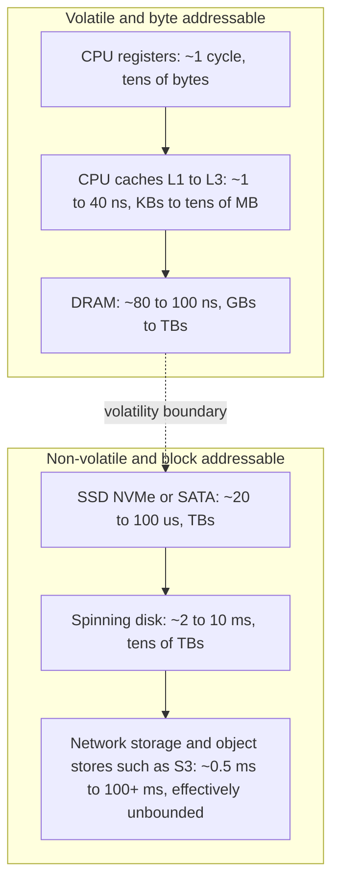
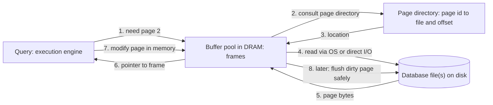
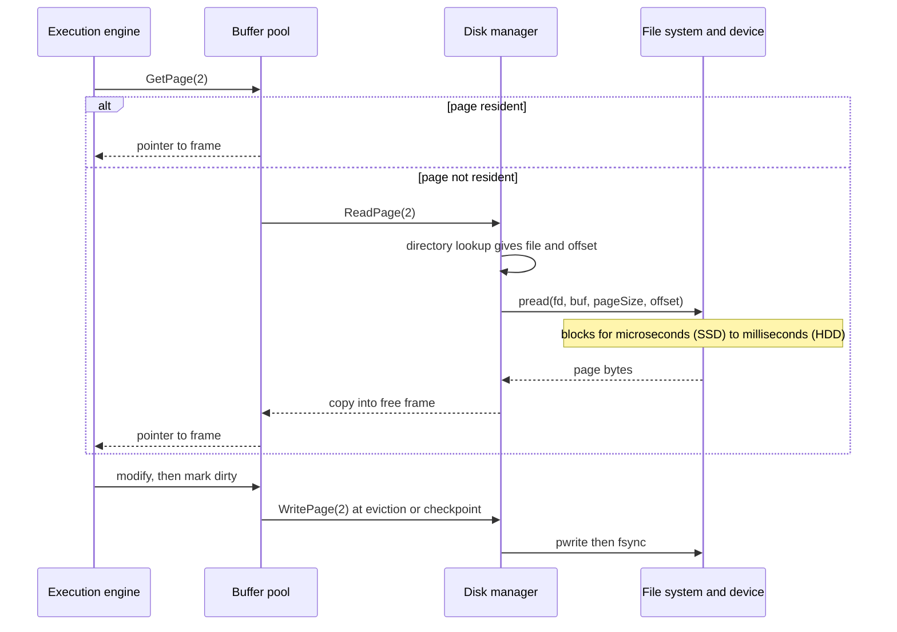
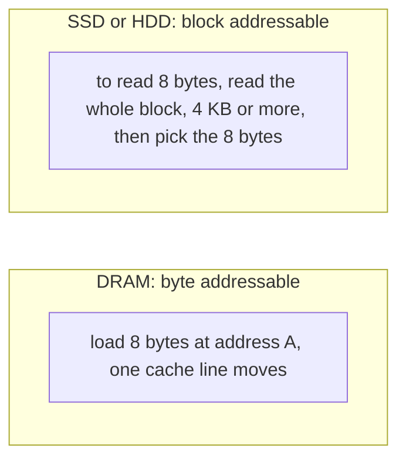
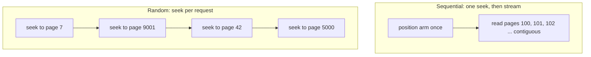
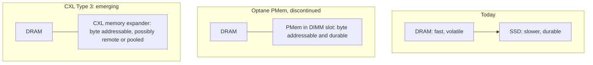
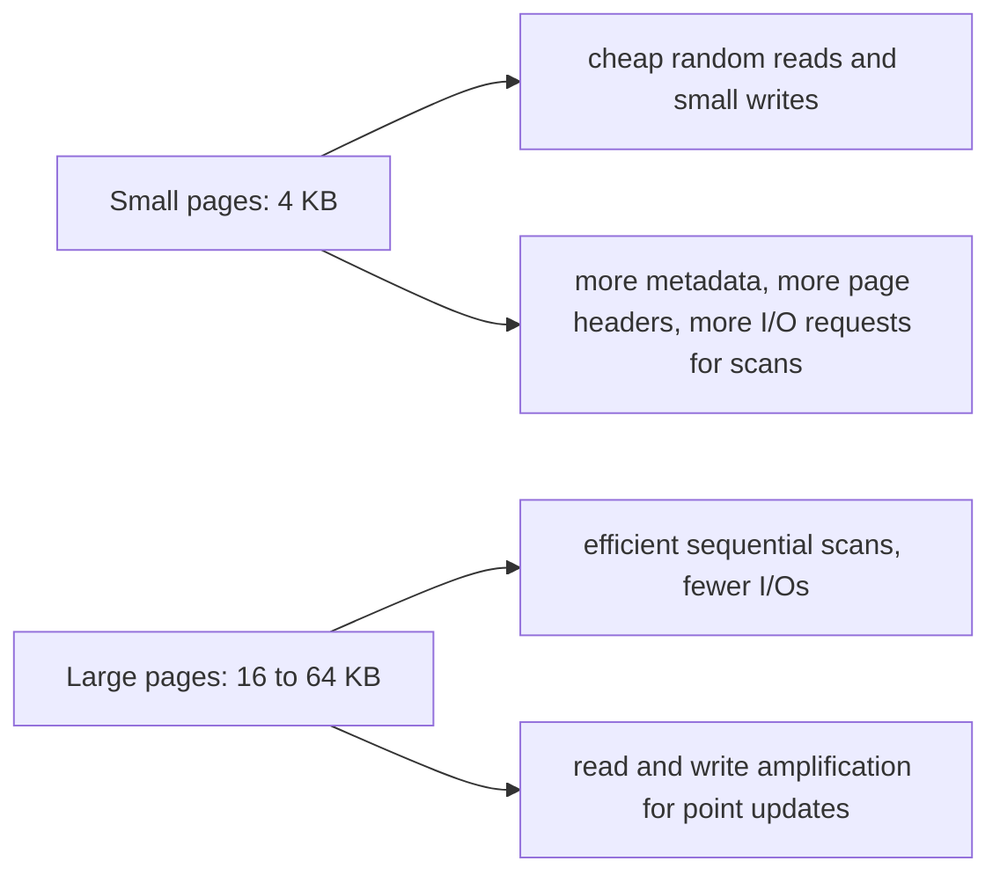

# Module 3 · Part 3.1 Theory: Disk-Oriented Architecture and Storage Hardware

*Source: CMU 15-445/645, Lecture 3 (Fall 2024), Database Storage I. This module contains both theory and real engine code, so under our rules it gets a theory section and a practical section, and it is too large for the default two responses. I'm splitting it as follows and delivering one part per response:*

| Part | Type | Scope |
|---|---|---|
| **3.1** (this response) | Theory | Disk-oriented architecture, storage hierarchy, access latencies, sequential vs random I/O, design goals |
| **3.2** | Theory | Storage manager, files, pages (hardware, OS, and database pages), heap files, page directory, free space map, page header, slotted pages, deletion and compaction, the PostgreSQL and SQL Server demos, and the Neon flash talk |
| **3.3** | Practical | `PageId`, `Page`, and a slotted page engine, with GoogleTest and both benchmark suites |
| **3.4** | Practical | `DiskManager` (`pread`/`pwrite`, optional `O_DIRECT`), heap file, page directory, free space map, with tests, both benchmark suites, and the instructor assignment |

The lecture ends before record IDs and tuple layout, and the lecturer says he'll return to record IDs next time. I'll preview them in 3.2 and cover them fully in Module 4.

**Transcript fidelity notes.** I omitted logistics, banter, and the rap audio. Terms I normalized:

| Transcript says | I read it as |
|---|---|
| "Optin" | Intel Optane (3D XPoint persistent memory) |
| "CXL Type 3" | CXL Type 3 devices (memory expanders) |
| "heat files" | heap files |
| "Dam" | DRAM |
| "ISAMs" | ISAM (indexed sequential access method) files |
| "Vos class" | an OS class (virtual memory) |
| "my seagull" | MySQL/InnoDB (doublewrite buffer) |
| "wi tiger" | WiredTiger (MongoDB's storage engine) |
| "hecky" | Heikki Linnakangas (Neon co-founder, PostgreSQL committer) |

**Corrections and caveats on what the lecture says**

1. **"The hardware page is always 4 KB, and that is the atomic write unit."** This is a simplification. Devices guarantee atomicity at the logical block (sector) size, which is 512 B or 4 KB, and the guarantee depends on the device. NVMe exposes atomic write limits (AWUN, AWUPF) that are often 512 B to a few KB unless the drive says otherwise. The 4 KB *OS virtual-memory page* is a separate concept, and the lecture blurs the two. A DBMS therefore assumes only that a sector write is atomic, and treats anything larger as tearable (§3.6).
2. **"MySQL writes dirty pages to a sequential side buffer first, so commits are fast."** That conflates two mechanisms:
   - The **redo log (write-ahead log)** is what makes commits fast. It is sequential and written before data pages.
   - The **doublewrite buffer** defends against *torn pages*, and it persists on disk (it's overwritten, not "blown away").
   
   Both write data twice, for different reasons. Modules on WAL and recovery cover this fully.
3. **"Intel's new CEO killed Optane in 2022."** Intel announced the wind-down of Optane in July 2022, and the timing and attribution to a CEO change are the lecturer's shorthand. The substance holds: byte-addressable persistent memory in DIMM slots has no mainstream successor today.
4. **Page sizes.** Defaults as I know them: SQLite 4 KB (configurable 512 B to 64 KB), PostgreSQL 8 KB (compile-time), SQL Server 8 KB (fixed), InnoDB 16 KB, Oracle 8 KB default (2 to 32 KB per tablespace), DB2 4/8/16/32 KB per tablespace. The lecture says WiredTiger and RocksDB use 4 KB. RocksDB's block size defaults to 4 KB, but WiredTiger's page sizes are configurable and its in-memory and leaf page defaults are much larger, so verify against your version.
5. **"DRAM loses data after about 30 seconds."** DRAM is volatile. Charge decay and data remanence vary with temperature, and cold-boot attacks exploit seconds to minutes of retention, so the figure is a rough illustration, not a spec.
6. The lecturer says "we ignore CPU caches" and "memory means DRAM" for this course. I follow that framing here and note where cache behavior matters.
7. **Latency figures** below are order-of-magnitude values for current server hardware and shift with every hardware generation. Treat them as scales, not specifications.

---

## 1. Executive Summary & Mental Model

**The one sentence for the whole semester.** A disk-oriented DBMS is software that orchestrates the movement of data between non-volatile storage and DRAM, because the CPU can only compute on what is in memory and the database lives on disk.

**Von Neumann bargain.** The CPU cannot operate on data that lives on disk. Every query therefore follows the same loop: *locate data on disk, bring it into memory, compute, and (if modified) write it back safely.* Three questions drive the architecture:

1. **How is data represented on disk?** (Files, pages, tuples: Modules 3 and 4.)
2. **How does data move between disk and memory?** (Buffer pool: Module 6.)
3. **How do we make writes safe?** (Logging and recovery: later modules.)

**Design stance: never trust that data is in memory.** Every access path must tolerate "the page is not resident." The system must also support databases much larger than RAM while presenting the illusion of a big memory.

**Layered architecture.** We build the system bottom-up, and the course is ordered the same way:

| Layer | Responsibility | Where we cover it |
|---|---|---|
| Disk / storage manager | Files and pages on non-volatile storage | Modules 3 and 4 |
| Buffer pool manager | Caching pages in DRAM | Module 6 |
| Access methods | Heap files, B+Trees, hash tables | Modules 7 to 10 |
| Operator execution | Scans, joins, aggregations | Modules 11 to 13 |
| Query planning | Optimizer | Modules 14 and 15 |
| Concurrency control and recovery | Transactions, WAL | Later modules |

**Why not just let the OS do it?** The lecture states a recurring theme: *the OS is the DBMS's frenemy.* The DBMS knows its query's future access pattern, its dirty-page ordering constraints, and its own page boundaries. The OS knows none of that, so the DBMS manages memory and I/O itself (Module 6 develops this).

---

## 2. Architectural Diagrams

### 2.1 Storage hierarchy (speed vs capacity vs volatility)

### 2.2 The disk-oriented system (the course in one picture)

### 2.3 Request flow in time

### 2.4 Byte-addressable vs block-addressable access

### 2.5 Sequential vs random I/O on a spinning disk

### 2.6 Where persistent memory and CXL fit

### 2.7 Page-size trade-off

---

## 3. Deep-Dive Mechanics & Invariants

### 3.1 What "disk-oriented" means and what it does not

A **disk-oriented DBMS** assumes the *primary storage location* of the database is non-volatile storage, and that DRAM is a cache the DBMS manages. This is the architecture of PostgreSQL, MySQL/InnoDB, SQLite, Oracle, and SQL Server.

Contrast with:
- **In-memory DBMSs** (HyPer, VoltDB, SAP HANA, Redis for its use case): the primary location is DRAM, and disk is for logging and snapshots. They have no buffer pool and use different data structures (Modules in 15-721).
- **Persistent-memory designs:** had Optane survived, much of the buffer pool material would collapse, since the database could live directly in byte-addressable durable memory.

The architecture is not tied to magnetic disks. An NVMe-backed or S3-backed system is still disk-oriented in this sense (data lives on non-volatile, block-addressed storage and is brought into DRAM to be processed).

**The recurring hazard.** Getting data *in* is the easy half. The hard half is that once you modify a page in DRAM, you must get it back to non-volatile storage *safely* (atomically, in the right order relative to the log) so a crash does not corrupt the database. That is the entire recovery half of the course.

### 3.2 The storage hierarchy, in detail

Use the picture in §2.1 for orientation. Three properties change as you go down:

| Property | Going down the hierarchy |
|---|---|
| Latency | Rises by about 10⁶ to 10⁹ from L1 to archival |
| Capacity | Rises (and cost per byte falls) |
| Volatility and addressing | Everything above the line is **volatile** and **byte addressable**. Everything below is **non-volatile** and **block addressable** |

**Volatile vs non-volatile.** Pull the plug and everything above the line is gone. Below it, a completed write *should* survive, with caveats the 3.2 module covers: devices and kernels cache writes, so "the hardware said yes" is not the same as "it's durable" until you issue the right flush and the device honors it.

**Byte addressable vs block addressable.** DRAM lets you load any byte (in practice the hardware moves a 64-byte cache line, which the lecture sets aside). Block devices expose fixed-size units, typically 512 B or 4 KB logical blocks:
- To read 8 bytes from an SSD you read at least one block, and the OS and DBMS typically read a whole page.
- To write 8 bytes you read-modify-write a block (or page).

This single fact shapes the data structures that follow. Pages exist because the device speaks in blocks, and algorithms are chosen to make each block transfer useful.

**Terminology for this course.** "Memory" means DRAM (we ignore CPU caches until 15-721). "Disk" means anything non-volatile and slow, whether SSD, HDD, or S3. The distinctions matter only when they change an algorithm.

**Blurring lines.**
- **Fast network storage:** a datacenter network can deliver data to a node faster than a local HDD. Remote block storage (EBS-like) behaves like local disk with higher latency, and the DBMS often cannot tell what it's writing to.
- **Persistent memory (Optane):** sat in DIMM slots, was byte addressable, retained data without power, and was slower than DRAM and needed explicit flushes (CPU cache line write-backs plus fences). It also wore out. Intel discontinued it, which removes the case for databases built directly on it.
- **CXL (Compute Express Link):** a cache-coherent interconnect over PCIe. *CXL Type 3* devices are memory expanders: byte-addressable memory attached over PCIe, potentially in another chassis ("disaggregated" or pooled memory). A CXL device can be backed by DRAM or by flash with a DRAM cache, so durable byte-addressable designs may return. As of the lecture no database fully exploits it. Latency sits between local DRAM and flash (tens to a few hundred ns more than local DRAM).

### 3.3 Access times: the numbers that drive design

Order-of-magnitude figures, with Jim Gray's trick of rescaling 1 ns to 1 s so the human mind can feel them:

| Operation | Typical latency | If 1 ns were 1 s |
|---|---|---|
| L1 cache reference | ~1 ns | 1 s |
| L2 cache reference | ~4 ns | 4 s |
| L3 cache reference | ~15 to 40 ns | ~half a minute |
| DRAM reference | ~80 to 100 ns | ~1.5 minutes |
| NVMe SSD random 4 KB read | ~20 to 100 µs | ~6 to 28 hours |
| SATA SSD random read | ~100 to 200 µs | 1 to 2 days |
| Datacenter network round trip | ~0.5 ms | ~6 days |
| HDD random read (seek + rotation) | ~2 to 10 ms | ~1 to 4 months |
| Object store first byte (S3) | ~10 to 100 ms | ~3 to 30 years |
| Tape or cold archive retrieval | seconds to hours | decades to millennia |

The lecturer's analogy: reading a page from a book on your desk is L1, walking to the library is DRAM, and **flying to Pluto to read one page is disk**. The consequence for DBMS design: *keep everything you can in DRAM, and when you must go to disk, make every I/O count.*

Note that both scales matter. The bandwidth hierarchy is gentler than the latency hierarchy. A single NVMe drive streams several GB/s, which is within one to two orders of magnitude of DRAM bandwidth per channel. The pain is *latency per request*, and it's why a DBMS issues many I/Os in parallel and keeps the CPU busy while it waits.

### 3.4 Sequential vs random I/O

**Definitions.** *Sequential* access reads or writes contiguous addresses. *Random* access jumps between non-adjacent addresses. For algorithm designers who live in the RAM model, this distinction doesn't exist, but on non-volatile storage it's one of the largest performance factors.

**Spinning disks (the clearest case).** A platter spins under a head on an arm. A random access costs a *seek* (move the arm, a few ms) plus *rotational latency* (wait for the sector, up to a full rotation, ~4 ms at 7,200 rpm). A sequential read pays that once and then streams.
- Illustrative numbers: ~100 to 200 random 4 KB IOPS, which is ~0.5 to 1 MB/s, versus ~150 to 250 MB/s sequential. The ratio is **~200×**.

**SSDs (smaller gap, still real).** No moving parts, but:
- **Parallelism:** an NVMe drive reaches its rated random IOPS (hundreds of thousands to over a million) only with *deep queues* (many outstanding requests across many flash channels and dies). At queue depth 1, a random 4 KB read is limited by latency, so throughput looks like tens of thousands of IOPS and a small fraction of sequential bandwidth.
- **Read vs write asymmetry:** flash is programmed in *pages* (4 to 16 KB) but erased in much larger *erase blocks* (hundreds of KB to several MB). Overwriting in place is not possible, so the **flash translation layer (FTL)** remaps logical blocks, buffers writes, and runs garbage collection. Random small writes cause **write amplification** and unpredictable latency spikes, and sustained random writes degrade throughput (and wear the device). Sequential writes are friendlier to the FTL.
- Reads are generally cheaper and more predictable than writes.

**How the DBMS exploits this.**
- **Prefer sequential patterns where possible:** sequential scans, append-only logs, batched flushes, allocating contiguous regions (extents).
- **Trade CPU for I/O:** it's often worth spending cycles (compaction, sorting, coalescing writes) to turn random I/O into sequential I/O.
- **The "write twice" trick (lecture):** write changes first to a sequential log (fast, makes the commit durable), and update the scattered data pages later in the background and in batches. This is the write-ahead log, the central idea behind recovery. (As noted in the corrections, the InnoDB *doublewrite buffer* is a separate defense against torn pages.)
- **Batching and I/O scheduling:** sorting pending I/Os by offset (elevator scheduling for HDDs), merging adjacent requests, and issuing many in parallel for SSDs (asynchronous I/O, `io_uring`).

**Extents (lecture preview, detailed in 3.2).** To make a growing table land contiguously, allocate space in large chunks instead of one page at a time. Examples:
- InnoDB allocates in **extents** (64 consecutive pages, 1 MB at the default page size) and groups them into segments.
- Many file systems (ext4, XFS) allocate in extents and support `fallocate` to reserve contiguous space.
- PostgreSQL historically extended relation files one 8 KB page at a time, as the lecture hints. Newer versions extend in larger batches for bulk loads. The lecturer notes PostgreSQL doesn't seem to preallocate in the demo, and that matches the traditional behavior.
- Cost: some unused tail space, which is acceptable since storage is cheap.

> **Foundations refresher (skippable): what the OS does between your `write()` and the device.**
> A `write()` copies data into the kernel **page cache** and returns. The kernel flushes dirty pages later, in an order of its choosing. `fsync(fd)` forces a file's dirty pages (and metadata) to the device and waits, and the device itself may have a volatile write cache that must also be flushed (FLUSH CACHE or FUA). `O_DIRECT` bypasses the page cache and requires aligned buffers, sizes, and offsets (typically 512 B or 4 KB). A DBMS that manages its own buffer pool often uses `O_DIRECT` to avoid caching every page twice (once in its pool and once in the kernel), at the cost of losing kernel readahead. PostgreSQL traditionally relies on the kernel page cache (buffered I/O), while InnoDB, Oracle, and SQL Server default to or support direct I/O. These choices return in Module 6.

### 3.5 Design goals for a disk-oriented DBMS

The lecture lists four, which I extend with their engineering consequence:

1. **Assume any access may miss memory.** Data may not be resident, so every access path must handle a miss (fetch, wait, retry) without breaking correctness.
2. **Support databases larger than memory,** presenting the *illusion* of unbounded memory.
   - *OS comparison (the lecturer prompts "virtual memory"):* this is what virtual memory does, and the DBMS still doesn't use it as the buffer manager. The kernel can't know which pages must not be evicted before their log record is durable, cannot prefetch based on the query plan, handles I/O errors via signals (`SIGBUS` for `mmap`), and stalls threads invisibly on a page fault. Module 6 develops the case, citing the CIDR 2022 *mmap* paper.
3. **Avoid large stalls.** Disk reads block the requesting thread, so the system should keep other work running: other queries, other threads, asynchronous or prefetched I/O. A stall on one query shouldn't stall the engine.
4. **Maximize sequential access.** Expect to do more CPU work, buffer more data, and copy more bytes if it converts random I/O to sequential I/O.

The meta-principle (stated in the lecture for page sizes but true throughout): **there is no free lunch.** Every choice (page size, layout, flush policy) trades one workload against another, and the right answer depends on data shape and workload shape.

### 3.6 Atomicity of device writes (preview, needed for later modules)

The lecturer introduces three meanings of "page," and this atomicity point is the reason the distinction matters:

- A **device** guarantees that a write of one logical block (sector, 512 B or 4 KB) is atomic. A *larger* write spans several blocks and a crash can persist only some of them (a **torn write**).
- A **database page** (4 to 64 KB) therefore spans multiple device blocks and can tear on its own.
- Consequences and defenses, which later modules treat in depth:
  - **Checksums** per page detect a torn or corrupted page on read (InnoDB and PostgreSQL both support them).
  - **Doublewrite buffer** (InnoDB): write a page to a staging area first, then to its home location. After a crash, restore a torn page from the staging copy.
  - **Full-page writes** (PostgreSQL `full_page_writes`): log a full page image the first time a page is modified after a checkpoint, so recovery can overwrite a torn page.
  - **Copy-on-write and shadow paging** (LMDB, SQLite's old rollback journal in a different form).
  - **Atomic-write hardware features:** some systems configure the device and file system to guarantee larger atomic writes and then turn the software defense off, but this must be verified per device.

### 3.7 Page-size trade-offs (the lecture's classroom discussion, organized)

Why not one universal page size? The class derived the trade-offs:

| Factor | Favors small pages (4 KB) | Favors large pages (16 to 64 KB) |
|---|---|---|
| Point lookups and small updates | Fewer useless bytes read, smaller write when a row changes | Read amplification: fetch 64 KB for one 100-byte row |
| Write amplification | Writing a dirty page costs 4 KB | Updating 1 KB dirties and re-writes 64 KB |
| Sequential scans | More I/O requests, more per-page overhead | Fewer, larger sequential reads, better bandwidth use |
| Row size | Wide rows may not fit | Wide rows fit, less spillover to overflow pages |
| Metadata overhead | More headers and slot arrays per byte of data | Amortizes per-page overhead |
| Cache granularity | Finer-grained caching, less pollution by cold neighbors | Coarser, one hot row drags in cold neighbors |
| Index fan-out | Lower B+Tree fan-out | Higher fan-out, shallower trees |
| Concurrency | Less contention per page latch | More threads collide on one page |

Rules of thumb that fall out:
- **Read-heavy, scan-heavy (analytics)** favors larger pages.
- **Write-heavy, random OLTP** favors smaller pages.
- Some systems expose the choice **per table or tablespace** (DB2, Oracle), while PostgreSQL and SQL Server fix it. Systems like InnoDB (16 KB) pick a compromise.
- The *hardware* page and the *OS* page are separate, and choosing a database page that is a multiple of the device block (and aligned) avoids read-modify-write at the device.

**Huge pages (preview).** The OS can back memory with 2 MB or 1 GB pages to reduce TLB misses. A DBMS buffer pool is a natural candidate, and the DBMS page size is independent of it (many database pages fit in one huge page). Transparent Huge Pages (the kernel trying to do this automatically) are famously problematic for databases, causing latency stalls during compaction, and most vendors advise disabling THP. The lecture defers this to a later module.

### 3.8 Why the DBMS does not trust the file system (and sometimes bypasses it)

The lecture notes that database files are ordinary files on an ordinary file system (ext4, XFS, NTFS), and the DBMS stores them in a **proprietary format** that only that DBMS understands (SQLite files are the exception DuckDB can read, since DuckDB ships an SQLite scanner). Portable open formats (Parquet, ORC, Arrow) exist for analytical interchange, and the lecture defers them to the column store module.

Historically some systems tried to avoid the OS file system altogether (1980s-era custom file systems on raw blocks). Today this survives mainly in high-end systems: **Oracle ASM** (Automatic Storage Management) replaces file system plus volume manager with a user-space layer using direct I/O, and it also gives a single administration interface for storage. Most systems skip this, because building a database *and* a file system is too much work, and the course assumes off-the-shelf file systems.

**What the DBMS still owns despite using files:** page layout, caching policy, write ordering, checksums, and its own I/O scheduling decisions (or deliberate delegation to the OS).

### 3.9 Redundancy is someone else's job (by default)

The storage layer in this course does not write multiple copies of each page for redundancy:
- **Below the DBMS:** RAID, storage appliances, and cloud block or object stores replicate for you (S3 keeps multiple copies).
- **Above the DBMS:** replication writes the same logical change to other database instances.
- Page-level duplicates written *by the DBMS itself* exist only for specific purposes (doublewrite buffer, WAL, full-page images), not general redundancy.

---

## 4. Algorithmic Trade-offs & Comparisons

### 4.1 Storage tiers for a DBMS

| Tier | Strength | Weakness | Typical DBMS role |
|---|---|---|---|
| DRAM | Fastest practical working set, byte addressable | Volatile, costly per GB | Buffer pool, execution state |
| NVMe SSD | Low latency, high IOPS with parallelism | Write amplification, wear, capacity cost | Primary data and WAL |
| SATA SSD / HDD | Cheap capacity (HDD especially) | Latency, sequential-only performance on HDD | Cold data, backups |
| Network block store | Elastic, replicated | Added latency, shared bandwidth | Cloud-managed database volumes |
| Object store (S3) | Near-infinite, cheap, durable | High latency, immutable objects, per-request cost | Cloud-native and lakehouse systems (Snowflake, Neon's storage backend) |
| PMem / CXL memory | Byte-addressable, large | Niche, hardware-dependent | Research and early-adopter designs |

### 4.2 Sequential vs random: what to do about it

| Technique | Mechanism | Used by |
|---|---|---|
| Write-ahead log | Sequential append first, scattered page writes later | Nearly every transactional DBMS |
| Extent allocation | Reserve contiguous runs | InnoDB, file systems |
| Log-structured storage (LSM) | Turn random writes into sequential flushes and merges | RocksDB, Cassandra (Module 4) |
| Prefetch and readahead | Issue sequential reads before they're needed | PostgreSQL (effective I/O concurrency), InnoDB linear and random read-ahead |
| I/O batching and reordering | Sort and merge requests | HDD-era schedulers, `io_uring` for SSDs |
| Checkpoint spreading | Smooth background flushes | PostgreSQL, InnoDB |

### 4.3 Buffering via the OS vs managing it yourself

| | OS page cache (buffered I/O) | DBMS buffer pool + `O_DIRECT` |
|---|---|---|
| Simplicity | Easiest, kernel readahead and caching for free | You must build and tune the pool |
| Double caching | Yes, if the DBMS also has a pool | No |
| Eviction policy | Kernel LRU-ish, unaware of queries | DBMS policy knows plans and pinned pages |
| Write ordering control | Weak (`fsync` and ordering subtleties) | Strong, with explicit flush control |
| Error handling | Subtle, historic fsync error loss | Explicit |
| Examples | PostgreSQL (traditionally), SQLite | InnoDB, Oracle, SQL Server, MySQL by config |

### 4.4 Production systems at a glance

| System | Relevant points from this part |
|---|---|
| PostgreSQL | 8 KB pages, multiple files per table in a directory tree, buffered I/O through the OS cache, page-at-a-time file extension (traditionally) |
| MySQL/InnoDB | 16 KB pages, 64-page extents, direct I/O option, doublewrite buffer |
| SQLite | Single-file database, 4 KB default page, page size configurable from 512 B |
| Oracle | Per-tablespace block size, ASM bypasses the file system |
| SQL Server | 8 KB pages, 8-page extents (64 KB), mixed and uniform extents |
| DB2 | Page size per tablespace (4, 8, 16, 32 KB) |
| DuckDB | Single-file format, columnar blocks, reads SQLite files through a scanner |
| Neon | PostgreSQL pages served from a remote storage service (the flash talk, covered in 3.2) |

---

## Theory self-check (conceptual, no code)

1. Why can't a CPU run a query directly over a file on an SSD, and what two properties of the device force the DBMS to move data through DRAM?
2. State the volatility line and the addressability line in the hierarchy. Do they coincide? What changes if Optane-style memory is used?
3. A random 4 KB read costs ~100 µs on NVMe. Roughly how many sequential 4 KB reads fit in the time one HDD seek takes? What does that suggest about HDD-era designs?
4. Why does an NVMe drive show a much smaller sequential-vs-random gap than an HDD, and why does queue depth matter?
5. Explain the "write it twice" strategy and what each copy buys you. Why is the doublewrite buffer a different mechanism from the WAL?
6. A table's rows average 120 bytes and the workload is 95% point reads. Argue for a page size, then argue what changes if the workload becomes 95% full scans.
7. Why is a 16 KB database page not atomic on a device with 4 KB atomic writes? Name two defenses.
8. Give three reasons a DBMS may prefer its own buffer pool over the OS page cache.

---

**Next (3.2, theory).** The storage manager and file organization: pages (device, OS, and database), page identity and the page directory, heap files and their API, the free space map, page headers, the slotted page layout with its deletion and compaction trade-offs, a walk-through of the PostgreSQL and SQL Server demos, and the Neon flash talk. Say "go ahead" and I'll deliver it. After that, 3.3 and 3.4 are the practical parts, where we build the slotted page and the disk manager and heap file with tests and both benchmark suites.
