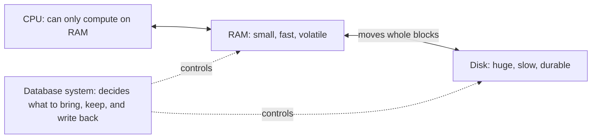
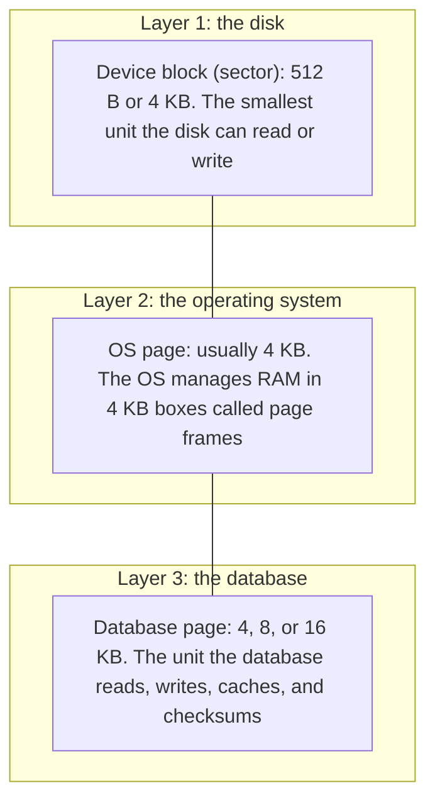
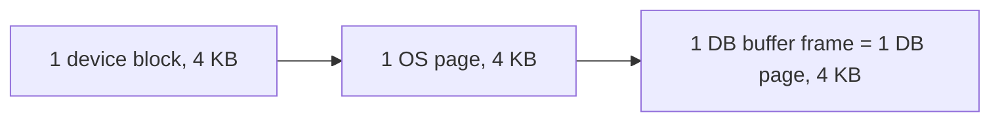
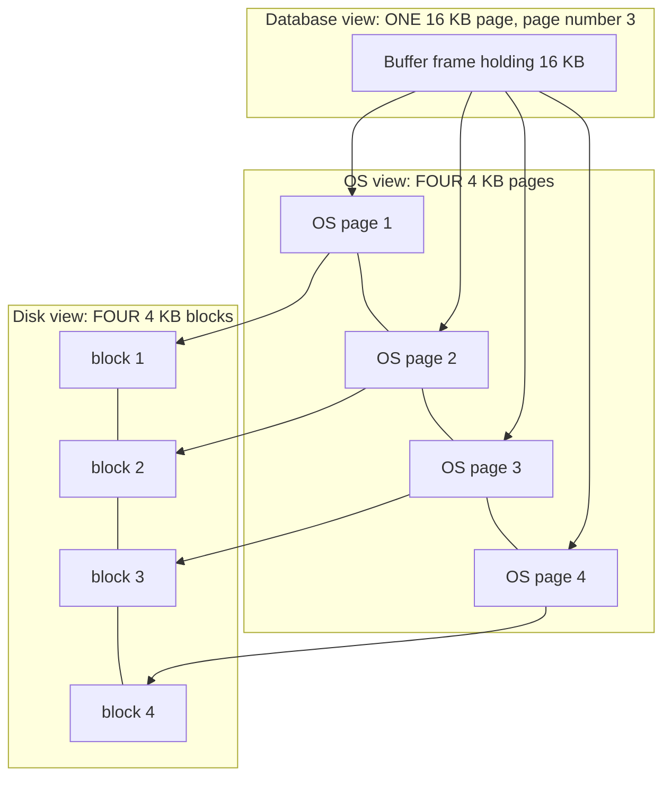
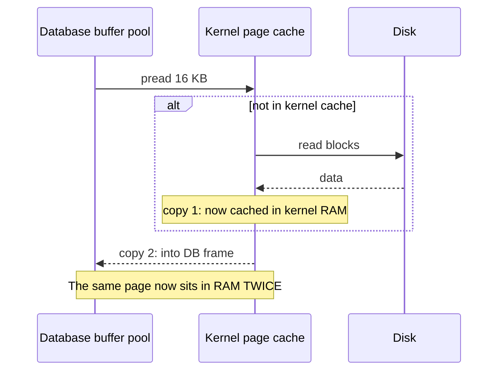
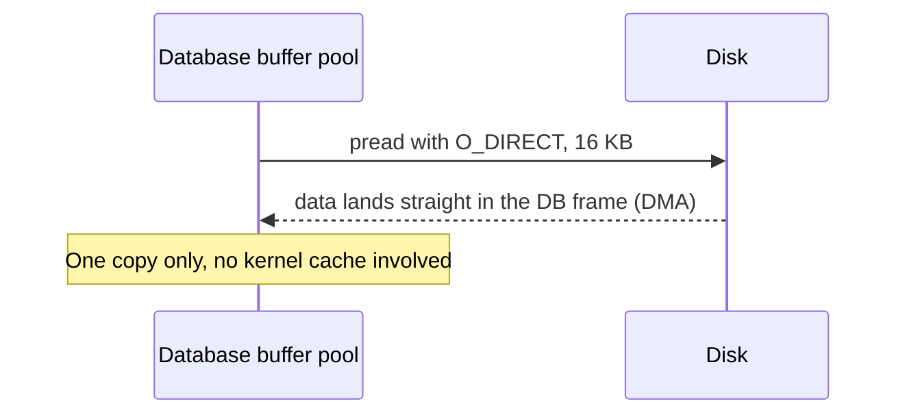
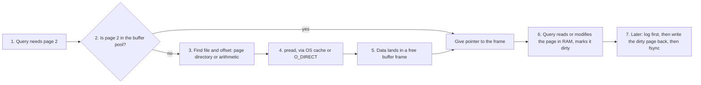

# Module 3 · 3.1 (Rebuilt, Easy Version): Disk-Oriented Database Architecture

## 1. The whole idea in one picture

Your data lives on disk, but the CPU can only work on data in RAM. A disk-oriented database is mostly a **delivery system**: it decides which pieces of the disk to bring into RAM, keeps them there while they are useful, and sends changed pieces back safely.

Think of a **warehouse and a desk**:

- **Warehouse = disk (SSD/HDD).** Huge and cheap, but far away and slow. It only ships in fixed **crates** (blocks), never single items.
- **Desk = RAM.** Small and fast, and the only place you can work.
- **You = the CPU.** You only work on what's on the desk.
- **The database = a smart assistant** who knows what you'll need next, orders crates, arranges the desk, and returns changed items to the warehouse.

Three questions drive the whole course:

1. How is data laid out on disk? (files, pages, tuples)
2. How does it move between disk and RAM? (buffer pool)
3. How do we write it back safely? (logging and recovery)

---

## 2. Why disk is a different world: speed

Latencies are order-of-magnitude figures (see the caveat about hardware generations from 3.1):

| Where the data is | Time to reach it | Scaled so 1 ns = 1 second |
|---|---|---|
| CPU cache (L1) | ~1 ns | 1 second |
| RAM | ~100 ns | ~2 minutes |
| NVMe SSD | ~50 µs | ~14 hours |
| Spinning disk | ~5 ms | ~2 months |
| S3 and similar | ~50 ms | ~1.5 years |

If reading from RAM is walking to the library, reading from disk is flying to Pluto for one page. So the database's main goals are:

- Keep as much useful data in RAM as possible.
- When you must go to disk, make every trip count.

### Volatile vs non-volatile, and byte vs block

| | RAM | Disk |
|---|---|---|
| Power cut | Data **lost** (volatile) | Data **survives** (non-volatile) |
| Access unit | Any **byte** (the hardware moves a 64-byte cache line) | Only whole **blocks** (512 B or 4 KB or more) |

To read 8 bytes from an SSD, you must read at least a whole block and then pick out the 8 bytes. **This single fact is why pages exist.**

### Sequential vs random

- **Sequential:** read neighbors, one after another. Fast.
- **Random:** jump around. Slow, especially on a spinning disk, where the arm has to physically move (about 100 to 200× slower). On SSDs the gap is smaller but real, because writes are expensive for the SSD's internal bookkeeping.

So databases try to turn random I/O into sequential I/O. Examples:

- Allocate space in big contiguous chunks (extents).
- Write changes to a sequential log first (this is the write-ahead log idea), and update scattered data pages later in batches.

---

## 3. The confusing part: "page" means three different things

This is what you asked about, so let's go slowly. People say "page" and "frame" for three different layers:

**Page vs frame, to keep the words straight:**

- A **page** is the *data*, a chunk of content.
- A **frame** is the *box in RAM* that holds one page.

So there are two kinds of "box" in RAM:

1. **OS page frame:** a 4 KB box of physical RAM that the OS manages.
2. **Buffer pool frame:** a box *the database* manages, sized exactly like one DB page.

The database asks the OS for one huge block of memory at startup (say 32 GB). The OS builds that block out of millions of 4 KB OS pages. The database then **carves that block into its own frames** and uses them to hold DB pages. The OS doesn't know or care that the database sees them as 16 KB or 8 KB frames.

### Worked example A: DB page = 4 KB

Everything lines up one-to-one: one disk block, one OS page, one DB page. It is simple and clean, and writes are naturally atomic at the device level (a 4 KB write won't be half-written, assuming the device honors its atomic unit).

### Worked example B: DB page = 16 KB (InnoDB's default)

When the database wants page 3:

1. It computes the file offset: 3 × 16384 = 49152.
2. It calls `pread(fd, buffer, 16384, 49152)`, which is one request for 16 KB.
3. The disk delivers four consecutive 4 KB blocks.
4. They land in a buffer frame, which spans four OS pages in RAM.
5. The database now reads it as "page 3", which means one unit with a header, slots, and tuples.

The disk and OS don't know what a "DB page" is. To them it's just 16 KB of bytes. The database is the one that gives those bytes meaning.

### The danger of a bigger page: torn writes

The disk promises an atomic write only for **one block** (say 4 KB). A 16 KB page is 4 blocks. If the power dies after block 2 is written, the page on disk is half new and half old, a **torn page**.

This is why databases add protections:

- **Page checksums** to detect a torn page.
- **The doublewrite buffer** (InnoDB).
- **Full-page writes** (PostgreSQL).
- The **write-ahead log** to repair things (later modules).

A 4 KB page has this problem less, but the same idea applies to everything larger. Some storage setups guarantee larger atomic writes, but you must verify that for your own device.

---

## 4. Large vs small database pages: what actually changes

Take a 100-byte row and imagine two designs. The numbers are illustrative.

### Reading one row (a point lookup)

- **4 KB page:** read 4 KB, use 100 bytes.
- **64 KB page:** read 64 KB, use 100 bytes. That's 16× more data moved for the same result, which wastes memory and bandwidth. This is called **read amplification**.

### Changing one row (a small update)

- **4 KB page:** one block is dirty, so write back 4 KB.
- **64 KB page:** write back 64 KB for a 100-byte change. This is **write amplification**, and since writes are the expensive part on SSDs, it hurts more.

### Scanning the whole table

- **4 KB page:** 16 separate requests for every 64 KB of data. There is more overhead per page and more requests.
- **64 KB page:** one big sequential read. Excellent bandwidth and fewer requests.

### The full trade-off

| | Small pages (4 to 8 KB) | Large pages (16 to 64 KB) |
|---|---|---|
| Point lookups | Good: little wasted I/O | Wasteful: read extra |
| Small updates | Cheap write-back | Rewrite a lot for little change |
| Full scans | More requests, more overhead | Great: few big sequential reads |
| Wide rows | May not fit, needs overflow pages | Fit easily |
| Per-page overhead (header, slot array) | Higher share per byte | Amortized |
| B+Tree depth | Lower fan-out, taller tree | Higher fan-out, shallower |
| Caching precision | Cache only what's hot | Cold rows get dragged in next to hot ones |
| Lock contention | A hot page is smaller, so fewer collisions | More threads collide on one big page |
| Torn-write risk | Lower | Higher (spans more blocks) |

**Rule of thumb:**

- **Transactional workloads** (many small random reads and writes) → smaller pages.
- **Analytical workloads** (large scans) → larger pages.
- Many systems pick a middle compromise: PostgreSQL and SQL Server use 8 KB, InnoDB uses 16 KB, SQLite uses 4 KB by default. DB2 lets you pick per table (4, 8, 16, or 32 KB).

There is no free lunch. Every page size helps one workload and hurts another.

### How the OS page size interacts with the DB page size

- DB page size **should be a multiple of the device block** (usually 4 KB) **and aligned** to block boundaries. Otherwise one DB page straddles partial blocks, and the disk must do **read-modify-write** (read the old block, patch it, write it back), which is slow and unsafe.
- The DB page size does **not** have to equal the OS page size. A 16 KB page just spans four OS pages.
- With **huge pages** (the OS uses 2 MB boxes instead of 4 KB), hundreds of DB pages sit inside one OS page. This is great for the buffer pool because it reduces TLB misses (address-translation cache misses), and the DB page size stays the same.
- **Transparent Huge Pages** (the OS doing this automatically, unasked) is known to cause random latency stalls in databases, and most database vendors tell you to turn it off.

---

## 5. What the OS does (and why this matters)

Your program never touches disk directly. The OS sits in between and does a lot of work "helpfully":

1. **Virtual memory:** your program sees fake continuous addresses. The OS maps them to real RAM using a **page table**, in 4 KB units.
2. **Page cache:** when you `read()` a file, the OS first reads the data into its own cache in RAM (so the next read is fast), then **copies** it into your program's buffer.
3. **Readahead:** if it guesses you're reading sequentially, the OS prefetches ahead.
4. **Writeback:** when you `write()`, the OS copies your data into its cache and **returns immediately**. The data is *not on disk yet*. The OS flushes dirty pages later, in whatever order it likes.
5. **`fsync()`:** the only way to demand "put it on disk now and tell me when it's done". Even then, the disk itself may have a volatile cache that must be flushed.

### The normal (buffered) read path

### The bypass (direct I/O) path

`O_DIRECT` means "skip the OS cache". The catch is that buffer address, size, and file offset must all be aligned to the device block size (usually 512 B or 4 KB). That's one more reason DB pages are multiples of 4 KB.

---

## 6. Why databases try to bypass the OS

The recurring line is "the OS is the DBMS's frenemy". The OS is general-purpose and knows nothing about queries. The database does. Concretely:

| Problem with letting the OS manage it | Why it hurts a database |
|---|---|
| **Double caching:** the page sits in the OS cache and in the DB buffer pool | Wastes RAM, and RAM is the scarce resource |
| **Wrong eviction choices:** the OS uses a generic LRU-ish rule | A huge table scan can flush your hot pages. The DB knows "this scan won't reuse these pages" and can protect the hot ones |
| **Uncontrolled write order** | The log record **must** reach disk *before* the data page it describes (write-ahead logging). The OS may flush in any order and doesn't know about this rule |
| **Subtle flush and error behavior** | In PostgreSQL's 2018 "fsyncgate", a failed `fsync` cleared the dirty flag and the data was silently lost. The DB needs explicit control |
| **Wrong prefetching** | The OS guesses from access patterns. The DB knows the query plan and can prefetch exactly the right pages |
| **`mmap` risks** | A page fault stalls a thread invisibly, I/O errors arrive as `SIGBUS` signals, and TLB shootdowns limit scalability (see the CIDR 2022 paper "Are You Sure You Want to Use MMAP in Your DBMS?") |
| **I/O scheduling** | The DB may want to prioritize certain queries and batch or order its requests |

**What bypassing costs you:**

- You have to build the buffer pool yourself (Module 6).
- You lose free kernel readahead.
- You take on more complexity.

That is why bypassing isn't universal. **PostgreSQL traditionally uses buffered I/O** and relies on the OS cache (it is adding direct and asynchronous I/O options in recent versions). **InnoDB, Oracle, and SQL Server** commonly use or support direct I/O. **Oracle ASM** goes further and replaces the file system itself. Most systems stop short of that, because building a database *and* a file system is too much work.

---

## 7. The four design goals, in plain words

1. **Assume any access can miss RAM.** Every access path must handle "the page isn't in memory yet" and not break.
2. **Support databases bigger than RAM** while making the user feel like memory is unlimited. (This sounds like virtual memory, and it is the same *idea*, but the DBMS does it itself, for the reasons in §6.)
3. **Avoid big stalls.** When one query waits for disk, other queries and threads should keep running, using prefetching and asynchronous I/O.
4. **Prefer sequential access.** It's fine to burn extra CPU (sorting, merging, copying) if it turns random I/O into sequential I/O.

---

## 8. Whole system working, end to end

Notice what the database does and what it hands off:

- **The database decides** what's in RAM, what to evict, when to write back, and in what order.
- **The OS and disk only move bytes**, and in the direct-I/O case they do even less.

---

## 9. Mental model to keep

- **Disk = warehouse that ships crates (blocks).**
- **OS page = a 4 KB drawer in the RAM desk.**
- **DB page = one binder the database orders** (one or more crates, such as four for a 16 KB page). **Buffer frame = the slot on the desk where that binder sits.**
- Bigger binders are efficient for flipping through everything (scans) but wasteful when you want one sheet (point lookups and small updates).
- Left alone, the OS tries to be helpful (cache, readahead, delayed writes), but it doesn't know your queries or your safety rules. So serious databases take control of caching and I/O order themselves.

---

## Quick self-check

1. A 16 KB DB page is fetched. How many device blocks and OS pages does it span, and how many `pread` calls does the database make?
2. Why must a DB page be aligned to the device block? What is "read-modify-write"?
3. Give one workload where 64 KB pages beat 4 KB pages, and one where they lose. Explain both.
4. What is double caching, and which read path causes it?
5. Why can a 16 KB page tear but a single 4 KB write not, and name two defenses.
6. Why does the OS's `write()` returning mean nothing about durability? What do you call to force it?
7. Name three reasons a DBMS may prefer its own buffer pool over the OS page cache.

---

**Next:** 3.2 is the theory for the storage manager, heap files, page directory, free space map, and slotted pages. I can also redo 3.2 in this same easy style with more diagrams. Tell me whether you want that, or "go ahead" to move on to 3.3 (the practical code).
