# Module 3 · Part 3.2 Theory: Storage Manager, Files, Pages, Heap Files, Slotted Pages

*Source: CMU 15-445/645, Lecture 3 (Fall 2024), Database Storage I, second half, plus the Neon flash talk. This is part 2 of the 4-part split in 3.1. The next parts are 3.3 and 3.4 (practical).*

**Transcript fidelity notes.** I omitted logistics, banter, and the rap audio. The lecture ends abruptly and defers record IDs to next time, so I preview them (§3.4) and cover them in Module 4. Terms I normalized:

| Transcript says | I read it as |
|---|---|
| "heat file" | heap file |
| "FSM", "VM" | free space map, visibility map (PostgreSQL relation forks) |
| "PG free", "free PG free space" | `pg_freespacemap` extension, function `pg_freespace()` |
| "PG relation file path" | `pg_relation_filepath()` |
| "Paxes" | Paxos |
| "rhead log", "wall" | write-ahead log (WAL) |
| "safee keepers", "PID servers" | safekeepers, page servers |
| "hecky"/"Kiki" | Heikki Linnakangas |

**Corrections and caveats on what the lecture says** (verify against your versions):

1. **"PostgreSQL does not compact within a page."** Partly wrong. Deleted tuples are only marked, but *page pruning* (triggered opportunistically during access, and by VACUUM) removes dead tuples and **defragments the page**. What PostgreSQL does not do is compact eagerly on every delete (§3.10).
2. **"Autovacuum runs after ~10% of tuples are updated."** The defaults are a threshold of 50 dead tuples plus 20% of the table (`autovacuum_vacuum_scale_factor = 0.2`). Newer versions also trigger on insert counts. These settings are tunable per table.
3. **Demo: "block 0 is 97% full".** With three tiny tuples in an 8 KB page, the page is about 97% **free**. The transcript or the demo query's label inverted it. The FSM stores *available* space.
4. **Demo: FSM reports zero free space after inserting 1,000 rows.** That is expected and instructive. The FSM is a **lazily maintained hint**, updated by VACUUM and by some backend code paths, and not WAL-logged. The 56 KB file size in the demo equals exactly 7 × 8 KB pages, a good consistency check (§3.7).
5. **"Page ID is unique per table in PostgreSQL."** More precisely, it is a *block number within a relation's main fork*, and relations are split into 1 GB segment files (`16653`, `16653.1`, ...). The ID is not globally unique. `(tablespace, database, relfilenode, fork, block)` is the full identity (`BufferTag`).
6. **"Hash table" page directory.** This is the lecturer's mental model. Real systems use allocation bitmaps, extent maps, or catalog tables (§3.6).
7. **Self-containment of pages for disaster recovery.** The lecturer attributes this to Oracle. The honest summary is that most systems (PostgreSQL, InnoDB) rely on a separate catalog plus per-page checksums, and recovery from catastrophic loss is mostly backups and replicas.
8. **Neon: "at least three safekeepers must receive the WAL".** A standard deployment has 3 safekeepers and commits on a **majority quorum (2 of 3)**. Treat "three" as a simplification or mis-transcription.
9. **MySQL "blows away" the sequential file.** As noted in 3.1, the redo log is circular and reused, and the doublewrite area is overwritten. Neither is deleted.
10. **Neon organizational status** (e.g., the Databricks acquisition in 2025) postdates the lecture and is not part of the talk. Check current details.

---

## 1. Executive Summary & Mental Model

**The storage manager** is the DBMS layer that owns the files on non-volatile storage. It presents the rest of the system with *pages*: fixed-size, addressable blocks that the buffer pool can fetch and flush. Everything above it (buffer pool, access methods, execution) thinks in page IDs, not file offsets.

**Four nested ideas** (each is a layer of indirection):

| Layer | Question it answers | Example |
|---|---|---|
| **File** | What's on disk? | `base/16835/16653` |
| **Page** | What is the unit of transfer and caching? | 8 KB block at offset `n × 8192` |
| **Slot** | Where inside a page is each tuple? | Slot array entry gives an offset and a length |
| **Tuple** | What does one record look like? | Next module |

**The mental model:**
- A **heap file** is an unordered collection of pages. A **page directory** says where each page lives and how full it is. A **page** is a header, a slot array growing from the front, and tuple bytes growing from the back, meeting in the middle.
- Pages exist because the device speaks blocks. Slots exist because tuples are variable-length and must be movable without breaking outside references.

**Recurring principle:** *indirection buys freedom.* The page ID lets the system relocate pages without updating references. The slot number lets the page compact or reorder tuple bytes without updating references. The cost is one extra lookup.

---

## 2. Architectural Diagrams

### 2.1 Storage manager responsibilities

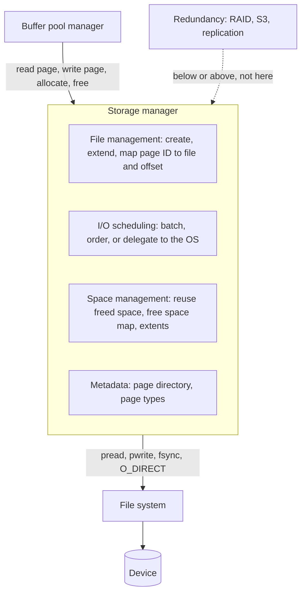

### 2.2 Three meanings of "page"

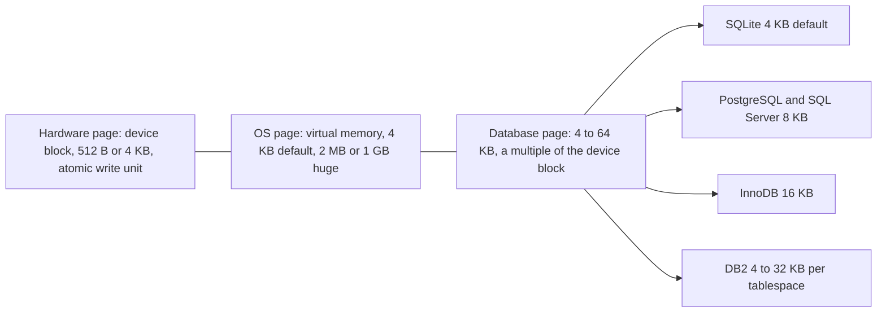

### 2.3 Heap file with page directory and free space map

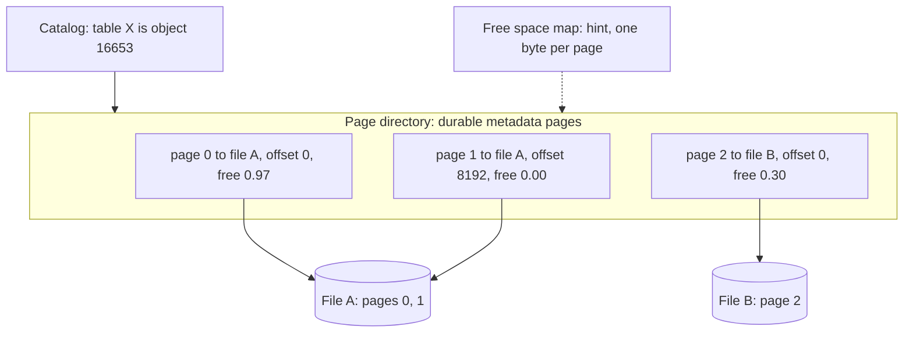

### 2.4 Alternative heap file organization: linked lists (textbook variant)

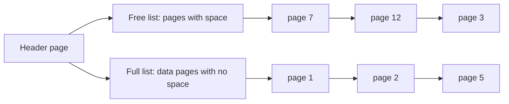

### 2.5 Resolving a page ID to bytes

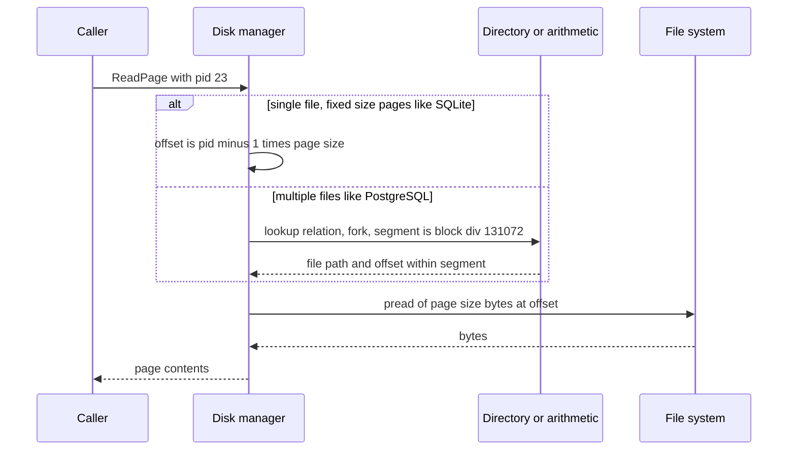

### 2.6 PostgreSQL 8 KB heap page layout

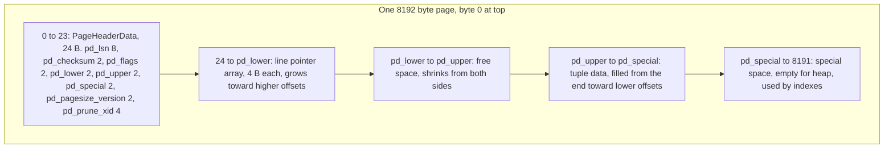

### 2.7 Slot array and tuple area meeting in the middle

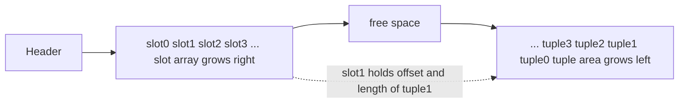

### 2.8 Line pointer state machine (PostgreSQL view)

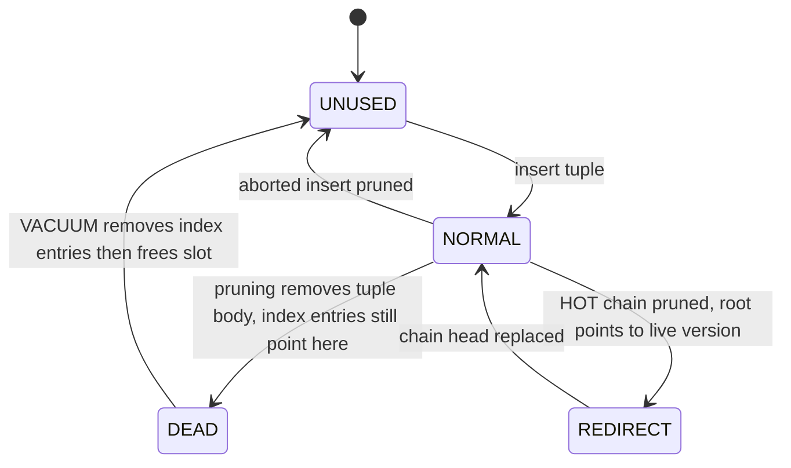

### 2.9 Delete, then compact (what moves and what does not)

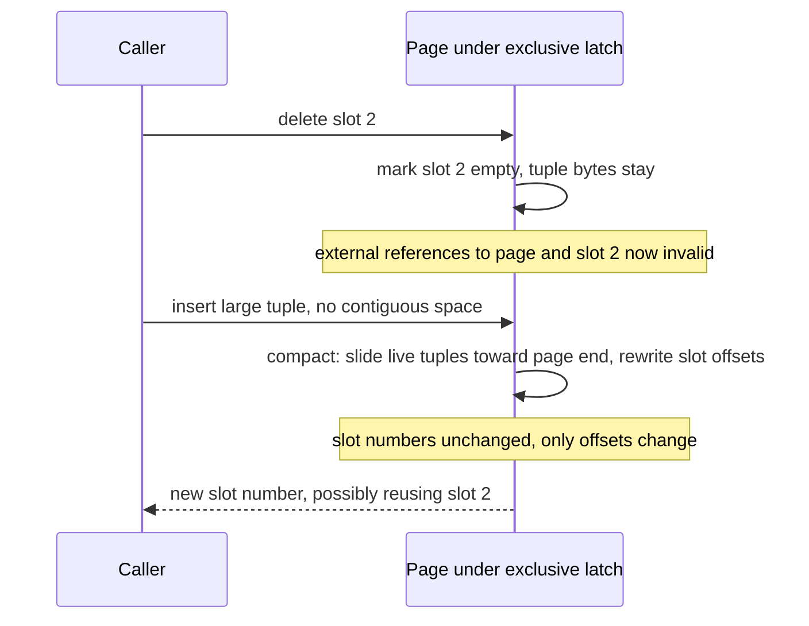

### 2.10 Why the FSM is stale (timeline from the demo)

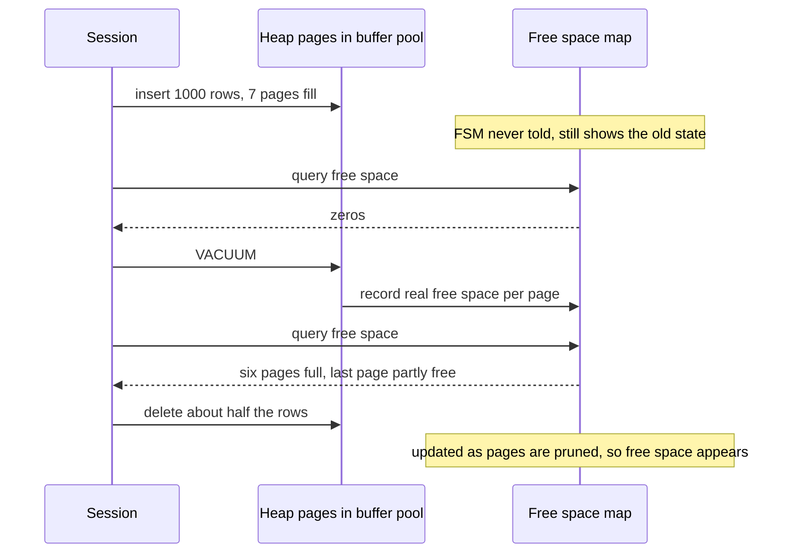

### 2.11 Neon architecture (flash talk)

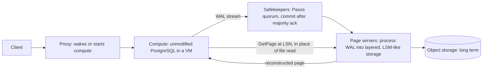

---

## 3. Deep-Dive Mechanics & Invariants

### 3.1 The storage manager

**What it owns.** The collection of files on disk, and the mapping from *page ID* to physical location. It exposes, to the buffer pool, a small API: read page, write page, allocate page, free page.

**Disk scheduling.** The storage manager may reorder, batch, and prioritize I/O requests (deciding which queries' reads go first, merging adjacent pages, issuing sequential reads together). Alternatively, it may **delegate to the OS** by calling `pread`/`pwrite` and letting the kernel schedule. DBMS-owned scheduling can use query knowledge (this scan is sequential, so prefetch), and delegation is simpler. Later modules cover this in depth.

**Space management.** The DBMS (not the file system) must:
- Reuse space freed by deletes.
- Compact fragmented pages.
- Spread or move data across pages when it grows.

**Redundancy is not its job.** As noted in 3.1, replication happens below (RAID, storage appliances, S3) or above (replication of logical changes to other DBMS instances).

**Scope note.** Everything here applies to *tables*, and indexes and other database objects have the same file and page properties (their pages are interpreted differently once loaded).

### 3.2 Files

- **Single file vs many.** SQLite and DuckDB use **one file** per database. PostgreSQL uses a directory tree with several files per table. InnoDB uses a shared system tablespace plus (by default) one `.ibd` file per table.
- **Proprietary formats.** A PostgreSQL data file cannot be opened by MySQL. DuckDB is the exception that proves the rule: it reads SQLite files through a scanner and can attach to other systems, because it was built to be a Swiss-army engine. Open portable formats (Parquet, ORC, Arrow) arrive in the column-store module.
- **Ordinary file systems.** Database files are plain files on ext4, XFS, or NTFS, and the file system sees only bytes. Oracle ASM, discussed in 3.1, is the notable bypass.

**Practical file-level facts** (the PostgreSQL demo, §3.7):

| Item | PostgreSQL example |
|---|---|
| Data directory | `$PGDATA` |
| Per-database directory | `base/<database OID>/` (the demo's `base/16835`) |
| Per-table main fork | `<relfilenode>` (the demo's `16653`) |
| Free space map fork | `<relfilenode>_fsm` |
| Visibility map fork | `<relfilenode>_vm` (Module on MVCC) |
| Segment files | `16653`, `16653.1`, ... each up to 1 GB by default |

`relfilenode` is *not* a stable table identity. `VACUUM FULL`, `TRUNCATE`, and `REINDEX` assign a new one.

### 3.3 Pages: contents, homogeneity, self-containment

**What a page may hold:** tuples, metadata (last-update LSN, checksum), log records or other change records in some designs, and in-page index structures.

**Homogeneity.** A page usually belongs to exactly one object. Tuples from two tables are not mixed in one page, and index and table data are not mixed either. Exceptions exist (Oracle *clustered tables* store rows from several tables together to speed up joins), and the lecturer notes that some systems break the rule.

**Self-contained pages.** Some systems store, inside each page, everything needed to interpret it (schema information, object identity). The class's answers are right:

- Reading one page never requires reading other pages to understand it. Take 10⁹ one-tuple pages as the extreme: having to consult a global structure per page would be awful.
- It supports **disaster recovery**: if the catalog or directory is destroyed or part of a disk melts, surviving pages remain interpretable.

Costs: redundant metadata in every page (space), and metadata can disagree across pages. Most systems instead keep one catalog and rely on backups.

**Student questions, answered:**

- *"Wouldn't more copies of metadata pages help?"* Yes, that is exactly the self-contained-page tradeoff, and a redundant copy can also be lost.
- *"What if the page directory is missing?"* In a true disaster, you restore from backup or replicas. Forensic recovery vendors read raw pages and reconstruct structure. It works, at a high cost.
- *"What if metadata inside a page is corrupted but data is fine?"* A **per-page checksum** detects *that* something is wrong but not *what*. A human or tool then uses sibling pages of the same table to infer the metadata. PostgreSQL supports data checksums (opt-in at `initdb` for most versions, and as I recall enabled by default for new clusters in PostgreSQL 18), and InnoDB checksums every page by default.

### 3.4 Page identity and indirection

Every page gets a **page ID** (also called block ID or page number). Scope varies:

- SQLite: offset within the one file, so `offset = (page_no − 1) × page_size`.
- PostgreSQL: block number within a relation fork (`BufferTag` makes it unique system-wide).
- InnoDB: `(space ID, page number)`.

**Why it matters (indirection).** Pages are addressed by ID, and a separate structure maps ID to physical location. Move a page (compaction, file growth, shrinking, restore) and update only that mapping. Everything else (indexes, other pages, in-memory pointers keyed by page ID) remains valid.

**Preview of record IDs (Module 4).** One level down, a tuple is addressed by `(page ID, slot number)`, called **RID** in the textbook, `ctid` in PostgreSQL, `ROWID` in Oracle, and `RID (file:page:slot)` in SQL Server. This is the same indirection idea applied inside the page (§3.10).

**The three kinds of pages, in detail** (the lecture's spoken breakdown):

| Kind | Size | Who defines it | Why it matters |
|---|---|---|---|
| **Hardware (device block)** | 512 B or 4 KB logical block | Device | Largest unit with an atomicity guarantee, so anything larger can tear (3.1 §3.6) |
| **OS page** | 4 KB default (x86), 2 MB or 1 GB huge | CPU and kernel | Virtual-memory and TLB granularity, and page-cache unit |
| **Database page** | 512 B to 64 KB | DBMS | Unit of I/O, caching, latching, and checksumming |

**Student question: how does a 16 KB database page fit inside 2 MB OS huge pages?** Many database pages sit within one huge page. The sizes are independent, and the DBMS simply sees a larger contiguous region. Transparent Huge Pages (the kernel doing this automatically) are discussed as problematic, and later modules cover why.

**Page-size choice** was analyzed in 3.1 §3.7. In the lecture's exact discussion: smaller rows favor smaller pages (more rows per fetch is not the reason, since a page of small rows holds *more* rows, but updates dirty less); read-heavy and scan-heavy workloads favor large pages (one big sequential fetch); write-heavy random workloads favor small pages (less write amplification). DB2 can set page size per table (4, 8, 16, or 32 KB), and the lecture's "64 KB" is not a DB2 page size, so I'd treat it as a slip.

### 3.5 How pages are organized in files

Four approaches (the lecture names them, and the next lecture covers the first three beyond heap):

| Organization | Idea | Status |
|---|---|---|
| **Heap file** | Unordered pages, tuples go anywhere with space | Most common (PostgreSQL, SQL Server heaps, Oracle heap tables) |
| **Tree / index-organized** | Table *is* a B+Tree keyed by the primary key, tuples live in leaves | InnoDB, SQLite, SQL Server clustered tables (next lecture) |
| **Log-structured** | Append-only records, merge in the background | RocksDB, Cassandra, LSM stores (next lecture) |
| **Sequential/sorted (ISAM)** | Pages physically sorted by key with a sparse index on top | Historical, deprecated |

At this point, in the lecturer's framing, we know nothing about what is inside pages (rows or columns). We only need to *address* them.

### 3.6 Heap files in depth

**Definition.** A heap file is an unordered collection of pages where tuples may be stored in any page with room. Order is meaningless (it echoes the relational model).

**Storage manager API for a heap file:**

| Operation | Purpose |
|---|---|
| `CreatePage` / allocate | Grow the file (append pages) |
| `GetPage(pid)` | Return the page at that ID |
| `WritePage(pid, data)` | Persist a page |
| `DeletePage(pid)` | Release a page for reuse |
| `Scan()` iterator | Walk all pages for sequential scans |

**Locating pages: single file.** Pages are fixed-size, so `offset = page_no × page_size`. This is pure arithmetic, no lookup (SQLite does this and keeps some extra metadata about page types).

**Locating pages: many files.** The DBMS needs a **page directory**: a map from page ID to *(file, offset)*. The lecture's mental model is a hash table. In real systems it is persistent allocation metadata:

| System | Mechanism |
|---|---|
| PostgreSQL | Catalog (`pg_class`) maps table to `relfilenode`, then block number to segment file by arithmetic. Free space in a separate FSM fork |
| InnoDB | Tablespace file header, **extent descriptor** (XDES) pages every 16,384 pages, and **inode** pages for segments |
| SQL Server | **GAM** and **SGAM** (global and shared global allocation maps), **IAM** (index allocation map, per object), **PFS** (page free space) pages |
| SQLite | Single file, freelist trunk pages, optional pointer-map pages for auto-vacuum |

**Directory per object.** The directory has an entry per database object (table, index) saying where its files are and what its metadata is. As the lecturer puts it, it is "the database of the database."

**Durability invariant for allocation metadata.** The directory itself is stored in pages and must be written safely, with the correct ordering relative to data pages. The invariant to remember (my formulation):

> The allocation metadata may *under-report* free space (it says full when there is room, so we waste some space or go look elsewhere) but must **never over-report** (claim a page is free or unallocated when it holds live data), and it must never leave an allocated page unreachable after a crash (a leaked page).

This is why the lecture can say the free space map is allowed to be wrong, while the page directory needs careful flushing.

**Allocate in chunks.** The lecturer's practical advice: do not extend the file one page at a time on every insert. Reserve (say) a megabyte or a gigabyte, update the directory once, flush it, and then start filling. This reduces directory writes, keeps data contiguous, and cuts file-system metadata churn. PostgreSQL traditionally extends one page at a time (the lecturer notes this), though recent versions extend in batches for concurrent bulk inserts.

**Metadata beyond location:**

1. **Free space per page (FSM).** Without it, every insert scans pages looking for room. Properties from the lecture:
   - It is allowed to be wrong, since if you jump to a page that turns out to be full, you simply try another.
   - It need not be flushed with the same urgency as the directory.
   - PostgreSQL's FSM is **one byte per page** (free space in 32-byte units, 256 categories), organized as a **max-tree** over FSM pages so that "find a page with at least *n* bytes free" is O(log pages).
   - SQL Server's PFS tracks a coarser few free-space buckets per page.
2. **List of free or empty pages**, so empty pages can be reused or returned to the file system.
3. **Page type** (data, index, metadata, allocation map), as SQL Server shows in the demo.

**Linked-list heap file** (a textbook alternative; not in the lecture transcript, but good to know): a header page points to a *free-page list* and a *full-page list*. Finding a page with space requires walking the free list. It needs no separate directory, and the cost is O(n) search and poor locality, which is why practical systems prefer directory or bitmap structures.

**Student questions, answered:**

- *Why store table-to-file and index-to-file mappings together?* One directory format serves all object types, so there is no reason to have a separate scheme for each.
- *For an index, is there an entry per value?* No. At this level we know nothing about values or structure. The directory only says where page *k* of object *y* lives. Interpretation happens after the page is loaded.
- *Is the FSM in memory or on disk?* Both. It is persistent in a file (PostgreSQL's `_fsm` fork, read through the buffer pool) and cached in memory. Some systems put it inside the page-directory metadata. (The lecturer jokes about `mmap`, and PostgreSQL does not use it for this.)

### 3.7 PostgreSQL demo walk-through

The lecturer's demo as reproducible commands:

```sql
-- 1. Setup (student table with 3 tuples)
CREATE EXTENSION IF NOT EXISTS pg_freespacemap;
SELECT *, round(100.0 * avail / 8192, 1) AS pct_free
FROM pg_freespace('student');                -- block 0: ~97% free

-- 2. Add many rows
INSERT INTO student SELECT i, 'name', 'login@cs', 20, 3.5
FROM generate_series(1, 1000) AS i;
SELECT * FROM pg_freespace('student');       -- stale: mostly zeros

-- 3. Find the file
SELECT pg_relation_filepath('student');      -- e.g. base/16835/16653
-- ls -l shows 16653 (56 KB), 16653_fsm, 16653_vm

-- 4. Make the FSM catch up
VACUUM student;
SELECT * FROM pg_freespace('student');       -- 6 full pages, last partly free

-- 5. Delete about half at random
DELETE FROM student WHERE sid > 3 AND random() < 0.5;
SELECT * FROM pg_freespace('student');       -- free space spread over pages

-- 6. Insert again
INSERT INTO student SELECT i, 'name', 'login@cs', 20, 3.5
FROM generate_series(2000, 2009) AS i;
VACUUM student;
SELECT * FROM pg_freespace('student');       -- inserts landed in page 0
```

**What each step shows**

- **Page count check:** 56 KB = 7 pages × 8 KB. About 1,003 tuples over 7 pages is roughly 143 tuples per page, so around 57 bytes per tuple including header and line pointer (a heap tuple header alone is 23 bytes padded to 24).
- **FSM staleness (step 2):** inserts update the page, not the FSM. VACUUM (or a backend that finds a page full and consults the FSM) refreshes it. Correctness is unaffected because the FSM is a hint.
- **Relational unorderedness (step 6):** the new tuples fill holes in page 0, not the end of the file. The table has no insertion order.
- **Student question: can PostgreSQL force-fill pages?** `VACUUM FULL` rewrites the table into a new file, packing tuples. It takes an `ACCESS EXCLUSIVE` lock, so it blocks readers and writers, and needs temporary disk space for the second copy. Online alternatives exist (`pg_repack`).
- **Student question: when is VACUUM used by applications?** Applications generally don't call it. **Autovacuum** triggers on dead-tuple thresholds (default 50 + 20% of table), plus you can schedule manual runs.

For true byte-level confirmation of the layout, use `pageinspect`:

```sql
CREATE EXTENSION pageinspect;
SELECT * FROM page_header(get_raw_page('student', 0));   -- lsn, lower, upper, special
SELECT lp, lp_off, lp_len, lp_flags, t_xmin, t_xmax, t_ctid
FROM heap_page_items(get_raw_page('student', 0));         -- every slot
```

`lower` grows with each new line pointer and `upper` shrinks with each tuple, and free space is `upper − lower`.

**SQL Server demo.** The lecturer queries a metadata view for the table's pages, which lists page IDs and **page types**: *data page*, *index page*, and *IAM (index allocation map) page*. The transcript does not show the command (likely `sys.dm_db_database_page_allocations` or the older `DBCC IND`). It illustrates that SQL Server tracks per-page type and allocation explicitly (page type codes: 1 data, 2 index, 8 GAM, 9 SGAM, 10 IAM, 11 PFS), while PostgreSQL tracks less per page.

### 3.8 The page header

Systems differ, and typical contents:

| Field | Purpose | Example |
|---|---|---|
| Page size or version | Detect format and DBMS version, so an upgrade can convert old pages | `pd_pagesize_version` |
| **Checksum** | Detect torn writes and bit rot | `pd_checksum` |
| Last-modified **LSN** | WAL ordering: a page cannot be flushed before its log (later module) | `pd_lsn` |
| Free-space pointers | Where slots end and tuples begin | `pd_lower`, `pd_upper` |
| Transaction visibility info | MVCC hints | `pd_prune_xid` |
| Compression info | Scheme used for this page | column stores |
| Schema or object ID | Self-containment (Oracle-style) | block header |
| Summary or sketch | Min and max values so a scan can skip the page (zone maps) | column stores, next lecture |

PostgreSQL's header is 24 bytes (§2.6), InnoDB's page header is 38 bytes plus an 8-byte trailer (checksum and LSN copy), and SQL Server's is 96 bytes.

**Torn-page detection note.** InnoDB's trailer repeats the low LSN bytes so a page torn between header and trailer is detectable even without a full checksum, which is an old trick that shows why the header's placement matters.

### 3.9 Placing tuples: the straw man and why it fails

**Straw man.** Keep a tuple count in the header. Each insert writes the tuple at the next free offset, so the page fills sequentially.

| Scenario | Failure |
|---|---|
| **Delete** a tuple | Leaves a hole. With fixed-length tuples you could reuse it (a free list or bitmap), but with variable-length tuples (emails, names) a new tuple may not fit the hole |
| **Variable-length tuples** | Cannot compute an offset from a tuple number |
| **Move tuples** to defragment | Tuple 4 slides over tuple 3. Every outside reference (an index entry holding "page 7, offset 400") is now wrong, and you must find and update all of them |
| **Find free space** | Requires scanning |

**Where "append-only" is the right idea.** Log-structured stores *do* append, but they never update or reuse space in place (they merge in the background), and they handle variable length. That is next lecture's material.

**Fixed-length variants** exist for niche cases (a bitmap marks occupied slots, so slot *i* sits at `header + i × size`), and they fail as soon as record sizes vary.

### 3.10 Slotted pages (the core structure)

**Layout.** Almost every row-oriented DBMS uses a variant of this (the lecturer stresses the details differ):

```
 +--------+---------------------+---------------+-----------------------+
 | header | slot array  ->      |  free space   |   <-  tuple data      |
 +--------+---------------------+---------------+-----------------------+
 0                                                                  page_size
```

- The **slot array** (also called line pointers, item IDs, or the row directory) grows **forward**. Entry *i* holds the offset (and usually the length) of tuple *i*.
- **Tuples** are written from the **end of the page backward**.
- Free space is the contiguous gap between the two. The page is full when they meet.

**Insert algorithm**

1. Compute the required space: tuple length (aligned) + 4 bytes if a new slot is needed.
2. Compare to `free = upper − lower`. If it fits: `upper −= len`, write the tuple at `upper`, write the slot entry (offset = `upper`, length = `len`), `lower += slot_size`. Return the slot number.
3. If the tuple does not fit contiguously but total free space (including holes) would suffice, compact (below), then retry.
4. Otherwise the page is full, so the caller picks another page via the FSM.

**Why slots matter: the key invariant.** *A tuple's identity is `(page, slot)`, and the slot number never changes while the tuple lives.* The page can slide tuple bytes anywhere, and only the offset inside the slot entry changes. External references (indexes, foreign pointers in other tuples, the RID) stay valid. This is the same indirection principle as page IDs, applied inside the page.

**Fixed-length vs variable-length.** Tuple bytes may be any size. The slot array is the only fixed-width structure, so lookups are O(1): read slot *i*, jump to the offset.

**Space accounting.** Per-tuple overhead is the slot entry (4 B in PostgreSQL) plus the tuple header (23 B padded to 24 in PostgreSQL), so tiny rows are dominated by overhead. PostgreSQL caps a heap page at 291 tuples (`MaxHeapTuplesPerPage` for 8 KB).

**Delete.** Mark the slot as empty (and, in some designs, set a flag in the header). The tuple bytes may remain in place. Two further decisions arise:

1. **Compact immediately?** Slide following tuples to close the gap and patch the slot offsets.
2. **When may the slot number be reused?** That is a correctness question, not an efficiency one. If an index entry still points at `(7, 3)`, reusing slot 3 for a *different* tuple would make the index return the wrong row. PostgreSQL therefore moves slots through states (§2.8): a tuple is first pruned to a **dead** line pointer (body removed, slot retained), and only after **VACUUM** has removed the index entries is the slot marked **unused** and reusable.

**To compact or not (the classroom debate).** The class found the right answer: *it depends.*

| Eager compaction | Lazy compaction (only when needed) |
|---|---|
| Minimal wasted space, contiguous free space | Pages stay fragmented, so a tuple may not fit in the total free space |
| Every delete does a `memmove` of live tuple bytes (up to page size) and rewrites slot offsets | Deletes are O(1) |
| Page is **latched exclusively** during the move, so other threads wait | Latch held briefly |
| Cost is memory-only (the page is in the buffer pool), cheap compared to a disk fetch | The savings come from avoiding a fetch of another page |
| Used by SQL Server and Oracle (per the lecture) | Common middle path: compact when an insert fails to find contiguous space |

The lecturer's key observation holds: **once the page is in DRAM, in-page work is nearly free relative to I/O**, and compaction can save a page fetch. The counter-argument is latch hold time. Moving up to 8 to 16 KB (128 to 256 cache lines, a few microseconds) with an exclusive latch can stall readers on a hot page, which matters when many cores contend.

**PostgreSQL's actual policy** (correcting the lecture):
- Deletion sets `xmax` on the tuple (MVCC), so the body remains until it is no longer visible to any transaction.
- **Pruning** (`heap_page_prune`) runs opportunistically when a page is accessed and is nearly full, and during VACUUM. It removes dead tuple bodies and defragments the page (`PageRepairFragmentation`) while keeping slot numbers stable.
- **`fillfactor`** (default 100 for tables) can reserve space on each page so updates can stay on the same page (HOT updates), which is a deliberate use of free space.

**Latch refresher (the lecturer defers this).** A **latch** is a short-term lightweight mutex (or reader-writer lock) protecting an *in-memory physical structure* such as a page, held for microseconds and not subject to deadlock detection. A **lock** is a logical, transaction-duration claim on a database object. The module on concurrency control and the module on indexes develop this fully.

**Production variants**

| System | Layout |
|---|---|
| PostgreSQL | 24 B header, line pointer array at the front, tuples from the end (§2.6). Slot states LP_UNUSED, LP_NORMAL, LP_REDIRECT, LP_DEAD |
| SQL Server | 96 B header, **rows stored forward from the header**, and the **slot (row offset) array is stored at the *end* of the page growing backward**. This is the mirror image of the lecture's picture. Max in-row size about 8,060 bytes |
| Oracle | Block header, **row directory**, row data from the end of the block, `PCTFREE` reserves space for growth |
| InnoDB | Records are chained by a **next-record pointer** in key order, and a **sparse page directory** (one slot per 4 to 8 records) supports binary search. Not a classic slotted page, because of the index-organized design |
| SQLite | Cell pointer array plus cell content area from the end of the page, which is a slotted page for B-tree nodes |

**Overflow.** A tuple larger than a page is stored out of line (PostgreSQL TOAST, InnoDB and SQL Server overflow pages), which is next lecture's tuple-layout material.

### 3.11 Neon flash talk (Heikki Linnakangas)

**Product.** Neon provides **serverless PostgreSQL** with branching, autoscaling, and time-travel queries. The architectural idea is **separation of compute and storage**.

**Compute.** Unmodified PostgreSQL runs in a VM. Users connect to it like any PostgreSQL instance.

**Storage** (written from scratch in Rust, open source, multitenant):

1. **Safekeepers** receive the WAL stream. A Paxos-based protocol replicates it, and a commit is acknowledged once a **majority** has it. From PostgreSQL's view this resembles synchronous replication.
2. **Page servers** process the WAL into a layered, LSM-like format, retaining **the entire history**. A page can be reconstructed at *any LSN* from base page images plus WAL records.

**The interception point.** Where PostgreSQL would read an 8 KB page from a file, Neon sends `GetPage(page, LSN)` to a page server, which reconstructs and returns it. The explicit LSN is what enables:
- **Time travel:** ask for an older LSN.
- **Branching:** a branch is a new timeline sharing history, with copy-on-write at page-version granularity.
- **Fast start:** no WAL replay on startup, since compute just begins requesting pages.

**Consequences**
- **Page eviction becomes a no-op.** A dirty page evicted from the buffer cache need not be written anywhere, because the storage can always rebuild it from the WAL. Hence **no real checkpointing** (the code path remains, but there are no data pages to flush).
- **Single writer:** no distributed transactions. Scale reads with **multiple read replicas**, which frees write capacity on the primary.
- **MVCC unchanged:** PostgreSQL still handles row versions on pages as usual, and Neon does not use its storage history for MVCC.
- **Compatibility:** the planner, executor, and extensions are unchanged, so tuning knowledge and the ecosystem carry over.

**Autoscaling discussion (open problems).** CPU is easy (starved CPU only slows queries). Disk is harder (running out fails the query). **Memory is hardest**:

1. *Avoid running out*, but a runaway query could consume unlimited memory. When do you cut it off?
2. *Grow the cache*: PostgreSQL runs with little memory (sorts spill, caches shrink), but more memory could make the working set fit, at a cost.
3. *Plan changes with memory*: more memory could justify a hash join over a merge join, so a scaler would have to predict what the optimizer would do given more memory, which is an unsolved research problem.

**Q&A: Neon vs PlanetScale.** (Heikki doesn't know PlanetScale's internals.) The lecturer's summary: PlanetScale is built on **Vitess** (YouTube's MySQL sharding layer) and distributes at the *front*, routing queries across shards. Neon distributes at the *bottom*, replacing the file layer under an unmodified PostgreSQL.

**Why it belongs in this module.** It is a real system that redefines the storage-manager boundary: the "disk manager" is a network service, the "page" is reconstructed on demand, and write-back is replaced by log shipping. Every concept here (page ID, LSN, buffer pool miss path) reappears in Module 6.

### 3.12 Invariants to remember

1. A page ID maps to exactly one physical location at any time, and the mapping is durable.
2. Allocation metadata may under-report free space but must never over-report, and must not lose allocated pages across a crash.
3. A tuple's `(page, slot)` identity is stable until the tuple is truly gone and all references to it are removed.
4. The slot array and tuple area never overlap: `lower ≤ upper` always.
5. Compaction preserves slot numbers and changes only offsets, and it holds the page's exclusive latch.
6. A write larger than the device's atomic unit may tear, so pages need checksums and a torn-page defense.
7. The FSM is a hint, so every insert path must tolerate a stale or wrong answer.

---

## 4. Algorithmic Trade-offs & Comparisons

### 4.1 Heap file organizations

| Organization | Find page with space | Find page by ID | Space overhead | Weakness |
|---|---|---|---|---|
| Linked lists | O(n) walk of the free list | O(n) or needs an index | One pointer per page | Poor locality, slow search |
| Page directory (explicit map) | O(n) without an FSM, O(log n) with | O(1) arithmetic or hash lookup | One entry per page | The directory is durable metadata that must be flushed correctly |
| FSM max-tree (PostgreSQL) | O(log n) | n/a (separate) | 1 byte per page plus tree levels | Stale hints, rebuilt by VACUUM |
| Allocation bitmaps and extents (InnoDB, SQL Server) | Scan the bitmap | O(1) | Bits per page | Coarse free-space granularity |

### 4.2 Page layouts for tuples

| Layout | Insert | Delete | Lookup by slot | Defragment | Notes |
|---|---|---|---|---|---|
| Append with a tuple count (straw man) | O(1) | Leaves holes | Offset computed, needs fixed length | Breaks references | Don't |
| Fixed-length slots plus bitmap | O(1) | O(1) | O(1) | None needed | Only for fixed-width records |
| **Slotted page** | O(1) amortized | O(1) mark | O(1) via slot | O(live bytes) `memmove` | Variable length, stable IDs |
| Log-structured | O(1) append | Append a tombstone | Needs an index | Background merge | Next lecture |

### 4.3 Compaction policies

| Policy | Space efficiency | Latch hold time | Complexity | Used by |
|---|---|---|---|---|
| Never compact (mark only) | Poor | Minimal | Simplest | Naive implementations |
| Eager (on every delete) | Best | Long, repeated | Medium | SQL Server and Oracle (per the lecture) |
| Lazy (on insert failure or opportunistic pruning) | Good | Short, rare | Medium | PostgreSQL pruning (`PageRepairFragmentation`) |
| Offline (VACUUM FULL, rewrite) | Perfect | Table-wide lock | Heavy | PostgreSQL, `OPTIMIZE TABLE` in MySQL |

### 4.4 Where to keep free-space information

| Scheme | Accuracy | Durability cost | Example |
|---|---|---|---|
| Exact, in the page header only | Exact | None extra, but must read the page to know | Scan-based search |
| Separate FSM, hint only | Approximate | Not WAL-logged, cheap | PostgreSQL FSM |
| Bitmap with a few buckets | Coarse | Logged with the page | SQL Server PFS |
| Segment and extent maps | Coarse (extent level) | Logged | InnoDB, Oracle ASSM bitmaps |

### 4.5 Production systems at a glance

| System | Relevant points from this part |
|---|---|
| PostgreSQL | Heap files per relation fork, 1 GB segments, FSM and VM forks, slotted pages with line pointers, pruning plus VACUUM, `fillfactor`, `pageinspect` and `pg_freespacemap` for inspection |
| SQL Server | 8 KB pages, 8-page extents, GAM, SGAM, IAM, and PFS allocation pages, slot array at the end of the page |
| InnoDB | Index-organized tables, 16 KB pages, 38 B header, sparse page directory, extents and segments |
| SQLite | One file, `(page_no − 1) × page_size`, B-tree pages with a cell pointer array |
| Oracle | Per-tablespace block size, ASM, row directory, `PCTFREE` |
| Neon | WAL-as-database: page servers reconstruct pages on demand at a requested LSN |

---

## Theory self-check (conceptual, no code)

1. Why does a heap file need a page directory once the database spans multiple files, and why does it not when it is a single file?
2. State the durability invariant for allocation metadata. What is the safe direction of error, and why?
3. In the PostgreSQL demo, explain why the FSM shows zeros after 1,000 inserts, and why the table still works correctly.
4. A page has `lower = 80`, `upper = 600`, and a new 300-byte tuple arrives (slot entry 4 bytes). Does it fit? What if `upper = 380`? What does compaction change, and what does it leave alone?
5. Why can't a freed slot number be reused immediately in a database with indexes? Describe PostgreSQL's three-step solution.
6. Argue for eager compaction, and argue against it. What factor decides?
7. Why is the page checksum insufficient to repair a corrupted page by itself? What additional information does self-containment provide?
8. Explain why Neon can treat buffer pool eviction of a dirty page as a no-op. What guarantee makes that safe?
9. A SQL Server page stores its slot array at the end. Sketch the layout, and explain why the invariants in §3.12 still hold.

---

**Next (3.3, practical).** We build the first real engine component: `PageId`, `SlotId`, `RecordId`, an aligned `Page` buffer, and a `SlottedPage` view with insert, get, update, delete, and compaction, using stable slot numbers and a PostgreSQL-like header. It comes with a GoogleTest suite (including a randomized model-checking test and a concurrent latch test), a raw `<chrono>` benchmark, and a Google Benchmark harness. 3.4 then adds the `DiskManager` (`pread`/`pwrite`, optional `O_DIRECT`), heap file, page directory, and FSM.

Say "go ahead" for 3.3. If you tell me your compiler (GCC or Clang version) and kernel, I'll target the C++23 features and `O_DIRECT` alignment accordingly.
