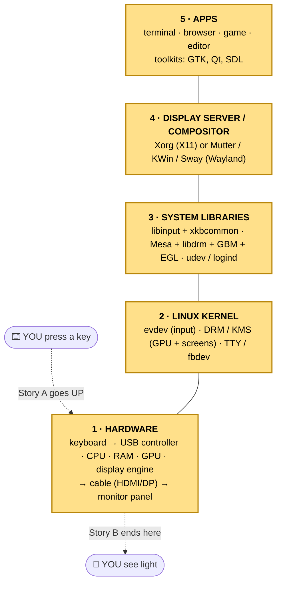
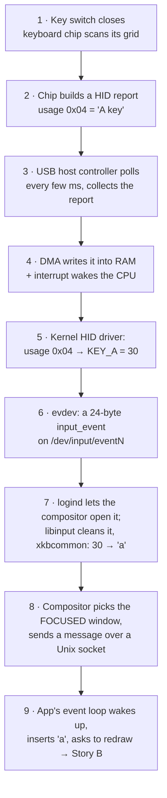
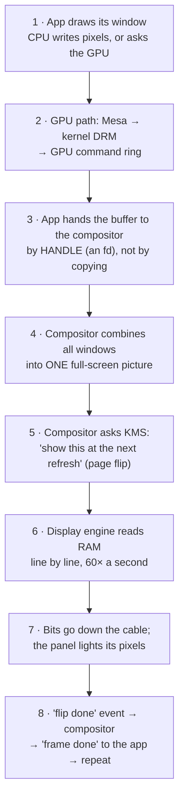
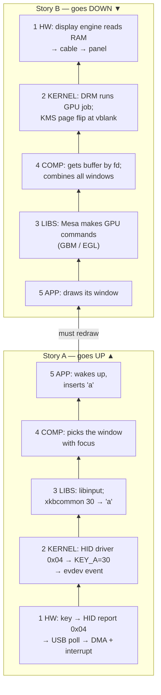
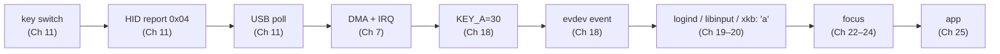
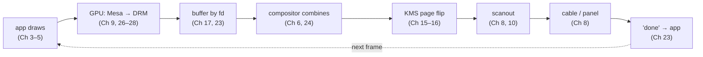

# 🧙 Graphics Chapter 01 — The Map
## What happens when I press **A** and a pixel lights up

> **Series:** Linux Graphics & Input · **Chapter 01 of 32** · ⭐ core · ≈ 60–75 minutes
> **Before this:** nothing from this series. From the I/O course you need file descriptors, `read/write/ioctl/mmap`, and Unix sockets.
> **After this:** you can draw the whole stack on one page and tell both stories from start to end, in rough strokes.
> Every later chapter zooms into **one box** of this map.

---

## 📍 You are here

This chapter is the map, so **all five layers** are lit. Later chapters light one layer at a time.


*Yellow = this chapter. Chapter 01 lights **all five** layers, in rough strokes.*

## 🔁 Quick recall

*(Skipped: this is the first chapter. From Chapter 02 on, every chapter starts with 3 questions about earlier ones.)*

---

## 💡 The idea in one sentence

> **A key press travels UP the five layers to reach one app; a frame travels DOWN the five layers to reach the screen —
> and every layer exists because it solves exactly one problem the layer below can't.**

---

## 🧒 The easy version: a restaurant

Imagine a restaurant. Many customers. One kitchen. One serving window.

| Restaurant | Graphics stack | Why the comparison works |
|---|---|---|
| **Customers** at tables | **Apps** (layer 5) | They want things. They never walk into the kitchen. |
| **Head waiter** | **Compositor / display server** (layer 4) | Takes every order, knows which table asked. Also puts **every dish on ONE big tray** for the serving window. |
| **Menu + phrasebook** | **System libraries** (layer 3) | Turn "a raw code" into something with meaning: "key 30" → "the letter a". Recipes, not cooking. |
| **The only staff allowed to touch the stove** | **Kernel** (layer 2) | Safety. If every customer touched the stove, the kitchen would burn. |
| **The kitchen itself** — stove, fridge, bell | **Hardware** (layer 1) | Does the real physical work. |

Now the two stories, restaurant style:

- **Story A (press A):** a customer rings a bell (key). Kitchen staff hear it (kernel). They check the phrasebook: "bell 30 means *a*" (libraries).
  The head waiter decides **which table** this belongs to (focus) and walks over (socket). The customer reacts (app inserts "a").
- **Story B (one frame):** each customer prepares a little plate (app draws its window). The head waiter puts all the plates on **one tray**
  (compositing). The tray goes out through the serving window **only when the window opens**, 60 times a second (vblank + page flip).

Keep this picture. Now the real names.

---

## 🔍 What really happens, step by step

### 1. The layer cake — five layers, one job each

| # | Layer | Its one job | Real names you will meet |
|---|---|---|---|
| 1 | **Hardware** | Physically sense keys; physically make light | USB controller, keyboard chip, GPU, display engine, HDMI/DP, panel |
| 2 | **Kernel** | Be the *only* one who touches hardware; give programs safe **device files** | `evdev` → `/dev/input/event*` · `DRM/KMS` → `/dev/dri/card*` |
| 3 | **System libraries** | Turn raw numbers into **meaning**, and hide hardware differences | libinput, xkbcommon, Mesa, libdrm, GBM, EGL, udev, logind |
| 4 | **Display server / compositor** | **Share** one screen + one keyboard between many apps | Xorg (X11) · Mutter, KWin, Sway, Weston (Wayland) |
| 5 | **Apps** | Decide *what* to draw and what a key *does* | your terminal, browser, editor, games; toolkits GTK, Qt, SDL |

New words:
- `device file` = a file in `/dev` that is really a door into a driver. You `open()` it; `read()`/`ioctl()` talk to the driver. *(You know these from I/O Part 3.)*
- `driver` = kernel code that knows how to talk to one kind of hardware.
- `compositor` = the program that combines all windows into one picture.

### 2. Why layers exist — the problem each layer solves

Ask "what breaks if this layer is missing?"

| Remove this layer… | …and this goes wrong |
|---|---|
| **Kernel** | Every app pokes the hardware directly. Two apps program the screen at once → garbage. One bad app → whole machine dies. No security: any app reads your password keystrokes. |
| **Libraries** | Every app must know every GPU model (hundreds), every keyboard layout (hundreds), every touchpad quirk. Nobody can write an app. |
| **Compositor** | Apps fight over the one screen. Who gets the key press? Who draws on top? Nobody decides. |
| **Apps** | A working machine that does nothing useful. 🙂 |
| **Hardware** | Nothing to show. (Demo A shows this machine: a kitchen with recipes but no stove.) |

> 🔑 **Notice the direction:** lower layers know **how** (hardware details); higher layers know **what** (meaning).
> The kernel knows "key number 30 went down". Only higher layers know that means "a" on your layout.

### 3. Story A — "I press the letter A" (9 hops, going UP)



| Hop | Layer | What happens, in plain words | New word |
|---|---|---|---|
| 1 | Hardware | Pressing closes a switch in a grid of wires. A tiny chip in the keyboard scans the grid many times per second and notices. | `key matrix` = grid of switches |
| 2 | Hardware | The chip writes a small **report**: "these keys are down now". The A key is called **usage `0x04`**. No letter "a" exists yet — just a number for a *position*. | `HID` = Human Interface Device: the USB standard for keyboards/mice; `report` = a small fixed-format message |
| 3 | Hardware | A USB keyboard **cannot speak first.** The USB host controller asks it "anything new?" on a fixed schedule — often every 8 ms (125 times a second), gaming keyboards every 1 ms. | `polling` = asking again and again |
| 4 | Hardware → Kernel | The controller copies the report into RAM itself (**DMA**) and raises an **interrupt** so the CPU stops and looks. *(You saw both in I/O Part 1.)* | `DMA` = device writes RAM without the CPU · `interrupt` = "hey CPU, look now" |
| 5 | Kernel | The kernel's HID driver translates the USB usage `0x04` into the Linux code **`KEY_A = 30`**. Every keyboard type (USB, laptop, Bluetooth) ends up as the same Linux codes. | `keycode` = a number for a key *position*, not a letter |
| 6 | Kernel | `evdev` packs it as a 24-byte `input_event` (`EV_KEY`, code 30, value 1 = down), then an `EV_SYN` "end of packet", and makes it readable on `/dev/input/eventN`. | `evdev` = the kernel part that offers input as device files |
| 7 | Libraries | Normal users can't open `/dev/input/*`. **logind** opens it for the compositor because *you* are the person sitting at this seat. **libinput** reads the events (and handles touchpads, debouncing, …). **xkbcommon** applies your layout: 30 + no Shift + US layout → `a`. | `logind` = the "who is sitting at this computer" service · `keysym` = the symbol a key means (`a` = `0x61`) |
| 8 | Compositor | Many windows are open. Only one has **focus**. The compositor sends the key only to that app, as a message over a Unix socket. | `focus` = the window that receives keys |
| 9 | App | The app was sleeping inside its **event loop**. The socket becomes readable, it wakes, reads the message, adds "a" to the text, and decides it must draw again. **That starts Story B.** | `event loop` = "wait for something, handle it, wait again" |

> 🧠 **Small surprise you'll verify in Demo B:** in X11 the app receives **keycode 38**, not 30. X adds 8 to every Linux code (an old rule: X keycodes start at 8).
> In Wayland, the compositor sends the raw **30** plus a copy of the keymap, and **the app runs xkbcommon itself** to get "a".

### 4. Story B — "one frame appears" (8 hops, going DOWN)



| Hop | Layer | What happens | New word |
|---|---|---|---|
| 1 | App | The app (often through a toolkit) fills a block of memory with pixels: 4 bytes each, row after row. Small apps use the CPU. | `framebuffer` / `buffer` = a block of memory holding one picture |
| 2 | Libs → Kernel → HW | Big drawing (browsers, games) goes to the GPU: the app calls OpenGL/Vulkan, **Mesa** turns that into GPU commands, the kernel's **DRM** driver puts them on the GPU's command ring and rings the doorbell. *(Ring + doorbell + fence: I/O Part 1.)* | `Mesa` = the open-source GPU driver *libraries* · `DRM` = the kernel's GPU subsystem |
| 3 | App → Compositor | A 1080p window is ~8 MB. Copying it 60× a second is waste. So the app sends only a **file descriptor** that points at the buffer. The compositor maps the **same memory**. (Demo C does exactly this.) | `dma-buf` = a GPU buffer shared as an fd |
| 4 | Compositor | It places every window (position, stacking order, shadows) into one picture for the whole screen. Only the parts that changed need redrawing. | `damage` = "this rectangle changed" |
| 5 | Compositor → Kernel | It does **not** copy pixels to the screen. It tells **KMS**: "at the next vblank, scan out *this* buffer instead". Swapping which buffer is shown is cheap and can't tear. | `KMS` = Kernel Mode Setting: the screen-control half of DRM · `page flip` = switch the shown buffer at vblank |
| 6 | Hardware | The **display engine** (part of the GPU chip) reads the buffer from memory, one line at a time, at a fixed speed. For 1080p60 that's a pixel clock of 148.5 MHz. | `scanout` = reading a buffer to the screen · `display engine` = the "reader" hardware |
| 7 | Hardware | Pixels travel down HDMI or DisplayPort. The monitor's panel sets each pixel's light. Between frames there is a short pause (≈ 667 µs at 1080p60). | `vblank` = the pause between two frames; safe moment to swap buffers |
| 8 | Back up | The kernel tells the compositor "flip done". The compositor tells the app "your frame was shown — draw the next one now". | `frame callback` = Wayland's "good time to draw" message |

> ⏱️ **Two clocks rule everything:** USB polling (every 1–8 ms) on the way up, and the screen refresh (every 16.7 ms at 60 Hz) on the way down.
> You can't show a key faster than the next refresh. Chapter 30 measures the full delay.

### 5. Three ways to put windows on a screen

The big question of layer 4: *many apps, one screen, one keyboard — who decides?*

| Way | Who owns the screen and keyboard | Used by | Good | Bad |
|---|---|---|---|---|
| **① Nobody in between** | **One app** talks to KMS and evdev itself | Games on a console, kiosks, car dashboards, boot splash, Lumen in early chapters | Simplest, fastest | Only one app at a time |
| **② X11** | The **X server** (Xorg) is in the middle. Apps send it drawing requests and get events back. A *separate* window manager program decides window placement. | Linux desktops 1987 → ~2020; still everywhere | Very flexible, network-transparent, huge history | Old design: any app can read every key (keylogging), extra copies, tearing fights |
| **③ Wayland** | The **compositor** is the display server, window manager and compositor **in one program** | GNOME (Mutter), KDE (KWin), Sway, Weston; default on most distros now | Apps isolated from each other; "every frame is perfect" design | Younger; some old X features (global hotkeys, screen grab) needed new protocols |

> 🔑 **Wayland is a language, not a program.** It is a *protocol* = a set of message rules (like HTTP).
> Mutter, KWin and Sway are different programs that all **speak** Wayland. Old X11 apps still run through **XWayland**, a small X server living inside the Wayland session.

---

## 🧪 Predict, then see

The sandbox I run demos in is a cloud virtual machine (Linux 6.18, 2 vCPUs, 7.8 GB RAM) **with no screen, no GPU, no keyboard and no mouse.**
So every demo has an honesty label:

- ✅ **Measured** — really ran here; you see real output.
- 🧪 **Simulated** — faked hardware; I say what is faked.
- 📖 **Explained only** — can't run here; I give you commands for your own PC.

All four demos below are ✅. **The full code of every demo is right here in the notes** — copy a block into a file with the name shown above it, and you can run it yourself.

### Demo A ✅ — "Which layers does this machine have?"

The script `ch01_layers.sh` only **looks** (reads `/sys`, `/proc`, `/dev`, the library list). It changes nothing.
I started a test X server first (`Xvfb` = an X server that draws into memory instead of a monitor).

**How the script looks at each layer** (no special tools, only normal files):

| Layer | Where the script looks | Why that place tells the truth |
|---|---|---|
| 1 Hardware | `/sys/bus/pci/devices`, `/sys/bus/usb/devices`, `/sys/bus/virtio/devices` | `/sys` = the kernel's live list of every device it found |
| 2 Kernel | `/proc/bus/input/devices`, `/dev/input/event*`, `/dev/dri/*`, `/sys/class/drm/*` | Device files exist only when a driver is loaded and a device is present |
| 3 Libraries | `ldconfig -p` (the list of installed shared libraries), `/run/systemd/system` | A library is "there" if the loader can find it |
| 4 Server | `/tmp/.X11-unix/X*`, `$XDG_RUNTIME_DIR/wayland-*`, process names | A display server is a program listening on a Unix socket |
| 5 Apps | `ldconfig -p` again, for toolkit libraries | Toolkits are libraries too |

📜 **`ch01_layers.sh`** (bash, read-only):

```bash
#!/usr/bin/env bash
# ch01_layers.sh -- "Which layers of the graphics & input stack exist on THIS machine?"
# READ-ONLY: it only looks. Nothing is changed. Safe to run on your own PC.
#   bash ch01_layers.sh

ok()  { printf "   ✔ %s\n" "$1"; }
bad() { printf "   ✘ %s\n" "$1"; }
have_lib() { ldconfig -p 2>/dev/null | grep -q "$1"; }
first_line() { head -n1; }

echo "=============== LAYER 1: HARDWARE (what the kernel can see) ==============="
pci=$(ls /sys/bus/pci/devices 2>/dev/null | wc -l)
usb=$(ls /sys/bus/usb/devices 2>/dev/null | wc -l)
virt=$(ls /sys/bus/virtio/devices 2>/dev/null | wc -l)
[ "$pci" -gt 0 ]  && ok "PCI devices: $pci  (graphics card, network card, USB controller sit here)" || bad "no PCI devices visible"
[ "$usb" -gt 0 ]  && ok "USB devices and hubs: $usb  (keyboards and mice are usually here)" || bad "no USB devices visible"
[ "$virt" -gt 0 ] && ok "virtio devices: $virt  (virtual hardware: this is a virtual machine)" || bad "no virtio devices"
cpus=$(grep -c '^processor' /proc/cpuinfo); mem=$(awk '/MemTotal/ {printf "%.1f", $2/1024/1024}' /proc/meminfo)
ok "CPU cores: $cpus   RAM: ${mem} GB"

echo
echo "=============== LAYER 2: KERNEL (drivers) ==============="
echo " -- input side --"
ndev=$(grep -c '^N:' /proc/bus/input/devices 2>/dev/null)
nev=$(ls /dev/input/event* 2>/dev/null | wc -l)
[ "${ndev:-0}" -gt 0 ] && ok "input devices known to the kernel: $ndev" || bad "no input devices (no keyboard, no mouse)"
[ "$nev" -gt 0 ] && ok "event files in /dev/input: $nev (these are what evdev gives programs)" || bad "no /dev/input/event* files"
handlers=$(awk '/^N:/ {sub(/.*Name=/,""); sub(/ .*/,""); printf "%s ", $0}' /proc/bus/input/handlers 2>/dev/null)
[ -n "$handlers" ] && ok "input handlers loaded: $handlers"
echo " -- graphics side --"
cards=$(ls /dev/dri/card* 2>/dev/null | wc -l); render=$(ls /dev/dri/renderD* 2>/dev/null | wc -l)
[ "$cards" -gt 0 ]  && ok "DRM card nodes: $cards (/dev/dri/card*: screens + GPU)" || bad "no /dev/dri/card* (no graphics driver / no display device)"
[ "$render" -gt 0 ] && ok "DRM render nodes: $render (/dev/dri/renderD*: GPU drawing only)" || bad "no /dev/dri/renderD* (no GPU for apps to use)"
for c in /sys/class/drm/card[0-9]; do
  [ -e "$c" ] || continue
  drv=$(basename "$(readlink -f "$c/device/driver" 2>/dev/null)")
  ok "$(basename "$c") is driven by kernel driver: ${drv:-unknown}"
done
for s in /sys/class/drm/card*-*/status; do
  [ -e "$s" ] || continue
  printf "   · connector %-22s %s\n" "$(basename "$(dirname "$s")")" "$(cat "$s")"
done
[ -e /dev/fb0 ]  && ok "old-style framebuffer /dev/fb0 exists (fbdev)" || bad "no /dev/fb0 (old fbdev not present)"
[ -e /dev/tty0 ] && ok "virtual terminals exist (/dev/tty0): the text console" || bad "no /dev/tty0"

echo
echo "=============== LAYER 3: SYSTEM LIBRARIES ==============="
for pair in "libinput:libinput (turns raw input into clean events)" \
            "libxkbcommon:xkbcommon (key code -> letter, keyboard layouts)" \
            "libdrm.so:libdrm (talks to DRM/KMS)" \
            "libgbm:GBM (allocates buffers the screen can show)" \
            "libEGL:EGL (glue between GPU drawing and windows)" \
            "libGL.so:OpenGL" \
            "libvulkan:Vulkan loader" \
            "libwayland-client:Wayland client library" \
            "libwayland-server:Wayland server library (compositors use it)" \
            "libxcb.so:XCB (talks X11)" \
            "libudev:udev (device discovery)"; do
  lib="${pair%%:*}"; label="${pair#*:}"
  have_lib "$lib" && ok "$label" || bad "$label  — not installed"
done
if [ -d /run/systemd/system ]; then ok "systemd is running (logind can hand devices to your desktop)"; else bad "systemd is NOT the init process here (no logind, so no seat/session handling)"; fi
init=$(ps -p 1 -o comm= 2>/dev/null); echo "   · process number 1 (the first program started) is: ${init:-unknown}"

echo
echo "=============== LAYER 4: DISPLAY SERVER / COMPOSITOR ==============="
xs=$(ls /tmp/.X11-unix 2>/dev/null | tr '\n' ' ')
ws=$(ls ${XDG_RUNTIME_DIR:-/run/user/$(id -u)}/wayland-* 2>/dev/null | tr '\n' ' ')
[ -n "$xs" ] && ok "X11 socket(s) found: $xs" || bad "no X11 socket (no X server is listening)"
[ -n "$ws" ] && ok "Wayland socket(s) found: $ws" || bad "no Wayland socket (no Wayland compositor is listening)"
procs=$(ps -eo comm 2>/dev/null | grep -E '^(Xorg|Xwayland|Xvfb|gnome-shell|kwin_wayland|kwin_x11|sway|weston|mutter|Hyprland|labwc|cage)$' | sort -u | tr '\n' ' ')
[ -n "$procs" ] && ok "display-server programs running: $procs" || bad "no known display-server program is running"
echo "   · your session says: XDG_SESSION_TYPE='${XDG_SESSION_TYPE:-}'  DISPLAY='${DISPLAY:-}'  WAYLAND_DISPLAY='${WAYLAND_DISPLAY:-}'"

echo
echo "=============== LAYER 5: APPS AND TOOLKITS ==============="
for pair in "libgtk-3:GTK 3" "libgtk-4:GTK 4" "libQt5Gui:Qt 5" "libQt6Gui:Qt 6" "libSDL2-2:SDL2 (games)" "libcairo.so:Cairo (2D drawing)"; do
  lib="${pair%%:*}"; label="${pair#*:}"
  have_lib "$lib" && ok "$label installed" || bad "$label not installed"
done
echo
echo "Done. Count the ✔ in each layer: that is the stack you actually have."
```

**🤔 Predict:** a cloud VM with no monitor. Will it have graphics **libraries** installed? Will it have a graphics **device**?

<details><summary>Reveal the real output</summary>

```
=============== LAYER 1: HARDWARE (what the kernel can see) ===============
   ✔ PCI devices: 11  (graphics card, network card, USB controller sit here)
   ✘ no USB devices visible
   ✔ virtio devices: 10  (virtual hardware: this is a virtual machine)
   ✔ CPU cores: 2   RAM: 7.8 GB

=============== LAYER 2: KERNEL (drivers) ===============
 -- input side --
   ✘ no input devices (no keyboard, no mouse)
   ✘ no /dev/input/event* files
   ✔ input handlers loaded: kbd evdev
 -- graphics side --
   ✘ no /dev/dri/card* (no graphics driver / no display device)
   ✘ no /dev/dri/renderD* (no GPU for apps to use)
   ✘ no /dev/fb0 (old fbdev not present)
   ✔ virtual terminals exist (/dev/tty0): the text console

=============== LAYER 3: SYSTEM LIBRARIES ===============
   ✔ libinput (turns raw input into clean events)
   ✔ xkbcommon (key code -> letter, keyboard layouts)
   ✔ libdrm (talks to DRM/KMS)
   ✔ GBM (allocates buffers the screen can show)
   ✔ EGL (glue between GPU drawing and windows)
   ✔ OpenGL
   ✔ Vulkan loader
   ✔ Wayland client library
   ✔ Wayland server library (compositors use it)
   ✔ XCB (talks X11)
   ✔ udev (device discovery)
   ✘ systemd is NOT the init process here (no logind, so no seat/session handling)
   · process number 1 (the first program started) is: process_api

=============== LAYER 4: DISPLAY SERVER / COMPOSITOR ===============
   ✔ X11 socket(s) found: X99
   ✘ no Wayland socket (no Wayland compositor is listening)
   ✔ display-server programs running: Xvfb
   · your session says: XDG_SESSION_TYPE=''  DISPLAY=''  WAYLAND_DISPLAY=''

=============== LAYER 5: APPS AND TOOLKITS ===============
   ✔ GTK 3 installed
   ✔ GTK 4 installed
   ✔ Qt 5 installed
   ✘ Qt 6 not installed
   ✔ SDL2 (games) installed
   ✔ Cairo (2D drawing) installed

Done. Count the ✔ in each layer: that is the stack you actually have.
```
</details>

**What it shows:**
- Layer 3 is **full**; layers 1–2 have **no keyboard, no GPU, no screen**. → *A kitchen with every recipe book but no stove.*
  Libraries are just files on disk. They don't need a device to exist — only to *do* anything.
- The 11 PCI devices are 1 host bridge + 10 virtio devices (disks, network, and helpers). **None** is a display device.
- `kbd` and `evdev` are loaded: the kernel is *ready* for keyboards, but none is plugged in.
- Layer 4 shows only my test X server. It is a real X server, but it draws into RAM, not onto a monitor.
- On your desktop PC you should see ✔ almost everywhere. That's your homework (end of chapter).

### Demo B ✅ — "A key arrives at an app" (real X server, raw protocol)

The program `ch01_x11_key.cpp` connects to the X server's Unix socket `/tmp/.X11-unix/X99`, speaks the X11 protocol **byte by byte** (no X library),
opens a 300×200 window at (100,100), and then uses **XTEST** (an X extension that injects fake input, used by test tools) to:
move the pointer into the window, press and release keycode 38, click button 1. Then it reads what arrives.

> 🧪 *Honesty note:* the **key press itself is faked** (no keyboard exists here). Everything from the X server upward is real:
> a real X server decides which window gets it and sends a real event.

**The API first.** Here the "API" is the X11 protocol itself: the app writes small binary **requests** into the socket, and reads back 32-byte **events** and **replies**.
Every request starts with the same 4 bytes: `[opcode: 1 byte][1 byte of data][length in 4-byte words: 2 bytes]`. Numbers are little-endian (the app says so in its first byte: `'l'`).

| Step | Request (opcode) | Plain meaning |
|---|---|---|
| 1 | connection setup (12 bytes) | "Hello, I speak X11 version 11.0." The reply tells you the screen size, the root window id, and a **range of ids** you may use for your own windows |
| 2 | `CreateWindow` (1) | Make a 300×200 window. The **event mask** says which events I want: key press/release, button press/release, expose |
| 3 | `MapWindow` (8) | "Put it on the screen" |
| 4 | `QueryExtension` (98) | "Do you have XTEST? What opcode does it use?" (extensions get their opcode at run time) |
| 5 | XTEST `FakeInput` (minor 2) | Inject a fake event: type 6 = motion, 2 = key press, 3 = key release, 4/5 = button press/release |
| 6 | `GetKeyboardMapping` (101) | "Which keysyms are printed on keycode 38?" |

Incoming messages are always 32 bytes. Byte 0 says what it is: `0` = error, `1` = reply (may carry extra data; its length is at offset 4), `2..` = event (2 = KeyPress, 12 = Expose …).
The C++ is plain: a small `Req` helper appends bytes in little-endian order; `next_msg()` reads one message. *(Every byte is explained properly in Chapter 22 — today just watch what comes back.)*

📜 **`ch01_x11_key.cpp`** — build: `g++ -std=c++20 -Wall -Wextra -O2 ch01_x11_key.cpp -o x11_key` · run: start `Xvfb :99 -screen 0 1280x720x24 -nolisten tcp &` first, then `./x11_key`

```cpp
// ch01_x11_key.cpp -- Demo B: "a key arrives at an app"
// Talks the raw X11 protocol to a real X server (Xvfb :99). No Xlib, no XCB.
// Fakes a key press with the XTEST extension, then reads the events the app gets.
// Build: g++ -std=c++20 -Wall -Wextra -O2 ch01_x11_key.cpp -o x11_key
// Run:   Xvfb :99 -screen 0 1280x720x24 -nolisten tcp &   then   ./x11_key
// (Full explanation of every byte comes in Chapter 22.)
#include <sys/socket.h>
#include <sys/un.h>
#include <unistd.h>
#include <cerrno>
#include <cstdint>
#include <cstdio>
#include <cstring>
#include <string>
#include <system_error>
#include <vector>

static int g_writes = 0, g_reads = 0;

[[noreturn]] static void die(const char* what) { throw std::system_error(errno, std::generic_category(), what); }

struct UniqueFd {
    int fd = -1;
    explicit UniqueFd(int f) : fd(f) {}
    ~UniqueFd() { if (fd >= 0) ::close(fd); }
    UniqueFd(const UniqueFd&) = delete;
    UniqueFd& operator=(const UniqueFd&) = delete;
};

// Little helpers to build requests in little-endian byte order.
struct Req {
    std::vector<uint8_t> b;
    void u8(uint8_t v) { b.push_back(v); }
    void u16(uint16_t v) { u8(v & 0xff); u8(v >> 8); }
    void u32(uint32_t v) { u16(v & 0xffff); u16(v >> 16); }
    void pad4() { while (b.size() % 4) u8(0); }
};
static uint16_t rd16(const uint8_t* p) { return uint16_t(p[0] | p[1] << 8); }
static uint32_t rd32(const uint8_t* p) { return p[0] | p[1] << 8 | p[2] << 16 | uint32_t(p[3]) << 24; }

static void send_all(int fd, const std::vector<uint8_t>& v) {
    ++g_writes;
    if (::write(fd, v.data(), v.size()) != ssize_t(v.size())) die("write");
}
static void recv_exact(int fd, uint8_t* p, size_t n) {
    while (n) {
        ++g_reads;
        ssize_t r = ::read(fd, p, n);
        if (r <= 0) die("read");
        p += r; n -= size_t(r);
    }
}
// Read one 32-byte message; if it is a reply, also read its extra data.
static std::vector<uint8_t> next_msg(int fd) {
    std::vector<uint8_t> m(32);
    recv_exact(fd, m.data(), 32);
    if (m[0] == 1) {                         // 1 = reply
        size_t extra = size_t(rd32(&m[4])) * 4;
        m.resize(32 + extra);
        if (extra) recv_exact(fd, m.data() + 32, extra);
    }
    return m;
}

int main() try {
    UniqueFd s{::socket(AF_UNIX, SOCK_STREAM, 0)};
    sockaddr_un a{};
    a.sun_family = AF_UNIX;
    std::strcpy(a.sun_path, "/tmp/.X11-unix/X99");
    if (::connect(s.fd, reinterpret_cast<sockaddr*>(&a), sizeof a) < 0) die("connect X99");

    // 1. Hello: 'l' = little endian, protocol 11.0, no authorization.
    Req hello; hello.u8('l'); hello.u8(0); hello.u16(11); hello.u16(0); hello.u16(0); hello.u16(0); hello.u16(0);
    send_all(s.fd, hello.b);
    uint8_t h[8]; recv_exact(s.fd, h, 8);
    if (h[0] != 1) { std::puts("setup refused"); return 1; }
    std::vector<uint8_t> d(size_t(rd16(&h[6])) * 4); recv_exact(s.fd, d.data(), d.size());
    uint32_t rid_base = rd32(&d[4]);
    uint16_t vlen = rd16(&d[16]);
    uint8_t nformats = d[21], min_kc = d[26], max_kc = d[27];
    std::string vendor(reinterpret_cast<char*>(&d[32]), vlen);
    const uint8_t* scr = &d[32 + ((vlen + 3) & ~3) + 8 * nformats];
    uint32_t root = rd32(scr);
    std::printf("server vendor  : %s\n", vendor.c_str());
    std::printf("screen         : %ux%u depth %u, keycodes %u..%u, id base 0x%x\n",
                rd16(scr + 20), rd16(scr + 22), scr[38], min_kc, max_kc, rid_base);

    // 2. CreateWindow (opcode 1) 300x200 at (100,100): white background, ask for key+button+expose events.
    uint32_t win = rid_base | 1;
    Req cw; cw.u8(1); cw.u8(0); cw.u16(10); cw.u32(win); cw.u32(root);
    cw.u16(100); cw.u16(100); cw.u16(300); cw.u16(200); cw.u16(0); cw.u16(1); cw.u32(0);
    cw.u32(0x2 | 0x800);                 // value mask: background-pixel, event-mask
    cw.u32(0xffffff);                    // white
    cw.u32(0x1 | 0x2 | 0x4 | 0x8 | 0x8000);  // KeyPress KeyRelease ButtonPress ButtonRelease Exposure
    // 3. MapWindow (opcode 8) = "show it".
    Req mw; mw.u8(8); mw.u8(0); mw.u16(2); mw.u32(win);
    // 4. QueryExtension (opcode 98) "XTEST" = the fake-input extension.
    Req qe; qe.u8(98); qe.u8(0); qe.u16(4); qe.u16(5); qe.u16(0);
    for (char c : std::string("XTEST")) qe.u8(uint8_t(c));
    qe.pad4();
    Req all; for (auto* r : {&cw, &mw, &qe}) all.b.insert(all.b.end(), r->b.begin(), r->b.end());
    send_all(s.fd, all.b);                    // three requests in ONE write

    uint8_t xtest = 0;
    for (bool exposed = false; !exposed || !xtest;) {
        auto m = next_msg(s.fd);
        if (m[0] == 1) xtest = m[9];          // reply to QueryExtension: major opcode
        if ((m[0] & 0x7f) == 12) exposed = true;  // Expose: the window is on screen
        if (m[0] == 0) { std::printf("X error %u\n", m[1]); return 1; }
    }
    std::printf("XTEST opcode   : %u\n", xtest);

    // 5. XTEST FakeInput: move pointer into the window, then press+release key 38, then click.
    auto fake = [&](uint8_t type, uint8_t detail, int16_t x = 0, int16_t y = 0) {
        Req f; f.u8(xtest); f.u8(2); f.u16(9); f.u8(type); f.u8(detail); f.u16(0);
        f.u32(0); f.u32(type == 6 ? root : 0); f.u32(0); f.u32(0);
        f.u16(uint16_t(x)); f.u16(uint16_t(y)); f.u32(0); f.u32(0);
        return f.b;
    };
    Req inject;
    for (auto&& part : {fake(6, 0, 150, 130), fake(2, 38), fake(3, 38), fake(4, 1), fake(5, 1)})
        inject.b.insert(inject.b.end(), part.begin(), part.end());
    send_all(s.fd, inject.b);

    const char* names[] = {"", "", "KeyPress", "KeyRelease", "ButtonPress", "ButtonRelease"};
    for (int got = 0; got < 4;) {
        auto m = next_msg(s.fd);
        uint8_t code = m[0] & 0x7f;
        if (code >= 2 && code <= 5) {
            std::printf("event          : %-13s detail=%-3u at window (%d,%d)\n",
                        names[code], m[1], int16_t(rd16(&m[24])), int16_t(rd16(&m[26])));
            ++got;
        }
    }

    // 6. GetKeyboardMapping (opcode 101) for keycode 38: which symbols are printed on that key?
    Req gk; gk.u8(101); gk.u8(0); gk.u16(2); gk.u8(38); gk.u8(1); gk.u16(0);
    send_all(s.fd, gk.b);
    for (;;) {
        auto m = next_msg(s.fd);
        if (m[0] != 1) continue;
        std::printf("keycode 38 has keysyms: 0x%02x ('%c') and 0x%02x ('%c')\n",
                    rd32(&m[32]), char(rd32(&m[32])), rd32(&m[36]), char(rd32(&m[36])));
        break;
    }
    std::printf("socket calls   : %d write(), %d read()\n", g_writes, g_reads);
} catch (const std::exception& e) {
    std::fprintf(stderr, "error: %s\n", e.what());
    return 1;
}
```

**🤔 Predict:** Linux calls the A key `KEY_A = 30`. Which number will the app see in the event? And will the event contain the letter "a"?

<details><summary>Reveal the real output</summary>

```
server vendor  : The X.Org Foundation
screen         : 1280x720 depth 24, keycodes 8..255, id base 0x200000
XTEST opcode   : 132
event          : KeyPress      detail=38  at window (50,30)
event          : KeyRelease    detail=38  at window (50,30)
event          : ButtonPress   detail=1   at window (50,30)
event          : ButtonRelease detail=1   at window (50,30)
keycode 38 has keysyms: 0x61 ('a') and 0x41 ('A')
socket calls   : 4 write(), 12 read()
```
</details>

**What it shows:**
1. **The event has no letter in it.** Only `detail=38` = a key *position*. To get "a", the app had to ask a second question
   (`GetKeyboardMapping`): "what is printed on key 38?" → `a` without Shift, `A` with Shift.
2. **38 = 30 + 8.** X keycodes are Linux evdev codes plus 8. I checked several keys against the X keyboard file
   `/usr/share/X11/xkb/keycodes/evdev` and the kernel header `linux/input-event-codes.h`:

   | Key | Linux code (kernel) | X keycode (X server) |
   |---|---|---|
   | Esc | 1 | 9 |
   | Enter | 28 | 36 |
   | Left Ctrl | 29 | 37 |
   | **A** | **30** | **38** |
   | `;` | 39 | 47 |
   | Space | 57 | 65 |
   | F1 | 59 | 67 |

3. **Focus by position.** The pointer was at screen (150,130); the window starts at (100,100); so the event says (50,30) *inside the window*.
   With no window manager running, X gives keys to the window under the pointer. That's hop 8 of Story A: the server picks the window.
4. **Few, small messages.** The whole conversation took 4 `write()` calls (the app sends several requests in one write) and 12 `read()` calls.

**What the X server itself does** (✅ I traced the real server with `strace`, a tool that prints every system call a program makes):

```
epoll_ctl(3, EPOLL_CTL_ADD, 8, {events=EPOLLET, ...}) = 0           ← "watch my new client"
recvmsg(8, ...) = -1 EAGAIN (Resource temporarily unavailable)        ← "read until empty"
writev(...) = 8     writev(...) = 2588                                ← setup reply: 8 + 2,588 bytes
```

The X server is one big **event loop** built on `epoll`, with **nonblocking** sockets (you know `EAGAIN` from I/O Part 5).

> ### 📦 epoll in plain words (5-minute box — the full story is I/O Part 8)
> - **Problem:** a server has many sockets (one per app) and also the keyboard and the GPU. It can't `read()` one and block — the others would wait.
> - You know `select()` (I/O 6.1): "here is my list of fds, wake me when any is ready". It re-sends the whole list every time.
> - **`epoll`** = the same idea, but the kernel **keeps the list**:
>   1. `epoll_create1()` → you get an "epoll fd" (a watch-list living in the kernel).
>   2. `epoll_ctl(ADD, fd)` → add a socket or device to the list, once.
>   3. `epoll_wait()` → sleep until one or more fds are ready; the kernel returns **only the ready ones**.
> - `EPOLLET` (edge-triggered) = "tell me once when new data arrives". So you must read until `EAGAIN`, or you'll never be told again. That's why the trace shows a read ending in `EAGAIN`.
> - **Every display server and every compositor is this loop:** wait → client message? key event? flip done? → handle → wait again.

### Demo C ✅ — "A picture handed over by file handle"

**The API first** (everything here is a normal system call; nothing is graphics-specific):

| Call | Plain meaning |
|---|---|
| `memfd_create(name, 0)` | Make an anonymous file that lives only in RAM. You get an fd. |
| `ftruncate(fd, size)` | Give it a size (here 640 × 480 × 4 = 1,228,800 bytes). |
| `mmap(..., MAP_SHARED, fd, 0)` | See that file as memory. `MAP_SHARED` = everyone who maps it sees the **same** bytes. |
| `socketpair(AF_UNIX, ...)` | Two connected Unix sockets — a private pipe between two processes. |
| `sendmsg()` / `recvmsg()` | Like `write`/`read`, but can carry **extra "control" data** beside the normal bytes. |
| `SCM_RIGHTS` | A control message type that means "**here is a file descriptor**". The kernel gives the receiver its *own* fd number pointing to the *same* open file. |

The control data is built with a few C macros: `CMSG_SPACE` (how big the buffer must be), `CMSG_FIRSTHDR` (first control header),
`CMSG_LEN`, `CMSG_DATA` (where to put the fd). It looks odd, but it's always the same 6 lines — see `send_with_fd()` and `recv_with_fd()` below.

C++ notes for this file:
- **`std::span<uint32_t>`** (new in C++20) = "a pointer plus a length" in one object. The mapped memory is returned as a `span`, so `px.size()` and `px[i]` just work, and nothing is owned or freed by it.
- **`UniqueFd`** = a tiny RAII class: the destructor calls `close()`. Lumen will have a proper one in Chapter 02.
- **`if (cmsghdr* c = ...; c && ...)`** = an `if` with a starter statement (C++17): `c` lives only inside the `if`.
- Errors throw **`std::system_error(errno, ...)`**, so a failing call can't be silently ignored.

The program forks into two processes. The **"app"** draws a gradient into shared memory and sends the fd. The **"compositor"** receives it, maps it and reads two pixels.

📜 **`ch01_fd_pass.cpp`** — build: `g++ -std=c++20 -Wall -Wextra -O2 ch01_fd_pass.cpp -o fd_pass` · run: `./fd_pass`

```cpp
// ch01_fd_pass.cpp -- Demo C: "a picture handed over by file handle"
// An "app" draws a 640x480 picture into shared memory and sends only the
// FILE DESCRIPTOR plus a tiny message to a "compositor" process.
// The compositor maps the SAME memory and reads the pixels. No pixel is copied.
// Build: g++ -std=c++20 -Wall -Wextra -O2 ch01_fd_pass.cpp -o fd_pass
#include <sys/mman.h>
#include <sys/socket.h>
#include <sys/wait.h>
#include <unistd.h>
#include <cerrno>
#include <cstdint>
#include <cstdio>
#include <cstring>
#include <span>
#include <utility>
#include <system_error>

[[noreturn]] void die(const char* what) { throw std::system_error(errno, std::generic_category(), what); }

class UniqueFd {                       // RAII: the fd is closed when the object dies
public:
    explicit UniqueFd(int fd = -1) : fd_(fd) {}
    ~UniqueFd() { if (fd_ >= 0) ::close(fd_); }
    UniqueFd(UniqueFd&& o) noexcept : fd_(std::exchange(o.fd_, -1)) {}
    UniqueFd(const UniqueFd&) = delete;
    UniqueFd& operator=(const UniqueFd&) = delete;
    int get() const { return fd_; }
private:
    int fd_;
};

constexpr int W = 640, H = 480;
constexpr size_t BYTES = size_t(W) * H * 4;          // 4 bytes per pixel (XRGB8888)

struct Message { uint32_t width, height, stride; };  // what travels in the socket

// Send `msg` and attach `fd` "out of band" with SCM_RIGHTS.
void send_with_fd(int sock, const Message& msg, int fd) {
    iovec iov{const_cast<Message*>(&msg), sizeof msg};
    alignas(cmsghdr) char ctrl[CMSG_SPACE(sizeof(int))]{};
    msghdr mh{};
    mh.msg_iov = &iov; mh.msg_iovlen = 1;
    mh.msg_control = ctrl; mh.msg_controllen = sizeof ctrl;
    cmsghdr* c = CMSG_FIRSTHDR(&mh);
    c->cmsg_level = SOL_SOCKET; c->cmsg_type = SCM_RIGHTS; c->cmsg_len = CMSG_LEN(sizeof(int));
    std::memcpy(CMSG_DATA(c), &fd, sizeof fd);
    std::printf("[app]        sending %zu bytes through the socket (+ 1 fd)\n", sizeof msg);
    if (::sendmsg(sock, &mh, 0) != ssize_t(sizeof msg)) die("sendmsg");
}

UniqueFd recv_with_fd(int sock, Message& msg) {
    iovec iov{&msg, sizeof msg};
    alignas(cmsghdr) char ctrl[CMSG_SPACE(sizeof(int))]{};
    msghdr mh{};
    mh.msg_iov = &iov; mh.msg_iovlen = 1;
    mh.msg_control = ctrl; mh.msg_controllen = sizeof ctrl;
    ssize_t n = ::recvmsg(sock, &mh, 0);
    if (n < 0) die("recvmsg");
    int fd = -1;
    if (cmsghdr* c = CMSG_FIRSTHDR(&mh); c && c->cmsg_type == SCM_RIGHTS)  // C++17 if-with-init
        std::memcpy(&fd, CMSG_DATA(c), sizeof fd);
    std::printf("[compositor] got %zd bytes and fd %d\n", n, fd);
    return UniqueFd(fd);
}

std::span<uint32_t> map_pixels(int fd) {
    void* p = ::mmap(nullptr, BYTES, PROT_READ | PROT_WRITE, MAP_SHARED, fd, 0);
    if (p == MAP_FAILED) die("mmap");
    return {static_cast<uint32_t*>(p), size_t(W) * H};    // std::span = pointer + length
}

int main() try {
    std::setvbuf(stdout, nullptr, _IOLBF, 0);   // line-buffered: keep the two processes' lines in order
    int sv[2];
    if (::socketpair(AF_UNIX, SOCK_STREAM, 0, sv) < 0) die("socketpair");
    UniqueFd app_end(sv[0]), comp_end(sv[1]);

    pid_t pid = ::fork();
    if (pid < 0) die("fork");
    if (pid == 0) {                                   // ---- the "compositor" process ----
        Message m{};
        UniqueFd buf = recv_with_fd(comp_end.get(), m);
        auto px = map_pixels(buf.get());
        std::printf("[compositor] mapped %ux%u, stride %u: pixel(0,0)=0x%08x pixel(639,479)=0x%08x\n",
                    m.width, m.height, m.stride, px[0], px[px.size() - 1]);
        ::munmap(px.data(), BYTES);
        return 0;
    }
    // ---- the "app" process ----
    UniqueFd buf(::memfd_create("lumen-frame", 0));   // anonymous shared memory, as an fd
    if (buf.get() < 0) die("memfd_create");
    if (::ftruncate(buf.get(), BYTES) < 0) die("ftruncate");
    auto px = map_pixels(buf.get());
    for (int y = 0; y < H; ++y)                       // a gradient: red grows left->right, green top->bottom
        for (int x = 0; x < W; ++x)
            px[size_t(y) * W + x] = 0xff000000u | uint32_t(x * 255 / (W - 1)) << 16 | uint32_t(y * 255 / (H - 1)) << 8 | 0x40;
    std::printf("[app]        drew %zu bytes of pixels into shared memory\n", BYTES);
    send_with_fd(app_end.get(), Message{W, H, W * 4}, buf.get());
    ::munmap(px.data(), BYTES);
    ::waitpid(pid, nullptr, 0);
} catch (const std::exception& e) {
    std::fprintf(stderr, "error: %s\n", e.what());
    return 1;
}
```

**🤔 Predict:** the picture is 1,228,800 bytes. How many bytes go **through the socket**? And will the fd number be the same in both processes?

<details><summary>Reveal the real output</summary>

```
[app]        drew 1228800 bytes of pixels into shared memory
[app]        sending 12 bytes through the socket (+ 1 fd)
[compositor] got 12 bytes and fd 5
[compositor] mapped 640x480, stride 2560: pixel(0,0)=0xff000040 pixel(639,479)=0xffffff40
```
Counting system calls with `strace -c`: **1** `sendmsg`, **1** `recvmsg`, **1** `memfd_create`.
</details>

**What it shows:**
- **12 bytes** (width, height, stride) went through the socket. The **1.2 MB** of pixels never did — about 100,000× less traffic.
- The compositor read the app's pixels correctly: top-left `0xff000040` (no red, no green), bottom-right `0xffffff40` (full red + full green). Same memory, no copy.
- The receiver got **fd 5** — a different number, but the **same file**. An fd number is only a per-process "ticket number".
- `stride` = bytes per row (2,560 = 640 × 4 here). Chapter 04 explains why it isn't always width × 4.

> 📖 **How real Wayland does it:** exactly this mechanism. An app creates shared memory, sends its fd with `SCM_RIGHTS` in a `wl_shm.create_pool` message,
> then `wl_surface.attach` + `damage` + `commit` say "show this buffer". Each Wayland message is `[object id: 4 bytes][size and opcode: 4 bytes][arguments]`.
> For GPU buffers it's the same idea, with **dma-buf** fds instead of memfd. You'll read real Wayland traffic with `WAYLAND_DEBUG=1` in Chapter 23.
> *(This demo uses my own 12-byte message, not the Wayland format.)*

### Demo D ✅ — "A GPU that is really the CPU"

The program `ch01_egl_probe.cpp` opens **EGL** (the glue library between GPU drawing and the rest of the system) with **no window and no screen**
("surfaceless"), asks OpenGL who is doing the drawing, then clears a 1920×1080 picture to the colour (0.2, 0.4, 0.6) three times and times it.

**The API first** (EGL and OpenGL are C APIs; each call is one function):

| Call | Plain meaning |
|---|---|
| `dlopen("libEGL.so.1")` + `dlsym(name)` | Load a library while running and find a function in it by name (no headers needed) |
| `eglGetPlatformDisplay(SURFACELESS_MESA)` | "Give me a GPU connection that needs **no screen and no window**" |
| `eglInitialize` / `eglQueryString` | Start EGL; ask its version, vendor, extension list |
| `eglBindAPI(EGL_OPENGL_API)` + `eglCreateContext` | "I'll speak OpenGL" + create a **context** = all of OpenGL's state for one user |
| `eglMakeCurrent(dpy, none, none, ctx)` | "From now on, OpenGL calls on this thread use that context" |
| `eglGetProcAddress("glClear")` | Ask EGL for an OpenGL function pointer |
| `glGenFramebuffers` + `glGenRenderbuffers` + `glRenderbufferStorage` | No window means no screen picture, so make an **off-screen** 1920×1080 picture to draw into |
| `glClearColor` + `glClear` | Fill the whole picture with one colour |
| `glFinish` | **Wait** until drawing is really done (GPU work is normally queued, not finished, when a call returns) |
| `glReadPixels` | Copy pixels back into normal memory, to check them |

C++ notes:
- **Lambda with a template parameter** — `[&]<class F>(F*, const char* n) { ... }` is new in C++20. The helper `gl(...)` loads any OpenGL function and returns it with the right pointer type; the dummy `nullptr` argument only tells it which type `F` is.
- `std::chrono::steady_clock` is a clock that never jumps (good for timing).
- No EGL headers are installed here, so the file declares the few constants it needs itself (their values come from the Khronos registry).

📜 **`ch01_egl_probe.cpp`** — build: `g++ -std=c++20 -Wall -Wextra -O2 ch01_egl_probe.cpp -o egl_probe -ldl` · run: `LIBGL_ALWAYS_SOFTWARE=1 ./egl_probe` (drop the variable on your PC to use your real GPU)

```cpp
// ch01_egl_probe.cpp -- Demo D: "a GPU that is really the CPU"
// Opens Mesa through EGL with NO screen and NO window ("surfaceless"),
// asks OpenGL who is drawing, clears a 1920x1080 picture and times it.
// No EGL/GL headers are installed in the sandbox, so we declare the few
// constants and function types ourselves and load libEGL with dlopen().
// Build: g++ -std=c++20 -Wall -Wextra -O2 ch01_egl_probe.cpp -o egl_probe -ldl
// Run:   LIBGL_ALWAYS_SOFTWARE=1 ./egl_probe
#include <dlfcn.h>
#include <chrono>
#include <cstdint>
#include <cstdio>
#include <stdexcept>
#include <string_view>

using EGLDisplay = void*; using EGLContext = void*; using EGLint = int32_t; using EGLBoolean = unsigned;
using GLenum = unsigned; using GLuint = unsigned; using GLsizei = int;
constexpr EGLint EGL_NONE = 0x3038, EGL_VERSION = 0x3054, EGL_VENDOR = 0x3053, EGL_EXTENSIONS = 0x3055;
constexpr unsigned EGL_OPENGL_API = 0x30A2, EGL_PLATFORM_SURFACELESS_MESA = 0x31DD;
constexpr GLenum GL_RENDERER = 0x1F01, GL_VERSION = 0x1F02, GL_FRAMEBUFFER = 0x8D40, GL_RENDERBUFFER = 0x8D41,
                 GL_RGBA8 = 0x8058, GL_COLOR_ATTACHMENT0 = 0x8CE0, GL_COLOR_BUFFER_BIT = 0x4000,
                 GL_RGBA = 0x1908, GL_UNSIGNED_BYTE = 0x1401;

template <class F> F load(void* lib, const char* name) {
    auto f = reinterpret_cast<F>(dlsym(lib, name));
    if (!f) throw std::runtime_error(name);
    return f;
}

int main() try {
    void* egl = dlopen("libEGL.so.1", RTLD_NOW);
    if (!egl) throw std::runtime_error(dlerror());
    auto getProc   = load<void* (*)(const char*)>(egl, "eglGetProcAddress");
    auto getPlatDp = load<EGLDisplay (*)(unsigned, void*, const intptr_t*)>(egl, "eglGetPlatformDisplay");
    auto init      = load<EGLBoolean (*)(EGLDisplay, EGLint*, EGLint*)>(egl, "eglInitialize");
    auto query     = load<const char* (*)(EGLDisplay, EGLint)>(egl, "eglQueryString");
    auto bindApi   = load<EGLBoolean (*)(unsigned)>(egl, "eglBindAPI");
    auto mkCtx     = load<EGLContext (*)(EGLDisplay, void*, EGLContext, const EGLint*)>(egl, "eglCreateContext");
    auto mkCurrent = load<EGLBoolean (*)(EGLDisplay, void*, void*, EGLContext)>(egl, "eglMakeCurrent");

    EGLDisplay dpy = getPlatDp(EGL_PLATFORM_SURFACELESS_MESA, nullptr, nullptr);
    EGLint major = 0, minor = 0;
    if (!dpy || !init(dpy, &major, &minor)) throw std::runtime_error("eglInitialize failed");
    std::printf("EGL            : %s, vendor \"%s\"\n", query(dpy, EGL_VERSION), query(dpy, EGL_VENDOR));
    bindApi(EGL_OPENGL_API);
    const EGLint attrs[] = {EGL_NONE};
    EGLContext ctx = mkCtx(dpy, nullptr /* no config */, nullptr, attrs);
    if (!ctx || !mkCurrent(dpy, nullptr, nullptr, ctx)) throw std::runtime_error("no GL context");

    // Ask EGL for OpenGL functions by name (it returns pointers into Mesa).
    auto gl = [&]<class F>(F*, const char* n) {          // C++20: a lambda with a template parameter
        auto f = reinterpret_cast<F*>(getProc(n));
        if (!f) throw std::runtime_error(n);
        return f;
    };
    auto glGetString = gl((const unsigned char* (*)(GLenum))nullptr, "glGetString");
    auto glGenFb   = gl((void (*)(GLsizei, GLuint*))nullptr, "glGenFramebuffers");
    auto glBindFb  = gl((void (*)(GLenum, GLuint))nullptr, "glBindFramebuffer");
    auto glGenRb   = gl((void (*)(GLsizei, GLuint*))nullptr, "glGenRenderbuffers");
    auto glBindRb  = gl((void (*)(GLenum, GLuint))nullptr, "glBindRenderbuffer");
    auto glRbStore = gl((void (*)(GLenum, GLenum, GLsizei, GLsizei))nullptr, "glRenderbufferStorage");
    auto glFbRb    = gl((void (*)(GLenum, GLenum, GLenum, GLuint))nullptr, "glFramebufferRenderbuffer");
    auto glViewport= gl((void (*)(int, int, GLsizei, GLsizei))nullptr, "glViewport");
    auto glClearCol= gl((void (*)(float, float, float, float))nullptr, "glClearColor");
    auto glClear   = gl((void (*)(unsigned))nullptr, "glClear");
    auto glFinish  = gl((void (*)())nullptr, "glFinish");
    auto glRead    = gl((void (*)(int, int, GLsizei, GLsizei, GLenum, GLenum, void*))nullptr, "glReadPixels");

    std::printf("GL_RENDERER    : %s\n", reinterpret_cast<const char*>(glGetString(GL_RENDERER)));
    std::printf("GL_VERSION     : %s\n", reinterpret_cast<const char*>(glGetString(GL_VERSION)));
    std::printf("dma-buf import : %s\n",
                std::string_view(query(dpy, EGL_EXTENSIONS)).find("EGL_EXT_image_dma_buf_import") != std::string_view::npos ? "yes" : "no");

    // No window, so draw into an off-screen picture (a renderbuffer) of 1920x1080.
    GLuint fb = 0, rb = 0;
    glGenFb(1, &fb); glBindFb(GL_FRAMEBUFFER, fb);
    glGenRb(1, &rb); glBindRb(GL_RENDERBUFFER, rb);
    glRbStore(GL_RENDERBUFFER, GL_RGBA8, 1920, 1080);
    glFbRb(GL_FRAMEBUFFER, GL_COLOR_ATTACHMENT0, GL_RENDERBUFFER, rb);
    glViewport(0, 0, 1920, 1080);
    glClearCol(0.2f, 0.4f, 0.6f, 1.0f);
    glClear(GL_COLOR_BUFFER_BIT); glFinish();            // warm-up (first time allocates memory)

    for (int run = 0; run < 3; ++run) {
        auto t0 = std::chrono::steady_clock::now();
        glClear(GL_COLOR_BUFFER_BIT);
        glFinish();                                       // wait until the "GPU" is really done
        auto us = std::chrono::duration<double, std::micro>(std::chrono::steady_clock::now() - t0).count();
        std::printf("clear 1920x1080: %.0f us  (%.1f GB/s)\n", us, 1920.0 * 1080 * 4 / (us * 1e3));
    }
    unsigned char px[4]{};
    glRead(10, 10, 1, 1, GL_RGBA, GL_UNSIGNED_BYTE, px);
    std::printf("pixel (10,10)  : RGBA %u,%u,%u,%u\n", px[0], px[1], px[2], px[3]);
} catch (const std::exception& e) {
    std::fprintf(stderr, "error: %s\n", e.what());
    return 1;
}
```

**🤔 Predict:** there is no GPU here. Will OpenGL work at all? If yes, who draws?

<details><summary>Reveal the real output</summary>

```
EGL            : 1.5, vendor "Mesa Project"
GL_RENDERER    : llvmpipe (LLVM 20.1.2, 256 bits)
GL_VERSION     : 4.5 (Compatibility Profile) Mesa 25.2.8-0ubuntu0.24.04.4
dma-buf import : yes
clear 1920x1080: 956 us  (8.7 GB/s)
clear 1920x1080: 667 us  (12.4 GB/s)
clear 1920x1080: 580 us  (14.3 GB/s)
pixel (10,10)  : RGBA 51,102,153,255
```
</details>

**What it shows:**
- OpenGL **works** — but `GL_RENDERER` is **llvmpipe**: Mesa's *software* GPU. It turns OpenGL into normal CPU code (using the CPU's 256-bit vector instructions).
  On your PC you'd see something like "Mesa Intel(R) UHD Graphics" or "AMD Radeon …" instead.
- 0.2 × 255 = 51, 0.4 × 255 = 102, 0.6 × 255 = 153. The colour came back exactly.
- One clear writes 1920 × 1080 × 4 ≈ **8.3 MB**. It took 580–956 µs here (the first run is slowest). That's CPU-memory speed. A real GPU does this much faster, but these numbers are only for comparison, not a benchmark.
- **Lesson:** OpenGL is an *API*, not a chip. Mesa is the *library* that implements it — on a real GPU, or on the CPU. Mesa here ships 52 driver files (`i915`, `iris`, `radeonsi`, `nouveau`, `virtio_gpu`, `swrast`, `zink`, …): one library, many kitchens.

### 📖 What I could not run here: lighting up a real screen

Hops 5–7 of Story B (KMS page flip → display engine → cable) need `/dev/dri/card0`, which this machine doesn't have. Chapters 14–16 explain them fully.
On **your** Linux PC you can already look (all safe, read-only):

```bash
ls -l /dev/dri/                              # card0 = screens + GPU, renderD128 = GPU drawing only
cat /sys/class/drm/card*-*/status            # which connectors (HDMI-A-1, eDP-1, DP-1...) have a monitor
grep -E 'Name|Handlers' /proc/bus/input/devices   # your keyboards/mice and their eventN files
echo $XDG_SESSION_TYPE                        # "wayland" or "x11"
glxinfo -B 2>/dev/null | grep -i renderer     # who draws for you (package: mesa-utils)
```

---

## 📚 The 40 key words

One line each. Don't memorise them now — each one gets its own chapter. Grouped by layer.

**Hardware (10)**

| Word | = meaning |
|---|---|
| pixel | One dot of colour; in memory usually 4 bytes |
| framebuffer | A block of memory holding one whole picture |
| GPU | A chip with many small cores, built to draw and compute in parallel |
| display engine | The part of the graphics chip that *reads* a framebuffer and sends it to the cable |
| vblank | The short pause between two screen refreshes; the safe moment to swap pictures. Refresh rate = how many refreshes per second (e.g. 60 Hz) |
| EDID | A small data block the monitor sends to say "here are the modes I support" |
| USB | The bus most keyboards and mice use; the host asks, the device answers |
| HID | The standard format keyboards and mice use to report what happened |
| interrupt | A hardware signal that makes the CPU stop and handle something |
| DMA | A device copying data to/from RAM without the CPU |

**Kernel (10)**

| Word | = meaning |
|---|---|
| driver | Kernel code that controls one kind of hardware |
| evdev | The kernel's way of giving input events to programs as `/dev/input/event*` files |
| input event | One 24-byte record: time, type, code, value (e.g. `EV_KEY`, 30, 1) |
| keycode | A number for a key *position* (`KEY_A` = 30), not a letter |
| DRM | Direct Rendering Manager: the kernel's GPU + display subsystem (`/dev/dri/*`) |
| KMS | Kernel Mode Setting: the part of DRM that controls screens (modes, which buffer is shown) |
| page flip | Telling the display engine "show this other buffer from the next frame" |
| dma-buf | A buffer (often GPU memory) shared between drivers and programs as an fd |
| fbdev | The old, simple framebuffer interface (`/dev/fb0`) |
| TTY / VT | The text consoles you get with Ctrl+Alt+F3; `/dev/tty*` |

**System libraries (9)**

| Word | = meaning |
|---|---|
| udev | Finds devices as they appear and tells programs about them |
| seat / logind | "Who is sitting at this keyboard and screen"; logind hands devices to that user's session |
| libinput | Reads evdev and turns raw input into clean events (touchpad gestures, acceleration…) |
| xkbcommon | Turns keycodes into symbols using your keyboard layout |
| keysym | The symbol a key means right now (`a` = `0x61`, `A` = `0x41`) |
| Mesa | The open-source implementation of OpenGL/Vulkan for many GPUs (and for the CPU) |
| GBM | Generic Buffer Manager: allocates buffers that the GPU can draw into and the screen can show |
| EGL | Glue between OpenGL and the system (windows, buffers, no-window contexts) |
| OpenGL / Vulkan | The two main APIs apps use to ask a GPU to draw |

**Display server / compositor (7)**

| Word | = meaning |
|---|---|
| display server | The program that shares one screen and one keyboard between many apps |
| compositor | The program that combines all windows into one picture |
| window manager | Decides where windows go and how they look (a separate program in X11; part of the compositor in Wayland) |
| X11 | The old display-server protocol (1987); the server is usually Xorg |
| Wayland | The newer display-server **protocol** (a set of message rules); spoken by Mutter, KWin, Sway… |
| XWayland | An X server running inside a Wayland session, so old X11 apps still work |
| focus | The window that currently receives keyboard input |

**Apps (4)**

| Word | = meaning |
|---|---|
| toolkit | A library apps use to build windows and widgets: GTK, Qt, SDL |
| event loop | "Wait for something, handle it, wait again" — the heart of every GUI program and server |
| damage | The rectangle of a window that changed and needs redrawing |
| frame callback | The compositor's message "your last frame was shown; draw the next one now" |

---

## ⚠️ Common confusions

| ❌ Wrong idea | ✅ Right idea |
|---|---|
| "Wayland is a program I can kill." | Wayland is a **protocol**. You kill the *compositor* (gnome-shell, kwin_wayland, sway) that speaks it. |
| "GPU = graphics card." | The GPU is a **chip**. It may sit on a card, or inside your CPU (laptop "integrated graphics"), or not exist at all (Demo D: llvmpipe on the CPU). |
| "The kernel knows I typed 'a'." | The kernel only knows "key **30** went down". The letter appears in **xkbcommon** (layer 3), and depends on your layout: the same key is "ф" on a Russian layout. |
| "Compositor and window manager are the same thing." | In **X11** they can be separate programs (e.g. a WM plus a compositor). In **Wayland** one program does both — plus the display-server job. |
| "If libinput/Mesa are installed, I have input/graphics." | Libraries are just files (Demo A: everything installed, zero devices). They need a kernel device to do real work. |
| "Wayland is always faster than X11." | Not always. Wayland avoids some copies and tearing by design, but speed depends on the compositor, drivers and settings. Some setups are faster on X11. Measure, don't believe. |
| "The app sends its pixels to the compositor." | It sends a **handle** (fd) to the pixels (Demo C: 12 bytes, not 1.2 MB). |
| "Pressing a key makes the keyboard send a message right away." | A USB keyboard waits until the host **polls** it (every 1–8 ms typically). |

---

## ✅ Check yourself

**1.** Name the five layers from bottom to top, with one job each.
<details><summary>Answer</summary>Hardware (senses keys, makes light) · Kernel (only one allowed to touch hardware; offers device files) · System libraries (turn raw numbers into meaning, hide hardware differences) · Display server/compositor (shares one screen + keyboard between apps) · Apps (decide what to draw and what keys do).</details>

**2.** In Story A, where does the number **30** become the letter **a**? Why not earlier?
<details><summary>Answer</summary>In xkbcommon (layer 3; in Wayland the app runs it too). Not earlier, because the kernel only knows key positions; the letter depends on your layout and on Shift/Caps Lock, which is user-space knowledge.</details>

**3.** Your app receives an X11 KeyPress with keycode **36**. Which Linux key code is that, and which key?
<details><summary>Answer</summary>36 − 8 = 28 = <code>KEY_ENTER</code>. Enter.</details>

**4.** Why does an app send an fd to the compositor instead of the pixels? Give the numbers from Demo C.
<details><summary>Answer</summary>Copying is slow and wasteful. Demo C sent 12 bytes + 1 fd through the socket while the picture was 1,228,800 bytes; the compositor mapped the same memory and read the pixels with no copy. At 60 frames a second, copying full windows would waste lots of memory bandwidth.</details>

**5.** Why does the compositor ask KMS to *flip* at vblank instead of just writing into the buffer the screen is showing?
<details><summary>Answer</summary>The display engine is reading that buffer line by line. If you change it mid-read, the top half shows the old picture and the bottom half the new one: tearing. Flipping during vblank swaps whole pictures between two reads.</details>

**6.** Demo D ran OpenGL with no GPU. What did the drawing, and what does that teach?
<details><summary>Answer</summary>llvmpipe, Mesa's software renderer, running on the CPU. OpenGL is an API; Mesa implements it, on a real GPU or on the CPU.</details>

**7.** The X server's trace shows `recvmsg(...) = -1 EAGAIN` right after it read data. Is that an error?
<details><summary>Answer</summary>No. It uses nonblocking sockets and edge-triggered epoll (<code>EPOLLET</code>), so it reads until the socket is empty. <code>EAGAIN</code> means "nothing more right now" — the signal to go back to <code>epoll_wait</code>.</details>

**8. ✏️ Draw it.** On a blank page, without looking: draw the five layers as boxes. Then draw Story A as an arrow going **up** (at least 7 stops) and Story B as an arrow going **down** (at least 6 stops). Label where these appear: `KEY_A=30`, `0x04`, `'a'`, `focus`, `fd`, `page flip`, `vblank`.
<details><summary>Compare with mine</summary>


If you missed a box, re-read sections 3 and 4.
</details>

---

## 📖 Story so far

This is the **first full sketch**. Each later chapter adds detail to one hop (chapter numbers show where).

**Story A — "I press the letter A"**


**Story B — "one frame appears"**


---

## 🏗️ Lumen milestone

**None in this chapter.** Lumen starts in Chapter 02 with **m01**: the repository, CMake + Catch2, a `lumen::core` library (with a proper `UniqueFd`), and a `lumen-info` tool that prints
which DRM and input devices a machine has — basically Demo A, in C++20, done properly. You'll get the full PRD there.

## 🏠 Homework (Tier B, 5 minutes)

Copy the script from **Demo A** into a file `ch01_layers.sh` on **your own** Linux machine and run it (it only reads; nothing is changed):

```bash
bash ch01_layers.sh
```

Send me the output. I'll tell you which layers you have, which GPU driver and compositor you use, and which later demos you can run for real on your machine.
Also answer the three open questions from the roadmap if you like: which machine you have, picture path or all chapters, and chapter size. *(Until then I assume: read-only Tier A, all chapters in order, I/O-course depth.)*

---

## 🔗 Connects to

- **⬅️ Before:** [Chapter 00 — Roadmap](00_roadmap.md). From the I/O course: Part 1 (DMA, interrupts, scanout, vblank), Part 3 (fds), Part 4 (Unix sockets), Part 5 (`EAGAIN`).
- **➡️ Next:** **Chapter 02 — Lab setup (3 tiers) + project kickoff**: your lab (read-only → your PC → a VM you can crash), and Lumen m01.
- **Code for this chapter:** all four programs are inside the demos above (Demo A: `ch01_layers.sh` · B: `ch01_x11_key.cpp` · C: `ch01_fd_pass.cpp` · D: `ch01_egl_probe.cpp`).

> Say **"NEXT graphics"** for Chapter 02.
