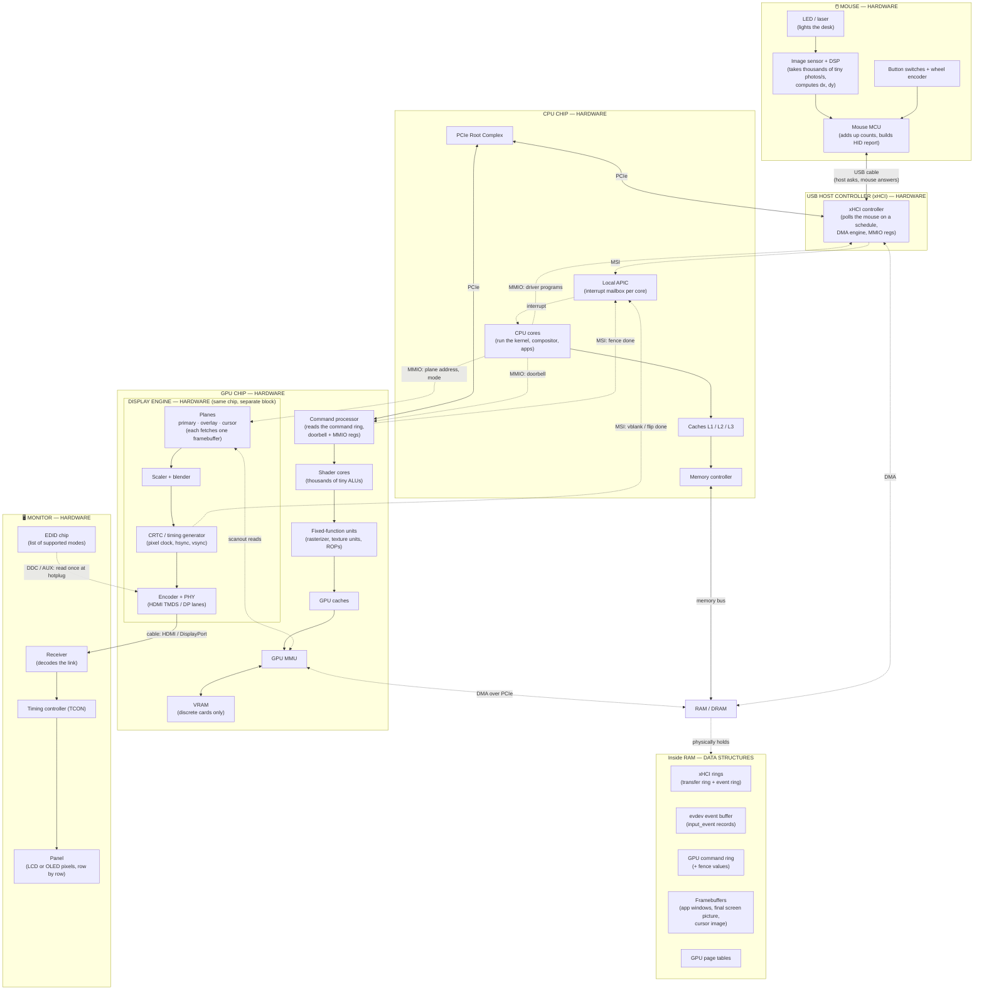
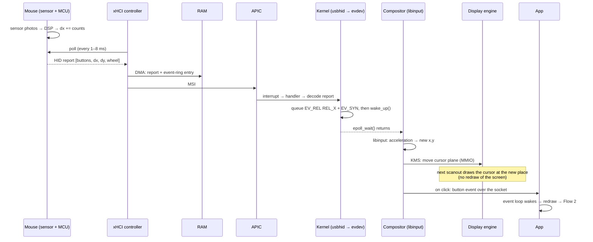
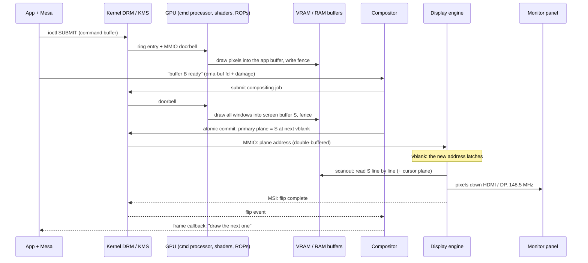
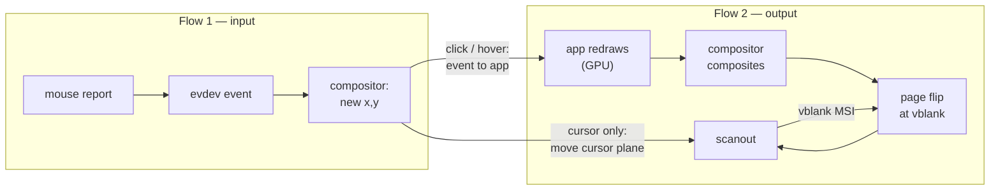

# 🗺️ Chapter 01a — Architecture Short Notes: Mouse, GPU, Display
## One picture, two flows, for life

> **What this is:** a companion to [Chapter 01 — The Map](01_the_map.md). Chapter 01 told the stories with the **software** layers.
> These notes zoom into the **hardware**: the mouse, the GPU and the display. They show how those parts talk to the CPU, to RAM and to each other.
> **How to use it:** learn the **static map** first, as a shape. Then each flow is just a path *through that same map*. The box names stay the same everywhere.
> Every new word is explained where it first appears. Later chapters go deeper: mouse → Ch 11 · GPU → Ch 9 · display → Ch 8, 10, 15.

---

## THE STATIC MAP — memorise this shape



**Legend**
- **HARDWARE**: chips and wires. The mouse, xHCI, CPU, RAM, GPU, display engine, monitor.
- **DATA STRUCTURES**: bytes in ordinary RAM. Software sets their *format*; hardware reads or writes them *directly* (the xHCI rings, the GPU command ring, framebuffers).
- **Solid arrow** = data moves this way. **Dotted arrow** = a signal (interrupt), a configuration write (MMIO), or "this reads that".

**Five words you need before reading on** (from I/O Part 1; recap only):

| Word | = meaning |
|---|---|
| MMIO | Memory-mapped I/O: the CPU writes to an *address* that is really a device register, not RAM |
| DMA | A device reads or writes RAM by itself, without the CPU copying |
| ring + doorbell | A circular list of jobs in RAM; one MMIO write ("doorbell") tells the device "new jobs are there" |
| MSI | Message Signalled Interrupt: a device raises an interrupt by doing a small memory write to the APIC's address |
| polling | Asking again and again on a schedule. USB devices **never** speak first; the host polls them |

---

## THE STATIC MAP — every connection explained

### Group A — Inside the mouse
- **`LED → SENSOR`**: an optical mouse is a **tiny camera**. The LED (or laser) lights the desk. The image sensor takes very small photos (around 20×20 to 30×30 pixels) thousands of times per second.
  `DSP` = Digital Signal Processor, a small chip that does fast maths on those photos. It compares each photo with the previous one, finds how far the texture moved, and outputs **dx, dy** in sensor counts.
- **`CPI`** = counts per inch: how many counts the sensor reports per inch of movement (e.g. 800, 1600). Higher CPI = more counts for the same hand movement.
- **`BTN → MCU`**: buttons are plain switches. Switches "bounce" (flicker on/off for a few milliseconds), so the MCU **debounces** them = waits until the signal is stable.
  The wheel is a small encoder that gives "one step up / one step down".
- **`MCU`** = microcontroller, a tiny computer inside the mouse. It **adds up** all dx/dy since the last time the host asked, and packs everything into a **HID report**.

> 🔑 The mouse never knows *where* the pointer is. It only knows **how much it moved** since the last report. Position is a software idea (the compositor keeps it).

### Group B — Mouse → USB host controller
- **`MCU <--> XHCI`** (USB cable): `xHCI` = eXtensible Host Controller Interface, the standard USB controller chip in every modern PC.
  The mouse has an **interrupt endpoint** = a small mailbox that the host checks on a fixed schedule.
  The schedule comes from the mouse itself: plain mice ask for 8 ms (125 Hz), gaming mice for 1 ms (1000 Hz) or faster.
- If nothing moved, the mouse answers "nothing new" (a NAK) and no report is sent. The host asks again next time.
- **`XHCI <-.DMA.-> RAM`**: the report bytes go into a buffer in RAM. The xHCI controller writes them itself (DMA). It also writes a small "transfer done" note into its **event ring** in RAM.
- **`XHCI -.MSI.-> APIC`**: then it interrupts the CPU.

### Group C — The CPU side (shared by both flows)
- **`APIC -.interrupt.-> CORE`**: the core stops what it is doing and jumps to the right handler, through the IDT (the "vector number → handler address" table).
  The handler is short and the real work happens just after it. *(Same chain as I/O Flow 3: ISR → softirq → `wake_up()` → scheduler.)*
- **`CORE --> CACHE --> MC <--> RAM`**: everything the CPU reads or writes, including evdev events, compositor state and CPU-drawn pixels, goes through the caches to RAM.
- **`RC`** (Root Complex) = where the PCIe links join the CPU. Both the xHCI controller and the GPU hang off it.

### Group D — The GPU (the drawing part)
- **`CORE -.MMIO: doorbell.-> GPUFE`**: the kernel's GPU driver writes a batch of GPU commands into the **command ring** in RAM. Then one MMIO write, the doorbell, says "go".
- **`GPUFE`** = the GPU's front end, or command processor. It fetches commands by DMA and hands out work.
- **`SHADER`** = shader cores: thousands of very simple ALUs that all run the **same small program** on many pixels or vertices at once. This is why a GPU is fast at pictures: every pixel is an independent little job.
- **`FIXED`** = fixed-function units, hardware built for one job each:
  - `rasterizer` = turns triangles into a list of pixels to colour;
  - `texture unit` = reads and filters images;
  - `ROP` (render output unit) = writes and blends final pixels into the target buffer.
- **`GMMU`** = the GPU's own MMU. GPU programs use **GPU virtual addresses**; GPU page tables (in RAM) map them to VRAM or system RAM. It is the same idea as the CPU MMU, but owned by the GPU driver.
- **`VRAM`** = the card's own fast memory (GDDR). **Integrated GPUs** (most laptops) have no VRAM; they use system RAM through the same memory controller as the CPU.
- **`GPUFE -.MSI: fence done.-> APIC`**: when a batch finishes, the GPU writes a **fence** value (a sequence number) to memory and can raise an interrupt. "Fence 1042 reached" = "the jobs up to 1042 are done".

### Group E — The display engine (the showing part)
The display engine sits on the **same chip** as the GPU, but it is a **separate block** with a separate job. The GPU *draws* into buffers; the display engine *reads* a buffer and sends it to the cable. They never need to run at the same time.

- **`PLANES`**: a **plane** is a hardware layer. Each plane points at one framebuffer in memory. Common planes:
  - `primary` = the full-screen picture;
  - `overlay` = an extra layer, e.g. a video;
  - `cursor` = a small image (often 64×64) that the hardware draws **on top**, at an x,y position.
- **`BLEND`**: it scales each plane and stacks them into one stream of pixels. This stacking happens **while scanning out**, with no extra buffer.
- **`CRTC`** = the timing generator (the name is old, from "cathode ray tube controller"). It produces the **pixel clock** and decides when each line and frame starts. At 1080p60 it runs at 148.5 MHz.
- **`ENC` + PHY**: the encoder turns pixels into the link format, HDMI (`TMDS` signalling) or DisplayPort (packet lanes). The `PHY` is the analogue circuit that drives the wires.
- **`CORE -.MMIO.-> PLANES`**: the driver writes "plane address = buffer X", the mode and the cursor position into display-engine registers.
  These registers are **double-buffered**: a new value waits and only takes effect at the next **vblank**. *This is how a page flip avoids tearing.*
- **`CRTC -.MSI: vblank / flip done.-> APIC`**: at each vblank the display engine can interrupt the CPU: "a new frame starts; your flip happened".

### Group F — Cable and monitor
- **`ENC → MONRX`**: the bits travel down the cable, line after line, at the exact speed the CRTC sets.
- **`TCON`** = timing controller inside the monitor. It takes the pixel stream and drives the panel's row and column drivers.
- **`PANEL`**: LCD (liquid crystals in front of a backlight) or OLED (each pixel makes its own light). The panel updates top to bottom, like the scanout.
- **`EDIDROM -.DDC/AUX.-> ENC`**: when you plug in a monitor, a **hotplug** pin changes and the display engine interrupts the CPU.
  The driver then reads the monitor's **EDID** = "my name, my sizes, my supported modes". It uses `DDC` (a slow I²C side channel) on HDMI, or the `AUX` channel on DisplayPort.

**The one-paragraph summary:** there are **two roads into RAM** (the CPU's memory controller, and DMA over PCIe) and **three devices** that use DMA: the xHCI controller writes mouse reports, the GPU reads commands and writes pixels, and the display engine reads pixels.
All three report back the same way: an **MSI to the APIC**. All three are controlled the same way: **MMIO writes from the driver**. Learn those three verbs (**DMA, MSI, MMIO**) and every arrow on the map is one of them.

---

## FLOW 1 — "I move the mouse 1 cm to the right, and click"

**Goal:** the cursor moves across the screen, and the button under it gets the click.
**Rule to hold onto:** the mouse reports *motion*, the kernel reports *events*, and only the compositor knows *position*.

### Step 1 — The sensor sees the desk move *(mouse hardware)*
```
LED lights the desk → sensor photo N, photo N+1, … (thousands per second)
DSP compares neighbouring photos → "texture moved +3 counts in x, 0 in y"
1 cm at 800 CPI ≈ 315 counts (800 per inch ÷ 2.54 cm)
MCU adds up counts until the host asks: dx = +42, dy = 0 (since the last poll)
```

### Step 2 — The host asks; the mouse answers *(USB)*
```
every 1 ms (1000 Hz mouse) or 8 ms (125 Hz mouse):
  xHCI → mouse:  "anything new?"     (IN token on the interrupt endpoint)
  mouse → xHCI:  HID report          e.g. [buttons=0x00][dx=+42][dy=0][wheel=0]
  (nothing moved? the mouse answers NAK and no data is sent)
```
`HID report descriptor` = a small "format sheet" the mouse sends **once** when plugged in. It says which bits are buttons and how many bytes dx and dy use. The kernel reads it, so every mouse can use its own layout.

### Step 3 — DMA + interrupt *(xHCI → RAM → CPU)*
```
xHCI DMA-writes the report into a buffer in RAM
xHCI DMA-writes an "event: transfer complete" entry into its event ring
xHCI sends an MSI → Local APIC → CPU jumps through the IDT → xhci interrupt handler
```

### Step 4 — The kernel turns bytes into events *(drivers: xhci_hcd → usbhid → hid-input → evdev)*
```
xhci_hcd: "this transfer finished" → calls the USB HID driver
usbhid + hid-input: use the report descriptor to decode → "REL_X +42"
input core → evdev queues three 24-byte input_event records:
    EV_REL  REL_X       +42
    EV_REL  REL_Y        0     (only sent if non-zero; omitted here)
    EV_SYN  SYN_REPORT   0     ← "end of this packet"
evdev wakes everyone waiting on /dev/input/eventN (wait queue → wake_up())
```
Values (from `linux/input-event-codes.h`): `EV_REL = 0x02`, `REL_X = 0x00`, `REL_Y = 0x01`, `REL_WHEEL = 0x08`, `EV_KEY = 0x01`, `BTN_LEFT = 0x110` (272).

### Step 5 — The compositor wakes and computes the new position *(libinput + compositor)*
```
compositor's epoll_wait() returns: /dev/input/eventN is readable
libinput reads the events, applies POINTER ACCELERATION:
    slow hand → small multiplier (precise); fast hand → bigger multiplier (travel far)
    → POINTER_MOTION dx = +51.3 (fractional, after acceleration)
compositor: cursor_x = clamp(cursor_x + 51.3, 0, 1919)   ← POSITION exists only here
compositor: which window is under (cursor_x, cursor_y)? → the "pointer focus"
```

### Step 6 — The cursor moves on screen: the cheap path *(display engine)*
The compositor does **not** redraw the screen to move the cursor. It moves the **cursor plane**:
```
compositor → kernel (KMS): "cursor plane: x = 851, y = 400"     (one ioctl)
driver → display engine: MMIO write to the cursor-position register
display engine: at the next frame, while scanning out, it draws the 64×64 cursor image
                on top of the primary plane at the new place
```
The picture underneath is **not touched**. That's why the cursor can stay smooth even when an app is slow.
(If the hardware has no cursor plane, the compositor uses a **software cursor**: it draws the cursor into the screen picture itself, which costs a whole recomposite, i.e. Flow 2.)

### Step 7 — The click *(same road, different event)*
```
switch closes → MCU debounces → next poll: report [buttons=0x01][dx=0][dy=0]
xHCI DMA + MSI → kernel → evdev: EV_KEY BTN_LEFT 1, EV_SYN
libinput → POINTER_BUTTON pressed
compositor: the button goes to the window under the cursor
            (it may also raise that window and give it keyboard focus)
compositor → app over the Unix socket:  wl_pointer.button  (Wayland)  /  ButtonPress  (X11)
app's event loop wakes → "the OK button was clicked" → the app must redraw → FLOW 2
```



### Worked numbers — how long until the cursor *visibly* moves?

| Stage | Typical time | Why |
|---|---|---|
| Sensor + MCU | well under 1 ms | thousands of photos per second |
| Waiting for the next USB poll | 0–1 ms (1000 Hz) or 0–8 ms (125 Hz) | the mouse cannot speak first |
| DMA + interrupt + kernel + evdev | tens of µs | all in RAM and CPU |
| Compositor wakes, libinput, cursor ioctl | tens to hundreds of µs | depends on how busy the compositor is |
| Waiting for the next frame | 0–16.7 ms at 60 Hz | a new cursor position only shows when the next frame starts |
| Scanout down to the cursor's row | 0–16.7 ms | the panel is drawn top to bottom |

*These are rough sizes for orientation, not measurements. My sandbox has no mouse or screen (📖 explained only). Chapter 30 measures a real timeline.*
**Lesson:** the screen's refresh, not the CPU, is usually the biggest wait.

---

## FLOW 2 — "One frame appears" (GPU draws, display engine shows)

**Goal:** after the click, the app's new picture reaches the glass.
**Rule to hold onto:** the GPU **writes** pictures into memory. The display engine **reads** one picture from memory. They meet only at a **buffer**, and a **page flip** decides which buffer is shown.

### Step 1 — The app builds GPU work *(CPU, user space)*
```
app (via its toolkit) → OpenGL / Vulkan calls: "draw these triangles with this texture"
Mesa (user-space driver) turns the calls into the GPU's OWN command format
and compiles small "shader" programs for the shader cores
Result: a command buffer in memory, plus the buffers it reads and writes
```

### Step 2 — Submit: ring + doorbell *(kernel DRM driver → GPU)*
```
app → ioctl(/dev/dri/renderD128, SUBMIT, command buffer)
kernel DRM driver: checks the buffers, makes sure the GPU page tables map them,
                   puts a "run this batch" entry on the GPU's command ring,
                   then ONE MMIO write: the doorbell
the ioctl returns at once; the CPU does not wait for the GPU
```

### Step 3 — The GPU draws *(GPU hardware, no CPU involved)*
```
command processor fetches the batch (DMA)
vertex shaders run on shader cores    → move the triangles to screen positions
rasterizer                            → which pixels does each triangle cover?
fragment shaders + texture units      → colour of each pixel
ROPs                                  → write and blend the pixels into the app's buffer
                                        (in VRAM on a discrete card, or system RAM on an integrated one)
at the end: write the FENCE value to memory, and raise an MSI if asked
```
`fence` = "is the GPU done with this yet?" Nobody may *show* the buffer before its fence is reached, or you'd see a half-drawn picture.

### Step 4 — The app hands the buffer to the compositor *(by handle, not by copy)*
```
app → compositor over the socket: "my new picture is in buffer B" (a dma-buf fd; Chapter 01 Demo C)
     + "it changed only in this rectangle" (damage)
nothing is copied: the compositor and the GPU see the SAME memory
```

### Step 5 — The compositor makes the screen picture *(GPU again, or a plane)*
Two ways:
- **Usual way, compositing:** the compositor itself submits GPU work. It draws every window's buffer, at its position and with shadows, into **one full-screen buffer S**. Then it waits for that fence. *(Steps 2–3 again, from the compositor.)*
- **Fast way, direct scanout:** if one app fills the whole screen (a game, a full-screen video), the compositor skips drawing. It points the **primary plane** straight at the app's buffer. Overlay planes can do the same for a video in a window. No GPU work at all.

### Step 6 — Page flip at vblank *(kernel KMS → display engine registers)*
```
compositor → KMS (atomic commit): "primary plane = buffer S, at the next vblank"
driver → display engine: MMIO write of S's address into the plane's DOUBLE-BUFFERED register
the display engine keeps scanning the OLD buffer until this frame ends…
…vblank: the hardware latches the new address → the next frame reads S
display engine → MSI → kernel → "flip complete" event → compositor wakes
```
A flip is **one address change**, not a copy of 8.3 MB. Because it happens in vblank, no frame shows half old and half new, so there is **no tearing**.

### Step 7 — Scanout *(display engine → cable → panel)*
```
for each of the 1125 lines (1080 visible + 45 blanking):
    each plane DMA-reads its part of the line from memory (primary S + cursor)
    blender stacks them (cursor on top) → encoder → PHY → cable
    1 line = 2200 pixel-clock ticks = 14.8 µs at 148.5 MHz
monitor receiver → TCON → panel rows light up top to bottom
the 45 blank lines = vblank ≈ 667 µs → the next flip can land here
```

### Step 8 — The loop closes
```
compositor got "flip complete" → tells each app whose buffer was used:
    "frame done, draw the next one now"   (Wayland frame callback)
the old buffer S' is free again → it will be the drawing target for the next frame
```
That is **double buffering**: one buffer is being shown, one is being drawn. They swap at every flip.



### Worked numbers — 1080p at 60 Hz

| Quantity | Value | How |
|---|---|---|
| Total slots per frame | 2200 × 1125 | 1920 + 280 blank columns, 1080 + 45 blank lines (CEA-861 timing) |
| Pixel clock | **148.5 MHz** | 2200 × 1125 × 60 |
| One line | 14.8 µs | 2200 ÷ 148.5 MHz |
| One frame | 16.67 ms | 1 ÷ 60 |
| vblank | **≈ 667 µs** | 45 lines × 14.8 µs |
| Visible share | 83.8 % | 1920·1080 ÷ (2200·1125) |
| One XRGB8888 frame | 8.29 MB | 1920 × 1080 × 4 bytes |
| Scanout memory traffic | ≈ 0.50 GB/s | 8.29 MB × 60, for the primary plane alone |
| 64×64 cursor image | 16 KB | 64 × 64 × 4 bytes |

✅ *These are arithmetic I checked by running it. They are not measurements of real hardware.*

---

## HOW THE TWO FLOWS MEET



| Meeting point | What connects them | Why it matters |
|---|---|---|
| **Cursor plane** | Flow 1 changes one register; Flow 2's scanout draws the cursor | The cursor moves without redrawing anything; it stays smooth even when apps are slow |
| **Click → redraw** | Flow 1's last hop starts Flow 2's first hop | The "input-to-photon" delay = Flow 1 + Flow 2 |
| **vblank** | The display engine's clock drives the compositor's loop | Input that arrives just *after* a flip waits almost a whole frame |
| **Same RAM, same interrupts** | xHCI, GPU and display engine all DMA into RAM and MSI the APIC | One memory system, one interrupt system, three devices |

---

## ⚠️ Common confusions

| ❌ Wrong idea | ✅ Right idea |
|---|---|
| "The mouse sends its position." | It sends **movement since the last poll**. Position lives in the compositor. |
| "The mouse interrupts the CPU." | The mouse can't. The **xHCI controller** polls it, then the xHCI interrupts the CPU. |
| "The GPU sends pictures to the monitor." | The **display engine** does that, a separate block that *reads* memory. The GPU only *draws* into memory. |
| "Moving the cursor redraws the screen." | Not with a hardware cursor plane: one position register changes. |
| "Page flip = copying the new picture to the screen." | A flip changes **one address**, which takes effect at vblank. Nothing is copied. |
| "Integrated graphics has no GPU." | It has a full GPU and display engine on the CPU chip. It uses system RAM instead of VRAM. |
| "Higher mouse CPI = faster computer response." | CPI is *resolution* (counts per inch). Delay comes from the polling rate and the refresh rate. |

---

## ✅ Check yourself

**1.** Name the three devices on the map that use DMA, and what each one reads or writes.
<details><summary>Answer</summary>xHCI: writes mouse reports + event-ring entries into RAM. GPU: reads the command ring and textures, writes pixels and fences. Display engine: reads framebuffers (primary, overlay, cursor) for scanout.</details>

**2.** Why can a cursor stay smooth while the app under it is frozen?
<details><summary>Answer</summary>The compositor moves the hardware cursor plane (one register write). The display engine draws the cursor on top during scanout. The app's buffer is not needed at all.</details>

**3.** A 125 Hz mouse on a 60 Hz screen: what is the worst-case wait from these two clocks alone?
<details><summary>Answer</summary>Up to 8 ms waiting for the poll + up to 16.7 ms waiting for the next frame ≈ 24.7 ms, before scanout even reaches the cursor's row.</details>

**4.** What stops the display engine from showing a half-drawn GPU picture?
<details><summary>Answer</summary>The fence: the compositor (or the kernel, for implicit sync) waits until the GPU reaches the buffer's fence value before flipping to it. The flip itself only latches at vblank.</details>

**5.** What is EDID, and when is it read?
<details><summary>Answer</summary>The monitor's description of itself (name, size, supported modes). It is read over DDC (HDMI) or AUX (DisplayPort) when the monitor is plugged in (hotplug) or at boot.</details>

**6. ✏️ Draw it.** On a blank page, draw: mouse → xHCI → RAM ← GPU, with the display engine reading RAM → monitor. Add the APIC and draw the **three MSI arrows** into it. Then trace Flow 1 in one colour and Flow 2 in another.
<details><summary>Compare</summary>Your drawing should match the static map at the top. Check you have: three MSI arrows (xHCI, GPU fence, display vblank), and three MMIO arrows from the CPU (xHCI, GPU doorbell, plane registers).</details>

---

## Quick-reference summary

| Flow | Hardware involved | Who starts it | How "done" is reported | Key ideas |
|---|---|---|---|---|
| **1. Mouse → cursor** | sensor + MCU → xHCI → RAM → CPU → display engine (cursor plane) | the **host's poll** (every 1–8 ms) | xHCI **MSI** → evdev `wake_up()` → compositor `epoll` | relative motion, HID report, DMA + MSI, `EV_REL`, acceleration, cursor plane |
| **2. One frame** | CPU (Mesa) → GPU (ring, shaders, ROPs) → memory → display engine → cable → panel | the app (after input, or an animation) | GPU **fence** MSI, then display-engine **vblank/flip** MSI | command ring + doorbell, fence, dma-buf handle, compositing or direct scanout, page flip at vblank, scanout timing |

> 🔗 **Back to:** [Chapter 01 — The Map](01_the_map.md) · **Deeper later:** Ch 8 (displays, EDID, timings) · Ch 9 (inside a GPU) · Ch 10 (tearing, double buffering) · Ch 11 (input hardware) · Ch 15–16 (KMS, planes)
