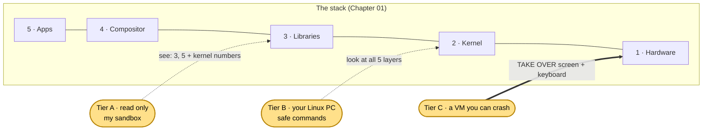
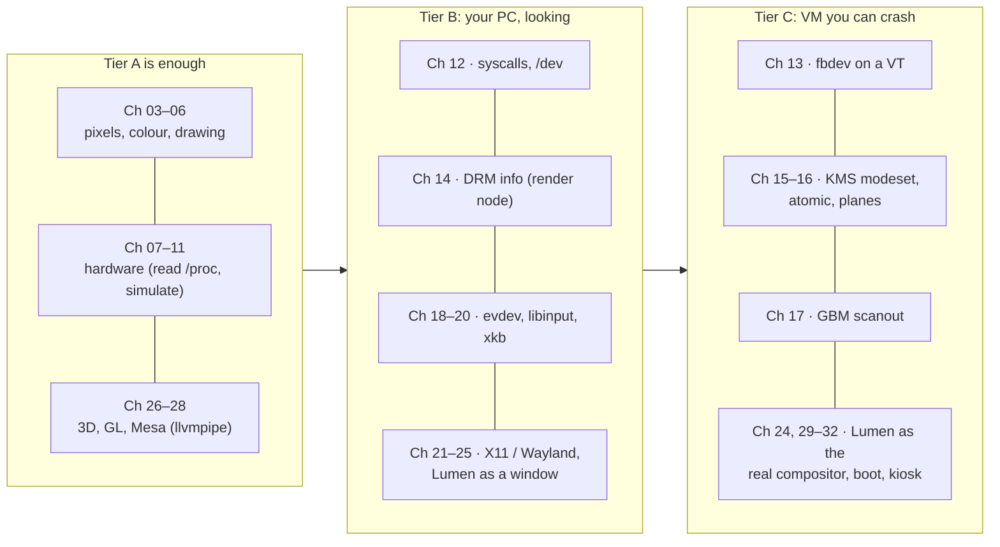
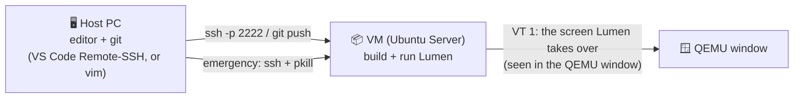
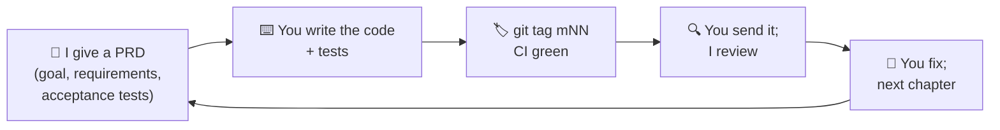
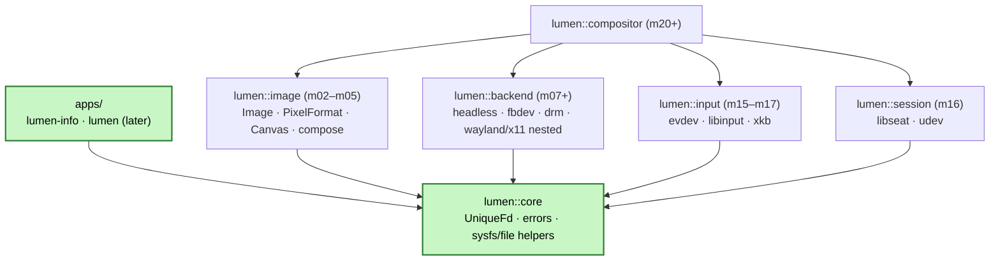

# 🧙 Graphics Chapter 02 — Lab Setup (3 Tiers) + Project Kickoff
## Your workbench, your safety net, and the first brick of Lumen

> **Series:** Linux Graphics & Input · **Chapter 02 of 32** · 🔹 deep (skills) · ≈ 60 minutes to read, a weekend for the milestone
> **Before this:** [Chapter 01 — The Map](01_the_map.md) and [01a — Architecture notes](01a_architecture_notes.md).
> **After this:** you know which machine to use for each chapter, how not to lock yourself out of your own PC, and you start **Lumen m01**: the repository, the `lumen::core` library and the `lumen-info` tool.

---

## 📍 You are here

This chapter adds no new layer. It builds the **workbench around the stack**: three lab tiers, and each tier lets you reach deeper layers.



---

## 🔁 Quick recall

**1.** The kernel sends `KEY_A = 30`. In X11 the app gets keycode 38. Why the difference, and where does the letter "a" come from?
<details><summary>Answer</summary>X keycodes are evdev codes + 8 (an old X rule: keycodes start at 8). The letter comes from the keymap: xkbcommon in Wayland, or the X server's keyboard mapping in X11 (Demo B in Chapter 01 asked <code>GetKeyboardMapping</code>).</details>

**2.** In Chapter 01 Demo C, how many bytes went through the socket, and how big was the picture?
<details><summary>Answer</summary>12 bytes (+ 1 fd via <code>SCM_RIGHTS</code>). The picture was 1,228,800 bytes and was never copied: both processes mapped the same memory.</details>

**3.** Which three hardware blocks on the 01a map use DMA, and how does each one say "done"?
<details><summary>Answer</summary>xHCI (USB controller), the GPU, and the display engine. Each one sends an MSI to the Local APIC: transfer complete, fence reached, and vblank / flip done.</details>

---

## 💡 The idea in one sentence

> **Look anywhere, but only take over the screen and keyboard inside a machine you are allowed to break —
> and build Lumen so that every piece can be tested on a machine with no screen at all.**

---

## 🧒 The easy version: learning to cook

| Kitchen | Lab tier | What you may do |
|---|---|---|
| **Watching a cooking show** | **Tier A** — I run things in my sandbox and show you the output | Learn the steps. Nothing can burn. But it's not your kitchen. |
| **Walking around your home kitchen** | **Tier B** — your own Linux PC, read-only commands | Open the fridge, read the labels on the stove (`/sys`, `/dev`, `libinput list-devices`). Don't turn anything on. |
| **A practice kitchen you rent** | **Tier C** — a virtual machine (VM) | Turn on every burner. If it catches fire, throw the kitchen away and get a new one in 2 minutes. |

Why not just cook in your home kitchen? Because in Chapters 13–16 your program will **take the screen away from your desktop**. If it crashes in the middle, you may be left with a black screen and a keyboard that types nowhere. On your main PC that means a forced reboot and maybe lost work. In a VM it means closing a window.

---

## 🔍 What really happens, step by step

### 1. The three tiers in detail

| | Tier A · Read-only | Tier B · Your Linux PC, safe commands | Tier C · A VM you can crash |
|---|---|---|---|
| **You need** | Nothing | Any Ubuntu 24.04 desktop (or another distro) | QEMU + an Ubuntu **Server** 24.04 VM, no desktop installed |
| **Who runs it** | Me, in my sandbox | You | You |
| **Can touch real hardware?** | No (no GPU, screen, keyboard or mouse here) | Yes, but **looking only** | Virtual hardware (virtio GPU, USB keyboard and tablet) |
| **Can take over the screen?** | No | ❌ **No** — your desktop owns it | ✅ Yes — that's the point |
| **Typical commands** | anything I show as ✅ | `ls /dev/dri`, `cat /sys/class/drm/*/status`, `libinput list-devices`, `WAYLAND_DEBUG=1 app` | `sudo lumen --backend=drm` on a text console |
| **If it breaks** | Nothing happens to you | Very unlikely, since you only read | Close the VM, or restore a snapshot |

New words:
- `VM` = virtual machine: a whole pretend computer running as a program on your real one.
- `QEMU` = the open-source program that runs VMs on Linux. With **KVM** (the kernel's VM accelerator) it runs at near-native speed.
- `virtio` = a family of simple *pretend* devices made for VMs: virtio-gpu, virtio-net, virtio-keyboard. The guest kernel has real drivers for them.
- `snapshot` = a saved copy of the VM's disk state. You can jump back to it in seconds.

### 2. Which tier for which chapter



> 🔑 **Rule of thumb:** if a program opens `/dev/dri/card*` and *sets a mode*, or reads `/dev/input/event*` **exclusively**, it belongs in Tier C.
> Reading `/sys`, `/proc`, or a GPU **render node** (`/dev/dri/renderD128`) is Tier B.

### 3. Why "taking over the screen" is dangerous (and how to stay safe)

When you sit at a Linux desktop, one program is the **DRM master** (`DRM master` = the one process allowed to change what the screen shows). That is your compositor (gnome-shell, kwin_wayland, …).
A second program can't change the mode while the compositor holds that role. So Lumen's KMS backend must run where **nothing else** owns the screen: a text console (VT) with no desktop on it.

```mermaid
sequenceDiagram
    participant You
    participant VT as Text console (VT 3)
    participant L as Lumen (DRM master)
    participant K as Kernel
    participant SSH as SSH from your host
    You->>VT: log in, run sudo lumen --backend=drm
    VT->>L: start
    L->>K: become DRM master, set mode, grab keyboard
    Note over L,K: the screen now shows Lumen; keys go to Lumen
    L--)L: bug: infinite loop / crash with keyboard still grabbed
    You->>SSH: ssh lumen-vm "sudo pkill -9 lumen"
    SSH->>K: process killed → kernel drops master, frees keyboard
    K-->>VT: text console comes back
```

**Your safety net in Tier C (set it up before Chapter 13):**

| Safety net | How | Saves you when… |
|---|---|---|
| **SSH into the VM** | port-forward 2222 → 22 (commands below) | the VM's screen and keyboard are both stuck |
| **A watchdog timeout** | `timeout 20s sudo ./lumen …` | your program never exits |
| **Magic SysRq** | `sudo sysctl kernel.sysrq=1` in the VM; then Alt+SysRq+R ("unRaw" = take the keyboard back), Alt+SysRq+K (kill everything on this console) | a program grabbed the keyboard. Ubuntu enables only some SysRq keys by default, so turn them on inside the VM only. |
| **VM snapshot** | `qemu-img snapshot -c clean lumen-vm.qcow2` | you broke the VM's setup |
| **VT switch** | Ctrl+Alt+F2 … F6 | normally works, unless a crashed program still holds the keyboard |

### 4. Device permissions: who may open what

On Ubuntu, device files belong to groups:

| Device file | Owner group | What it allows | Join it? |
|---|---|---|---|
| `/dev/dri/card0` | `video` | screens (KMS) + GPU | Not needed. logind gives the active session access through ACLs |
| `/dev/dri/renderD128` | `render` | GPU drawing only, no screen control | Usually already allowed for desktop users |
| `/dev/input/event*` | `input` | **every** key you type, including passwords | ⚠️ **Only inside the VM.** On your main PC, any program you run could read every key you type. Use `sudo` for single commands instead |

`ACL` = Access Control List: extra per-user permissions on a file. logind uses them to say "the person at this seat may use this device right now". That's Chapter 19.

### 5. Setting up Tier C (📖 commands for your machine)

I can't boot a VM here: my sandbox has no `/dev/kvm`, and I can't download an install image. So this part is 📖 explained only.
What I *can* show (Demo C below) is that QEMU really offers the virtual GPU, keyboard and mouse devices we'll use.

```bash
# --- on your Linux host (Tier B) ---
sudo apt install qemu-system-x86 qemu-utils ovmf
ls -l /dev/kvm                       # must exist, or the VM will be ~10-50x slower
qemu-img create -f qcow2 lumen-vm.qcow2 25G

# first boot: install Ubuntu Server 24.04 from the ISO (choose "OpenSSH server"; NO desktop)
qemu-system-x86_64 -enable-kvm -cpu host -smp 4 -m 4G \
  -drive file=lumen-vm.qcow2,if=virtio \
  -cdrom ubuntu-24.04-live-server-amd64.iso \
  -device virtio-vga \
  -device qemu-xhci -device usb-kbd -device usb-tablet \
  -nic user,model=virtio-net-pci,hostfwd=tcp::2222-:22 \
  -display gtk

# every later boot: same command without -cdrom. Then from the host:
ssh -p 2222 you@localhost
```

| Flag | Plain meaning |
|---|---|
| `-enable-kvm -cpu host` | Use the real CPU at full speed |
| `-device virtio-vga` | A virtual GPU + display. In the guest: `/dev/dri/card0`, driver `virtio_gpu` |
| `-device qemu-xhci -device usb-kbd -device usb-tablet` | A virtual **USB controller** with a USB keyboard and a tablet (an absolute pointer, which feels better in a VM window than `usb-mouse`) |
| `-nic user,…hostfwd=tcp::2222-:22` | Networking, plus "port 2222 on the host goes to SSH in the guest" |
| `-display gtk` | Show the VM's screen in a window on your desktop |

Inside the VM, after installing:
```bash
sudo apt install build-essential cmake ninja-build git pkg-config \
     libdrm-dev libudev-dev libinput-dev libxkbcommon-dev catch2 \
     drm-info libdrm-tests evtest clang-format clang-tidy
ls /dev/dri                          # card0 (+ renderD128 if 3D is enabled)
cat /sys/class/drm/card0-*/status    # Virtual-1: connected
drm_info | head -30                  # the whole KMS picture, read-only
sudo modprobe vkms                   # an extra FAKE display device, no window; great for tests (Ch 16)
                                     # (on some Ubuntu kernels vkms is in linux-modules-extra-$(uname -r))
```

> 💻 **Only Windows or macOS?** Then a VM is your Tier B **and** Tier C. Use VirtualBox / VMware on Windows, or UTM on macOS (on Apple Silicon you get an ARM64 Ubuntu; everything in this series still works).
> WSL2 is fine for Tier A and for compiling, but it has no real KMS and no evdev keyboard, so it can't do Tier C.

### 6. The SSH workflow (Tier C, day to day)



- **Edit** on the host. **Build and run** in the VM (`ssh`, then `cmake --build build && sudo ./build/apps/lumen …`).
- Keep **one SSH terminal** always open as your emergency exit.
- The QEMU window *is* the VM's monitor. Lumen draws there.

### 7. The project: what Lumen is, and how we work

`Lumen` = a display engine and Wayland compositor in C++20 that you build across this series. Finish lines: 🥉 Lumen-Core (Ch 18) · 🥈 Lumen-Compositor (Ch 24–25) · 🥇 Lumen v1.0 (Ch 32).

**How we work:**



**The shape Lumen will grow into** (this is the plan, not code to copy; only the green part is m01):



---

## 🧪 Predict, then see

My sandbox for these demos: Ubuntu 24.04.5 in a cloud VM (Linux 6.18, 2 vCPUs, 7.8 GB RAM), running as root, with **no GPU, screen, keyboard or mouse**. I installed the same packages you'll install.

### Demo A ✅ — "Does my toolchain match the series?"

**🤔 Predict:** which C++ compiler and CMake version does Ubuntu 24.04 ship? Is Catch2 version 2 or 3?

<details><summary>Reveal the real output</summary>

```
g++ (Ubuntu 13.3.0-6ubuntu2~24.04.1) 13.3.0
cmake version 3.28.3
ninja 1.11.1
git version 2.43.0
Ubuntu clang-format version 18.1.3 (1ubuntu1)
Ubuntu LLVM version 18.1.3   (clang-tidy)
catch2 3.4.0   (package: 3.4.0-1build1)
libdrm 2.4.125
libudev 255
QEMU emulator version 8.2.2
```
</details>

**What it shows:** this is the **reference toolchain** for every PRD. GCC 13 has almost all of C++20 (concepts, ranges, `std::span`, `std::format`). It lacks a few C++23 bits: in Chapter 01, `std::string_view::contains` failed to compile. Catch2 is **v3**: include `<catch2/catch_test_macros.hpp>` and link `Catch2::Catch2WithMain`. Old v2 tutorials use a single `catch.hpp`, which is the wrong one.

Run the same check on your machine:
```bash
g++ --version | head -1; cmake --version | head -1; ninja --version
pkg-config --modversion libdrm libudev catch2-with-main
```

### Demo B ✅ — "What will `lumen-info` see on a machine with no screen?"

Your m01 tool must work **everywhere**, including CI servers and my sandbox, which have no GPU. So first let's look at what the existing tools say here.

**🤔 Predict:** `drm_info` and `modetest` are the standard "show me the display hardware" tools. On a machine with no GPU, will they print an empty list, or fail?

<details><summary>Reveal the real output</summary>

```
$ drm_info
drmGetDevices: No such file or directory

$ modetest
drmGetDevices2() failed with Unknown error -2

$ ls /sys/class/drm /sys/class/input
ls: cannot access '/sys/class/drm': No such file or directory
/sys/class/input:
```
</details>

**What it shows:**
- Both tools **fail** instead of saying "0 devices". `modetest` even prints `Unknown error -2`. That's the raw `-ENOENT`, not turned into words. **Lumen will do better**: "no DRM devices found" and exit code 0.
- `/sys/class/drm` doesn't exist at all (the kernel has no DRM driver loaded). `/sys/class/input` exists but is empty. Your parser must handle **both** "missing" and "empty".
- `error -2` = `ENOENT` = "No such file or directory". Errors in the kernel and libdrm are negative errno numbers. Lumen will always carry the errno inside a `std::system_error`, so it can print the words (next demo).

### Demo C ✅ — "Does QEMU really offer the virtual devices for Tier C?"

I asked QEMU for its device list and filtered for display and input devices:

```bash
qemu-system-x86_64 -device help | grep -E 'virtio-gpu|virtio-vga|bochs|xhci|usb-kbd|usb-mouse|usb-tablet|virtio-(keyboard|mouse|tablet)'
```

**🤔 Predict:** will a VM keyboard be a "USB keyboard" (like Chapter 01a's mouse path), or something else?

<details><summary>Reveal the real output</summary>

```
name "qemu-xhci", bus PCI
name "usb-kbd", bus usb-bus
name "usb-mouse", bus usb-bus
name "usb-tablet", bus usb-bus
name "virtio-keyboard-pci", bus PCI, alias "virtio-keyboard"
name "virtio-mouse-pci", bus PCI, alias "virtio-mouse"
name "virtio-tablet-pci", bus PCI, alias "virtio-tablet"
name "bochs-display", bus PCI
name "virtio-gpu-pci", bus PCI, alias "virtio-gpu"
name "virtio-vga", bus PCI
```
</details>

**What it shows:** both kinds exist.
- `qemu-xhci` + `usb-kbd` / `usb-tablet` = a **pretend USB controller with pretend USB devices**. The guest kernel runs the *real* xhci → usbhid → evdev path from 01a Flow 1. That's why I chose them for your VM: you'll see real HID reports.
- `virtio-keyboard` = a shortcut device with no USB: the events go straight into the guest's evdev. Faster, but it skips the hops we want to study.
- `virtio-gpu` / `virtio-vga` = a pretend GPU **with a display engine**. In the guest it shows up as `/dev/dri/card0` with real KMS (connectors, CRTCs, planes, page flips). `bochs-display` is a simpler one with KMS but no 3D.

### Demo D ✅ — "What happens to file descriptors when something throws?"

`lumen::core` starts with one rule: **a file descriptor must never leak, and an error must never be silent.** Here is why.

**The API first:**

| Thing | Plain meaning |
|---|---|
| `open(path, O_RDONLY \| O_CLOEXEC)` | Open a file. Returns an fd ≥ 0, or −1 and sets `errno`. `O_CLOEXEC` = close it automatically if we later start another program |
| `std::system_error(errno, std::generic_category(), what)` | A C++ exception that **carries the errno number** and builds a message like `"what: No such file or directory"` |
| `e.code() == std::errc::no_such_file_or_directory` | Compare an error with a named constant, without magic numbers |
| `std::filesystem::directory_iterator("/proc/self/fd")` | List a directory. `/proc/self/fd` has one entry per open fd of *this* process |
| `[[maybe_unused]]` | "I know this variable isn't used; don't warn" (C++17) |
| a destructor (`~FdGuard()`) | Runs on **every** way out of a scope: normal return, `return` early, or an exception |

The program probes `/dev/null` 1000 times. Each probe opens the file and then "finds a problem" and throws. Version 1 keeps the fd in a plain `int`. Version 2 keeps it in a 3-line guard object.

📜 **`fd_leak.cpp`** — build: `g++ -std=c++20 -Wall -Wextra -O2 fd_leak.cpp -o fd_leak` · run: `./fd_leak`

```cpp
// fd_leak.cpp -- what happens to file descriptors when an error is thrown?
#include <fcntl.h>
#include <unistd.h>
#include <cerrno>
#include <cstdio>
#include <filesystem>
#include <stdexcept>
#include <system_error>

// Count this process's open fds by listing /proc/self/fd.
int open_fd_count() {
    int n = 0;
    for ([[maybe_unused]] auto& e : std::filesystem::directory_iterator("/proc/self/fd")) ++n;
    return n - 1;   // the directory listing itself holds one fd
}

// Version 1: a raw int. If anything throws between open() and close(), the fd is lost.
void probe_raw(const char* path) {
    int fd = ::open(path, O_RDONLY | O_CLOEXEC);
    if (fd < 0) throw std::system_error(errno, std::generic_category(), path);
    throw std::runtime_error("device is not what we expected");   // simulate a later failure
    ::close(fd);                                                    // never reached
}

// Version 2: the fd lives inside an object; its destructor closes it on ANY exit.
struct FdGuard {
    int fd;
    ~FdGuard() { if (fd >= 0) ::close(fd); }
};
void probe_guarded(const char* path) {
    FdGuard g{::open(path, O_RDONLY | O_CLOEXEC)};
    if (g.fd < 0) throw std::system_error(errno, std::generic_category(), path);
    throw std::runtime_error("device is not what we expected");
}

int main() {
    std::printf("open fds at start         : %d\n", open_fd_count());
    for (int i = 0; i < 1000; ++i) try { probe_raw("/dev/null"); } catch (const std::exception&) {}
    std::printf("after 1000 raw probes     : %d\n", open_fd_count());
    for (int i = 0; i < 1000; ++i) try { probe_guarded("/dev/null"); } catch (const std::exception&) {}
    std::printf("after 1000 guarded probes : %d\n", open_fd_count());

    try { probe_guarded("/dev/dri/card0"); }
    catch (const std::system_error& e) {
        std::printf("opening a missing device  : what()=\"%s\"\n", e.what());
        std::printf("                            code().value()=%d (%s)\n", e.code().value(),
                    e.code() == std::errc::no_such_file_or_directory ? "== std::errc::no_such_file_or_directory" : "other");
    }
}
```

**🤔 Predict:** how many fds are open after 1000 raw probes? And after 1000 guarded probes?

<details><summary>Reveal the real output</summary>

```
open fds at start         : 3
after 1000 raw probes     : 1003
after 1000 guarded probes : 1003
opening a missing device  : what()="/dev/dri/card0: No such file or directory"
                            code().value()=2 (== std::errc::no_such_file_or_directory)
```
</details>

**What it shows:**
- The raw version **leaked 1000 fds**: 3 → 1003. A compositor that leaks one fd per hotplug or per client will one day hit the limit (`ulimit -n`; 20,000 here, often 1,024 on desktops) and stop working.
- The guarded version leaked **zero**: the count stayed at 1003. The destructor closed the fd even though every probe threw.
- The error message wrote itself: `"/dev/dri/card0: No such file or directory"`, and the code can be compared by name. No `printf("error %d")`, no forgotten `errno`.
- ⚠️ This `FdGuard` is **too simple for Lumen**. If you copy it, two guards can close the same fd twice (double close). Making a correct, **move-only** `UniqueFd` is your first task in m01. The PRD lists exactly what it must do.

### Demo E ✅ — "Does CMake + Catch2 work, and what does a failing test look like?"

This is a toolchain check in a throwaway folder, **not** Lumen's layout.

**The API first:**

| Thing | Plain meaning |
|---|---|
| `find_package(Catch2 3 REQUIRED)` | Find the installed Catch2 v3 (from the Ubuntu package) |
| `Catch2::Catch2WithMain` | Catch2 plus a ready-made `main()`, so test files have only tests |
| `include(CTest)` + `include(Catch)` + `catch_discover_tests(x)` | Register every `TEST_CASE` with CTest, so `ctest` runs and lists them one by one |
| `TEST_CASE("name") { … }` | One test |
| `REQUIRE(expr)` | Check; if false, **stop** this test |
| `CHECK(expr)` | Check; if false, record the failure and **continue** |

📜 **`CMakeLists.txt`**
```cmake
cmake_minimum_required(VERSION 3.25)
project(smoke LANGUAGES CXX)
set(CMAKE_CXX_STANDARD 20)
set(CMAKE_CXX_STANDARD_REQUIRED ON)
find_package(Catch2 3 REQUIRED)            # the Ubuntu package "catch2" (v3)
add_executable(smoke_test smoke_test.cpp)
target_link_libraries(smoke_test PRIVATE Catch2::Catch2WithMain)
include(CTest)
include(Catch)
catch_discover_tests(smoke_test)
```

📜 **`smoke_test.cpp`**
```cpp
#include <catch2/catch_test_macros.hpp>
#include <span>
#include <array>

TEST_CASE("the toolchain speaks C++20") {
    std::array<int, 4> a{1, 2, 3, 4};
    std::span<int> s{a};          // C++20
    REQUIRE(s.size() == 4);
    CHECK(s[3] == 4);
}
TEST_CASE("a failing check is reported, not hidden") {
    double r = 0.1 + 0.2;
    CHECK(r == 0.3);              // fails on purpose: see how Catch2 reports it
}
```

Build and run:
```bash
cmake -S . -B build -G Ninja -DCMAKE_BUILD_TYPE=Debug -DCMAKE_CXX_FLAGS="-Wall -Wextra"
cmake --build build
ctest --test-dir build      # the CTest view
./build/smoke_test          # the Catch2 view, with details
```

**🤔 Predict:** `0.1 + 0.2 == 0.3` — pass or fail? If it fails, what will Catch2 print as the two values?

<details><summary>Reveal the real output</summary>

Timing (first build): configure 0.21 s, build 1.19 s.

```
The following tests FAILED:
	  2 - a failing check is reported, not hidden (Failed)
Errors while running CTest
```
```
-------------------------------------------------------------------------------
a failing check is reported, not hidden
-------------------------------------------------------------------------------
/tmp/c2/smoke/smoke_test.cpp:11
...............................................................................

/tmp/c2/smoke/smoke_test.cpp:13: FAILED:
  CHECK( r == 0.3 )
with expansion:
  0.3 == 0.3

===============================================================================
test cases: 2 | 1 passed | 1 failed
assertions: 3 | 2 passed | 1 failed
```
</details>

**What it shows:**
- It **fails**. In binary, 0.1 + 0.2 is 0.30000000000000004, not exactly 0.3.
- Catch2 **expands** the values for you ("with expansion"). Here it rounds them to `0.3 == 0.3`, which looks equal and is a trap. For floats, compare with a tolerance: Catch2's `Catch::Approx` or the `WithinAbs` / `WithinRel` matchers. This matters for colour maths in Chapter 03.
- CTest lists each `TEST_CASE` separately (thanks to `catch_discover_tests`), so CI tells you *which* test broke.
- A clean configure + build of a tiny test is about 1.4 s here, so tests are cheap. Run them all the time.

---

## ⚠️ Common confusions

| ❌ Wrong idea | ✅ Right idea |
|---|---|
| "I'll test the KMS backend on my desktop, it's just one program." | Your compositor is the DRM master. Your program either fails, or it fights the compositor and you lose the screen. KMS work goes in **Tier C**. |
| "I'll add myself to the `input` group so I don't need sudo." | Fine **in the VM**. On your main PC, any program you run could then read every key you type, including passwords. |
| "A VM can't teach real hardware." | The guest kernel runs the **real** drivers and subsystems: xhci, usbhid, evdev, DRM/KMS with virtio-gpu. Only the chip at the bottom is pretend. |
| "If there's no GPU, `lumen-info drm` should exit with an error." | "No devices" is a normal answer, not an error. Exit 0 with a clear message. Only *unexpected* failures are errors. |
| "Tests need real hardware." | Lumen's parsers read from a **root path** you can point at a fake `/sys` tree in `tests/fixtures/`. Then CI tests them on servers with no GPU. |
| "`CHECK` and `REQUIRE` are the same." | `REQUIRE` stops the test at the first failure; `CHECK` keeps going and reports all failures. |
| "Catch2 tutorials with `#include "catch.hpp"` apply." | That's v2. Ubuntu 24.04 ships **v3**: `<catch2/catch_test_macros.hpp>`, `Catch2::Catch2WithMain`. |

---

## ✅ Check yourself

**1.** Which tier for each: (a) reading `/sys/class/drm/card0-HDMI-A-1/status`; (b) running Lumen's KMS backend; (c) `libinput debug-events`; (d) Chapter 04's pixel-format converter.
<details><summary>Answer</summary>(a) B (read-only). (b) C (sets the mode, needs DRM master). (c) B with <code>sudo</code> on your PC, or C. It reads every key, but only for as long as you watch it. (d) A (pure software).</details>

**2.** Your KMS test in the VM crashed. The screen is frozen and the keyboard doesn't respond. What do you do, in order?
<details><summary>Answer</summary>Use the open SSH session: <code>sudo pkill -9 lumen</code>. The kernel drops DRM master and frees the keyboard, and the console comes back. If SSH is also dead: Alt+SysRq+R / K (if enabled), or close the VM and restore the snapshot.</details>

**3.** Why do I use `usb-kbd` + `usb-tablet` instead of `virtio-keyboard` for your VM?
<details><summary>Answer</summary>The USB devices go through the real xHCI → usbhid → HID report → evdev path (01a Flow 1), so you can study real HID reports. virtio-keyboard skips USB and HID.</details>

**4.** In Demo D, why didn't the guarded version leak, even though every probe threw?
<details><summary>Answer</summary>The fd was owned by an object. When the exception left the function, C++ destroyed the object, and its destructor called <code>close()</code>. This is RAII: the lifetime of the resource is tied to the lifetime of an object.</details>

**5.** Name two problems with Demo D's 3-line `FdGuard` that `UniqueFd` must fix.
<details><summary>Answer</summary>(1) Copying it gives two owners → double <code>close()</code>. It must be move-only. (2) There's no way to take the fd out (<code>release()</code>) or replace it (<code>reset()</code>), and no clear "empty" state after a move.</details>

**6.** `modetest` printed `Unknown error -2`. What does −2 mean, and how will Lumen show it instead?
<details><summary>Answer</summary>−2 = −ENOENT = "No such file or directory". Lumen keeps errno inside <code>std::system_error</code>, which prints the words. For "no devices" it doesn't fail at all: it prints a clear message and exits 0.</details>

**7. ✏️ Draw it.** Draw your Tier C setup: host PC, the QEMU VM, the QEMU window, an SSH arrow, and where Lumen runs. Mark the "emergency exit". Then add one box per Lumen module you know so far (`lumen::core`, `lumen-info`).
<details><summary>Compare</summary>It should look like the SSH-workflow diagram in section 6, plus the green boxes of the module diagram in section 7. The emergency exit is the SSH arrow from host to VM (<code>pkill</code>).</details>

---

## 📖 Story so far

No new hop this chapter. Instead, here is **where you can watch each hop yourself**, by tier.

**Story A — "I press the letter A"**

🔵 Tier A (my sandbox, Xvfb) · 🟠 Tier B (your PC: `/proc/interrupts`, `sudo evtest`, `libinput debug-events`) · 🔴 Tier C (VM with `usb-kbd`: `usbmon` HID reports, Ch 11)

**Story B — "one frame appears"**

🔵 Tier A (llvmpipe, fd passing) · 🟠 Tier B (`WAYLAND_DEBUG=1` on your desktop) · 🔴 Tier C (Lumen's own page flips on virtio-gpu, Ch 15)

---

## 🏗️ Lumen milestone m01 — PRD: repository, `lumen::core`, `lumen-info`

> **You write all of this.** I give the goal, the rules and the tests. When the tag is green, send me the repo (a link, or a zip of the source) and I'll review it.

### Goal
A clean, tested C++20 project skeleton, and a first useful tool: **`lumen-info`**. It prints the DRM (display/GPU) devices and the input devices of any Linux machine, read-only. It must work on a desktop, in your VM, and on a CI server with no hardware.

### APIs you will need (explained first; how you combine them is up to you)

| API | Plain meaning | Notes |
|---|---|---|
| `std::filesystem::directory_iterator`, `exists`, `is_directory`, `read_symlink`, `canonical` | List folders and follow links | `/sys/class/drm/card0/device/driver` is a **symlink** whose last part is the driver name (`i915`, `amdgpu`, `virtio_gpu`) |
| `std::ifstream` + `std::getline` | Read small text files | sysfs files end with `\n`; trim it |
| sysfs DRM files | `/sys/class/drm/` has `card0`, `renderD128`, and connectors `card0-eDP-1`, `card0-HDMI-A-1` … | connector files: `status` (connected/disconnected), `enabled`, `modes` (one per line, e.g. `1920x1080`); card: `device/vendor`, `device/device` (PCI ids like `0x8086`) |
| `/proc/bus/input/devices` | One text block per input device, blank line between blocks | see the format below |
| `drmVersionPtr drmGetVersion(int fd)` / `void drmFreeVersion(drmVersionPtr)` | libdrm (C). Asks an **open** DRM fd for the driver's name, date and version | the result is heap-allocated by libdrm; you must free it, so wrap it in RAII (e.g. `std::unique_ptr` with a custom deleter) |
| `open("/dev/dri/renderD128", O_RDWR \| O_CLOEXEC)` | Opening a **render node** is allowed for desktop users and never touches the screen | if it fails (`EACCES`, `ENOENT`), report the reason; don't crash |
| *(stretch)* libudev: `udev_new`, `udev_enumerate_add_match_subsystem(e, "drm")`, `udev_enumerate_scan_devices`, `udev_device_get_devnode` | The "official" way to list devices | each object has an `_unref` function; wrap them all in RAII |

**`/proc/bus/input/devices` format** (📖 typical shape, shown for parsing; your fixture should copy a real one from your PC):
```
I: Bus=0003 Vendor=046d Product=c52b Version=0111
N: Name="Logitech USB Receiver"
P: Phys=usb-0000:00:14.0-2/input0
S: Sysfs=/devices/pci0000:00/0000:00:14.0/usb1/1-2/1-2:1.0/0003:046D:C52B.0001/input/input5
U: Uniq=
H: Handlers=sysrq kbd leds event5
B: PROP=0
B: EV=120013
```
`B: EV=` is a hex **bitmask of event types**: bit 0 `EV_SYN`, bit 1 `EV_KEY`, bit 2 `EV_REL`, bit 3 `EV_ABS`, bit 4 `EV_MSC`, bit 17 `EV_LED`, bit 20 `EV_REP`.
So `0x120013` (SYN+KEY+MSC+LED+REP) looks like a **keyboard**, and `0x17` (SYN+KEY+REL+MSC) looks like a **mouse**. Bus `0003` = USB.

### Requirements

**R1 · Repository layout** (names are required; inner details are yours)
```
lumen/
├── CMakeLists.txt  CMakePresets.json  README.md  LICENSE
├── .clang-format  .clang-tidy  .gitignore
├── .github/workflows/ci.yml
├── docs/adr/0001-language-build-and-error-handling.md
├── include/lumen/core/…        ← public headers of lumen::core
├── src/core/…                  ← its .cpp files
├── apps/lumen-info/…           ← the tool
└── tests/  (+ tests/fixtures/…) ← Catch2 tests and fake sysfs/proc trees
```

**R2 · Build**
- CMake ≥ 3.25, C++20 required, `-Wall -Wextra -Wpedantic`. In CI: **warnings are errors**.
- `CMakePresets.json` with at least `debug`, `release` and `asan` (AddressSanitizer + UBSan) presets.
- `lumen::core` is a **library target** with an alias `lumen::core`. `lumen-info` links it. Tests link it plus `Catch2::Catch2WithMain`.
- libdrm found with `pkg-config` (`PkgConfig::LIBDRM` imported target). No hard-coded include paths.

**R3 · `lumen::core` must contain**
1. **`UniqueFd`**: owns one fd.
   - Move-only (copying doesn't compile). A moved-from object is empty (`-1`).
   - `get()`, `release()` (gives the fd up without closing it), `reset(int = -1)` (closes the old fd), `explicit operator bool`.
   - The destructor closes. Moves are `noexcept`. Never closes `-1` or the same fd twice.
2. **Error helpers**: one place that turns "a syscall returned −1" into `std::system_error` with the current `errno` and a message that says *what* failed (`"open /dev/dri/renderD128"`).
   They must also handle libdrm-style **negative errno return values** (like `-2`).
3. **File helpers**: read a small text file (trim the trailing newline); read a sysfs attribute that may not exist (returns "empty / not found", not an exception); list a directory that may not exist.
4. **Testability rule**: everything that reads `/sys`, `/proc` or `/dev` takes a **root path** parameter (default `/`). So `lumen-info --root tests/fixtures/laptop drm` reads `tests/fixtures/laptop/sys/class/drm/…`.

**R4 · `lumen-info drm`**: for each DRM card print:
- node names (`card0`, matching `renderD128` if any);
- kernel driver name; PCI vendor:device if present;
- every connector with its status, and its modes when connected (first mode marked as preferred);
- *(only on a real root)* the driver name + version from `drmGetVersion` on the **render node**. If opening fails, print the reason (from `std::system_error`) and continue.
- Never open `card*` for writing, never become DRM master, never set anything.

**R5 · `lumen-info input`**: for each input device print the event node (`event5`), name, bus (USB/I8042/Bluetooth/virtual…) and a **guessed kind** from `EV=` (keyboard / mouse / touchpad-or-tablet (`EV_ABS`) / other). Read `/proc/bus/input/devices` only; don't open `/dev/input/*`.

**R6 · Behaviour and exit codes**
- No devices → a clear sentence (`no DRM devices found (no /sys/class/drm)`), exit **0**.
- Bad command line → usage text on stderr, exit **2**. Unexpected error → the message, exit **1**.
- `lumen-info` with no subcommand = `drm` then `input`. `--help` works.
- *(stretch)* `--json` output.

**R7 · Tests (Catch2)**: at least these:
- `UniqueFd`: closes on destruction (check with `fcntl(fd, F_GETFD)` → `-1` and `errno == EBADF`); move leaves the source empty; `release()` doesn't close; `reset()` closes the old fd; self-move-assign is safe.
- Error helper: keeps `errno`; message contains the "what"; `-2` becomes `std::errc::no_such_file_or_directory`.
- Parsers with **fixtures**, no real hardware: `tests/fixtures/empty/` (like my sandbox: no `sys/class/drm`), and `tests/fixtures/laptop/` (you build it from your PC: one card, `eDP-1` connected with 2 modes, `HDMI-A-1` disconnected, a keyboard and a touchpad in `proc/bus/input/devices`).
- No fd leaks: run the DRM listing 1000 times in a test and check that the open-fd count is unchanged (Demo D's trick).

**R8 · CI** (GitHub Actions, `ubuntu-24.04`)
- Job 1: install packages, configure with `-Werror`, build, `ctest --output-on-failure`, then run `lumen-info` for real on the runner. It has no GPU, so it must print "no DRM devices" and exit 0.
- Job 2: the `asan` preset, all tests clean.
- Job 3: `clang-format --dry-run --Werror` on all sources.

**R9 · ADR 0001** (`ADR` = Architecture Decision Record: a one-page note "we decided X, because Y, and we gave up Z").
Decide and explain: C++20 + CMake + Catch2; how Lumen wraps C APIs (RAII + `std::system_error`); "no devices is not an error"; the root-path rule for testing. ½–1 page.

**R10 · README**: what Lumen is (2 lines), how to build, how to run the tests, sample `lumen-info` output from **your** machine, and the CI badge.

### Acceptance tests

| # | Do this | Expected |
|---|---|---|
| AT1 | fresh clone → `cmake --preset debug && cmake --build --preset debug && ctest --preset debug` | everything builds with zero warnings; all tests pass |
| AT2 | `./lumen-info --root tests/fixtures/empty` | prints "no DRM devices found …" and "no input devices found …"; exit code 0 |
| AT3 | `./lumen-info --root tests/fixtures/laptop drm` | shows `card0`, driver, `eDP-1 connected` with 2 modes (first marked preferred), `HDMI-A-1 disconnected` |
| AT4 | `./lumen-info --root tests/fixtures/laptop input` | shows the keyboard as *keyboard* and the touchpad as *touchpad/tablet* with their `eventN` |
| AT5 | `./lumen-info` on **your PC** (Tier B) and in **your VM** (Tier C) | real cards, drivers (e.g. `i915` / `amdgpu` / `virtio_gpu`), connectors, input devices; no crash without sudo |
| AT6 | `./lumen-info --frobnicate` | usage on stderr, exit code 2 |
| AT7 | `ctest --preset asan` | all pass; no ASan/UBSan reports |
| AT8 | a test that copies a `UniqueFd` | **must not compile** (prove it with a `static_assert(!std::is_copy_constructible_v<…>)`) |
| AT9 | GitHub Actions | all 3 jobs green on the tagged commit |

### Definition of done
- [ ] All acceptance tests pass. Tag **`m01`** pushed. CI badge green.
- [ ] ADR 0001 and README written. README shows real output from your PC **and** your VM.
- [ ] No compiler warnings, clang-format clean.
- [ ] You can explain, in one sentence each: why `UniqueFd` is move-only; why "no devices" exits 0; why every reader takes a root path.
- [ ] Send me the code. In my review I'll look at: ownership (who closes what), error paths, test quality (do the tests fail when the code is wrong?), CMake target hygiene, and naming.

> 💡 Hints (not solutions): start with `UniqueFd` and its tests, *before* any sysfs code. Build the `laptop` fixture by copying a few real files from your PC (`cat` each one into the fixture; don't `cp -r` whole `/sys` folders, they are full of links that loop and special files). Keep `main()` tiny: parse arguments, call one function per subcommand, catch `std::exception` once at the top.

---

## 🏠 Homework

1. **Tier B:** run the Chapter 01 layer script on your PC, if you haven't yet, and send me the output.
2. **Tier C:** create the VM (section 5), log in over SSH, and send me the output of `ls -l /dev/dri; cat /sys/class/drm/card0-*/status; grep -E 'N: Name|H: Handlers' /proc/bus/input/devices`.
3. Tell me your machine (Ubuntu PC / VM only / Windows or macOS). That decides how much Tier B/C I assume in later chapters. *(Until then: Tier A, with commands for later.)*
4. Start **m01**.

---

## 🔗 Connects to

- **⬅️ Before:** [Chapter 01 — The Map](01_the_map.md) · [01a — Architecture notes](01a_architecture_notes.md)
- **➡️ Next:** **Chapter 03 — Light, pixels, colour** ⭐: what a pixel really is (a *sample*, not a square), why colours need gamma, and alpha. Lumen **m02**: `Image`, PPM files, colour conversions.
- **Code for this chapter:** Demo D `fd_leak.cpp` · Demo E `CMakeLists.txt` + `smoke_test.cpp`, all inside the demos above.

> Say **"NEXT graphics"** for Chapter 03.
