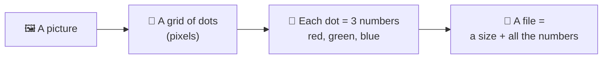
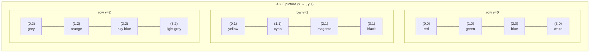

# Chapter 1 — What Is a Picture on a Computer?

> ⏱️ 15 minutes · Part 0: Start · ⭐ core

---

## 🎯 Today's goal

By the end you will know that **a picture is just a grid of numbers**, and you will make a picture file **by typing the numbers yourself**.

This is the picture you'll make. It is only 4 × 3 dots, shown here very big:


---

## 🧒 The idea in plain words

Think of a **mosaic**: a wall picture made of small coloured tiles. Each tile has **one** colour. From far away you don't see tiles, you see a picture.

A computer picture is a mosaic too:
- each tile is called a **pixel** (`pixel` = "picture element", one coloured dot);
- the tiles sit in a **grid** of rows and columns;
- the colour of each tile is stored as **numbers**.



So **"a picture"** = **"how wide, how tall, and a long list of numbers"**. That's all. Everything else in this course builds on this one idea.

---

## 🔍 How it works

**1. The grid.** A picture has a `width` (dots per row) and a `height` (number of rows). Our tiny picture is 4 wide and 3 tall = **12 pixels**.
We number columns with **x** (from the left, starting at 0) and rows with **y** (from the **top**, starting at 0).



> ⚠️ On screens, **y grows downwards**. (0,0) is the **top-left** corner, not the bottom-left like in school maths.

**2. A colour is 3 numbers.** Every pixel stores how much **red**, **green** and **blue** light to make (`RGB`). Each number goes from **0** (off) to **255** (full).
Why 255? One `byte` (= 8 bits, the smallest box of memory) holds 256 different values: 0 to 255.

| Colour | Red | Green | Blue |
|---|---|---|---|
| red | 255 | 0 | 0 |
| yellow (red + green light) | 255 | 255 | 0 |
| white (all full) | 255 | 255 | 255 |
| black (all off) | 0 | 0 | 0 |
| grey (all half) | 128 | 128 | 128 |

Chapter 3 explains *why* red + green light gives yellow. For now, trust the table.

**3. The numbers go in a row-by-row list.** Memory and files are **one long line** of bytes, not a grid. So we write row 0 first (left to right), then row 1, then row 2. 12 pixels × 3 numbers = **36 numbers**.

**4. A file = a small header + the numbers.** We use the simplest picture format there is: `PPM` (Portable PixMap). It starts with three short lines of text:

```
P6         ← "I am a colour picture, numbers stored as bytes"
4 3        ← width and height
255        ← the biggest number used
```

…and then the 36 colour numbers, one byte each. No compression, no tricks. Image viewers (Ubuntu's *Image Viewer*, GIMP, ImageMagick) can open it.

---

## ▶️ Try it

### The program

New things in this code (everything else is plain C++):
- `std::vector<unsigned char>`: a list of bytes (`unsigned char` = one number 0–255).
- `std::ofstream file("tiny.ppm", std::ios::binary)`: open a file for writing, **as raw bytes**.
- `file << ...`: write text (the header). `file.write(...)`: write raw bytes (the pixels).
- `reinterpret_cast<const char*>(...)`: "treat my bytes as the type `write` wants". It's needed only because `write` asks for `char`.

📜 **`tiny.ppm` maker — `tiny.cpp`**
```cpp
// tiny.cpp -- make a picture by hand: 4 pixels wide, 3 pixels tall.
#include <fstream>
#include <vector>

int main() {
    int width = 4, height = 3;

    // Every pixel = 3 numbers: red, green, blue (0 = off, 255 = full).
    std::vector<unsigned char> pixels = {
        255,0,0,     0,255,0,     0,0,255,     255,255,255,   // row 0: red, green, blue, white
        255,255,0,   0,255,255,   255,0,255,   0,0,0,         // row 1: yellow, cyan, magenta, black
        128,128,128, 255,128,0,   0,128,255,   200,200,200,   // row 2: grey, orange, sky blue, light grey
    };

    std::ofstream file("tiny.ppm", std::ios::binary);
    file << "P6\n" << width << " " << height << "\n255\n";       // the header: what kind, how big
    file.write(reinterpret_cast<const char*>(pixels.data()), pixels.size());   // the numbers
}
```

Build and run (in a terminal, in the folder with the file):
```bash
g++ -std=c++20 -Wall -Wextra tiny.cpp -o tiny
./tiny
```

### 🤔 Guess first
1. How many **bytes** will `tiny.ppm` be? (Hint: count the header characters, including the 3 line breaks, and add the pixel numbers.)
2. Open the file in an image viewer. How big will it look on screen?

### ✅ What really happened (I ran it)

<details><summary>Reveal</summary>

```
$ ls -l tiny.ppm
-rw-r--r-- 1 root root 47 Nov 25 12:47 tiny.ppm
```

**47 bytes** = 11 bytes of header (`P6⏎` 3 + `4 3⏎` 4 + `255⏎` 4) + 36 pixel bytes.

Let's look **inside** the file. First the header, as text (`$` marks a line break):
```
P6$
4 3$
255$
```

Then the pixel bytes, one row of the picture per line (I asked the `xxd` tool to start after the 11 header bytes and print 12 bytes per line):
```
0000000b: ff 00 00 00 ff 00 00 00 ff ff ff ff  ............
00000017: ff ff 00 00 ff ff ff 00 ff 00 00 00  ............
00000023: 80 80 80 ff 80 00 00 80 ff c8 c8 c8  ............
```
`xxd` shows bytes in **hexadecimal** (`hex` = counting in 16s, so two hex digits = one byte): `ff` = 255, `80` = 128, `c8` = 200, `00` = 0.
Read the first line in groups of three: `ff 00 00` (red), `00 ff 00` (green), `00 00 ff` (blue), `ff ff ff` (white). **Exactly the numbers we typed.**

About question 2: in a viewer it looks like a **tiny speck**, just 4 × 3 dots on your screen. The big picture at the top of this chapter is the same file zoomed 80×, so each pixel became an 80 × 80 square.
</details>

### A picture made by a rule

Typing numbers by hand gets boring fast. Instead we can **compute** each pixel's colour from where it is.
Here red = x (grows to the right), green = y (grows downwards), blue = always 128:

📜 **`grid.cpp`**
```cpp
// grid.cpp -- a picture made by a rule: colour depends on where the pixel is.
#include <fstream>
#include <vector>

int main() {
    int width = 256, height = 256;
    std::vector<unsigned char> pixels;                 // starts empty; we add 3 numbers per pixel

    for (int y = 0; y < height; ++y) {                 // rows, top to bottom
        for (int x = 0; x < width; ++x) {              // pixels in the row, left to right
            pixels.push_back(x);                       // red   grows to the right
            pixels.push_back(y);                       // green grows downwards
            pixels.push_back(128);                     // blue  is always half
        }
    }

    std::ofstream file("grid.ppm", std::ios::binary);
    file << "P6\n" << width << " " << height << "\n255\n";
    file.write(reinterpret_cast<const char*>(pixels.data()), pixels.size());
}
```

🤔 **Guess first:** which corner will be the most **pink/red**? Which one the most **green**?

<details><summary>✅ Reveal (I ran it: <code>grid.ppm</code> is 196,623 bytes = 15 header + 256 × 256 × 3)</summary>


- Top-left (x=0, y=0): red 0, green 0, blue 128 → **dark blue**.
- Top-right (x=255): lots of red → **pink**.
- Bottom-left (y=255): lots of green → **green**.
- Bottom-right: red + green + some blue → **pale yellow**.

Notice the loop order: `y` outside, `x` inside. That walks the picture **row by row**, the same order the bytes go in the file.
</details>

> 💡 **This is the most important trick in graphics:** *for every pixel, compute its colour.* Wallpapers, buttons, shadows, even 3D games are this same double loop with smarter rules.

---

## 🏗️ Build it — Lumen step 1: your first wallpaper

Lumen is the desktop you'll build in this course. Its first piece: **a wallpaper generator**.

**Make a program `wallpaper.cpp` that writes `wallpaper.ppm`:**
- size **320 × 200**;
- a "sunset": the top row is dark blue, the bottom row is orange, and every row in between is a **smooth mix**. (Hint: for row `y`, use the fraction `t = y / 199.0`: 0 at the top, 1 at the bottom. Each channel = `top + t × (bottom − top)`.)
- a **white sun**: every pixel within 30 pixels of (240, 60) is white. (Hint: a pixel (x, y) is inside if `(x−240)² + (y−60)² < 30²`.)

**Done when:**
- [ ] it compiles with `-Wall -Wextra` and **no warnings**;
- [ ] `ls -l wallpaper.ppm` shows **192,015 bytes** (work out why before you run it!);
- [ ] it opens in an image viewer and looks like a sunset with a round sun.

**Hints:**
- Copy the shape of `grid.cpp`. Only the colour rule changes.
- No viewer handy? `convert wallpaper.ppm wallpaper.png` (package `imagemagick`) makes a PNG anything can open.
- Send me a screenshot or the code. I'll review it.

---

## ✅ Quick check

**1.** A picture is 1920 × 1080 pixels with 3 bytes per pixel. How many pixels, and how many bytes of colour numbers?
<details><summary>Answer</summary>1920 × 1080 = 2,073,600 pixels. × 3 = 6,220,800 bytes (about 6.2 MB). That's one screen full, which your computer redraws up to 60 times every second.</details>

**2.** What colour is a pixel stored as `0 255 255`? And `80 80 80` in hex?
<details><summary>Answer</summary><code>0 255 255</code> = no red, full green, full blue = <b>cyan</b>. Hex <code>80 80 80</code> = 128,128,128 = <b>grey</b>.</details>

**3.** In a 4 × 3 picture, the numbers are stored row by row. Where (which byte number, counting from 0 after the header) does pixel (x=1, y=2) start?
<details><summary>Answer</summary>Pixels before it: 2 full rows (2 × 4 = 8) + 1 = 9 pixels. 9 × 3 = byte <b>27</b>. The general rule: <code>(y × width + x) × 3</code>. Chapter 4 makes this rule a bit more real.</details>

---

## ➡️ Next

**Chapter 2 — Your workbench and your first window:** set up the Lumen project, and show your pixels **live in a window** instead of a file.

<details><summary>🔬 Going deeper (optional)</summary>

- PPM is great for learning because it has no compression. Real formats like **PNG** (lossless) and **JPEG** (lossy, for photos) store the same grid of numbers, just squeezed smaller.
- Your screen shows a grid of pixels too. A "1920 × 1080 screen" has exactly the grid size of Quick check 1. Later in the course you'll write numbers **straight into the screen's own memory**.
- Some formats store pixels bottom-row-first (old BMP files) or use 4 numbers per pixel (with transparency, Chapter 5). The idea never changes: a size + a list of numbers.
</details>
