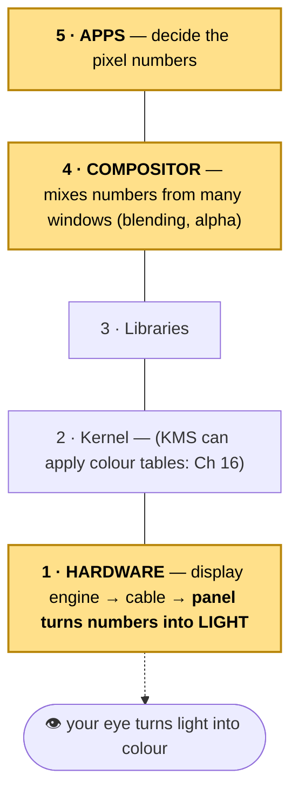
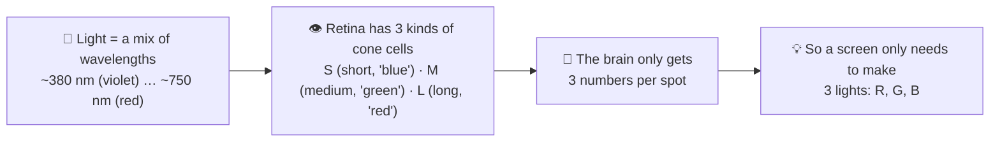
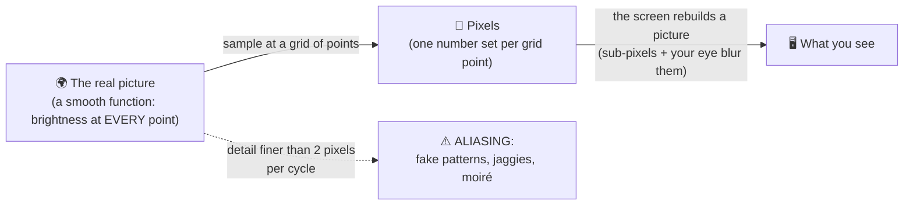
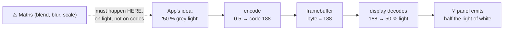
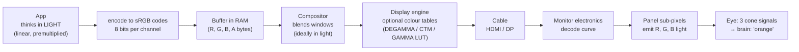
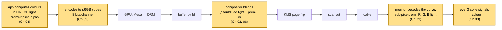

# 🧙 Graphics Chapter 03 — Light, Pixels, Colour
## What a pixel *really* is, why 128 is not "half bright", and how see-through works

> **Series:** Linux Graphics & Input · **Chapter 03 of 32** · ⭐ core · ≈ 75 minutes
> **Before this:** [Chapter 01 — The Map](01_the_map.md), [Chapter 02 — Lab + kickoff](02_lab_and_kickoff.md).
> **After this:** you know what the numbers in a framebuffer *mean*: which light they ask for, why doing maths on them directly gives wrong pictures, and how alpha (see-through) works.
> Every later chapter that touches pixels (drawing, blending, the compositor, the GPU) builds on these three ideas: **sample, gamma, alpha**.

---

## 📍 You are here

Pixels are **made** at the top of the stack (apps, compositor) and turned into **light** at the very bottom (the panel). This chapter is about what the numbers mean on that whole trip.



---

## 🔁 Quick recall

**1.** Why must Lumen's `UniqueFd` be **move-only**?
<details><summary>Answer</summary>If it could be copied, two objects would own the same fd and both would <code>close()</code> it: a double close, which can close an unrelated fd that later got the same number. Moving transfers ownership and leaves the source empty (−1).</details>

**2.** A page flip at vblank: what does it change, and what does it *not* do?
<details><summary>Answer</summary>It changes which buffer address the display engine scans out from the next frame. It does not copy any pixels.</details>

**3.** Which tier would you use to run Lumen's KMS backend, and what is your emergency exit there?
<details><summary>Answer</summary>Tier C (a VM you can crash). The emergency exit is an SSH session from the host: <code>sudo pkill -9 lumen</code>.</details>

---

## 💡 The idea in one sentence

> **A pixel is a *sample*: three numbers that ask the screen for some red, green and blue light at one point —
> but the numbers are *not* proportional to the light (gamma), so you must convert to "light" before any maths, and alpha says how much of the point is covered.**

---

## 🧒 The easy version

**Three ideas, three pictures:**

| Idea | Everyday picture | What it means for pixels |
|---|---|---|
| **Sample** | A **survey**: you ask 1 person per street, not every person in town | A pixel is one measurement of the picture at one point. Detail *between* the points is lost, or worse, **lies** to you (aliasing) |
| **Gamma** | A **light dimmer with an uneven scale**: the first half of the knob covers only a little light, because your eye cares most about dark steps | Pixel value 128 gives only about **22 % of the light**, not 50 %. The numbers are spaced the way your *eye* feels, not the way *light* adds |
| **Alpha** | **Tinted glass** over a picture | A 4th number: how much of this pixel the shape *covers*. 0 = invisible, 255 = solid |

And one rule that comes out of these three:

> 🔑 **To mix, blur, scale or blend pixels: convert numbers → light, do the maths, convert light → numbers.**
> Doing the maths straight on the numbers is the most common graphics bug in the world. You will see it go wrong four times in this chapter.

---

## 🔍 What really happens, step by step

### 1. Light and your eye: why three numbers are enough



1. Real light is a mix of many wavelengths. `wavelength` = the "size" of a light wave. Our eyes see about 380–750 nm (`nm` = nanometre, a billionth of a metre).
2. Your retina has **three kinds of colour sensors** (`cone cells`), most sensitive to short, medium and long waves.
3. Each spot of your eye sends the brain only **three signals**. Two very different mixes of light that give the *same three signals* look **identical** to you. (`metamer` = two different lights that look like the same colour.)
4. So a screen doesn't need to copy the real light. It only needs **three lights**, red, green and blue, mixed in the right amounts to make the same three signals. That's why every pixel has **R, G, B**.
5. On the panel, each pixel is really **3 small sub-pixels** (`sub-pixel` = one of the red/green/blue dots inside a pixel). On most LCDs they're three stripes side by side. OLED layouts vary.

> ⚠️ "RGB" is a *recipe*, not a colour. "R = 255" means "the **red lamp of this screen**, fully on". Two screens with different red lamps show different reds for the same number.
> The exact lamps (`primaries`) plus the white point plus the gamma curve make a **colour space**. The standard for desktops and the web is **sRGB**.

### 2. A pixel is a sample, not a little square



- `sample` = a measurement at one point. A **pixel** stores the picture's colour **at one point** of a grid. It is not "a tiny square of colour", even though it *looks* like a square when you zoom in.
  (The famous note on this is Alvy Ray Smith's *"A Pixel Is Not A Little Square"*, 1995.)
- **The sampling rule** (`Nyquist limit`): a grid can only show a pattern if every light-dark cycle spans **at least 2 pixels**. Finer detail doesn't just vanish. It turns into a **false, bigger pattern**: `aliasing` = fine detail disguised as coarse detail.
- You've seen aliasing: **jagged edges** on lines (`jaggies`), **shimmering** fine fences in games, **moiré** (wavy patterns) when you photograph a screen.
- **The cure:** measure the picture over the pixel's *area*, not at one point. Take many samples inside each pixel and average them (`supersampling`), or compute the exact covered area. This is **anti-aliasing**. Demo D shows both.

### 3. From numbers to bytes: bit depth

| Bits per channel | Levels per channel | Colours (R × G × B) | Where |
|---|---|---|---|
| 8 | 256 (0–255) | 16,777,216 | almost every desktop framebuffer (`XRGB8888`, Chapter 04) |
| 10 | 1024 | ≈ 1.07 billion | HDR video, some pro monitors |
| 16 (or float) | 65,536 | — | in-between maths, image editors |

`bit depth` = how many bits store one channel. Too few levels → **banding**: a smooth sky becomes visible stripes.
**8 bits is enough only because of gamma** (next section). In "light" units it would band badly in the dark.

### 4. Gamma: the numbers are spaced for your eye, not for light

**The key fact:** your eye is very sensitive to small changes in **dark** areas and not very sensitive to the same change in **bright** areas. (Roughly: you notice *ratios*, not differences.)

So sRGB spends its 256 codes **unevenly**: many codes for dark shades, fewer for bright ones. A code is *not* an amount of light. To get the light, you apply the sRGB curve:

| Direction | Formula (values in 0…1) | Name |
|---|---|---|
| code → light | if c ≤ 0.04045: c / 12.92, else ((c + 0.055) / 1.055)^2.4 | **decode** (`EOTF` = electro-optical transfer function: "signal → light") |
| light → code | if L ≤ 0.0031308: 12.92·L, else 1.055·L^(1/2.4) − 0.055 | **encode** (the inverse; also called the OETF) |

New words:
- `linear light` = numbers that are **proportional to the physical light**: 0.5 = half the photons of 1.0. Adding and averaging work correctly *only* here.
- `encoded` / `gamma-encoded` / `sRGB values` = the 0–255 codes stored in files and framebuffers.
- `gamma` = the everyday name for this curve. The sRGB curve is close to "light = code^2.2", with a small straight part near black.



**Why such a strange curve?** Two reasons that happen to agree:
1. **Your eye** (the real reason today): equal *code* steps should look like roughly equal *brightness* steps, so no 8-bit step is a visible band.
2. **History**: old CRT tubes naturally produced light ≈ voltage^2.2–2.5. Video signals were pre-corrected for it, and the convention stayed.

### 5. Colour spaces in one table

| Colour space | Primaries ("which R, G, B lamps") | White | Curve | Used for |
|---|---|---|---|---|
| **sRGB** | BT.709 | D65 (`D65` = standard daylight white) | sRGB curve (≈ 2.2) | desktops, the web, PNG/JPEG by default |
| **BT.709** | BT.709 (same as sRGB) | D65 | a similar video curve | HD video |
| **Display P3** | wider (redder red, greener green) | D65 | sRGB curve | modern phones, Apple screens |
| **BT.2020 + PQ** | very wide | D65 | `PQ` (an HDR curve in absolute nits) | HDR video |

`gamut` = all colours a colour space (or a screen) can show. A wide-gamut screen showing sRGB numbers *without* conversion makes everything look over-saturated.

> 📖 **On Linux (version-dependent):** traditionally the desktop just *assumed* everything is sRGB.
> KMS can apply hardware colour tables per CRTC (`DEGAMMA_LUT`, `CTM` = colour transform matrix, `GAMMA_LUT`). "Night light" uses these (Ch 16).
> A Wayland colour-management protocol (in recent wayland-protocols releases, 2025) lets apps say which colour space their buffer uses. Support differs between compositors.

**One more formula you'll meet everywhere: brightness from RGB.** Green looks much brighter than blue at the same power:

`relative luminance Y = 0.2126·R + 0.7152·G + 0.0722·B` *(R, G, B in **linear** light; the BT.709 / sRGB weights)*

Video uses the same weights on the *encoded* values and calls it `luma` (Y′). That's the "Y" of YUV, Chapter 04.

### 6. Alpha: how see-through works

`alpha` (α) = a 4th channel: how much of the pixel is **covered**. α = 0: nothing (fully see-through). α = 1 (255): fully covered (opaque).
Alpha comes from two places: **coverage** (an anti-aliased edge covers 30 % of a pixel → α = 0.3) and **opacity** (a tinted glass window).

**Putting A over B** (the `over` operator, from Porter & Duff, 1984):

| Convention | What's stored for "red at 50 %" | Formula for `src over dst` |
|---|---|---|
| `straight alpha` (also "non-premultiplied") | (1, 0, 0, **0.5**): colour as if it were solid, plus α | out = (src·α_s + dst·α_d·(1−α_s)) / α_out, a division per pixel |
| `premultiplied alpha` | (**0.5**, 0, 0, 0.5): colour *already multiplied* by α | out = src + dst·(1 − α_s) — **no division** |

**Why the whole graphics stack prefers premultiplied:**
1. The formula is simpler and faster (GPUs do it in one blend step).
2. **Filtering is correct.** Averaging, blurring and scaling premultiplied pixels give the right answer. With straight alpha, the "invisible" colour of transparent pixels leaks in as a **dark fringe** (Demo C).
3. A fully transparent pixel is just (0, 0, 0, 0). There's no hidden colour to worry about.

> 📖 **On Linux:** Wayland buffers with an alpha channel are treated as **premultiplied**. KMS planes have a `"pixel blend mode"` property: `"Pre-multiplied"` (the default), `"Coverage"` (straight), or `"None"`.

### 7. The whole trip, from number to colour in your head



---

## 🧪 Predict, then see

All demos are **✅ measured**: really compiled and run in my sandbox (Ubuntu 24.04, g++ 13.3). Pictures and numbers are pure software, so nothing here needs a screen.
The pictures were written as PPM by the programs, then converted to PNG with ImageMagick's `convert`, so this page can show them.

**The C++20 you'll meet in these demos** (explained once, here):

| Feature | Plain meaning |
|---|---|
| `std::numbers::pi_v<float>` (header `<numbers>`, C++20) | The real value of π as a `float`. No more `#define PI 3.14` |
| `float point_sample(auto f, int x, int y)` | An **abbreviated function template** (C++20): `auto` in a parameter means "any type", here any callable (a lambda) |
| `std::lround`, `std::clamp` (C++17) | Round to the nearest integer; keep a value between a minimum and a maximum |
| `Rgb8{255, 0, 0}`, `{v, v, v}` | Aggregate initialization: fill a plain struct in member order |

All demos share one small helper header (**not** Lumen's design; m02 asks for much more):

📜 **`demo.hpp`**
```cpp
// demo.hpp -- tiny helpers shared by the Chapter 03 demos (NOT Lumen's design).
#pragma once
#include <algorithm>
#include <cmath>
#include <cstdint>
#include <fstream>
#include <stdexcept>
#include <string>
#include <vector>

struct Rgb8 { std::uint8_t r, g, b; };            // one pixel: 3 sRGB codes

struct Picture {                                   // width x height pixels, row after row
    int w, h;
    std::vector<Rgb8> px;
    Picture(int w_, int h_) : w(w_), h(h_), px(std::size_t(w_) * h_, Rgb8{0, 0, 0}) {}
    Rgb8& at(int x, int y) { return px[std::size_t(y) * w + x]; }
};

// PPM "P6" = the simplest image file: a text header, then raw RGB bytes.
inline void write_ppm(const std::string& path, const Picture& p) {
    std::ofstream f(path, std::ios::binary);
    f << "P6\n" << p.w << ' ' << p.h << "\n255\n";
    f.write(reinterpret_cast<const char*>(p.px.data()), std::streamsize(p.px.size() * 3));
    if (!f) throw std::runtime_error("cannot write " + path);
}

inline float srgb_to_linear(float c) {             // c and result in 0..1
    return c <= 0.04045f ? c / 12.92f : std::pow((c + 0.055f) / 1.055f, 2.4f);
}
inline float linear_to_srgb(float l) {
    return l <= 0.0031308f ? l * 12.92f : 1.055f * std::pow(l, 1.0f / 2.4f) - 0.055f;
}
inline std::uint8_t to_code(float c) {             // 0..1 -> 0..255, rounded and clamped
    return std::uint8_t(std::lround(std::clamp(c, 0.0f, 1.0f) * 255.0f));
}
```

`PPM` = the simplest image format: the text `P6`, the width and height, the max value (255), then raw R,G,B bytes row after row. Any image viewer can open it, and Lumen m02 will read and write it.

### Demo A ✅ — "How much light is pixel value 128?"

**🤔 Predict:** value 128 is half of 255. Does a pixel of (128,128,128) give half the light of white (255,255,255)? If not, which value does?

📜 **`gamma.cpp`** — build: `g++ -std=c++20 -Wall -Wextra -O2 gamma.cpp -o gamma` · run: `./gamma`
```cpp
// gamma.cpp -- Demo A: "how much LIGHT is pixel value 128?"
#include <cmath>
#include <cstdio>
#include <initializer_list>

// sRGB code (0..255) -> linear light (0.0..1.0). The official sRGB curve.
double srgb_to_linear(int code) {
    double c = code / 255.0;
    return c <= 0.04045 ? c / 12.92 : std::pow((c + 0.055) / 1.055, 2.4);
}
// linear light (0.0..1.0) -> sRGB code (0..255), rounded.
int linear_to_srgb(double l) {
    double c = l <= 0.0031308 ? l * 12.92 : 1.055 * std::pow(l, 1.0 / 2.4) - 0.055;
    return static_cast<int>(std::lround(c * 255.0));
}

int main() {
    std::puts("code -> light (fraction of full white)");
    for (int code : {0, 1, 10, 50, 64, 128, 188, 192, 255})
        std::printf("  %3d -> %.4f  (%5.1f %%)\n", code, srgb_to_linear(code), 100 * srgb_to_linear(code));

    std::puts("light -> code");
    for (double l : {0.01, 0.10, 0.18, 0.25, 0.50, 0.75, 0.99})
        std::printf("  %4.0f %% light -> code %3d\n", 100 * l, linear_to_srgb(l));

    // If we stored LINEAR light in 8 bits, how many of the 256 codes would describe
    // the darker half of what we SEE (sRGB code < 128 looks "darker than middle")?
    double dark_half = srgb_to_linear(128);          // = how much light "looks half bright"
    int linear_codes = static_cast<int>(dark_half * 255) + 1;
    std::printf("codes for the visually darker half: sRGB 128 of 256, linear-8-bit only %d of 256\n", linear_codes);

    // How big is the smallest step between neighbouring codes, near black?
    std::printf("step 1->2 in light: sRGB %.6f, linear-8-bit %.6f\n",
                srgb_to_linear(2) - srgb_to_linear(1), 1.0 / 255);
}
```

<details><summary>Reveal the real output</summary>

```
code -> light (fraction of full white)
    0 -> 0.0000  (  0.0 %)
    1 -> 0.0003  (  0.0 %)
   10 -> 0.0030  (  0.3 %)
   50 -> 0.0319  (  3.2 %)
   64 -> 0.0513  (  5.1 %)
  128 -> 0.2159  ( 21.6 %)
  188 -> 0.5029  ( 50.3 %)
  192 -> 0.5271  ( 52.7 %)
  255 -> 1.0000  (100.0 %)
light -> code
     1 % light -> code  25
    10 % light -> code  89
    18 % light -> code 118
    25 % light -> code 137
    50 % light -> code 188
    75 % light -> code 225
    99 % light -> code 254
codes for the visually darker half: sRGB 128 of 256, linear-8-bit only 56 of 256
step 1->2 in light: sRGB 0.000304, linear-8-bit 0.003922
```
</details>

**What it shows:**
- **128 → 21.6 % of the light.** Half the light (50 %) is code **188**. "Half the number" is nowhere near "half the light".
- **18 % light → code 118.** Photographers' "middle grey" (18 % reflectance) *looks* halfway between black and white, and sRGB puts it near the middle of the code range. That's the curve doing its job: **codes are spaced like your eye's feeling of brightness.**
- If we stored *linear light* in 8 bits, only **56 of 256 codes** would cover everything darker than what sRGB code 128 looks like. And the smallest dark step would be **13× bigger** (0.0039 vs 0.0003): visible banding in shadows. **sRGB is a clever compression for 8 bits.**
- Bottom line: **store** in sRGB codes (efficient for the eye); **compute** in linear light (correct for physics).

### Demo B ✅ — "Shrinking a picture: wrong vs right"

When a compositor scales a window, or a browser shows an image smaller, it averages pixels. Two ways: average the **codes**, or average the **light**.

**🤔 Predict:** a black-and-white checkerboard (alternating 0 and 255) shrunk 2× becomes one grey. Which value: 128 or 188?
And what colour is halfway between pure red and pure green?

📜 **`resize.cpp`** — build: `g++ -std=c++20 -Wall -Wextra -O2 resize.cpp -o resize` · run: `./resize`
```cpp
// resize.cpp -- Demo B: shrinking a picture, done wrong and done right.
#include <cstdio>
#include <initializer_list>
#include "demo.hpp"

// Average a 2x2 block of codes, two ways.
float avg_codes(std::uint8_t a, std::uint8_t b, std::uint8_t c, std::uint8_t d) {   // WRONG: maths on codes
    return (a + b + c + d) / 4.0f / 255.0f;
}
float avg_light(std::uint8_t a, std::uint8_t b, std::uint8_t c, std::uint8_t d) {   // RIGHT: maths on light
    float sum = 0;
    for (std::uint8_t v : {a, b, c, d}) sum += srgb_to_linear(v / 255.0f);
    return linear_to_srgb(sum / 4.0f);
}

int main() {
    // 1) A 1-pixel black/white checkerboard, shrunk 2x: every 2x2 block is 2 black + 2 white.
    std::printf("checkerboard shrunk 2x: averaging codes -> %d, averaging light -> %d\n",
                to_code(avg_codes(0, 255, 255, 0)), to_code(avg_light(0, 255, 255, 0)));

    // 2) Half-way between pure red and pure green.
    float r_codes = (255 + 0) / 2.0f / 255.0f;
    float r_light = linear_to_srgb((1.0f + 0.0f) / 2.0f);
    std::printf("red/green midpoint: averaging codes -> (%d,%d,0), averaging light -> (%d,%d,0)\n",
                to_code(r_codes), to_code(r_codes), to_code(r_light), to_code(r_light));

    // 3) A test picture: checkerboard (left), a 128 patch (middle), a 188 patch (right).
    Picture test(384, 128);
    for (int y = 0; y < 128; ++y)
        for (int x = 0; x < 384; ++x) {
            std::uint8_t v = x < 128 ? ((x + y) % 2 ? 255 : 0) : x < 256 ? 128 : 188;
            test.at(x, y) = {v, v, v};
        }
    write_ppm("gamma_test.ppm", test);

    // 4) A red -> green gradient, top row averaging codes, bottom row averaging light.
    Picture grad(512, 96);
    for (int x = 0; x < 512; ++x) {
        float t = x / 511.0f;
        std::uint8_t wr = to_code(1 - t), wg = to_code(t);                       // codes blended
        std::uint8_t rr = to_code(linear_to_srgb(1 - t)), rg = to_code(linear_to_srgb(t));   // light blended
        for (int y = 0; y < 96; ++y) grad.at(x, y) = y < 46 ? Rgb8{wr, wg, 0} : y < 50 ? Rgb8{255, 255, 255} : Rgb8{rr, rg, 0};
    }
    write_ppm("red_green.ppm", grad);
    std::puts("wrote gamma_test.ppm and red_green.ppm");
}
```

<details><summary>Reveal the real output</summary>

```
checkerboard shrunk 2x: averaging codes -> 128, averaging light -> 188
red/green midpoint: averaging codes -> (128,128,0), averaging light -> (188,188,0)
wrote gamma_test.ppm and red_green.ppm
```
</details>

**See it with your own eyes.** View this picture at **100 % zoom** (no scaling, or the browser itself will average the checkerboard). Lean back or squint until the left checkerboard turns grey. Which patch matches it, the middle (128) or the right (188)?


*On a correctly set up screen the checkerboard matches the **right** patch (188). That's half the light, because half the pixels are fully on.* If it matches neither exactly, your screen's curve isn't quite sRGB, which is common on cheap laptop panels.

The red → green gradient. **Top:** blended on codes. **Bottom:** blended on light.


**What it shows:**
- Averaging codes gives **128** (only 21.6 % light): the shrunken checkerboard gets **too dark**. Averaging light gives **188**, which is correct.
- Red + green blended on codes has a **muddy brown** middle (128,128,0). Blended on light it's a clean **yellow** (188,188,0). That brown band is a classic sign of a gradient done in the wrong space.
- Every scaler, blur and blend in Lumen (m05) and in a real compositor has this choice. Many real programs still average codes, for speed or by accident.

### Demo C ✅ — "See-through edges: straight vs premultiplied alpha"

**🤔 Predict:** a solid red pixel sits next to a fully transparent pixel. We shrink the picture, so the two are averaged into one 50 %-covered pixel, then put it over a white background.
Should the result be pink (255,188,188)? Will both conventions give that?

📜 **`alpha.cpp`** — build: `g++ -std=c++20 -Wall -Wextra -O2 alpha.cpp -o alpha` · run: `./alpha`
```cpp
// alpha.cpp -- Demo C: see-through pixels. Straight alpha vs premultiplied alpha.
#include <cstdio>
#include <vector>
#include "demo.hpp"

struct Rgba { float r, g, b, a; };                 // linear light, 0..1

// "over": put src on top of dst. Formulas for both conventions.
Rgba over_straight(Rgba s, Rgba d) {               // colour NOT multiplied by alpha
    float a = s.a + d.a * (1 - s.a);
    auto mix = [&](float sc, float dc) { return a == 0 ? 0 : (sc * s.a + dc * d.a * (1 - s.a)) / a; };
    return {mix(s.r, d.r), mix(s.g, d.g), mix(s.b, d.b), a};
}
Rgba over_premul(Rgba s, Rgba d) {                 // colour ALREADY multiplied by alpha
    float k = 1 - s.a;
    return {s.r + d.r * k, s.g + d.g * k, s.b + d.b * k, s.a + d.a * k};
}
Rgba premultiply(Rgba c) { return {c.r * c.a, c.g * c.a, c.b * c.a, c.a}; }
Rgba average(Rgba p, Rgba q) { return {(p.r + q.r) / 2, (p.g + q.g) / 2, (p.b + q.b) / 2, (p.a + q.a) / 2}; }

void print(const char* label, Rgba c) {
    std::printf("%-44s -> sRGB (%3d,%3d,%3d)\n", label,
                to_code(linear_to_srgb(c.r)), to_code(linear_to_srgb(c.g)), to_code(linear_to_srgb(c.b)));
}

int main() {
    const Rgba white{1, 1, 1, 1};
    const Rgba red{1, 0, 0, 1};                    // solid red
    const Rgba clear{0, 0, 0, 0};                  // fully transparent (its colour is "black", unused)
    const Rgba half_red{1, 0, 0, 0.5f};            // red at 50 % opacity (straight)

    std::puts("1) one 50%-red pixel over white");
    print("   straight:      over_straight(half_red, white)", over_straight(half_red, white));
    print("   premultiplied: over_premul(premul(half_red), white)", over_premul(premultiply(half_red), white));

    std::puts("2) average a solid red pixel with a transparent pixel (an edge being shrunk), then put over white");
    print("   straight: average, then over", over_straight(average(red, clear), white));
    print("   premultiplied: average, then over", over_premul(average(premultiply(red), premultiply(clear)), white));

    // 3) Picture: a red disc on a transparent background, shrunk 8x, composited on white.
    const int N = 256, S = 8, n = N / S;
    std::vector<Rgba> big(N * N);
    for (int y = 0; y < N; ++y)
        for (int x = 0; x < N; ++x) {
            float dx = x - N / 2 + 0.5f, dy = y - N / 2 + 0.5f;
            big[y * N + x] = dx * dx + dy * dy < 100.0f * 100.0f ? red : clear;
        }
    Picture out(2 * n * S, n * S);                  // left: straight, right: premultiplied (shown 8x bigger)
    for (int by = 0; by < n; ++by)
        for (int bx = 0; bx < n; ++bx) {
            Rgba sum_s{0, 0, 0, 0}, sum_p{0, 0, 0, 0};
            for (int y = 0; y < S; ++y)
                for (int x = 0; x < S; ++x) {
                    Rgba c = big[(by * S + y) * N + bx * S + x], p = premultiply(c);
                    sum_s = {sum_s.r + c.r, sum_s.g + c.g, sum_s.b + c.b, sum_s.a + c.a};
                    sum_p = {sum_p.r + p.r, sum_p.g + p.g, sum_p.b + p.b, sum_p.a + p.a};
                }
            float k = 1.0f / (S * S);
            Rgba s = over_straight({sum_s.r * k, sum_s.g * k, sum_s.b * k, sum_s.a * k}, white);
            Rgba p = over_premul({sum_p.r * k, sum_p.g * k, sum_p.b * k, sum_p.a * k}, white);
            for (int y = 0; y < S; ++y)
                for (int x = 0; x < S; ++x) {
                    auto code = [](Rgba c) { return Rgb8{to_code(linear_to_srgb(c.r)), to_code(linear_to_srgb(c.g)), to_code(linear_to_srgb(c.b))}; };
                    out.at(bx * S + x, by * S + y) = code(s);
                    out.at(n * S + bx * S + x, by * S + y) = code(p);
                }
        }
    write_ppm("alpha_edges.ppm", out);
    std::puts("wrote alpha_edges.ppm");
}
```

<details><summary>Reveal the real output</summary>

```
1) one 50%-red pixel over white
   straight:      over_straight(half_red, white) -> sRGB (255,188,188)
   premultiplied: over_premul(premul(half_red), white) -> sRGB (255,188,188)
2) average a solid red pixel with a transparent pixel (an edge being shrunk), then put over white
   straight: average, then over              -> sRGB (225,188,188)
   premultiplied: average, then over         -> sRGB (255,188,188)
wrote alpha_edges.ppm
```
</details>

A red disc on a transparent background, shrunk 8× (each output pixel = 64 averaged pixels), put over white, shown 8× bigger. **Left:** straight alpha. **Right:** premultiplied.


**What it shows:**
- One pixel at 50 % over white: **both** conventions agree (255,188,188). For a single blend they're the same maths, just written differently.
- **Averaging** is where straight alpha breaks: (225,188,188) instead of (255,188,188). The transparent pixel's hidden colour (black) got averaged into the red, so the edge turns **dirty and dark**: the grey ring on the left disc.
- Premultiplied stores the transparent pixel as (0,0,0,0) **including** its colour, so averaging is just correct. No fix-up needed.
- That ring is exactly the "dark halo around icons and fonts" bug you may have seen in apps and games. **Lumen will store and blend premultiplied colour.**

### Demo D ✅ — "A pixel is a sample: aliasing"

The "real picture" is a function you can ask at **any** point, not only at whole pixels. Two of them: stripes 1.1 px wide (a little finer than the pixel grid), and rings that get thinner towards the edges.
We make pixels two ways: **one sample** at each pixel's centre, and **8×8 samples** averaged over the pixel's area (in light, of course).

**🤔 Predict:** the stripes are 1.1 pixels wide, nearly 1 pixel. Will point sampling show a clean "on/off/on/off" pattern?

📜 **`alias.cpp`** — build: `g++ -std=c++20 -Wall -Wextra -O2 alias.cpp -o alias` · run: `./alias`
```cpp
// alias.cpp -- Demo D: a pixel is a SAMPLE. What happens when detail is finer than the pixels?
#include <cmath>
#include <cstdio>
#include <numbers>
#include "demo.hpp"

// The "real world" we photograph: rings that get thinner and thinner away from the centre.
// brightness(x, y) in 0..1, defined for ANY real x, y -- not only whole pixels.
float rings(float x, float y) {
    float r2 = x * x + y * y;
    return 0.5f + 0.5f * std::cos(std::numbers::pi_v<float> * r2 / 256.0f);
}
// Stripes 1.1 pixels wide: a little finer than the pixel grid.
float stripes(float x) { return std::fmod(x, 2.2f) < 1.1f ? 1.0f : 0.0f; }

// One sample per pixel, at the pixel's centre.
float point_sample(auto f, int px, int py) { return f(px + 0.5f, py + 0.5f); }
// 8 x 8 samples spread over the pixel's area, averaged in LINEAR light.
float super_sample(auto f, int px, int py) {
    float sum = 0;
    for (int j = 0; j < 8; ++j)
        for (int i = 0; i < 8; ++i) sum += f(px + (i + 0.5f) / 8, py + (j + 0.5f) / 8);
    return sum / 64;
}

int main() {
    std::printf("stripes, point sampled : ");
    for (int x = 0; x < 24; ++x) std::printf("%4d", int(255 * point_sample([](float a, float) { return stripes(a); }, x, 0)));
    std::printf("\nstripes, 8x8 averaged  : ");
    for (int x = 0; x < 24; ++x) std::printf("%4d", to_code(linear_to_srgb(super_sample([](float a, float) { return stripes(a); }, x, 0))));
    std::puts("");

    const int N = 256;
    Picture pic(2 * N, N);                          // left: point sampled, right: super sampled
    for (int y = 0; y < N; ++y)
        for (int x = 0; x < N; ++x) {
            auto f = [](float a, float b) { return rings(a - 128, b - 128); };
            std::uint8_t p = to_code(linear_to_srgb(point_sample(f, x, y)));
            std::uint8_t s = to_code(linear_to_srgb(super_sample(f, x, y)));
            pic.at(x, y) = {p, p, p};
            pic.at(N + x, y) = {s, s, s};
        }
    write_ppm("rings.ppm", pic);
    std::puts("wrote rings.ppm");
}
```

<details><summary>Reveal the real output</summary>

```
stripes, point sampled :  255   0 255   0 255 255   0 255   0 255   0 255   0 255   0 255 255   0 255   0 255   0 255   0
stripes, 8x8 averaged  :  255  99 225 137 207 188 165 225 137 240   0 255  99 225 137 207 188 165 225 137 240   0 255  99
wrote rings.ppm
```
</details>


**What it shows:**
- Point sampling *looks* like clean stripes, but it **lies**: twice in 24 pixels it shows two whites in a row (pixels 4–5 and 15–16). The real stripes are slightly wider than a pixel, and the error builds up until the pattern "slips". On a screen this slip shimmers when things move. That's aliasing.
- Supersampling gives **in-between greys** that repeat every 11 pixels (11 px = 5 stripe pairs × 2.2 px). It's honest: "this pixel was half covered".
- In the rings picture, the left (point sampled) shows **false rings** in the corners. The real rings there are far finer than a pixel and should fade to grey, as on the right. (Your screen or browser may add its own moiré if the picture is scaled; view it at 100 %.)
- This is the root of every anti-aliasing technique: font smoothing (Ch 05), MSAA in GPUs (Ch 26), and good image scaling (Ch 06).

---

## ⚠️ Common confusions

| ❌ Wrong idea | ✅ Right idea |
|---|---|
| "128 is half brightness." | 128 is ≈ 22 % of the light. 188 is 50 %. Codes follow your eye, not physics. |
| "Gamma is an old CRT thing, not needed today." | It's needed so that 8 bits look smooth. LCD and OLED electronics recreate the curve on purpose. |
| "To blend two colours, average their RGB values." | Only in **linear light**. Averaging codes makes blends too dark and gradients muddy (Demo B). |
| "RGB (255,0,0) is one exact red." | It's "this screen's red lamp, full on". The exact colour depends on the colour space and the screen. |
| "A pixel is a little square." | It's a sample at a point. Squares are just how zoomed-in pictures are *drawn*. |
| "Alpha 0 means the colour doesn't matter." | With straight alpha the hidden colour **leaks** during filtering (Demo C). Premultiplied makes it (0,0,0,0) for real. |
| "Premultiplied loses information." | Only for nearly invisible pixels, where it can't be seen anyway. In return, all filtering is correct. |
| "Green and blue at the same value are equally bright." | Green contributes about 72 % of luminance, blue about 7 % (Y = 0.2126 R + 0.7152 G + 0.0722 B, in linear light). |

---

## ✅ Check yourself

**1.** Why are three numbers (R, G, B) enough to make almost any colour you can see?
<details><summary>Answer</summary>The eye has only three kinds of cone cells, so each spot sends just three signals to the brain. Any two lights giving the same three signals look identical (metamers). Three lamps mixed correctly can make those same three signals.</details>

**2.** Which sRGB code gives 50 % of white's light? Which code gives 25 %?
<details><summary>Answer</summary>188 for 50 %, 137 for 25 % (Demo A).</details>

**3.** A blur averages four pixels with codes 0, 0, 255, 255. What's the correct result, and what does the naive version give?
<details><summary>Answer</summary>Correct (average the light): 0.5 → code 188. Naive (average the codes): 128, too dark.</details>

**4.** Write the premultiplied `over` formula, then compute 50 %-transparent black (premultiplied: 0,0,0,0.5) over white (1,1,1,1).
<details><summary>Answer</summary>out = src + dst·(1 − α_src) = (0,0,0,0.5) + (1,1,1,1)·0.5 = (0.5, 0.5, 0.5, 1.0) in linear light → code 188 grey, fully opaque.</details>

**5.** Why do compositors and GPUs prefer premultiplied alpha? Give two reasons.
<details><summary>Answer</summary>(1) A simpler, faster blend: no division, one GPU blend step. (2) Filtering (scaling, blurring, mipmaps) is correct: transparent pixels are truly (0,0,0,0), so there are no dark fringes.</details>

**6.** Stripes with a period of 1.6 pixels are point-sampled. Will you see the true pattern? Why or why not?
<details><summary>Answer</summary>No. One light-dark cycle must span at least 2 pixels (the Nyquist limit). 1.6 px per cycle is finer than that, so it shows up as a false, slower pattern (aliasing). Fix: average over the pixel area (supersample), or blur the detail away before sampling.</details>

**7.** Why does sRGB use its 256 codes unevenly? What would go wrong with linear 8-bit storage?
<details><summary>Answer</summary>The eye is sensitive to small steps in the dark. sRGB puts many codes in the dark range. Linear 8-bit would have only 56 codes for the visually darker half, and dark steps 13× bigger, so you'd see banding in shadows.</details>

**8. ✏️ Draw it.** Draw the trip from "the app wants 50 % grey" to "the light leaves the panel": app (linear 0.5) → encode → byte 188 in the buffer → compositor → display engine → cable → monitor decode → panel → eye. Mark the **one place** where blending must use linear light, and write the number at each step.
<details><summary>Compare</summary>linear 0.5 → encode → <b>188</b> → buffer (188) → compositor: blending happens here and must convert 188 → 0.5, blend, then encode again → display engine (passes 188 unless colour tables are set) → cable (188) → monitor decodes 188 → 0.5 → panel emits 50 % light → eye. Compare with the mermaid diagram in section 7.</details>

---

## 📖 Story so far

This chapter explains what's inside the **first** and **last** boxes of Story B. Story A is unchanged.

**Story A — "I press the letter A"** (no change)


**Story B — "one frame appears"** (new: yellow boxes)


---

## 🏗️ Lumen milestone m02 — PRD: `lumen::image` — Image, PPM, colour

> **You write all of this.** The demo helpers above are deliberately too simple (no reading, no errors, no tests, no alpha in files). Don't copy them as the design.

### Goal
A small, well-tested library **`lumen::image`** that every later milestone uses: colour types with **correct** sRGB ↔ linear conversion and premultiplied alpha, an `Image` container, PPM file input/output, and one correct operation (a 2× downscale in linear light).
Plus a command-line tool, **`lumen-img`**, to make and inspect test pictures.

### APIs and C++ you will need (explained first)

| Thing | Plain meaning | Notes |
|---|---|---|
| `std::span<T>` | A view of contiguous elements (pointer + length) | return one row of an image as `std::span<Rgba8>`; no copy |
| `constexpr` function / variable | Can run at **compile time** | perfect for a 256-entry `srgb → linear` lookup table. ⚠️ `std::pow` is not `constexpr` in standard C++ (GCC accepts it as an extension). Building the table once at startup (`static const auto lut = make_lut();`) is also fine. Say which you chose in the ADR |
| `std::array<float, 256>` | A fixed-size array value | the lookup table |
| `std::ifstream` / `std::ofstream` in `std::ios::binary` | Read and write raw bytes | PPM pixel data is binary |
| `std::from_chars` (`<charconv>`) | Parse an integer from text, with no locale and no exceptions | for the PPM header numbers |
| `<=>` / `= default` comparison (C++20) | `bool operator==(const Rgba8&) const = default;` writes equality for you | handy for colour and image equality in tests |
| Catch2 `Catch::Matchers::WithinAbs(x, eps)` | Compare floats with a tolerance | from `<catch2/matchers/catch_matchers_floating_point.hpp>`. Never `==` on floats (Chapter 02 Demo E) |

**PPM (P6) format, exactly:**
```
P6            ← magic: 'P' '6'
# comment     ← optional comment lines, starting with '#', anywhere in the header
640 480       ← width and height, in ASCII decimal, separated by any whitespace
255           ← maxval: 1..65535 (≤ 255 → 1 byte per sample; > 255 → 2 bytes, big-endian)
<one single whitespace byte>, then width*height*3 samples, R G B, row by row, top row first
```

### Requirements

**R1 · Target and layout**: a new library target `lumen::image` (`include/lumen/image/…`, `src/image/…`) depending on `lumen::core`; a new tool `apps/lumen-img`; tests in `tests/image/…`.

**R2 · Colour types and conversions**
- `Rgba8`: 4 bytes, **sRGB-encoded, straight alpha**. This is the *interchange* format for files, and what the user writes.
- `ColorF`: 4 floats, **linear light, premultiplied alpha**. This is the *working* format: all maths happens here.
- `srgb_to_linear(std::uint8_t) -> float` via a 256-entry lookup table; `linear_to_srgb8(float) -> std::uint8_t` (clamped, rounded).
- `to_working(Rgba8) -> ColorF` (decode + premultiply) and `to_storage(ColorF) -> Rgba8` (unpremultiply + encode; α = 0 → (0,0,0,0)).
- `over(ColorF src, ColorF dst) -> ColorF` (premultiplied formula); `luminance(ColorF) -> float` (BT.709 weights, on linear values).

**R3 · `Image`**
- Width, height, and pixels stored as `Rgba8`, row after row. `width()`, `height()`, `row(y) -> std::span<Rgba8>` (+ a `const` version), `at(x, y)` **checked** (throws `std::out_of_range`), `fill(Rgba8)`, `==`.
- A zero-size image is allowed. Negative or huge sizes (more than 2^28 pixels) are rejected with `std::invalid_argument`.
- *(Chapter 04 will add stride and pixel formats; keep the class easy to extend, but don't add them yet.)*

**R4 · PPM input/output**
- `read_ppm(path) -> Image`: P6 with maxval 1…255 (scale to 0…255 when maxval < 255), comments, any whitespace. α = 255 for all pixels.
- `write_ppm(path, const Image&, Rgba8 background = black)`: P6, maxval 255. Pixels that aren't opaque are composited **over `background` in linear light** first (PPM has no alpha).
- Errors: a `lumen::image::ParseError` (derived from `std::runtime_error`) whose message includes **what** is wrong and the **byte offset** (`"bad maxval '0' at byte 8"`). File open/read failures → `std::system_error` with errno (reuse m01's helpers).
- *(stretch)* maxval up to 65535; P3 (ASCII) reading; PAM (`P7`) to keep alpha.

**R5 · One correct operation**: `downscale_2x(const Image&) -> Image`. Each output pixel = the average of a 2×2 block, done in **linear, premultiplied** `ColorF`. Odd sizes: the last row or column averages what exists.

**R6 · `lumen-img` tool**
```
lumen-img checker  W H out.ppm          # 1-px black/white checkerboard
lumen-img gradient W H out.ppm          # red→green, linear-light blend
lumen-img downscale in.ppm out.ppm      # R5
lumen-img info in.ppm                   # size; average colour as sRGB codes AND linear; luminance
```
Same exit-code rules as m01 (0 / 1 runtime error / 2 usage error).

**R7 · Tests (Catch2)**, at least:
- `srgb_to_linear(128)` ≈ 0.21586 and `(188)` ≈ 0.50289 (±1e-4); `linear_to_srgb8(0.5f) == 188`; `linear_to_srgb8(0.18f) == 118`.
- **Round trip:** for all 256 codes, `linear_to_srgb8(srgb_to_linear(c)) == c`.
- Premultiplied `over`: 50 %-red over white → `to_storage` gives (255,188,188,255).
- **The fringe test:** averaging solid red with transparent in `ColorF` then over white gives (255,188,188). Also write a test showing the naive straight-alpha byte average would give (225,188,188), and that your code does **not**.
- `downscale_2x(checkerboard 4×4)` → every pixel 188 (±1).
- PPM: write → read round trip is identical for opaque images; a header with comments and odd whitespace parses; maxval 15 scales correctly; a truncated file, a bad magic (`P5`), and `maxval 0` each throw `ParseError` with an offset in the message.
- `Image::at` out of range throws; `row(y).size() == width()`.

**R8 · ADR 0002 — "How Lumen handles colour"**: storage = sRGB 8-bit straight; working = linear float premultiplied; when conversion happens; how the LUT is built; why not do maths on bytes (link this chapter's demos). Half a page.

### Acceptance tests

| # | Do this | Expected |
|---|---|---|
| AT1 | `ctest --preset debug` and `ctest --preset asan` | all pass, no sanitizer reports, no warnings |
| AT2 | `lumen-img checker 256 256 c.ppm && lumen-img downscale c.ppm d.ppm && lumen-img info d.ppm` | size 128×128; average colour **188,188,188** (±1); linear ≈ 0.50 |
| AT3 | `lumen-img gradient 512 64 g.ppm`, then open it in any viewer | a clean yellow middle, no brown band (compare with Demo B's picture) |
| AT4 | `lumen-img info` on a PPM saved by GIMP or ImageMagick (`convert photo.jpg photo.ppm`) | reads it; sensible average colour |
| AT5 | `lumen-img info broken.ppm` (the file cut in half) | message with the byte offset, exit code 1 |
| AT6 | `lumen-img downscale` on a 3×5 image | a 2×3 result, no crash, ASan clean |
| AT7 | CI | all m01 jobs plus the new tests are green |

### Definition of done
- [ ] Tag **`m02`**, CI green, ADR 0002 written, README has a "colour" section with the AT2 numbers.
- [ ] You can explain in one sentence each: why 188 is 50 %; why the working format is premultiplied; why `to_storage` must handle α = 0.
- [ ] Send me the code. In review I'll look at: whether any maths happens on bytes, correct float comparisons in tests, PPM parser robustness (fuzz-style inputs), and the API names.

> 💡 Hints: write the R7 number tests **first**, from the values in Demos A–C, then make them pass. For the parser, write a tiny "cursor" over the bytes that knows its offset; it makes error messages easy.

---

## 🏠 Homework

1. Open the checkerboard picture (Demo B) on **your** screen at 100 % zoom. Does the checkerboard match 128 or 188? Tell me, plus your screen type (laptop panel or monitor).
2. On your Linux PC (Tier B): `xxd photo.ppm | head -3` on any PPM you create with `convert photo.jpg photo.ppm`. Find the magic, the size, the maxval, and where the pixel bytes start.
3. Start **m02** (after m01 is tagged).

---

## 🔗 Connects to

- **⬅️ Before:** [Chapter 02 — Lab + kickoff](02_lab_and_kickoff.md) · [Chapter 01 — The Map](01_the_map.md)
- **➡️ Next:** **Chapter 04 — Pixels in memory** ⭐: width × height × bytes, **stride**, pixel formats (`XRGB8888`, `ARGB8888`, `NV12`), byte order, and why the **FourCC** code exists. Lumen **m03**: `PixelFormat` + converters.
- **Later uses of this chapter:** Ch 05 (anti-aliased lines and text = coverage → alpha) · Ch 06 (blending and scaling done right) · Ch 16 (KMS colour properties) · Ch 24 (the compositor's blend) · Ch 26 (GPU MSAA).
- **Code for this chapter:** `demo.hpp`, `gamma.cpp`, `resize.cpp`, `alpha.cpp`, `alias.cpp`, all inside the demos above. Pictures: [`images/`](images/).

> Say **"NEXT graphics"** for Chapter 04.
