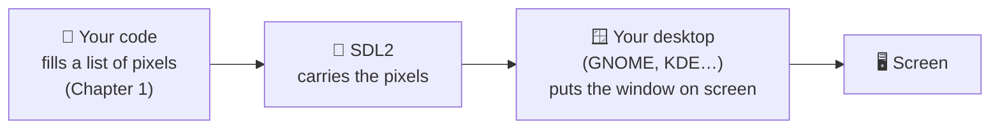
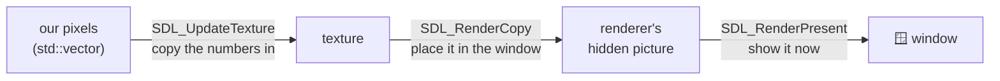

# Chapter 2 — Your Workbench and Your First Window

> ⏱️ 20 minutes · Part 0: Start · ⭐ core · 🎮 interactive

---

## 🎯 Today's goal

1. Install the tools you'll use for the whole course.
2. Show **your own pixels in a real window**, live, instead of in a file.

This is the result (a real screenshot, explained below):


---

## 🧒 The idea in plain words

In Chapter 1 you painted a picture into a **file**. Now we paint it into a **window**.

Think of an **art gallery**:
- **you** paint the canvas (you choose every pixel's colour, exactly like Chapter 1);
- the **gallery staff** hang it on the wall, next to other paintings (that's your desktop: it decides where windows go and shows them on the screen);
- a **helper** carries your canvas to the staff and speaks their language for you. That helper is a library called **SDL2**.



> 💡 **Why a helper?** Talking to a Linux desktop directly takes a few hundred lines. For now we want to learn **drawing**, so SDL does the talking.
> In Parts 5–7 you'll remove SDL and do every step yourself. By then, each step will be easy.

---

## 🔍 How it works

### 1. Your workbench (install once)

Open a terminal on your Linux PC (Ubuntu 24.04 shown) and run:

```bash
sudo apt install build-essential cmake ninja-build git libsdl2-dev imagemagick
```

| Tool | What it is, in one line |
|---|---|
| `build-essential` | the C++ compiler (`g++`) and friends |
| `cmake` | a **recipe tool**: you write down "my program is these files + these libraries", and it works out the compile commands |
| `ninja-build` | a fast worker that runs those compile commands |
| `git` | saves snapshots of your code, so you can always go back |
| `libsdl2-dev` | the SDL2 helper library (the `-dev` part = the files a programmer needs) |
| `imagemagick` | handy picture tools (`convert`, `display`) |

> No Linux PC? A Linux VM (VirtualBox, VMware, UTM on a Mac) with Ubuntu Desktop works for the whole first half of the course.

### 2. Three things SDL gives you

| SDL thing | Gallery picture | What it does |
|---|---|---|
| `SDL_Window` | the **frame** on the wall | a rectangle on your desktop with a title |
| `SDL_Renderer` | the **staff member** who hangs pictures | puts pictures into the window |
| `SDL_Texture` | the **canvas** you hand over | a picture the renderer can show. We copy our pixel numbers into it |

### 3. Showing a picture = 3 calls



Why "hidden picture" and then "present"? The renderer first builds the picture **out of sight**, then shows it all at once. You never see a half-drawn picture. (Chapter 15 is all about this trick.)

### 4. Telling SDL how our bytes are laid out

`SDL_UpdateTexture` needs two facts about our list of numbers:
- the **format**: `SDL_PIXELFORMAT_RGB24` = "3 bytes per pixel: R, G, B", exactly like Chapter 1;
- the **bytes per row**: `width * 3`. That's how SDL finds where each new row starts.

Remember that second number. In ▶️ *Try it* you'll see what happens when it's wrong.

### 5. Waiting for the close button

A window must stay open until the user closes it. SDL collects things that happen (`event` = something happened: a key, a mouse move, "close" clicked) and our program **waits** for them:

```cpp
SDL_Event event;
while (SDL_WaitEvent(&event) && event.type != SDL_QUIT) {}   // sleep until "close" is clicked
```

`SDL_WaitEvent` puts the program to **sleep** until something happens. It uses no CPU while waiting. This tiny loop grows into Lumen's heart in Chapter 11 (*the event loop*).

---

## ▶️ Try it

📜 **`main.cpp`**
```cpp
// main.cpp -- show OUR pixels in a real window, using SDL2.
#include <SDL2/SDL.h>
#include <cstdio>
#include <vector>

int main() {
    const int width = 400, height = 300;

    // 1. Our picture: the same idea as Chapter 1, 3 bytes (R, G, B) per pixel.
    std::vector<unsigned char> pixels(width * height * 3);
    for (int y = 0; y < height; ++y)
        for (int x = 0; x < width; ++x) {
            unsigned char* p = &pixels[(y * width + x) * 3];   // where pixel (x, y) starts
            p[0] = x * 255 / (width - 1);                       // red grows to the right
            p[1] = y * 255 / (height - 1);                      // green grows downwards
            p[2] = 128;                                         // blue is always half
        }

    // 2. Ask SDL for a window, a "renderer" (the thing that draws into the window)
    //    and a "texture" (a picture the renderer can show), all 400 x 300.
    if (SDL_Init(SDL_INIT_VIDEO) != 0) { std::printf("SDL_Init failed: %s\n", SDL_GetError()); return 1; }
    SDL_Window* window = SDL_CreateWindow("My first window", SDL_WINDOWPOS_CENTERED, SDL_WINDOWPOS_CENTERED,
                                          width, height, 0);
    SDL_Renderer* renderer = SDL_CreateRenderer(window, -1, 0);
    SDL_Texture* texture = SDL_CreateTexture(renderer, SDL_PIXELFORMAT_RGB24, SDL_TEXTUREACCESS_STREAMING,
                                             width, height);
    if (!window || !renderer || !texture) { std::printf("SDL error: %s\n", SDL_GetError()); return 1; }

    // 3. Copy our numbers into the texture and show it.
    SDL_UpdateTexture(texture, nullptr, pixels.data(), width * 3);     // width * 3 = bytes per row
    SDL_RenderCopy(renderer, texture, nullptr, nullptr);
    SDL_RenderPresent(renderer);

    // 4. Keep the window open until the user closes it.
    SDL_Event event;
    while (SDL_WaitEvent(&event) && event.type != SDL_QUIT) {}

    SDL_Quit();
}
```

New in this code:
- `unsigned char* p = &pixels[(y * width + x) * 3];` = "a **pointer** to where pixel (x, y) starts". Then `p[0]`, `p[1]`, `p[2]` are its red, green, blue. It's the formula from Chapter 1's quick check.
- `nullptr` in `SDL_UpdateTexture(texture, nullptr, …)` = "the whole texture, not just a part".

### Build it, the quick way (one command)

```bash
g++ -std=c++20 -Wall -Wextra main.cpp -o window $(pkg-config --cflags --libs sdl2)
./window
```
`pkg-config --cflags --libs sdl2` prints the extra compiler options SDL2 needs (where its files are, and which library to link). `$( … )` pastes that output into the command.

### Build it, the project way (CMake)

Real projects use CMake. Make this folder:

```
hello_window/
├── CMakeLists.txt
└── src/
    └── main.cpp      ← the code above
```

📜 **`CMakeLists.txt`** (the recipe):
```cmake
cmake_minimum_required(VERSION 3.25)
project(hello_window LANGUAGES CXX)

set(CMAKE_CXX_STANDARD 20)              # use C++20
set(CMAKE_CXX_STANDARD_REQUIRED ON)

find_package(SDL2 REQUIRED)             # find the installed SDL2 library

add_executable(hello_window src/main.cpp)                  # our program and its source file
target_link_libraries(hello_window PRIVATE SDL2::SDL2)     # ...which uses SDL2
target_compile_options(hello_window PRIVATE -Wall -Wextra) # ...with warnings on
```

```bash
cmake -S . -B build -G Ninja     # read the recipe, prepare a "build" folder (do this once)
cmake --build build              # compile (run this every time you change the code)
./build/hello_window
```

### ✅ What really happened (I ran it)

My sandbox has no screen, so I started a **pretend screen** (`Xvfb` = a display server that draws into memory) and took a screenshot of it. Both build ways compiled with **no warnings**.


- The gradient in the middle is **our window**: 400 × 300 pixels, exactly the colours we computed. Same picture as Chapter 1's grid, now live.
- The black around it is the empty pretend screen. On **your** PC the window sits on your normal desktop, with a title bar saying *My first window*. (My pretend screen has no desktop running, so nobody drew a title bar.)
- Click the window's ✕: the program ends. That's the `SDL_QUIT` event.

### 🤔 Guess first: a wrong "bytes per row"

Change `width * 3` in `SDL_UpdateTexture` to `width * 3 - 3` (we tell SDL each row is **one pixel shorter** than it really is). What will the picture look like?
(a) the same · (b) a bit darker · (c) slanted · (d) a crash

<details><summary>✅ Reveal (I ran it)</summary>


**(c) slanted.** SDL starts every row 3 bytes too early, so each row is shifted **one pixel more** than the row above. After 300 rows the error has added up and wrapped around, giving that diagonal cut.
Remember this look: **a slanted picture always means a wrong "bytes per row".** Chapter 4 gives that number its real name: the *stride*.
</details>

---

## 🏗️ Build it — Lumen step 2: the Lumen project

Time to start the real project. From now on, every chapter adds to it.

**Make this:**
```
lumen/
├── CMakeLists.txt
├── .gitignore          ← one line: build/
└── src/
    └── main.cpp
```

**What `main.cpp` must do:**
- open a window titled **"Lumen"**, **800 × 600**;
- fill it with your **sunset wallpaper from step 1**, computed in memory at 800 × 600 (no file this time);
- close when the ✕ is clicked **or** when **Esc** is pressed.

**Done when:**
- [ ] `cmake -S . -B build -G Ninja && cmake --build build` builds with **no warnings**;
- [ ] the window shows the sunset (sun included), at 800 × 600;
- [ ] ✕ and Esc both close it;
- [ ] `git init`, then a first commit: `git add . && git commit -m "Lumen step 2: first window"`.

**Hints:**
- Put the wallpaper code in its own function, e.g. `std::vector<unsigned char> make_wallpaper(int width, int height)`. Then `main` stays short.
- Esc is a key event: `event.type == SDL_KEYDOWN && event.key.keysym.sym == SDLK_ESCAPE`. Change the waiting loop so it stops on either event.
- Your sun moved: at 800 × 600, try the centre (600, 150) with radius 75.

Send me a screenshot or your code when it works.

---

## ✅ Quick check

**1.** What are SDL's window, renderer and texture, in one short line each?
<details><summary>Answer</summary>Window = the box on the desktop. Renderer = the thing that puts pictures into the window. Texture = a picture the renderer can show; we copy our pixel numbers into it.</details>

**2.** Why does the code call `SDL_RenderPresent` at the end, instead of the picture appearing right after `SDL_RenderCopy`?
<details><summary>Answer</summary>The renderer builds the new picture out of sight first, and <code>Present</code> shows it all at once, so you never see a half-finished picture.</details>

**3.** Your window shows a picture that leans to one side and wraps around. What did you most likely get wrong?
<details><summary>Answer</summary>The bytes-per-row number given to <code>SDL_UpdateTexture</code> (for RGB24 it must be <code>width * 3</code>).</details>

---

## ➡️ Next

**Chapter 3 — How screens make colour:** why red + green light makes yellow, and why the number 128 is *not* half as bright as 255.

<details><summary>🔬 Going deeper (optional)</summary>

- On your PC, SDL talks to your desktop with the **Wayland** or **X11** protocol, and `SDL_CreateRenderer` usually uses your **GPU** to show the texture. Chapter 30 explains these protocols, and in Chapter 31 you'll write a window *without* SDL.
- `SDL_WaitEvent` sleeps inside the kernel until the desktop sends a message. Chapter 21 shows the real mechanism (`epoll`).
- We used `SDL_PIXELFORMAT_RGB24` to match Chapter 1. Screens prefer **4 bytes per pixel**; Chapter 4 explains why.
</details>
