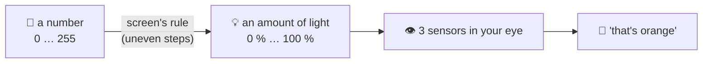
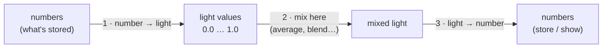

# Chapter 3 — How Screens Make Colour

> ⏱️ 20 minutes · Part 1: Just-enough graphics · ⭐ core

---

## 🎯 Today's goal

Understand two things that every graphics program depends on:
1. how **three little lamps** (red, green, blue) can make almost any colour you see;
2. why the number **128 is not "half as bright"** as 255, and how to mix colours correctly.

You'll end up with a colour-mixing function for Lumen that makes **bright, clean gradients** instead of muddy ones:


---

## 🧒 The idea in plain words

**Part 1: three lamps.** Inside your eye there are only **three kinds of colour sensors**. One is most sensitive to red light, one to green, one to blue. Every colour you have ever seen is just your brain reading *how strongly* each of the three was triggered.
So a screen doesn't need to copy real-world light. It only needs **three tiny lamps per pixel**, red, green and blue, set to the right strengths.

**Part 2: uneven steps.** Your eye notices small changes in **dark** areas much more than the same change in **bright** areas. So screens use the 256 numbers *unevenly*: many small steps in the dark, bigger steps in the bright. Like a staircase whose bottom steps are tiny and top steps are tall.
The result: a number is **not** an amount of light. **128 gives only about a fifth of full light.**



---

## 🔍 How it works

### 1. Light adds up

Mixing **light** is different from mixing **paint**. Paint *removes* light (more paint = darker). Lamps *add* light (more lamps = brighter). That's why it's called `additive colour` (= colours made by adding light).

| Lamps on | You see |
|---|---|
| red + green | **yellow** |
| green + blue | **cyan** |
| red + blue | **magenta** (pink-purple) |
| red + green + blue, all full | **white** |
| all off | **black** |
| all at the same middle strength | **grey** |

Surprised that red + green = yellow? Your eye's red and green sensors are both triggered, the same way real yellow light triggers them. Your brain can't tell the difference.

### 2. Sub-pixels: the lamps are really there

Look at your screen through a magnifying glass (or a phone camera zoomed in) and you'll see each pixel is made of **three thin stripes**, red, green and blue. Each stripe is a `sub-pixel` (= one of the three small lamps inside a pixel). The three numbers of a pixel simply set those three lamps.

Here's a simulation (🧪 I drew it with code, below in ▶️ *Try it*). **Top:** seven pixels seen very close up, just lamps. **Bottom:** the same seven pixels seen from far away.


- Yellow = red and green lamps on, blue off.
- White = all three on. Grey = all three at half.
- Orange = red full, green half, blue off.

From a normal distance the stripes are too small to see, and your eye blends them.

### 3. Numbers are not light

Screens (and picture files, and the web) follow a standard rule called `sRGB` (= the normal colour rule for screens). It says how much light each number means. Here's the rule as a table:

| Number | Light (share of full white) |
|---|---|
| 0 | 0 % |
| 64 | 5 % |
| **128** | **22 %** |
| **188** | **50 %** |
| 255 | 100 % |

The curve is steep at the top and flat at the bottom. That's the "uneven staircase", and its everyday name is `gamma`.

**Why build it this way?** With only 256 numbers, we want the steps to look **even to your eye**. Your eye is fussy about dark shades, so the rule gives dark shades many small steps. If the numbers were plain light amounts, dark areas (shadows, night skies) would show visible **bands** instead of smooth shading.

### 4. The golden rule for mixing colours

Whenever you **mix** colours (a gradient, blending two pictures, making something see-through, shrinking a picture), do it in three steps:



`light value` = how much light, as a number from 0.0 (off) to 1.0 (full). Adding and averaging only make sense for light values, because light physically adds up and numbers don't.

**Example: what's halfway between black (0) and white (255)?**
- ❌ Average the numbers: (0 + 255) / 2 = **128**. But 128 is only 22 % light: **too dark**.
- ✅ Average the light: (0 % + 100 %) / 2 = 50 % light = number **188**. Correct.

The formula for the rule (you'll copy it into Lumen; you don't need to memorise it):

```
number → light:   c = number / 255
                  light = c / 12.92                     if c ≤ 0.04045
                  light = ((c + 0.055) / 1.055) ^ 2.4   otherwise
light → number:   the same steps backwards (see the code below)
```

---

## ▶️ Try it

### 1. How much light is each number?

New here: `std::pow(a, b)` = a to the power b, from `<cmath>`. `std::lround` = round to the nearest whole number.

📜 **`light.cpp`**
```cpp
// light.cpp -- how much LIGHT does each number really give?
#include <cmath>
#include <cstdio>
#include <initializer_list>

// The sRGB rule every normal screen follows: number (0..255) -> light (0.0 = off, 1.0 = full).
double to_light(int number) {
    double c = number / 255.0;
    if (c <= 0.04045) return c / 12.92;
    return std::pow((c + 0.055) / 1.055, 2.4);
}
// The way back: light (0.0..1.0) -> number (0..255).
int to_number(double light) {
    double c = light <= 0.0031308 ? light * 12.92 : 1.055 * std::pow(light, 1 / 2.4) - 0.055;
    return int(std::lround(c * 255));
}

int main() {
    for (int n : {0, 64, 128, 188, 255})
        std::printf("number %3d -> %5.1f %% of full light\n", n, 100 * to_light(n));
    std::printf("half the light (50 %%) needs number %d\n", to_number(0.5));
    std::printf("a quarter of the light (25 %%) needs number %d\n", to_number(0.25));
}
```
```bash
g++ -std=c++20 -Wall -Wextra light.cpp -o light && ./light
```

🤔 **Guess first:** which number gives **half** of full light: 128, 160, 188 or 220?

<details><summary>✅ Reveal (I ran it)</summary>

```
number   0 ->   0.0 % of full light
number  64 ->   5.1 % of full light
number 128 ->  21.6 % of full light
number 188 ->  50.3 % of full light
number 255 -> 100.0 % of full light
half the light (50 %) needs number 188
a quarter of the light (25 %) needs number 137
```
**188** gives half the light. 128 gives only 21.6 %. And a quarter of the light needs 137, not 64.
</details>

### 2. Check it with your own eyes

This picture has three parts. **Left:** a fine checkerboard of pure black and pure white pixels (exactly half the pixels are fully on, so it has **50 % light**). **Middle:** solid grey 128. **Right:** solid grey 188.


👉 View it at **100 % zoom** (no zooming in or out, or the viewer itself mixes the pixels). Lean back or squint until the checkerboard looks like a flat grey. **Which square matches it, the middle or the right?**

On a normal screen it matches the **right** one (188). Your eyes just confirmed the table.
(Cheap laptop screens sometimes land in between. That's fine: it means the screen doesn't follow sRGB exactly.)

<details><summary>📜 The code that made the picture (<code>checker.cpp</code>)</summary>

```cpp
// checker.cpp -- see it yourself: which grey has HALF the light?
#include <fstream>
#include <vector>

int main() {
    const int width = 360, height = 120;
    std::vector<unsigned char> img(width * height * 3);
    for (int y = 0; y < height; ++y)
        for (int x = 0; x < width; ++x) {
            int v;
            if (x < 120)      v = (x + y) % 2 ? 255 : 0;   // left: tiny black/white checkerboard
            else if (x < 240) v = 128;                     // middle: the number 128
            else              v = 188;                     // right: the number 188
            for (int ch = 0; ch < 3; ++ch) img[(y * width + x) * 3 + ch] = v;
        }
    std::ofstream f("checker.ppm", std::ios::binary);
    f << "P6\n" << width << " " << height << "\n255\n";
    f.write(reinterpret_cast<const char*>(img.data()), img.size());
}
```
</details>

### 3. Mixing red and green, two ways

Each bar goes from red (left) to green (right). The **top** bar mixes the **numbers**. The **bottom** bar mixes the **light** (the golden rule).

📜 **`mix.cpp`**
```cpp
// mix.cpp -- mixing two colours: on the NUMBERS (wrong) vs on the LIGHT (right).
#include <cmath>
#include <fstream>
#include <vector>

double to_light(int n) { double c = n / 255.0; return c <= 0.04045 ? c / 12.92 : std::pow((c + 0.055) / 1.055, 2.4); }
int to_number(double l) { double c = l <= 0.0031308 ? l * 12.92 : 1.055 * std::pow(l, 1 / 2.4) - 0.055; return int(std::lround(c * 255)); }

int mix_numbers(int a, int b, double t) { return int(std::lround(a + t * (b - a))); }
int mix_light(int a, int b, double t)   { return to_number(to_light(a) + t * (to_light(b) - to_light(a))); }

int main() {
    const int width = 512, height = 130;
    std::vector<unsigned char> img(width * height * 3, 255);       // start white
    int red[3] = {255, 0, 0}, green[3] = {0, 255, 0};
    for (int x = 0; x < width; ++x) {
        double t = x / double(width - 1);                           // 0 at the left, 1 at the right
        for (int y = 0; y < height; ++y) {
            if (y >= 60 && y < 70) continue;                        // a white gap between the bars
            for (int ch = 0; ch < 3; ++ch)
                img[(y * width + x) * 3 + ch] = y < 60 ? mix_numbers(red[ch], green[ch], t)   // top bar
                                                       : mix_light(red[ch], green[ch], t);    // bottom bar
        }
    }
    std::ofstream f("mix.ppm", std::ios::binary);
    f << "P6\n" << width << " " << height << "\n255\n";
    f.write(reinterpret_cast<const char*>(img.data()), img.size());
}
```

🤔 **Guess first:** in the middle of each bar, will you see yellow or something else?

<details><summary>✅ Reveal (I ran it)</summary>


- **Top (numbers mixed):** the middle is (128, 128, 0), only 22 % light per lamp: a **muddy brown**.
- **Bottom (light mixed):** the middle is (188, 188, 0): a **clean yellow**, as bright as it should be.

That brown band is one of the most common mistakes in graphics. You'll see it in many apps once you know it. Lumen won't have it.
</details>

<details><summary>📜 The code for the sub-pixel picture (<code>subpixels.cpp</code>, optional)</summary>

```cpp
// subpixels.cpp -- what a screen does with (R, G, B): three tiny lamps per pixel.
#include <fstream>
#include <vector>

struct Color { int r, g, b; };

int main() {
    // 7 pixels in a row: red, green, blue, yellow, white, grey, orange
    std::vector<Color> row = {{255,0,0}, {0,255,0}, {0,0,255}, {255,255,0},
                              {255,255,255}, {128,128,128}, {255,128,0}};
    const int stripe = 20, tall = 60;                 // each lamp drawn as a 20 x 60 stripe
    int width = int(row.size()) * 3 * stripe, height = tall + 40;   // + a 40-px band below

    std::vector<unsigned char> img(width * height * 3, 0);   // start all black (lamps off)
    for (int y = 0; y < height; ++y)
        for (int i = 0; i < int(row.size()); ++i) {
            int lamps[3] = {row[i].r, row[i].g, row[i].b};
            for (int lamp = 0; lamp < 3; ++lamp)                  // 0 = red, 1 = green, 2 = blue lamp
                for (int s = 0; s < stripe; ++s) {
                    int x = (i * 3 + lamp) * stripe + s;
                    if (y < tall) {                                // top: the 3 lamps, close up
                        if (s > 1 && s < stripe - 2) img[(y * width + x) * 3 + lamp] = lamps[lamp];
                    } else if (y >= tall + 8) {                    // bottom band: seen from far away
                        for (int ch = 0; ch < 3; ++ch) img[(y * width + x) * 3 + ch] = lamps[ch];
                    }
                }
        }
    std::ofstream f("subpixels.ppm", std::ios::binary);
    f << "P6\n" << width << " " << height << "\n255\n";
    f.write(reinterpret_cast<const char*>(img.data()), img.size());
}
```
</details>

---

## 🏗️ Build it — Lumen step 3: colours that mix correctly

**Add to Lumen:**
1. A small colour type: `struct Color { unsigned char r, g, b; };`
2. Two helpers: `double to_light(unsigned char number)` and `unsigned char to_number(double light)` (the sRGB rule above; clamp `light` to 0.0–1.0 first).
3. `Color mix(Color a, Color b, double t)`: for each channel, number → light, mix with `t` (0 = all `a`, 1 = all `b`), light → number.
4. Use `mix` for your sunset wallpaper: each row = `mix(top_colour, bottom_colour, y / (height - 1.0))`.

**Done when:**
- [ ] `mix(black, white, 0.5)` gives **(188, 188, 188)**;
- [ ] `mix(red, green, 0.5)` gives **(188, 188, 0)**;
- [ ] `mix(a, b, 0)` gives exactly `a` and `mix(a, b, 1)` gives exactly `b`, for any colours;
- [ ] the sunset still shows, and its middle looks **brighter** than before (compare a screenshot with step 2);
- [ ] no warnings; committed to git.

**Hints:**
- Put the colour code in its own files: `src/color.hpp` (declarations) and `src/color.cpp` (code). Add `src/color.cpp` to `add_executable(...)` in `CMakeLists.txt`.
- For the checks, the simplest tool is `assert` from `<cassert>`: `assert(mix(black, white, 0.5).r == 188);` stops the program with a message if it's false. Put a few at the start of `main`. (We'll get a proper test tool later.)
- Watch out: `to_number` must **round**, not cut off. Use `std::lround`.

---

## ✅ Quick check

**1.** Which lamps are on, and how strongly, for the colour (255, 255, 0)? What colour is it?
<details><summary>Answer</summary>Red full, green full, blue off. That makes <b>yellow</b>.</details>

**2.** About how much light does the number 128 give? Which number gives 50 %?
<details><summary>Answer</summary>About 22 % (21.6 %). 188 gives 50 %.</details>

**3.** A gradient from blue to yellow has a dull grey-brown middle. What did the programmer do wrong, and what's the fix?
<details><summary>Answer</summary>They mixed the <b>numbers</b>. Fix: number → light, mix the light, light → number (the golden rule).</details>

---

## ➡️ Next

**Chapter 4 — Pictures in memory:** how a picture really sits in memory, why screens use **4 bytes** per pixel, and which byte is red.

<details><summary>🔬 Going deeper (optional)</summary>

- Two different lights that trigger your three sensors the same way look **identical**. That's why three lamps are enough.
- The exact red, green and blue of the lamps differ between screens. sRGB defines a standard set. Wide-colour screens (phones, newer laptops) have deeper reds and greens, and need colour management to show sRGB pictures correctly.
- The name "gamma" comes from old tube TVs, whose light naturally followed a curve like light = number^2.2. The curve was kept because it also suits the eye.
- Brightness isn't equal per lamp: green looks about 10× brighter than blue at the same strength (brightness ≈ 0.21 R + 0.72 G + 0.07 B, using light values).
</details>
