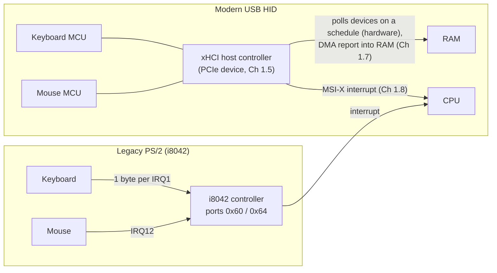
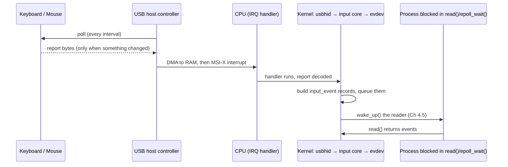

# PART 1 — Hardware Foundations (extension: the rest of the machine)

> Part 1 originally closed at Chapter 1.10 with CPU, caches, RAM, PCIe, DMA, interrupts, polling and MMIO. Chapters **1.11–1.18** finish the picture of a *complete* computer — input, buses, time, graphics, display, audio, boot — using generic hardware, and show that every one of those devices is built from the same handful of patterns you already know.

## Chapter 1.11 — Keyboard and Mouse (Input Devices)

### 🧠 One-Sentence Mental Model
> A keyboard or mouse is a tiny microcontroller that turns physical motion into a few bytes, which the *host* collects (by polling, in hardware) and hands to the CPU as an interrupt; the kernel then turns those bytes into timestamped `input_event` records that userspace reads from a file descriptor — the same "device → DMA/ring → interrupt → wake a blocked reader" chain as every other device, just at kilobytes per second instead of gigabytes.

### 🧒 Explain Like I'm Five
When you press a key, a tiny brain inside the keyboard notices and writes a little note: "key 4 went down." It can't shout across the room, so the computer's front desk keeps asking the keyboard, hundreds of times a second, "anything new?" The moment the answer is yes, the front desk rings a bell for the CPU, and the CPU hands the note to whoever is waiting for it.

### 🌍 Real-World Analogy
A restaurant kitchen pass: the waiter (the USB host controller) walks past the cook (the keyboard) every few milliseconds asking "anything ready?" The cook can't call out — only answer. When a dish is ready the waiter picks it up, rings the head chef's bell (interrupt), and the head chef (the kernel) puts the order slip on the correct customer's table (the process blocked in `read()`).

### ❓ The Problem
You've seen how blocking I/O works for files and sockets (Parts 3–5). But how does a *keystroke* — which no program asked for at any particular moment — get from a physical switch to your program's `read()` call? What is actually happening in the microseconds in between, and where can latency hide?

### 🔥 Why This Problem Matters
Input is the purest example of **rare, unpredictable, latency-critical events**: a thread should sleep at zero cost for hours, then wake within microseconds of a key press. It is the original motivation for blocking waits, interrupts, and event loops. And it is the first link in the key-to-pixel chain (Chapter 1.18) that decides whether a computer *feels* fast.

### 🕰 Historical Context
The IBM PC's keyboard controller (the **i8042**, with **PS/2** ports) gave keyboards IRQ 1 and mice IRQ 12, with one byte per interrupt via I/O ports `0x60` (data) and `0x64` (status/command). USB (Chapter 1.12) replaced PS/2 in the late 1990s–2000s, and **HID** (Human Interface Device) became the universal, self-describing way for keyboards, mice, gamepads and touchscreens to report input. The legacy ports are still there: on this chapter's sandbox, `/proc/ioports` still lists `0060 : keyboard` and `0064 : keyboard` — even inside a micro-VM with no physical keyboard.

### 💡 The Naive Solution
"The keyboard sends the character you typed, and the CPU reads it."

### ❌ Why the Naive Solution Fails
- A keyboard does **not** send characters — it sends *which physical key* changed state (a usage code). Layout (QWERTY vs. AZERTY), Shift, dead keys and input methods are all **software** translation.
- The CPU does not "ask" the keyboard — polling every device continuously would waste the CPU (Chapter 1.9). Something else must do the asking, and the CPU must be *told* when something happened (Chapter 1.8).
- A mouse does not send a *position* — it sends *how far it moved since the last report* (relative motion). Software integrates those deltas into a pointer position.

### ✅ The Better Solution
Layer it: (1) a microcontroller in the device scans switches/sensors and packs a tiny **report**; (2) the **host controller** polls the device on a fixed schedule in hardware and DMAs the report into RAM (Chapter 1.12); (3) one **interrupt** tells the CPU; (4) the kernel's **input subsystem** turns reports into generic **events**; (5) userspace reads the events from `/dev/input/eventN`, an ordinary file descriptor that can block, be nonblocking, or be watched by `epoll`.

### 🧠 Core Concept
> **Hardware polls, software is interrupted.** The device never initiates; the host controller asks it on a schedule (polling at the periphery), and the CPU is interrupted only when a poll returns something (interrupts at the core). That layering gives you zero CPU cost while idle *and* microsecond reaction time when something happens — Chapters 1.8 and 1.9 combined into one design.

---

### 📐 Deep Technical Explanation

#### 1. Inside the devices

| Device | What it physically measures | What it sends |
|---|---|---|
| **Keyboard** | A matrix of switches. A microcontroller scans rows/columns, applies *debouncing* (a mechanical contact "chatters" for a few ms), and tracks which keys are down. | An **8-byte report** (boot protocol): modifier-bit mask, a reserved byte, and up to **6 key usage codes** held at once. |
| **Mouse** | An optical (or laser) sensor photographs the surface thousands of times per second and computes how far it slid (counts per inch, "DPI"). Buttons and wheel are switches/encoders. | A **short report**: button bits, `dx`, `dy` (signed 8-bit in the boot protocol; wider in modern reports), wheel. **Relative** motion only. |
| **Touchpad / touchscreen / tablet** | Absolute finger/pen coordinates | Absolute `x`, `y`, pressure, contact IDs |

Keys are identified by **HID usage IDs** — a position/function on the keyboard, *not* a character: usage `0x04` is the "A" key, `0x05` is "B". Turning "usage `0x04` while Shift is down" into the character `A` is done by the keymap in software (e.g. xkb). That is why switching keyboard layouts needs no new hardware.

Holding a key down does **not** make the keyboard send repeated reports. The device reports "down" once; the *repeat* is generated by software (the kernel input core or your GUI session) after a delay, at a rate you can configure.

#### 2. Two generations of wiring



PS/2: the controller raises an interrupt *per byte*, and the CPU reads port `0x60` with a port-I/O instruction — a few hundred events/second at most, so it was fine. USB: the host controller does the polling and the DMA, and the CPU gets one (possibly batched) interrupt per completed transfer.

#### 3. Report sizes and rates

A typical report is **3–8 bytes**. A mouse polled at **1000 Hz** sends at most 1000 reports/s ≈ a few KB/s. Gaming mice poll at up to **8000 Hz**, which at worst means thousands of events per second per device — tiny in bandwidth, but, per Chapter 1.8, each event can cost an interrupt, which is why host controllers support **interrupt moderation** (batching).

Poll rate sets a **latency floor**: a report waits, on average, half a polling interval before the host even asks for it.

| Poll rate | Interval | Average wait | Worst-case wait |
|---:|---:|---:|---:|
| 125 Hz | 8.000 ms | 4.000 ms | 8.000 ms |
| 500 Hz | 2.000 ms | 1.000 ms | 2.000 ms |
| 1000 Hz | 1.000 ms | 0.500 ms | 1.000 ms |
| 8000 Hz | 0.125 ms | 0.062 ms | 0.125 ms |

(Computed from interval = 1 / rate; average ≈ interval / 2.)

#### 4. The kernel path (Linux, generic)



Userspace sees a stream of fixed-size **`struct input_event`** records — `{ timestamp, type, code, value }`, **24 bytes** on 64-bit Linux (measured below). The important types:

| `type` | Meaning | Example |
|---|---|---|
| `EV_KEY` | A key or button changed. `value`: `0` = release, `1` = press, `2` = autorepeat | `KEY_A` (code 30), `BTN_LEFT` (0x110) |
| `EV_REL` | Relative motion | `REL_X`, `REL_Y`, `REL_WHEEL` |
| `EV_ABS` | Absolute position (touch, tablets) | `ABS_X`, `ABS_Y` |
| `EV_SYN` / `SYN_REPORT` | "That was one complete report — act on everything you've collected" | marks the end of a batch |

`SYN_REPORT` matters: a diagonal mouse move is *two* events (`REL_X`, `REL_Y`) followed by one `SYN_REPORT`; a program must not move the pointer until it has seen both.

`/dev/input/eventN` is just a file descriptor (Chapter 3.1) whose `file_operations` (Chapter 3.4) dispatch to the input layer. Because it has a *producer* it has real readiness semantics: `read()` blocks (Chapter 4.2), it can be `O_NONBLOCK` (Chapter 5.2) returning `EAGAIN` when empty (Chapter 5.3), and it works with `poll`/`epoll` — unlike a regular file (Chapter 5.5).

#### 5. Pointer position is *your* job

Mouse events are relative, so something integrates them: `x += dx; y += dy`, clamped to the screen and usually passed through an **acceleration curve** (small motion = fine control, fast motion = larger jumps). On a modern desktop that something is the display server/compositor (via libinput). The pointer image itself is often drawn by the display hardware's dedicated **cursor plane** (Chapter 1.15), which is why it can keep moving smoothly even when an application is busy.

---

## 🔬 Project: decode input events yourself

**This sandbox has no `/dev/input` and no keyboard or mouse** (it is a headless micro-VM), so there is nothing real to read. Instead the test uses a file of **synthetic** `input_event` records that I generate, in exactly the format a real device node produces. The reader program is the real thing: point it at `/dev/input/eventN` on your own machine (needs `sudo` or membership in the `input` group) and it works unchanged.

**The reader** — a loop of blocking `read()`s that integrates relative motion:

```cpp
// evdev_reader.cpp -- decode Linux input events (what keyboards/mice look like to userspace)
// Compile: g++ -O2 -std=c++20 evdev_reader.cpp -o evdev_reader
// Run on real hardware (needs permission, e.g. sudo):  ./evdev_reader /dev/input/event3
// Run on a recorded/synthetic file:                     ./evdev_reader events.bin
#include <fcntl.h>
#include <linux/input.h>
#include <unistd.h>
#include <cstdio>
#include <cstring>

int main(int argc, char** argv) {
    if (argc < 2) { fprintf(stderr, "usage: %s <event-device-or-file>\n", argv[0]); return 1; }
    int fd = open(argv[1], O_RDONLY);
    if (fd < 0) { perror("open"); return 1; }

    long x = 500, y = 400;            // our own idea of the pointer position (mouse reports are RELATIVE)
    int  dx = 0, dy = 0;              // deltas accumulated until the next SYN_REPORT
    input_event ev;
    // One read() returns whole input_event structs. On a real device this BLOCKS (Ch 4.2) until the
    // device's interrupt -> driver -> evdev queue wakes us (Ch 4.5).
    while (read(fd, &ev, sizeof ev) == (ssize_t)sizeof ev) {
        if (ev.type == EV_REL && ev.code == REL_X) dx += ev.value;
        else if (ev.type == EV_REL && ev.code == REL_Y) dy += ev.value;
        else if (ev.type == EV_REL && ev.code == REL_WHEEL) printf("  wheel %+d\n", ev.value);
        else if (ev.type == EV_KEY) {
            const char* what = ev.value == 0 ? "release" : ev.value == 1 ? "PRESS" : "repeat";
            if (ev.code == BTN_LEFT)       printf("  mouse LEFT button %s\n", what);
            else if (ev.code == BTN_RIGHT) printf("  mouse RIGHT button %s\n", what);
            else                           printf("  key code %d (%s)\n", ev.code, what);
        } else if (ev.type == EV_SYN && ev.code == SYN_REPORT) {      // "that's one complete report"
            if (dx || dy) { x += dx; y += dy; printf("  pointer moved (%+d,%+d) -> now at (%ld,%ld)\n", dx, dy, x, y); }
            dx = dy = 0;
        }
    }
    close(fd);
}
```

**The synthetic generator** (writes 15 records = 360 bytes: two moves, a click, a key press/release, a wheel notch):

```cpp
// make_events.cpp -- write SYNTHETIC input_event records (what a driver would queue), to test the reader
#include <linux/input.h>
#include <cstdio>
#include <cstring>
static FILE* out;
static void ev(unsigned short type, unsigned short code, int value) {
    input_event e; memset(&e, 0, sizeof e); e.type = type; e.code = code; e.value = value;
    fwrite(&e, sizeof e, 1, out);
}
int main() {
    out = fopen("events.bin", "wb");
    ev(EV_REL, REL_X, 5);  ev(EV_REL, REL_Y, -3); ev(EV_SYN, SYN_REPORT, 0);   // small move
    ev(EV_REL, REL_X, 12); ev(EV_SYN, SYN_REPORT, 0);                          // move right
    ev(EV_KEY, BTN_LEFT, 1); ev(EV_SYN, SYN_REPORT, 0);                        // click down
    ev(EV_KEY, BTN_LEFT, 0); ev(EV_SYN, SYN_REPORT, 0);                        // click up
    ev(EV_KEY, KEY_A, 1);   ev(EV_SYN, SYN_REPORT, 0);                         // press 'a'
    ev(EV_KEY, KEY_A, 0);   ev(EV_SYN, SYN_REPORT, 0);                         // release 'a'
    ev(EV_REL, REL_WHEEL, -1); ev(EV_SYN, SYN_REPORT, 0);                      // scroll one notch
    fclose(out);
}
```

**Predict before running:** (a) After the first two moves, where is the pointer if it starts at (500, 400)? (b) What `code` will the 'A' key have — the ASCII value 65, or something else? (c) Why does the first move print only *one* line even though it contains two `EV_REL` events?

### 📊 Measured output (compiled and run here, synthetic input)

```
$ ./make_events && ./evdev_reader events.bin
  pointer moved (+5,-3) -> now at (505,397)
  pointer moved (+12,+0) -> now at (517,397)
  mouse LEFT button PRESS
  mouse LEFT button release
  key code 30 (PRESS)
  key code 30 (release)
  wheel -1
$ ls -l events.bin   -> 360 bytes (15 records x 24)
sizeof(input_event) = 24     KEY_A = 30     BTN_LEFT = 0x110
```

<details><summary>Click to reveal the answers</summary>

(a) **(517, 397)** — (500+5+12, 400−3+0). The program only knows the position because it *integrated the deltas itself*. (b) **30** — `KEY_A` is a Linux key *code* (a physical key identity), not ASCII; mapping it to `a`/`A` is the keymap's job. (c) `REL_X` and `REL_Y` are accumulated and only acted on at `SYN_REPORT` — the batching marker that says "this group of events belongs together."
</details>

**Decoding the raw wire bytes** (the USB HID boot-protocol reports that sit *beneath* `input_event`) — also compiled and run:

```cpp
// hid_decode.cpp -- decode the raw bytes a USB HID mouse / keyboard puts on the wire (boot protocol)
#include <cstdint>
#include <cstdio>
int main() {
    uint8_t mouse[3] = {0x01, 0x05, 0xFD};           // bit0 = left button down, dx = +5, dy = 0xFD = -3 (two's complement)
    printf("mouse report  %02x %02x %02x : left=%d right=%d middle=%d  dx=%+d dy=%+d\n",
           mouse[0], mouse[1], mouse[2], mouse[0] & 1, (mouse[0] >> 1) & 1, (mouse[0] >> 2) & 1,
           (int8_t)mouse[1], (int8_t)mouse[2]);
    uint8_t kbd[8] = {0x02 /*left shift*/, 0x00, 0x04 /*A*/, 0x05 /*B*/, 0, 0, 0, 0};
    printf("keyboard rpt  ");
    for (int i = 0; i < 8; ++i) printf("%02x ", kbd[i]);
    printf(": shift=%d  keys down:", (kbd[0] >> 1) & 1);
    for (int i = 2; i < 8; ++i) if (kbd[i]) printf(" usage 0x%02x ('%c' key)", kbd[i], 'A' + kbd[i] - 0x04);
    printf("\n");
}
```
```
mouse report  01 05 fd : left=1 right=0 middle=0  dx=+5 dy=-3
keyboard rpt  02 00 04 05 00 00 00 00 : shift=1  keys down: usage 0x04 ('A' key) usage 0x05 ('B' key)
```
A whole mouse movement-plus-click is **three bytes**. Everything above those three bytes — interrupts, wakeups, timestamps, acceleration, cursor drawing — is overhead and policy, which is exactly why latency work focuses on it.

**Try on your own machine** (not run here): `cat /proc/bus/input/devices` (lists input devices and their `eventN` handlers) and `sudo ./evdev_reader /dev/input/eventN` for the one matching your mouse; watch `cat /proc/interrupts` while moving the mouse to see the host-controller line count climb.

### ❌ Common Misconceptions
- ❌ **"The keyboard sends characters."** — It sends key *positions* (usage codes); software maps them to characters via the layout/keymap.
- ❌ **"A mouse reports where the pointer is."** — Mice report *relative* motion; touchpads/touchscreens/tablets report absolute positions. Software integrates the deltas.
- ❌ **"Each keystroke interrupts the CPU straight from the key."** — The device is *polled* by the host controller; the CPU is interrupted by the controller after it DMAs the report.
- ❌ **"Key repeat is done by the keyboard."** — The device reports "down" once; repeat is software.
- ❌ **"Input is too slow to matter for I/O design."** — Bandwidth is tiny, but it is the canonical *latency-sensitive, rarely-firing* event source — exactly what blocking and event-driven designs optimise.
- ❌ **"A process reading the keyboard polls it."** — It blocks (zero CPU) until the kernel's wakeup.

### 🧙 Wizard Insight
The whole stack is a chain of *translations at decreasing levels of physics*: switch closure → scan code → HID report → DMA'd bytes → `input_event` → keymap → character/pointer motion → application event. Each hop adds a few microseconds of work *and* a place where batching or scheduling can add milliseconds. When someone says "my input feels laggy," the tool is to find which hop is adding the time — and the largest hops are almost never the CPU work, but the **waiting**: the poll interval at the bottom and the display refresh at the top (Chapter 1.15).

### 🧠 Quiz
**Q1.** Why does a USB mouse polled at 125 Hz feel laggier than one at 1000 Hz even though both send the same 3-byte report?
<details><summary>Answer</summary>A report waits on average half a polling interval before the host controller asks for it: ~4 ms at 125 Hz versus ~0.5 ms at 1000 Hz. The data is identical; only the wait differs.</details>

**Q2.** Who is polling, and who is interrupted?
<details><summary>Answer</summary>The USB host controller (hardware) polls the device on a schedule; the CPU is interrupted only when a poll returns a report (after the controller has DMA'd it into RAM). Hardware polls, software is interrupted.</details>

**Q3.** Why must a program wait for `SYN_REPORT` before moving the pointer?
<details><summary>Answer</summary>A single physical movement is delivered as several events (`REL_X`, `REL_Y`, ...). `SYN_REPORT` marks that the group is complete; acting earlier would apply only part of the motion.</details>

**Q4.** Why can `/dev/input/eventN` be used with `epoll` while a regular file cannot (Chapter 5.5)?
<details><summary>Answer</summary>It has a real producer and a wait queue that is woken when events arrive, so "readable" is a meaningful state; a regular file has no producer and is always "ready."</details>

### 📌 Short Notes (Quick Reference)
- Keyboards send **usage codes** (key identities), not characters; mice send **relative** deltas, not positions. Software does the mapping/integration.
- Reports are tiny: mouse ≈ 3 bytes (buttons, dx, dy); keyboard boot report = 8 bytes (modifiers, reserved, ≤ 6 keys).
- PS/2: i8042, ports `0x60`/`0x64`, IRQ1/IRQ12, an interrupt per byte. USB HID: host controller polls, DMAs, interrupts.
- Poll interval = latency floor (avg wait = interval/2): 125 Hz → 4 ms, 1000 Hz → 0.5 ms.
- Linux: `usbhid` → input core → `evdev` → `/dev/input/eventN` → 24-byte `input_event {time, type, code, value}`; `SYN_REPORT` ends a batch.
- `eventN` is a normal fd: blocking, `O_NONBLOCK`, `epoll`-able.
- Key repeat and pointer acceleration are software; the cursor is often a hardware plane (Ch 1.15).

### 🔗 What This Connects To Next
**Previous:** Part 1, Chapter 1.10 — Memory-Mapped I/O
**Current:** Part 1, Chapter 1.11 — Keyboard and Mouse
**Next:** Part 1, Chapter 1.12 — USB: the shared, host-polled bus that carries them (and why a USB 3 host controller is yet another descriptor-ring device)
