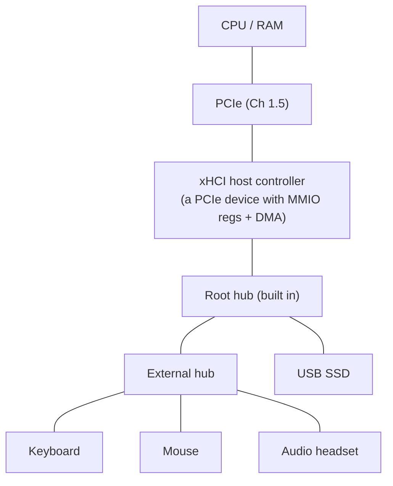
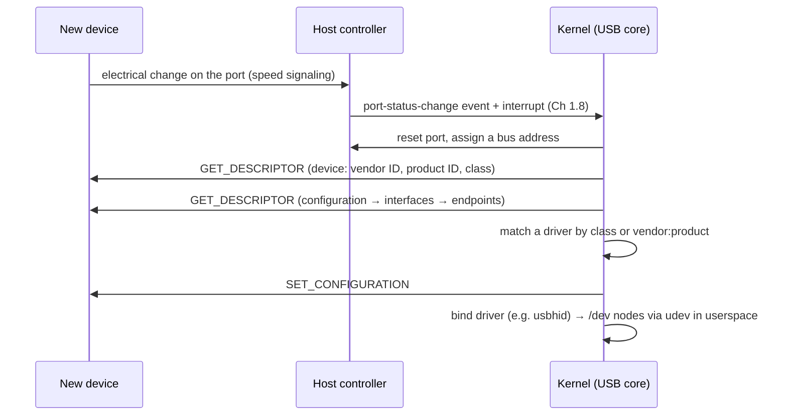
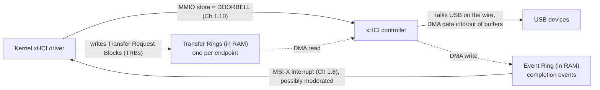

# PART 1 — Hardware Foundations (extension)

## Chapter 1.12 — USB: One Bus, Hundreds of Device Types

### 🧠 One-Sentence Mental Model
> USB is a **host-driven, tree-shaped serial bus**: nothing on it ever speaks unless the host asks, devices describe themselves with *descriptors* so one generic driver framework can serve keyboards, disks, cameras and headsets, and the host controller on the PCIe side (xHCI) is itself a ring-and-doorbell DMA device exactly like Chapter 1.6's pattern.

### 🧒 Explain Like I'm Five
USB is like a school where the teacher (the computer) is the only one allowed to start talking. Every student (device) sits quietly until called on. When a new student arrives, the teacher says "who are you and what can you do?" — the student hands over a card describing itself, and the teacher knows which helper to assign.

### 🌍 Real-World Analogy
A conference-room microphone system with a moderator: nobody speaks until the moderator points at them. Each speaker's name tag lists their role (translator, panelist, timekeeper); the moderator uses those tags to decide how to treat them. "Moderator points at someone every few milliseconds" is USB polling; the name tag is the descriptor.

### ❓ The Problem
Computers needed one cheap, hot-pluggable connector for devices with wildly different needs: a keyboard (a few bytes, but latency-sensitive), a disk (huge, throughput-oriented), a microphone (small but needs a *guaranteed* steady stream), a camera (both). How can one wire and one driver model serve all of them?

### 🔥 Why This Problem Matters
USB shows, in one place, three ideas the rest of the course keeps using: (1) **hardware polling hidden beneath interrupts** (Chapters 1.8–1.9 combined), (2) **different traffic classes with different guarantees** (throughput vs. latency vs. hard deadlines), and (3) **ring-based DMA command/completion** (the ancestor of `io_uring`, Chapter 1.6).

### 🕰 Historical Context
Before USB (1996), every peripheral had its own port and its own driver story: serial, parallel, PS/2, game port, SCSI. USB 1.x (1.5 and 12 Mb/s) unified them; USB 2.0 (480 Mb/s) made storage practical; USB 3.x (5 → 10 → 20 Gb/s) and USB4 (up to 40 Gb/s and beyond) approached internal-bus speeds. USB-C is a *connector*, not a speed — the protocol behind it can be USB 2, 3.x, USB4 or Thunderbolt-compatible.

### 💡 The Naive Solution
"Give each device an interrupt line and a register block, like PCIe devices" — or "let devices send whenever they have data."

### ❌ Why the Naive Solution Fails
Dedicated lines don't scale to hot-plugged, daisy-chained devices; and letting devices transmit freely on a shared wire causes collisions and makes guarantees impossible. A single bus needs a single *arbiter* — and the simplest arbiter is "the host decides who talks, and when."

### ✅ The Better Solution
A host-scheduled bus: the host controller divides time into tiny slots (frames of 1 ms, and 125 µs microframes at high speed), reserves slots for devices that need guaranteed timing, and fills the rest with best-effort bulk traffic. Devices identify themselves by **descriptors**, so drivers attach by *class* (HID, mass storage, audio, video, hub…) rather than by individual model.

### 🧠 Core Concept
> **USB = host polling + self-describing devices + four traffic types.** Because the host is the only initiator, the bus can promise latency and bandwidth where needed, and because devices describe themselves, one driver framework scales to thousands of products.

---

### 📐 Deep Technical Explanation

#### 1. Topology



A tree with the host controller at the root: every device talks only to the host, never to a sibling. A device's 7-bit address allows up to **127 devices per bus** (USB 2.0 rules; xHCI supports up to 255 device *slots* across its ports), and the bandwidth of a hub's upstream link is **shared** by everything below it — two busy disks on one hub fight over one uplink.

#### 2. Enumeration — how a new device becomes a driver



Hot-plug is therefore **an interrupt plus a conversation**: the kernel learns what the device is only by *asking* it. The device's **endpoints** (numbered one-way channels, e.g. "endpoint 1 IN") are the pipes the driver then uses.

#### 3. The four transfer types

| Type | Purpose | Guarantee | Typical user |
|---|---|---|---|
| **Control** | Setup, configuration, descriptors (endpoint 0) | Reliable, small | Every device at enumeration |
| **Bulk** | Large reliable data | Correct, but **no timing guarantee** — uses leftover bandwidth | Storage, printers |
| **Interrupt** | Small, periodic, latency-bounded data | Host polls at a fixed interval, so max latency is bounded | Keyboards, mice, hubs |
| **Isochronous** | Steady real-time streams | **Reserved bandwidth** and timing; **no retransmission** (late = lost) | Audio, video (Chapter 1.16) |

> ⚠️ **The naming trap.** A USB "interrupt transfer" is **not** a hardware interrupt from the device. It means *the host polls this endpoint every `bInterval` frames*. USB moves polling *into the host controller's hardware*, so the CPU is only interrupted when a poll actually returns data.

Periodic traffic (interrupt + isochronous) is allowed to occupy at most about **90 % of a full-speed frame** and **80 % of a high-speed microframe**, leaving room for control and bulk.

#### 4. Speeds (raw signaling rates)

| Name | Rate | Notes |
|---|---:|---|
| Low speed | 1.5 Mb/s | Early keyboards/mice |
| Full speed | 12 Mb/s | USB 1.1 |
| High speed | 480 Mb/s | USB 2.0 |
| SuperSpeed | 5 Gb/s | USB 3.0 / 3.1 Gen 1 / 3.2 Gen 1 (8b/10b coding → ≈ 4 Gb/s of payload) |
| SuperSpeed+ | 10 Gb/s | USB 3.1 Gen 2 / 3.2 Gen 2 (128b/132b coding, ≈ 97 % efficient) |
| 3.2 Gen 2×2 | 20 Gb/s | Two lanes |
| USB4 | up to 40 Gb/s (v2: up to 80) | Tunnels PCIe/DisplayPort |

These are line rates, **not** achievable file-copy speeds: protocol overhead, the device itself (a slow flash drive), and the shared uplink all cut into it. Always measure.

#### 5. The host controller is a ring device (xHCI)

An **xHCI** (USB 3) controller is a PCIe device (Chapter 1.5) driven exactly as Chapter 1.6 describes:



Command ring + per-endpoint transfer rings + event ring + a doorbell register array: **submit queue, completion queue, doorbell** — the same shape as NVMe, high-end NICs, GPU command buffers, and `io_uring`'s SQ/CQ (Part 14). In Linux, a driver submits an asynchronous **URB** (USB Request Block) and gets a completion callback — "submit, continue, be told later" is the whole USB software model.

#### 6. Power

A USB port also delivers power (5 V; up to about 500 mA on USB 2.0 and 900 mA on USB 3.x in the original specs; USB-C Power Delivery negotiates much higher, up to hundreds of watts). The same cable negotiates both data and power role.

---

## 🔬 Lab: what to look at (no USB hardware in this sandbox)

**Honest status: this sandbox is a micro-VM with only virtio devices — there is no USB controller, so nothing below was run here.** `ls /sys/bus/usb/devices` fails, `lsusb` is not installed. The arithmetic table in Chapter 1.11 (poll interval → latency) *was* computed here. On your own machine, try:

```bash
lsusb -t                                   # the device TREE: root hub → hubs → devices, with speed and driver
lsusb -v -d <vendor>:<product> | less      # the descriptors a device hands the host at enumeration
cat /sys/bus/usb/devices/*/speed           # 1.5 / 12 / 480 / 5000 / 10000 ...
grep -i xhci /proc/interrupts              # the host controller's interrupt lines (watch them climb as you move a mouse)
```
**Predict:** with a 1000 Hz mouse on the root hub, will `xhci` interrupts climb by ~1000/s while you wave it? (Often *less*: the controller only raises an interrupt when a poll returns *new data*, and may batch events — interrupt moderation — so the count depends on how continuously you move the mouse and on the moderation setting. Compare mouse-still vs mouse-waving.)

### ❌ Common Misconceptions
- ❌ **"USB devices raise interrupts to get attention."** — Devices cannot initiate; the host polls. "Interrupt transfer" is a polling schedule.
- ❌ **"USB-C means USB 3/4 speed."** — USB-C is a connector; the cable and ports may be USB 2.0 only.
- ❌ **"5 Gb/s means 5 Gb/s of file transfer."** — Coding overhead, protocol overhead and the device limit it (≈ 4 Gb/s usable at best for 5 Gb/s signaling).
- ❌ **"Two fast devices on one hub each get full speed."** — They share the hub's uplink.
- ❌ **"Isochronous = faster."** — It means *guaranteed timing, no retries*, not higher throughput.
- ❌ **"A USB driver is per-model."** — Class drivers (HID, mass storage, audio, hub) cover most devices through descriptors.

### 🧙 Wizard Insight
USB is where the three "ways to learn about events" meet. The device is **polled** (host controller, in hardware, on a fixed schedule), the CPU is **interrupted** (MSI-X, once per completed batch), and the application is **woken** (wait queue, Chapter 4.5). Each layer picks the cheapest technique for *its* event rate. That layering — poll low, interrupt in the middle, sleep at the top — is the same design NAPI, `epoll` and `io_uring` use, and it's the cleanest real-world answer to "polling or interrupts?" in the whole machine.

### 🧠 Quiz
**Q1.** What does "USB interrupt transfer" actually mean?
<details><summary>Answer</summary>The host controller polls the endpoint every `bInterval` frames/microframes, giving the device a bounded maximum latency. There is no device-initiated hardware interrupt.</details>

**Q2.** Why is isochronous transfer used for audio instead of bulk?
<details><summary>Answer</summary>Audio needs a *steady, on-time* stream: isochronous reserves bandwidth and timing each frame. Bulk is reliable but uses leftover bandwidth with no timing guarantee, so audio would glitch under load.</details>

**Q3.** Why does it not matter to the kernel whether a new device is a webcam or a disk at the bus level?
<details><summary>Answer</summary>Self-describing descriptors and class codes let the USB core match a class driver (video, mass storage...) from what the device says about itself; the bus mechanics (enumeration, endpoints, transfers) are identical.</details>

**Q4.** How is an xHCI controller like an NVMe SSD from the CPU's perspective?
<details><summary>Answer</summary>Both are PCIe devices commanded via rings in RAM plus a doorbell register, move data by DMA, and report completion via an event/completion ring and MSI-X.</details>

### 📌 Short Notes (Quick Reference)
- USB = host-initiated, tree topology, devices self-describe with descriptors; drivers bind by class.
- Enumeration: port-change interrupt → reset → address → read descriptors → match driver → configure.
- Transfer types: **control** (setup), **bulk** (throughput, no timing), **interrupt** (host-*polled*, bounded latency), **isochronous** (reserved timing, no retries).
- "Interrupt transfer" ≠ hardware interrupt. Hardware polls; CPU interrupted only on completion.
- Speeds: 1.5 M / 12 M / 480 M / 5 G / 10 G / 20 G / 40 G (line rates; payload less).
- xHCI = ring device: command/transfer/event rings + doorbells + MSI-X; software model = async URBs.
- Hubs share their uplink bandwidth; USB-C is a connector, not a speed.

### 🔗 What This Connects To Next
**Previous:** Part 1, Chapter 1.11 — Keyboard and Mouse
**Current:** Part 1, Chapter 1.12 — USB
**Next:** Part 1, Chapter 1.13 — Timers and Clocks (the device every other chapter quietly depends on: the scheduler tick, timeouts, and "what time is it")
