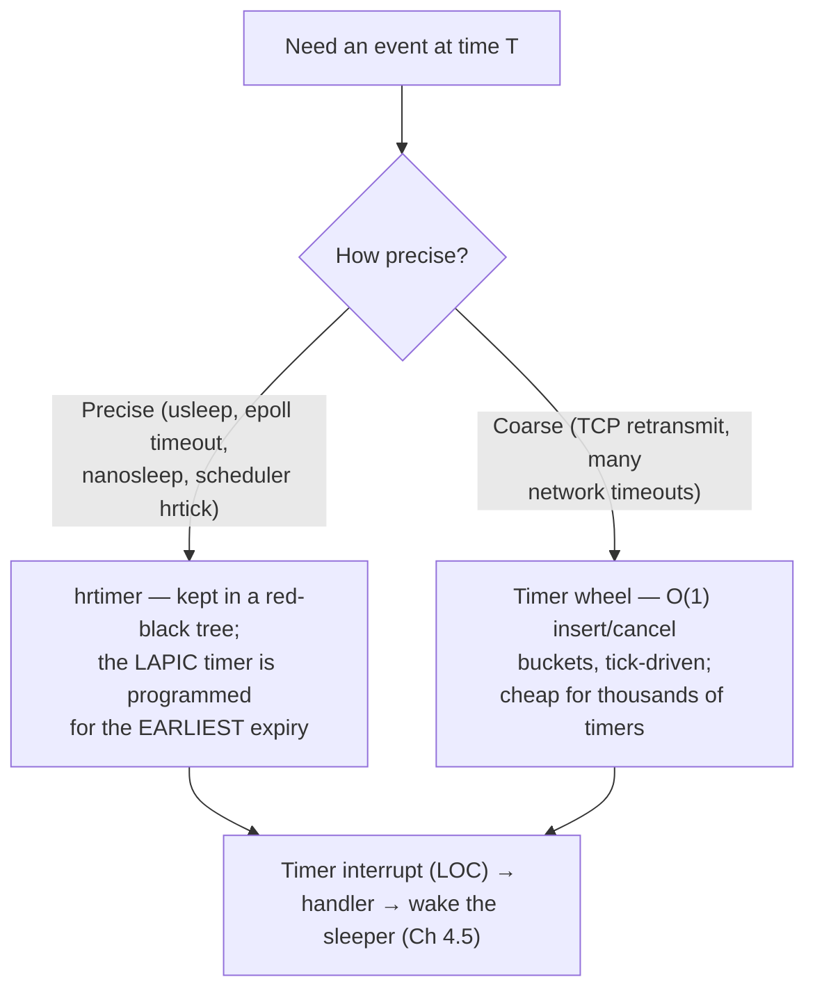

# PART 1 — Hardware Foundations (extension)

## Chapter 1.13 — Timers and Clocks: The Device Everything Else Depends On

### 🧠 One-Sentence Mental Model
> A CPU has no sense of "time passing" — time exists only because dedicated hardware **counts** (a free-running counter you can *read*) and hardware that **interrupts** (a countdown you can *program*); the scheduler's preemption (Chapter 2.8), every I/O timeout (Chapter 5.7), `sleep()`, and timestamps are all built on those two primitives.

### 🧒 Explain Like I'm Five
The CPU is a very fast worker who can't tell how long a minute is. So we give it two gadgets: a **stopwatch** it can glance at any time ("how many ticks since start?"), and an **alarm clock** it can set ("ring me in 5 milliseconds"). When the alarm rings, the CPU stops what it's doing, looks at the to-do list, and decides who should work next.

### 🌍 Real-World Analogy
A kitchen with both a wall clock (read it any time to know the time — a *clocksource*) and a set of oven timers (you set them and they interrupt you — *clock events*). The wall clock never interrupts; the timers never tell you the time of day. You need both.

### ❓ The Problem
Without time hardware, the OS could not preempt a thread that hogs the CPU (Chapter 2.8), could not wake a sleeping thread after 50 ms, could not time out a dead TCP connect after 127 s (Chapter 5.7), and could not timestamp a log line. What exactly provides these, and how accurate and how expensive is it?

### 🔥 Why This Problem Matters
Every `epoll_wait(timeout)`, `poll(timeout)`, `usleep`, retransmission timer and connection deadline is a timer. And every latency measurement in this course (Chapters 4.5, 5.4, 5.5…) rests on clocks. Knowing the *real* accuracy and cost of time — and that it is a hardware-interrupt-driven mechanism — explains jitter you will otherwise blame on "the network" or "the disk".

### 🕰 Historical Context
The original PC had an **8254 Programmable Interval Timer (PIT)** at I/O ports `0x40–0x43` and a battery-backed **RTC/CMOS clock** at ports `0x70–0x71` — both still listed in `/proc/ioports` on this chapter's sandbox (`0040-0043 : timer0`, `0070-0071 : rtc_cmos`). Later hardware added the **HPET**, the per-core **local APIC timer**, the ACPI power-management timer, and the CPU's own **TSC** (Time Stamp Counter). Modern kernels use the TSC to *read* time and the local APIC timer to *schedule* interrupts.

### 💡 The Naive Solution
"Just have a periodic timer interrupt firing at a fixed rate (say 1000 Hz) on every CPU, forever, and count the interrupts."

### ❌ Why the Naive Solution Fails
A fixed tick (a) wakes idle CPUs thousands of times a second, wasting power and ruining deep sleep; (b) limits timer resolution to the tick period (a 4 ms tick makes `usleep(100)` meaningless); and (c) adds jitter by interrupting running code even when nothing is due.

### ✅ The Better Solution
Modern Linux separates the two jobs and makes the interrupt **on demand**:
- **clocksource** — a cheap, monotonic counter you *read* (here: `tsc`; alternative: `kvm-clock` in VMs).
- **clockevent** — a per-CPU programmable device (the local APIC timer) set to fire **at the next needed moment** (high-resolution timers, *hrtimers*), plus a coarse periodic **tick** (`CONFIG_HZ`) that **stops on idle CPUs** (*tickless idle*, `NO_HZ_IDLE`).

### 🧠 Core Concept
> **Reading time and being interrupted at a time are two different hardware services.** Reading is nearly free (user-space, no syscall, tens of nanoseconds); an interrupt is expensive (Chapter 1.8) so the kernel arms the next one *only for the earliest pending deadline*. And the delivered accuracy is always *deadline + slack + wakeup latency*, never the nominal resolution.

---

### 📐 Deep Technical Explanation

#### 1. The hardware cast

| Device | Job | Notes |
|---|---|---|
| **TSC** (Time Stamp Counter) | Counts CPU-reference cycles; read with the `rdtsc` instruction in ring 3 | "Invariant TSC" ticks at a constant rate regardless of power state — a great clocksource; needs calibration against a known clock |
| **Local APIC timer** | Per-core one-shot/periodic/TSC-deadline interrupt source | The usual **clock event** device; shows as `LOC` (*Local timer interrupts*) in `/proc/interrupts` |
| **HPET** | Older multi-channel timer block (MMIO) | Fallback |
| **PIT (8254)** | Legacy 1.193 MHz timer at ports `0x40–0x43` | Boot-time/legacy |
| **RTC (CMOS)** | Battery-backed wall-clock date/time at ports `0x70–0x71` | Survives power-off; read at boot |

#### 2. Clock *kinds* (which one do I use?)

| Clock | Behavior | Use it for |
|---|---|---|
| `CLOCK_REALTIME` | Wall-clock time; **can jump** (NTP, admin changes) | Timestamps for humans/logs |
| `CLOCK_MONOTONIC` | Never goes backward; unaffected by wall-clock changes (what `std::chrono::steady_clock` uses) | **Durations, timeouts, benchmarks** |
| `CLOCK_BOOTTIME` | Monotonic *including* time suspended | Timers that must count across suspend |
| `CLOCK_PROCESS_CPUTIME_ID` / `CLOCK_THREAD_CPUTIME_ID` | CPU time *consumed* by the process/thread | "How much CPU did this burn?" (used in Chapters 5.4 and 5.6) |

#### 3. Two timer mechanisms in the kernel



#### 4. The tick — and tickless idle

A **periodic tick** (`CONFIG_HZ`; this kernel: **250 Hz = every 4 ms**) does scheduler accounting — updating a running thread's `vruntime` and deciding whether it has used its time slice (Chapter 2.8). On an **idle** CPU there is nothing to account for, so with `NO_HZ_IDLE` the tick is **stopped** until something needs it (this kernel: `CONFIG_NO_HZ_IDLE=y`, `CONFIG_HIGH_RES_TIMERS=y`).

#### 5. Timer *accuracy* = three stacked errors

When you ask for `usleep(N)` you get: `N` + **timer slack** + **wakeup latency**. *Timer slack* (default **50 µs** for ordinary threads — measured below with `prctl(PR_GET_TIMERSLACK)`) deliberately lets the kernel fire a timer up to that much late so nearby timers can share one interrupt. *Wakeup latency* is Chapter 4.5's "woken ≠ running" gap: the thread must be put on a run queue and actually scheduled. In a VM, the **hypervisor** adds its own scheduling delay on top.

---

## 🔬 Lab 1: the cost, accuracy and rate of time

```cpp
// timer_lab.cpp
// Compile: g++ -O2 -std=c++20 timer_lab.cpp -o timer_lab
// Run:     ./timer_lab
#include <time.h>
#include <unistd.h>
#include <x86intrin.h>
#include <algorithm>
#include <chrono>
#include <cstdio>
#include <fstream>
#include <sstream>
#include <string>
#include <vector>
using Clock = std::chrono::steady_clock;

static long loc_interrupts() {             // total of the "LOC:" (local APIC timer) row across CPUs
    std::ifstream f("/proc/interrupts"); std::string line;
    while (std::getline(f, line)) {
        if (line.find("Local timer") != std::string::npos || line.rfind(" LOC:", 0) == 0 || line.find("LOC:") != std::string::npos) {
            std::istringstream is(line); std::string tag; is >> tag; long v, sum = 0;
            while (is >> v) sum += v; return sum;
        }
    }
    return -1;
}

int main() {
    timespec res; clock_getres(CLOCK_MONOTONIC, &res);
    printf("1) clock_getres(CLOCK_MONOTONIC) = %ld ns\n", res.tv_nsec);

    // 2) TSC ticks per second, measured against the OS clock
    unsigned long long c0 = __rdtsc(); auto t0 = Clock::now();
    usleep(500000);
    unsigned long long c1 = __rdtsc(); auto t1 = Clock::now();
    double secs = std::chrono::duration<double>(t1 - t0).count();
    printf("2) TSC rate measured over 0.5 s: %.1f MHz (cpuinfo said 2100)\n", (c1 - c0) / secs / 1e6);

    // 3) how long does clock_gettime itself take (a vDSO read, no syscall)?
    const int N = 1'000'000; timespec ts; auto a = Clock::now();
    for (int i = 0; i < N; ++i) clock_gettime(CLOCK_MONOTONIC, &ts);
    printf("3) clock_gettime cost: %.1f ns/call\n", std::chrono::duration<double, std::nano>(Clock::now() - a).count() / N);

    // 4) sleep accuracy: ask for X, measure what we got
    for (int us : {50, 200, 1000, 4000, 10000}) {
        std::vector<double> got;
        for (int i = 0; i < 200; ++i) {
            auto s = Clock::now(); usleep(us);
            got.push_back(std::chrono::duration<double, std::micro>(Clock::now() - s).count());
        }
        std::sort(got.begin(), got.end());
        printf("4) usleep(%5d us): median=%8.1f us  p99=%8.1f us  max=%8.1f us\n",
               us, got[got.size()/2], got[got.size()*99/100], got.back());
    }

    // 5) how many timer interrupts per second does the kernel take on this machine?
    long l0 = loc_interrupts(); usleep(2000000); long l1 = loc_interrupts();
    printf("5) local-timer interrupts in 2 s (all CPUs): %ld  => %.0f /s total over %ld CPUs\n",
           l1 - l0, (l1 - l0) / 2.0, sysconf(_SC_NPROCESSORS_ONLN));
}
```

**Predict before running:** (a) Cost of one `clock_gettime`? (b) `usleep(50)` — will you get ~50 µs? (c) On an otherwise idle 2-CPU machine with a 250 Hz tick, roughly how many timer interrupts/s per CPU?

### 📊 Measured (this sandbox: 2 vCPU Intel Xeon @ 2.1 GHz VM, two runs)

```
1) clock_getres(CLOCK_MONOTONIC) = 1 ns
2) TSC rate measured over 0.5 s: 2100.0 MHz (cpuinfo said 2100)
3) clock_gettime cost: 32.7 ns/call           (second run: 23.2 ns)
4) usleep(   50 us): median=   116.6 us  p99=   148.3 us  max=   179.1 us     (run 2: median 111.8)
4) usleep(  200 us): median=   288.2 us  p99=   368.6 us  max=   427.7 us     (run 2: median 279.9)
4) usleep( 1000 us): median=  1107.3 us  p99=  1236.4 us  max=  2407.1 us     (run 2: median 1123.2)
4) usleep( 4000 us): median=  4129.7 us  p99=  4778.8 us  max=  8958.8 us     (run 2: median 4139.8)
4) usleep(10000 us): median= 10159.0 us  p99= 13220.9 us  max= 18245.3 us     (run 2: median 10157.2)
5) local-timer interrupts in 2 s (all CPUs): 114  => 57 /s total over 2 CPUs  (run 2: 120 → 60/s)
timer slack (prctl PR_GET_TIMERSLACK) = 50000 ns
```

<details><summary>Click to reveal the answers</summary>

(a) **~23–33 ns** — `clock_gettime` is served by the **vDSO** (a kernel-provided routine mapped into your address space that reads the TSC directly): *no syscall, no ring transition* (compare Chapter 2.6's syscall cost). (b) **No: ~110–117 µs.** Every sleep overshot by roughly **60–110 µs** here; this is consistent with the default **50 µs timer slack** plus wakeup/VM scheduling cost — I did not isolate the two. Even a "1 ns resolution" clock does not mean 1 ns accuracy. (c) Not 250! Only **~28/s per CPU** when idle (57–60/s total) — because of tickless idle (next lab).
</details>

> ⚠️ One VM, two runs. The `max` tails (2.4 ms on a 1 ms sleep, 9 ms on a 4 ms sleep) include hypervisor scheduling noise you won't see identically on bare metal. **Measure your own hardware.**

## 🔬 Lab 2: does the tick really stop when idle?

```cpp
// tick_busy.cpp -- does the local timer tick rate depend on whether the CPU is busy or idle?
// Compile: g++ -O2 -std=c++20 -pthread tick_busy.cpp -o tick_busy
#include <unistd.h>
#include <atomic>
#include <cstdio>
#include <fstream>
#include <sstream>
#include <string>
#include <thread>
#include <vector>
static std::vector<long> loc_per_cpu() {
    std::ifstream f("/proc/interrupts"); std::string line; std::vector<long> v;
    while (std::getline(f, line)) if (line.rfind("LOC:", 0) == 0) {
        std::istringstream is(line); std::string tag; is >> tag; long x;
        while (is >> x) v.push_back(x); break; }
    return v;
}
int main() {
    long ncpu = sysconf(_SC_NPROCESSORS_ONLN);
    for (int phase = 0; phase < 2; ++phase) {
        std::atomic<bool> stop{false}; std::vector<std::thread> th;
        if (phase == 1) for (long i = 0; i < ncpu; ++i) th.emplace_back([&]{ volatile unsigned long x = 0; while (!stop) x = x + 1; });
        usleep(200000);                       // let things settle
        auto a = loc_per_cpu(); usleep(3000000); auto b = loc_per_cpu();
        stop = true; for (auto& t : th) t.join();
        printf("%s: local-timer interrupts per CPU per second:", phase ? "BUSY (all CPUs spinning)" : "IDLE (we sleep)         ");
        for (size_t i = 0; i < a.size(); ++i) printf("  cpu%zu=%.0f", i, (b[i] - a[i]) / 3.0);
        printf("\n");
    }
}
```

**Predict:** idle vs. busy, per CPU, with `CONFIG_HZ=250`?

### 📊 Measured (two runs)
```
IDLE (we sleep)         : local-timer interrupts per CPU per second:  cpu0=28  cpu1=21
BUSY (all CPUs spinning): local-timer interrupts per CPU per second:  cpu0=259  cpu1=250
IDLE (we sleep)         : local-timer interrupts per CPU per second:  cpu0=35  cpu1=22
BUSY (all CPUs spinning): local-timer interrupts per CPU per second:  cpu0=258  cpu1=254
```
<details><summary>Click to reveal</summary>
**Busy CPUs take ≈ 250 interrupts/s — exactly `CONFIG_HZ`** (the scheduler tick is running). **Idle CPUs take only ~21–35/s** — the tick is *stopped*, and the remainder are genuine timers (timer expirations the kernel still had to service). A spinning loop (Chapter 5.4) therefore costs not just 100 % of a core but also keeps the periodic tick alive. This is the same interrupt-cost story as Chapter 1.8, now with a number.
</details>

### ❌ Common Misconceptions
- ❌ **"`sleep(1)` / `usleep(N)` sleeps exactly that long."** — It sleeps *at least* N, plus timer slack and wakeup latency (measured: +60–110 µs here).
- ❌ **"`clock_gettime` is an expensive syscall."** — It's a vDSO call: ~23–33 ns measured, no kernel entry.
- ❌ **"The kernel takes a timer interrupt HZ times per second."** — Only on *busy* CPUs; idle CPUs stop the tick (measured 21–35/s vs ~250/s).
- ❌ **"1 ns resolution means 1 ns accuracy."** — Resolution is the unit; accuracy is limited by slack, wakeup latency and (in VMs) the hypervisor.
- ❌ **"Use wall-clock time to measure durations."** — `CLOCK_REALTIME` can jump (NTP); use `CLOCK_MONOTONIC`.
- ❌ **"The TSC *is* time."** — It's a cycle counter; the kernel calibrates it against another clock (and prefers *invariant* TSC).

### 🧙 Wizard Insight
Time is a **device** like any other: it has registers (readable counter), an interrupt line (the timer), a driver (clocksource/clockevent), and a cost model. Once you see that, "timeouts" stop being magic: a 127-second `connect()` timeout (Chapter 5.7) is *just* a timer entry in a kernel data structure that eventually causes an interrupt, which wakes a thread — the exact same chain as a packet or key press, with "the clock" playing the role of the device.

### 🧠 Quiz
**Q1.** Why does Linux separate a *clocksource* from a *clockevent*?
<details><summary>Answer</summary>They are different services: a clocksource is a monotonic counter you read to learn the time (cheap, no interrupt); a clockevent is a programmable device that interrupts at a chosen time. Different hardware is best at each (TSC reads; LAPIC timer interrupts).</details>

**Q2.** Why did idle CPUs take ~25 timer interrupts/s instead of 250?
<details><summary>Answer</summary>Tickless idle (`NO_HZ_IDLE`): with nothing to account for, the periodic tick is stopped; only needed timers fire. Busy CPUs keep the tick (measured ≈ 250/s = HZ).</details>

**Q3.** `usleep(50)` measured ~112–117 µs. Name the stacked reasons.
<details><summary>Answer</summary>The requested 50 µs + timer slack (default 50 µs, lets nearby timers coalesce) + wakeup/scheduling latency (Chapter 4.5) + hypervisor scheduling in a VM.</details>

**Q4.** Which clock should a connection timeout use, and why?
<details><summary>Answer</summary>`CLOCK_MONOTONIC` — it never jumps backward or forward when the wall clock is adjusted, so a timeout can't be accidentally shortened or lengthened.</details>

System Timers & Timekeeping: Comprehensive Notes
1. The Core Principle
A CPU is a high-speed calculator with no innate sense of duration or speed. Timekeeping cannot exist in abstract software alone; it relies entirely on physical hardware oscillating and counting real-world electrical pulses. Software's job is simply to organize, multiply, and manage what the physical hardware provides.
2. The Two Halves of Timekeeping
The kernel separates time services into two distinct hardware mechanisms:
 * Clocksource (The Wall Clock / Stopwatch):
   * Purpose: To read the current time or elapsed cycles at any moment.
   * Hardware: The TSC (Time Stamp Counter) on x86 CPUs, which tracks CPU reference cycles.
   * Optimization: Accessed via vDSO, meaning reading the clock takes tens of nanoseconds without triggering a slow transition into the kernel.
 * Clockevent (The Alarm Clock):
   * Purpose: To program a future deadline that interrupts the CPU when it expires.
   * Hardware: The per-core Local APIC timer.
3. Hardware vs. Software Division of Labor
The physical hardware can only track one single deadline per core at a time, but the operating system needs to handle thousands of concurrent timers (sleeping threads, network timeouts, delayed tasks).
 * In Software (RAM): The kernel maintains a master sorted list (such as a red-black tree or timer wheel) of every active timeout across the system.
 * In Hardware (CPU Registers): The kernel looks at that master list, picks the very next upcoming deadline, and loads it into the physical Local APIC hardware register. When that hardware alarm rings, the kernel services it and reprograms the register for the next deadline on the list.
4. Surviving Power-Off: The RTC
When a computer is shut down, the CPU, TSC, and Local APIC lose power and reset to zero.
 * The RTC (Real-Time Clock): A dedicated, low-power hardware chip on the motherboard.
 * The CMOS Battery: A small coin-cell battery that supplies continuous power exclusively to the RTC.
 * At Boot: The BIOS/UEFI reads the current wall-clock date and time from the battery-powered RTC, and hands it off to the Linux kernel to initialize CLOCK_REALTIME.
5. Modern Optimizations & Real-World Realities
 * Tickless Idle (NO_HZ_IDLE): Historically, kernels fired a rigid periodic timer interrupt (e.g., 250 Hz) constantly. Modern kernels stop the tick on idle CPUs, reducing hardware interruptions to near zero when a core has no work, saving power and avoiding unnecessary wakeups.
 * Why usleep(N) Overshoots: Asking a thread to sleep for a specific duration will always take slightly longer due to three stacked factors:
   * Timer Slack: A kernel mechanism (default 50 µs) that intentionally delays timers slightly to batch them together into a single interrupt, saving CPU cycles.
   * Wakeup Latency: The time it takes for the awakened thread to be placed on a run queue and context-switched back onto a CPU.
   * Hypervisor Scheduling: Additional jitter if running inside a virtual machine.
 * Clock Selection: Always use CLOCK_MONOTONIC for durations, timeouts, and performance benchmarks because it never jumps backward or forward, unlike CLOCK_REALTIME (which can be adjusted by NTP or system administrators).


### 📌 Short Notes (Quick Reference)
- Time = a counter you **read** (clocksource: TSC) + a countdown that **interrupts** (clockevent: local APIC timer, `LOC` in `/proc/interrupts`).
- Legacy ports still present: PIT `0x40–0x43`, RTC `0x70–0x71`.
- `CLOCK_MONOTONIC` for durations/timeouts; `CLOCK_REALTIME` can jump; `*_CPUTIME_ID` = CPU consumed.
- `clock_gettime` = vDSO, ~23–33 ns measured, no syscall.
- Tick = `CONFIG_HZ` (250 here → 4 ms), runs on **busy** CPUs only (measured ~250/s busy vs 21–35/s idle).
- hrtimers (precise, rb-tree) vs timer wheel (coarse, O(1), TCP).
- Sleep accuracy = request + timer slack (50 µs default) + wakeup latency (+ hypervisor).

### 🔗 What This Connects To Next
**Previous:** Part 1, Chapter 1.12 — USB
**Current:** Part 1, Chapter 1.13 — Timers and Clocks
**Next:** Part 1, Chapter 1.14 — The GPU: a second computer on the PCIe bus, commanded with the same ring-and-doorbell pattern
