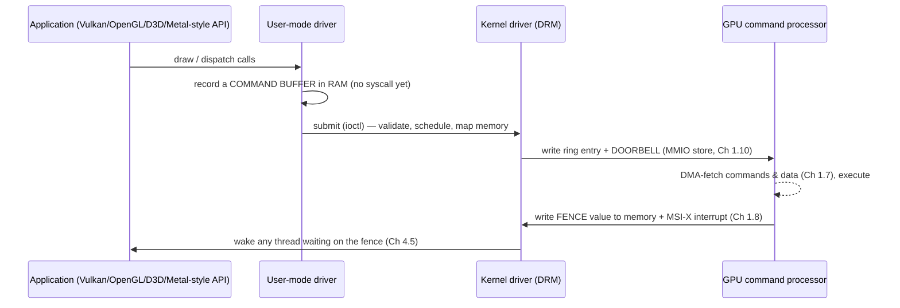

# PART 1 — Hardware Foundations (extension)

## Chapter 1.14 — The GPU: A Second Computer on the PCIe Bus

### 🧠 One-Sentence Mental Model
> A GPU is a separate, massively parallel computer — with its own processors, its own memory (VRAM) and its own scheduler — that the CPU controls **exactly like any other PCIe device**: write commands into a ring in memory, ring a doorbell register (MMIO), let the GPU fetch them by DMA, and get told "done" by a fence and an interrupt.

### 🧒 Explain Like I'm Five
The CPU is a few brilliant workers who can do any complicated job one at a time. The GPU is a huge stadium of simple workers who each do the *same tiny task* on different pieces at once — perfect for painting millions of pixels or multiplying giant grids of numbers. The CPU doesn't do the painting; it writes a to-do list, hands it over, and goes on with its day until the GPU says "finished."

### 🌍 Real-World Analogy
A head chef (CPU) in a kitchen with a separate **pastry factory** (GPU) across the street. The chef doesn't bake 10,000 cookies; he writes a work order (command buffer), drops it in the factory's mail slot (ring), rings the bell (doorbell), and keeps cooking. Ingredients must be carted over (PCIe transfer), and the factory sends a note back when the batch is done (fence + interrupt). The factory is *slower* at any single cookie but vastly faster at ten thousand.

### ❓ The Problem
Drawing millions of pixels 60+ times a second — and training or running modern numerical workloads — needs far more arithmetic throughput than a handful of CPU cores can deliver. But how do you add that much parallelism, how does the CPU talk to it without waiting on it, and what does the "bridge" between them cost?

### 🔥 Why This Problem Matters
The GPU is the clearest modern example of three themes in this course: **asynchronous device command queues** (the ancestor of `io_uring`'s SQ/CQ), **blocking waits on a hardware completion** (a fence wait is a blocked thread woken by an interrupt, Chapters 4.2 & 4.5), and **the cost of moving data across a bus** (PCIe, Chapter 1.5). Understanding it demystifies "why is my GPU program slow?" — it's usually the bridge, not the compute.

### 🕰 Historical Context
Early PCs drew by having the CPU write pixels into video memory (Chapter 1.15). Fixed-function 3D cards (1990s) offloaded triangle drawing; programmable shaders (early 2000s) made GPUs general parallel processors; GPGPU compute and then machine-learning accelerators followed. Meanwhile **integrated GPUs** moved onto the CPU die, sharing system RAM instead of having their own.

### 💡 The Naive Solution
"Make the CPU faster, or add many more full CPU cores."

### ❌ Why the Naive Solution Fails
A CPU core spends most of its transistors on **latency hiding for one thread**: branch prediction, out-of-order execution, big caches (Chapters 1.1–1.3). That's wasted on a problem with *millions of independent identical tasks*. Scaling the CPU that way costs power and area for features this workload doesn't need.

### ✅ The Better Solution
Specialize for **throughput**: thousands of simple arithmetic lanes grouped into SIMD/SIMT units; instead of caches and prediction, hide memory latency by keeping *thousands of threads resident* and **switching between them in hardware for free** (no OS context switch, Chapter 2.7). Give it very wide, very fast memory. Control it through a command queue so the CPU never waits.

### 🧠 Core Concept
> **A GPU = a throughput machine behind a command queue.** The performance story is *parallelism + memory bandwidth*; the programming-and-I/O story is *submit asynchronously, synchronize with fences, and pay for every byte that crosses PCIe.*

---

### 📐 Deep Technical Explanation

#### 1. CPU vs GPU (generic)

| | CPU | GPU |
|---|---|---|
| Design goal | Minimize **latency** of one thread | Maximize **throughput** of many |
| Cores | Few (4–64), complex | Thousands of simple lanes, grouped (e.g. 32-wide *warps* / 32–64-wide *wavefronts* running one instruction in lockstep — "SIMT") |
| Hides memory latency with | Big caches, prediction, out-of-order | **Switching among thousands of resident threads in hardware** |
| Branchy serial code | Good | Poor (lanes in a group diverge and wait) |
| Typical memory | Dual-channel DDR: tens of GB/s (illustrative: ~50–100 GB/s) | GDDR/HBM: hundreds of GB/s to several TB/s (illustrative) |

(Bandwidth figures are generation-dependent ballparks; always check your hardware's spec.)

**Integrated vs. discrete:** an **integrated** GPU shares system RAM (no PCIe copy, but it competes with the CPU for memory bandwidth — including display scanout, Chapter 1.15). A **discrete** GPU has its own VRAM on a PCIe card.

#### 2. How the CPU commands it — the Chapter 1.6–1.10 pattern, again



- The device registers and a window into VRAM are exposed through PCIe **BARs** (base address registers): MMIO regions in the physical address space (Chapter 1.10).
- Applications **batch** many draw calls into one command buffer and one submit — the same batching-per-doorbell principle from Chapter 1.6.
- The GPU has its **own MMU / page tables** (and sits behind the **IOMMU**), so one process's GPU memory is isolated from another's.
- **Fences/semaphores** are values the GPU writes to memory; "wait for the fence" is a *blocking wait* — the calling thread sleeps on a wait queue (Chapter 4.2) and is woken by the completion interrupt's handler (Chapter 4.5). Frame pipelining means the CPU prepares frame N+1 while the GPU executes frame N; a CPU that *waits* for the GPU every frame (or reads results back immediately) turns the pipeline into lock-step and loses most of the parallelism.

#### 3. The PCIe bridge — the real bottleneck

Theoretical per-direction bandwidth (128b/130b encoding; computed here):

| PCIe gen | Per lane | x16 link |
|---|---:|---:|
| 3.0 | 0.98 GB/s | **15.8 GB/s** |
| 4.0 | 1.97 GB/s | **31.5 GB/s** |
| 5.0 | 3.94 GB/s | **63.0 GB/s** |

Achievable is lower (protocol overhead; often around 80 %). Compare with VRAM bandwidth in the hundreds of GB/s: **moving data to the GPU is an order of magnitude slower than the GPU reading its own memory.** Dedicated **copy engines** (DMA) move data asynchronously so transfers can overlap compute.

#### 4. Offload break-even (worked arithmetic)

Offloading is worth it only if `transfer + GPU time + launch overhead < CPU time`. A calculator with **assumed inputs** (25 GB/s achievable over PCIe 4.0 x16, 20 µs launch overhead, both directions transferred):

| Case | CPU time | PCIe transfer | GPU total | Verdict |
|---|---:|---:|---:|---|
| Tiny: 4 KB each way | 0.005 ms | ~0.0003 ms | 0.021 ms | **CPU wins** (GPU 0.2×) — launch overhead dominates |
| 16 MB each way, moderate compute | 8 ms | 1.28 ms | 1.70 ms | GPU wins **4.7×** |
| 1 GB each way, moderate compute | 500 ms | 80 ms | 100 ms | GPU wins **5.0×** — *transfer is 80 % of the GPU time* |
| 16 MB each way, compute-heavy | 2000 ms | 1.28 ms | 41.3 ms | GPU wins **48×** |

The first row is why you don't send tiny tasks to a GPU; the third is why "GPU speedups" shrink when data movement dominates; the fourth is the GPU's sweet spot — **lots of math per byte moved** (high arithmetic intensity). (The inputs are my assumptions, not measurements of any device; the arithmetic is exact.)

#### 5. What else lives on a GPU
Fixed-function **video encode/decode** blocks, **copy engines**, and — importantly for the next chapter — the **display engine** that reads finished frames out to your monitor.

---

## 🔬 Lab status: no GPU in this sandbox

**Honest status: this sandbox has no GPU** (`/sys/class/drm` and `/dev/dri` do not exist; the only PCIe-style devices are virtio). So nothing here measured real GPU behavior; the table in §4 is **arithmetic with stated assumptions**. The closest real thing available is a **virtio** device: `/proc/interrupts` shows MSI-X lines like `virtio1-req.0` — a **virtqueue**, which *is* a descriptor ring (Chapter 1.6) with a doorbell and an interrupt, the same mechanism a GPU command queue uses.

On your own machine (not run here):
```bash
lspci -k | grep -A3 -Ei 'vga|3d|display'     # which GPU and which kernel driver is bound
ls /sys/class/drm                            # display connectors and cards (DRM = Direct Rendering Manager)
cat /sys/class/drm/card0/device/{vendor,device}
grep -i -E 'gpu|i915|amdgpu|nouveau|nvidia' /proc/interrupts   # the GPU's MSI-X vector(s)
```
Watch the interrupt count while a game or video plays: it ticks at roughly the frame rate (fences) — that is the completion half of the ring.

### ❌ Common Misconceptions
- ❌ **"A GPU is a faster CPU."** — It is slower per thread and much faster in aggregate for parallel, regular work; branchy serial code runs poorly.
- ❌ **"The API call does the work."** — Calls usually just *record* commands; the GPU runs them later, asynchronously.
- ❌ **"Copying data to the GPU is free."** — PCIe is ~10× slower than VRAM bandwidth; transfers can dominate (§4).
- ❌ **"More cores means automatic speedup."** — Memory-bound or branchy code, low occupancy, or small problems don't scale.
- ❌ **"A GPU only draws pictures."** — It also runs general compute, video codecs and copy engines.
- ❌ **"An integrated GPU avoids bandwidth limits."** — It shares system RAM with the CPU and the display scanout.

### 🧙 Wizard Insight
Replace the nouns and a GPU submission is an NVMe submission is an `io_uring` submission: **write an entry, ring a doorbell, let hardware consume it asynchronously, learn of completion via a completion record plus an interrupt, and block or poll on that completion.** When you later meet `io_uring` (Part 14) and "readiness vs completion" (Part 13), remember the GPU: it was *always* a completion-based device. Completion-style I/O isn't new — readiness-style (`select`/`epoll`) is the unusual one.

### 🧠 Quiz
**Q1.** Why does a GPU not need large caches and branch prediction the way a CPU does?
<details><summary>Answer</summary>It hides memory latency by keeping thousands of threads resident and switching between them in hardware for free, so while some wait for memory others compute; with throughput, not single-thread latency, as the goal, those latency-hiding transistors are better spent on more arithmetic lanes.</details>

**Q2.** Name the steps from "draw call" to "frame done," in terms of earlier chapters.
<details><summary>Answer</summary>Record a command buffer in RAM → ioctl submit → driver writes a ring entry and a doorbell (MMIO, Ch 1.10) → GPU DMA-fetches and executes (Ch 1.7) → writes a fence + MSI-X interrupt (Ch 1.8) → blocked waiters woken (Ch 4.5).</details>

**Q3.** In the break-even table, why does the 4 KB case lose to the CPU?
<details><summary>Answer</summary>Fixed overhead (launch/submit/synchronization, ~20 µs assumed) exceeds the entire CPU computation time; there isn't enough work to amortize it.</details>

**Q4.** What is a fence wait, and what does the kernel do while you wait?
<details><summary>Answer</summary>A fence is a value the GPU writes when work completes; waiting on it is a blocking wait — the thread leaves the run queue and sleeps on a wait queue until the completion interrupt's handler wakes it (Ch 4.2/4.5), using zero CPU meanwhile.</details>

### 📌 Short Notes (Quick Reference)
- GPU = throughput processor + own memory + own scheduler, on PCIe (discrete) or sharing RAM (integrated).
- Hides latency with thousands of hardware threads (free switches), not caches/prediction.
- Control path: command buffers in RAM → ioctl → ring + **doorbell** (MMIO) → GPU **DMA fetch** → fence + **MSI-X** → waiter woken.
- API calls are asynchronous; the CPU pipelines frame N+1 while the GPU runs frame N; waiting/readback stalls the pipeline.
- PCIe x16 per direction (theoretical): 3.0 ≈ 15.8, 4.0 ≈ 31.5, 5.0 ≈ 63 GB/s — ≈ 10× below VRAM bandwidth.
- Offload pays only with high arithmetic intensity (math per byte moved) and enough work to amortize launch cost.
- Completion-based device: the hardware ancestor of `io_uring`'s SQ/CQ.

### 🔗 What This Connects To Next
**Previous:** Part 1, Chapter 1.13 — Timers and Clocks
**Current:** Part 1, Chapter 1.14 — The GPU
**Next:** Part 1, Chapter 1.15 — Display: how finished pixels actually reach the screen (framebuffer, scanout, vblank, tearing)
