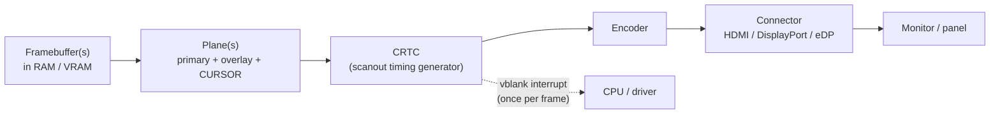

# PART 1 — Hardware Foundations (extension)

## Chapter 1.15 — Display: How Pixels Actually Reach the Screen

### 🧠 One-Sentence Mental Model
> A screen image is just a block of memory (the **framebuffer**) that a **display controller** reads out by DMA, line by line, on a rigid clock — 60, 120, 144 times a second, whether or not anything changed — and streams as a continuous signal to the panel; everything about tearing, vsync, double buffering and "input lag" follows from the fact that **the reading never stops and never waits for you**.

### 🧒 Explain Like I'm Five
Imagine a very strict teacher who walks past your desk 60 times every second and copies whatever is on your page onto the big classroom board, top to bottom, no matter what. If you're still erasing and redrawing while she walks by, the board shows half your old picture and half your new one. The fix: draw on a spare page, and swap pages only in the instant she's walking back to the top.

### 🌍 Real-World Analogy
A film projector. The film strip is the framebuffer; the projector lamp sweeps through it at a fixed frame rate. You can't ask the projector to "wait a moment" while you splice in a new frame — you must have the next frame ready *before* its slot comes up, and splice during the gap between frames.

### ❓ The Problem
Software "draws" by writing pixel values into memory. A monitor needs those values as a precisely timed electrical stream. Who moves the pixels, when does a new image become visible, and why does a naive approach show torn, half-updated frames?

### 🔥 Why This Problem Matters
Display is the *last* step of the key-to-pixel journey (Chapter 1.18) and often its **largest single latency**. It is also a constant, never-ending DMA read on the memory bus (Chapter 1.4), a periodic interrupt source (vblank), and a hard real-time deadline (every 16.7 ms at 60 Hz) — a textbook case of "hardware on a fixed clock that software must keep up with."

### 🕰 Historical Context
CRT monitors physically swept an electron beam across the screen line by line, with a brief pause (**blanking**) to return to the start of each line and each frame — the terms *hsync*, *vsync*, *front/back porch* are fossils of that beam. Flat panels don't need the retrace, but the **timing structure** survives in HDMI/DisplayPort signals. Early PCs let the CPU write straight into video memory; today a dedicated **display engine** (the "scanout" hardware) does the reading.

### 💡 The Naive Solution
"Draw directly into the one buffer the screen is showing."

### ❌ Why the Naive Solution Fails
Scanout reads the buffer *while you are modifying it*. The top of the screen shows the old frame, the bottom the new — **tearing**. (Simulated and visualised below.)

### ✅ The Better Solution
**Double buffering with a flip at vblank:** draw the next frame into a **back buffer**; when it's complete, tell the display engine to start scanning the *other* buffer, taking effect only in the **vertical blanking interval** (the gap between frames). Add **triple buffering** to avoid stalling while waiting, or **variable refresh rate** so the panel waits for *your* frame instead of the other way around.

### 🧠 Core Concept
> **The display controller is a DMA engine on a metronome.** It reads the *scanout buffer* continuously at a fixed rate; software can only choose *which* buffer it points at, and the safe moment to change that pointer is the blanking gap. A "page flip" is therefore a single register write (MMIO, Chapter 1.10) that the hardware latches at the next vblank — followed by an interrupt telling software the old buffer is now free to reuse.

---

### 📐 Deep Technical Explanation

#### 1. The pipeline (Linux DRM/KMS vocabulary, generic)



- **Plane:** a source buffer plus where it goes on screen. Hardware can composite several planes — e.g. the desktop, a video overlay, and a **cursor plane** that draws the mouse pointer (Chapter 1.11) without the compositor redrawing the screen each time it moves.
- **CRTC:** the timing generator — it counts pixels and lines and issues the DMA reads. ("CRT controller": a name from the beam era.)
- **Encoder/connector:** serialises pixels into the HDMI/DisplayPort/eDP electrical protocol. The monitor describes its capabilities in an **EDID** blob the host reads over a small side channel; plugging a cable in raises a **hot-plug** interrupt.

#### 2. The numbers — what refreshing a screen costs

Framebuffer size = width × height × bytes/pixel (4 bytes for 8-bit-per-channel color). Scanout read rate = that × refresh rate. (Computed by the lab program below.)

| Mode | Framebuffer | Continuous scanout read | Frame time |
|---|---:|---:|---:|
| 1080p @ 60 Hz | 7.91 MiB | **0.50 GB/s** | 16.67 ms |
| 1440p @ 144 Hz | 14.06 MiB | **2.12 GB/s** | 6.94 ms |
| 4K @ 60 Hz | 31.64 MiB | **1.99 GB/s** | 16.67 ms |
| 4K @ 144 Hz | 31.64 MiB | **4.78 GB/s** | 6.94 ms |

That read happens **forever, even for a static desktop** — on an integrated GPU it competes with the CPU for DRAM bandwidth (Chapter 1.4). HDR (more bits per pixel) and multiple planes multiply it.

**Timing of one real mode — 1080p60** (standard CTA-861-style timing): the signal is **2200 × 1125 "pixel slots" per frame** even though only 1920 × 1080 are visible. At 60 Hz that needs a **148.5 MHz pixel clock** (2200 × 1125 × 60). One line takes **14.81 µs**; the 45 blanking lines at the bottom form the **vertical blanking interval ≈ 667 µs** — the safe window to switch buffers. Only **83.8 %** of the slots carry visible pixels. (All arithmetic, computed here.)

#### 3. Tearing and the fix — *simulated*

The lab program models a display controller as a loop that copies one scanline at a time, then (a) lets the app overwrite the **same** buffer mid-scan, versus (b) lets it draw into a **back** buffer and flips afterwards:


*Left:* single buffer — the top part of the screen (up to scanline 95) is the old frame (blue-tinted, white square on the left), the bottom is the new frame (orange-tinted, square on the right), and the white square is **cut in two**. *Middle and right:* double buffering — every refresh shows one complete frame, and the flip happens in the gap between them. (A simulation in software, not a photograph of a monitor.)

#### 4. Vsync, latency and what vsync really costs

```mermaid
sequenceDiagram
    participant App as App / compositor
    participant KMS as Display driver
    participant HW as Display engine (CRTC)
    App->>App: render frame N into BACK buffer
    App->>KMS: page-flip request (ioctl)
    KMS->>HW: write new scanout address (MMIO), latched at NEXT vblank
    HW->>HW: vblank: switch buffer, start scanning frame N
    HW->>KMS: vblank / flip-complete interrupt (Ch 1.8)
    KMS->>App: flip event on the DRM file descriptor
    Note over App: old buffer free again; app may reuse it
```

- A frame you finish *just after* a vblank waits almost a whole **refresh period** to appear: up to 16.7 ms at 60 Hz, **average ≈ 8.3 ms**; up to 6.9 ms at 144 Hz (average ≈ 3.5 ms). Higher refresh rates cut this wait directly.
- Scanning is top to bottom, so the *bottom* of the screen updates up to one frame after the top.
- With plain double buffering, if you *miss* the vblank you wait a whole extra period (frame rate snaps to 60, 30, 20…). **Triple buffering** keeps rendering instead of stalling; **adaptive-sync / VRR** lets the panel hold the frame until you're ready within a range, removing the fixed deadline.
- Page-flip completion and vblank events arrive as **readable events on the DRM device's file descriptor** — an ordinary fd you can `poll`/`epoll` (Chapters 5.3, Part 8), which is how compositors wait for the next frame without spinning.

#### 5. Compositors and buffer sharing
Each application draws into its **own** buffer; a **compositor** combines them into the final scanout buffer. Buffers are shared between processes (and GPU/display) as **dma-buf** file descriptors, passed over a Unix domain socket with `SCM_RIGHTS` (the fd-passing mechanism, Chapter 3.2) — a zero-copy design (Part 16). A single fullscreen app can often skip compositing entirely (**direct scanout**).

#### 6. The legacy "just write memory" path
Old-style `/dev/fb0` (the Linux framebuffer device) exposes the display as a mappable buffer so a program can paint with plain stores — Chapter 1.10's "make it look like memory" in its purest form:

```cpp
// fb_demo.cpp -- paint pixels into the legacy Linux framebuffer with ordinary stores (mmap, Ch 1.10)
// NOT run in this sandbox (no /dev/fb0). Compile: g++ -O2 -std=c++20 fb_demo.cpp -o fb_demo ; Run on a text console: sudo ./fb_demo
#include <fcntl.h>
#include <linux/fb.h>
#include <sys/ioctl.h>
#include <sys/mman.h>
#include <unistd.h>
#include <cstdint>
#include <cstdio>
int main() {
    int fd = open("/dev/fb0", O_RDWR);
    if (fd < 0) { perror("open /dev/fb0"); return 1; }
    fb_var_screeninfo v; fb_fix_screeninfo f;
    ioctl(fd, FBIOGET_VSCREENINFO, &v);              // width, height, bits per pixel
    ioctl(fd, FBIOGET_FSCREENINFO, &f);              // line_length = bytes per row (may exceed width*4: "pitch")
    size_t size = (size_t)f.line_length * v.yres;
    uint8_t* fb = (uint8_t*)mmap(nullptr, size, PROT_READ | PROT_WRITE, MAP_SHARED, fd, 0);   // framebuffer now "looks like memory"
    for (unsigned y = 0; y < v.yres; ++y)
        for (unsigned x = 0; x < v.xres; ++x)
            *(uint32_t*)(fb + y * f.line_length + x * 4) = ((x * 255 / v.xres) << 16) | ((y * 255 / v.yres) << 8);  // gradient
    munmap(fb, size); close(fd);
}
```
**Status: compiled successfully here; not run** — the sandbox has no framebuffer device (`open` fails with "No such file or directory", as expected). Note the **pitch** (`line_length`): rows may be padded beyond `width × 4` bytes, so always index by pitch, not width.

---

## 🔬 Lab: a software display controller (compiled and run here)

```cpp
// scanout_lab.cpp -- a software model of a display controller reading a framebuffer ("scanout")
// Shows (1) the memory-bandwidth cost of just refreshing the screen, and (2) tearing vs. flip-at-vblank.
// Compile: g++ -O2 -std=c++20 scanout_lab.cpp -o scanout_lab ; Run: ./scanout_lab   (writes tear.ppm, noTear.ppm)
#include <cstdint>
#include <cstdio>
#include <cstring>
#include <vector>
using Pixel = uint32_t;                                   // 0x00RRGGBB, 4 bytes/pixel like XRGB8888
static const int W = 320, H = 180;                        // small stand-in screen (16:9)

static void fill_frame(std::vector<Pixel>& fb, int frame) {   // draw "frame N": a gradient + a square at a position
    for (int y = 0; y < H; ++y) for (int x = 0; x < W; ++x) {
        uint8_t shade = (uint8_t)(40 + 120 * y / H);
        fb[y * W + x] = frame == 0 ? (shade << 0) | (60u << 8) | (20u << 16)    // frame 0: blue-ish
                                   : (20u << 0) | (60u << 8) | (shade << 16);   // frame 1: red-ish
    }
    int sx = frame == 0 ? 40 : 200;                       // the "object" jumps between frames
    for (int y = 70; y < 110; ++y) for (int x = sx; x < sx + 60; ++x) fb[y * W + x] = 0xFFFFFF;
}
static void write_ppm(const char* name, const std::vector<Pixel>& img) {
    FILE* f = fopen(name, "wb"); fprintf(f, "P6\n%d %d\n255\n", W, H);
    for (Pixel p : img) { uint8_t rgb[3] = {(uint8_t)(p >> 16), (uint8_t)(p >> 8), (uint8_t)p}; fwrite(rgb, 1, 3, f); }
    fclose(f);
}

int main() {
    // ---- 1) bandwidth of refreshing a real screen: pixels x bytes x refresh rate ----
    struct Mode { const char* name; int w, h, hz; };
    for (Mode m : {Mode{"1080p @ 60 Hz", 1920, 1080, 60}, Mode{"1440p @ 144 Hz", 2560, 1440, 144}, Mode{"4K @ 60 Hz", 3840, 2160, 60}, Mode{"4K @ 144 Hz", 3840, 2160, 144}}) {
        double bytes_frame = (double)m.w * m.h * 4;
        printf("%-15s framebuffer = %6.2f MiB   scanout read rate = %6.2f GB/s   frame time = %5.2f ms\n",
               m.name, bytes_frame / (1024.0 * 1024.0), bytes_frame * m.hz / 1e9, 1000.0 / m.hz);
    }
    // ---- 2) tearing: ONE buffer, writer starts drawing frame 1 while the "beam" is mid-screen ----
    std::vector<Pixel> fb(W * H), shown(W * H);
    fill_frame(fb, 0);                                    // frame 0 is complete in the buffer
    for (int line = 0; line < H; ++line) {                // the display controller scans out line by line
        if (line == 95) fill_frame(fb, 1);                // the app overwrites the SAME buffer mid-scan
        memcpy(&shown[line * W], &fb[line * W], W * sizeof(Pixel));
    }
    write_ppm("tear.ppm", shown);
    // ---- 3) double buffering: app draws into the BACK buffer; scanout flips only at vblank ----
    std::vector<Pixel> front(W * H), back(W * H);
    fill_frame(front, 0);                                 // front = what is being scanned out
    for (int line = 0; line < H; ++line) {
        if (line == 95) fill_frame(back, 1);              // app draws frame 1 into the back buffer meanwhile
        memcpy(&shown[line * W], &front[line * W], W * sizeof(Pixel));   // scanout still reads the untouched front
    }
    write_ppm("noTear_frame0.ppm", shown);                // this refresh shows a clean frame 0 ...
    front.swap(back);                                     // ... and the page flip happens in the vblank gap
    for (int line = 0; line < H; ++line) memcpy(&shown[line * W], &front[line * W], W * sizeof(Pixel));
    write_ppm("noTear_frame1.ppm", shown);                // next refresh: clean frame 1
}
```

**Predict before running:** (a) bandwidth to refresh 4K at 60 Hz? (b) In the single-buffer run, what will the screen look like? (c) What determines *where* the tear line sits?

### 📊 Measured output
```
1080p @ 60 Hz   framebuffer =   7.91 MiB   scanout read rate =   0.50 GB/s   frame time = 16.67 ms
1440p @ 144 Hz  framebuffer =  14.06 MiB   scanout read rate =   2.12 GB/s   frame time =  6.94 ms
4K @ 60 Hz      framebuffer =  31.64 MiB   scanout read rate =   1.99 GB/s   frame time = 16.67 ms
4K @ 144 Hz     framebuffer =  31.64 MiB   scanout read rate =   4.78 GB/s   frame time =  6.94 ms
```
<details><summary>Click to reveal the answers</summary>

(a) **≈ 2.0 GB/s**, continuously, forever (3840 × 2160 × 4 B × 60). (b) Torn — the image in the figure above (left panel): old frame above scanline 95, new frame below, objects cut in two. (c) *When* the app overwrites the shared buffer relative to the scan position — i.e., a race between two things that aren't synchronised. That's why it's visible as a *moving* tear line in real games with vsync off.
</details>

> The tear line at scanline 95 is *forced* by the program, to show the mechanism. Real tearing positions are timing-dependent. The figure was produced by this program and inspected; it models the mechanism, not real panel behavior.

### ❌ Common Misconceptions
- ❌ **"The monitor stores the image."** — The framebuffer lives in RAM/VRAM; the display engine re-reads and re-sends it every refresh (even static content).
- ❌ **"Refresh rate and FPS are the same thing."** — Refresh is the panel/scanout clock; FPS is how often software produces new frames.
- ❌ **"The CPU/GPU pushes pixels to the monitor when it draws."** — A dedicated display engine does the reading, on its own clock.
- ❌ **"Vsync just adds latency for no reason."** — It prevents tearing by flipping only in the blanking gap; the cost is waiting for the next boundary (mitigated by triple buffering and VRR).
- ❌ **"Drawing makes pixels appear instantly."** — Pixels appear on the *next scanout* of that region: average ≈ half a refresh period later, plus panel response.
- ❌ **"A static screen costs no memory bandwidth."** — Scanout reads the whole buffer every refresh (0.5–5 GB/s above).

### 🧙 Wizard Insight
The display is the one device in the machine that **never waits for software**. Disks, NICs and USB wait to be asked; the display controller keeps its own metronome and will happily show stale or half-updated data rather than pause. Whenever hardware runs on a fixed clock (display, audio — next chapter), the software's job flips from "respond when data arrives" to "**have the next buffer ready before the deadline.**" That inversion (pull-by-hardware instead of push-by-software) is the shape of every real-time I/O problem.

### 🧠 Quiz
**Q1.** Why does a static desktop still use memory bandwidth?
<details><summary>Answer</summary>The display controller DMA-reads the whole framebuffer every refresh (e.g. ~0.5 GB/s for 1080p60), regardless of whether anything changed.</details>

**Q2.** What is the *only* safe moment to swap which buffer is scanned out, and why?
<details><summary>Answer</summary>The vertical blanking interval (between frames): the controller isn't mid-scan, so switching buffers can't produce a frame made of two different images.</details>

**Q3.** A game renders each frame in 17 ms on a 60 Hz display with plain double buffering and vsync. What frame rate do you get?
<details><summary>Answer</summary>The frame misses the 16.67 ms vblank and must wait for the next one, so it presents every 2nd refresh: 30 FPS. Triple buffering or VRR avoids snapping to fractions of the refresh rate.</details>

**Q4.** How does a compositor know it can reuse a buffer, without polling?
<details><summary>Answer</summary>The driver delivers a page-flip/vblank event on the DRM device's file descriptor after the hardware has switched; the compositor waits on that fd (blocking read or epoll) and is woken by the vblank interrupt (Chapters 1.8, 4.5).</details>

### 📌 Short Notes (Quick Reference)
- Framebuffer = memory; display engine (CRTC) DMA-reads it at a fixed refresh rate and streams it over HDMI/DP/eDP.
- Scanout bandwidth = W × H × bytes × Hz: 1080p60 ≈ 0.5 GB/s, 4K60 ≈ 2.0 GB/s, 4K144 ≈ 4.8 GB/s — continuous.
- 1080p60 timing: 2200×1125 slots, 148.5 MHz pixel clock, ~667 µs vblank, 83.8 % active.
- Single buffer → **tearing**; double buffer + flip **at vblank** → clean frames; triple buffering / VRR remove the stall.
- Page flip = one MMIO write latched at vblank; completion = vblank interrupt → event on the DRM fd.
- Avg display wait ≈ half the refresh period (8.3 ms at 60 Hz, 3.5 ms at 144 Hz).
- Hardware cursor plane lets the pointer move without recompositing; dma-buf fds (via `SCM_RIGHTS`) share buffers zero-copy.
- Index by **pitch**, not width, in a mapped framebuffer.

### 🔗 What This Connects To Next
**Previous:** Part 1, Chapter 1.14 — The GPU
**Current:** Part 1, Chapter 1.15 — Display
**Next:** Part 1, Chapter 1.16 — Audio: the other fixed-clock device — and what happens when software misses the deadline
