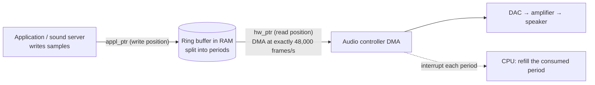

# PART 1 — Hardware Foundations (extension)

## Chapter 1.16 — Audio: A Tiny Data Rate with a Hard Deadline

### 🧠 One-Sentence Mental Model
> Sound hardware consumes samples from a ring buffer in RAM on its **own crystal-controlled clock** (e.g. exactly 48,000 times a second), by DMA, and interrupts once per *period*; the data rate is trivial (~190 KB/s) but the **deadline is absolute** — if software refills the ring even slightly late, the device runs dry and you hear a click (an *underrun*, or "xrun").

### 🧒 Explain Like I'm Five
A kid on a conveyor belt that never stops is putting sounds into a speaker's mouth, one tiny sound at a time, always at the same speed. You must keep dropping new sounds on the belt before the old ones run out. If you're even a blink late, the speaker has nothing to say for a moment — *click!* A longer belt gives you more time to catch up but makes everything you do sound later.

### 🌍 Real-World Analogy
A subway platform with a train that must depart on the second: you (software) load passengers (samples) into the train while it waits; the schedule (hardware clock) doesn't care that you're not finished. The more spare trains queued up (buffer), the more forgiving it is — but the longer a passenger waits between boarding and arriving (latency).

### ❓ The Problem
Audio is tiny data — kilobytes per second — yet it is one of the hardest I/O jobs to get right. Why do audio glitches happen on machines that are mostly idle, and how do you choose a buffer size?

### 🔥 Why This Problem Matters
Audio is the cleanest example of **hardware-clocked, pull-model I/O with a hard real-time deadline**: bandwidth is irrelevant, **scheduling jitter** is everything. It exposes the cost of timer slack, wakeup latency and CPU contention (Chapters 1.13, 4.5, 2.8) in a way that you can *hear*.

### 🕰 Historical Context
Early PC sound cards were ISA devices doing programmed I/O and ISA DMA; modern systems use Intel **HD Audio** (a controller with DMA engines plus a codec chip), **USB audio** (isochronous endpoints, Chapter 1.12), or Bluetooth. On Linux the kernel layer is **ALSA**; desktop **sound servers** (PulseAudio/PipeWire) mix many applications into the single stream the hardware accepts.

### 💡 The Naive Solution
"When the application has sound, `write()` it to the device; when it doesn't, don't."

### ❌ Why the Naive Solution Fails
The hardware clock doesn't pause. If no data is written in time, the device *must* output something (silence or the stale ring contents) — an audible glitch. Audio can't be "event-driven by the application": the **device** sets the schedule, and the app must continuously keep up.

### ✅ The Better Solution
A **ring buffer** in RAM, divided into **periods**. The hardware **DMA-reads** the ring continuously; at each period boundary it raises an interrupt (or the driver's timer fires). Software wakes, refills the period that was just consumed, and goes back to sleep. Two pointers describe the state — the hardware's read position and the application's write position — and the gap between them is the safety margin.

### 🧠 Core Concept
> **Latency ≈ buffer size ÷ sample rate, and safety = the slack in the buffer ÷ your worst-case wakeup lateness.** You are trading *latency* against *glitch risk* and *interrupt rate*, and the number that decides it is not CPU speed but the **worst-case scheduling delay** your thread can suffer.

---

### 📐 Deep Technical Explanation

#### 1. The numbers

PCM audio: *sample rate* × *bits per sample* × *channels*.

| Format | Data rate |
|---|---:|
| 44.1 kHz, 16-bit, stereo (CD) | 172.3 KiB/s |
| 48 kHz, 16-bit, stereo | **187.5 KiB/s** |
| 48 kHz, 24-bit, stereo | 281.2 KiB/s |
| 96 kHz, 24-bit, stereo | 562.5 KiB/s |

(Computed here.) Compare a 10 Gb/s NIC at ~1.25 GB/s: audio is thousands of times lighter. The difficulty is purely **timing**.

#### 2. Periods, latency and interrupt rate (48 kHz, computed)

| Period (frames) | Period length | Interrupts / s |
|---:|---:|---:|
| 64 | 1.33 ms | 750 |
| 128 | 2.67 ms | 375 |
| 256 | 5.33 ms | 187.5 |
| 512 | 10.67 ms | 93.8 |
| 1024 | 21.33 ms | 46.9 |
| 2048 | 42.67 ms | 23.4 |

A **2-period** buffer adds roughly **2 × period** of latency (e.g. 256-frame periods ≈ 10.7 ms). Smaller periods = lower latency but *more interrupts* (Chapter 1.8's cost) and *less slack* — the same coalescing trade-off as NIC interrupt moderation.

#### 3. The ring (ALSA-style)


**Underrun (xrun):** `hw_ptr` catches `appl_ptr` — the device has consumed everything you wrote. **Overrun** is the recording-side mirror: the ADC fills the ring faster than you drain it.

#### 4. Two clock domains
The audio chip runs from **its own crystal**; the CPU's timers run from another. They drift apart slightly, so long-running software must **resample or adjust** to avoid slowly drifting into an under- or overrun. Mixing several applications also needs resampling to a common rate. Compressed wireless audio adds encode/decode and radio buffering — often **100 ms or more** of extra latency (typical, varies by codec and device).

#### 5. Real-time rules for the audio thread
The code that refills the buffer must never block unpredictably: **no unbounded locks, no `malloc`, no file or network I/O, no page faults** (Chapter 1.4) — any of those can take milliseconds. That's why audio engines pre-allocate, lock memory, and run the audio thread at **real-time priority** (`SCHED_FIFO`, Chapter 2.8).

---

## 🔬 Lab: how small can a buffer be before scheduling jitter breaks it?

**What this models (and doesn't):** a "hardware" consumes one period every P ms on a fixed clock; the "app" must wake and refill each period. With a K-period buffer the app can be late by up to **(K−1) × P** before the device runs dry. The lab measures only the **scheduler/timer jitter** part of that story — no real audio device exists in this sandbox (`/dev/snd` and `/proc/asound` are absent).

```cpp
// xrun_lab.cpp -- how small can an audio buffer be before scheduling jitter breaks it?
// Models ONLY the scheduler-jitter part of an audio pipeline: a "hardware" consumes one period of
// frames every P ms on a fixed clock; the app must wake and refill each period. If the app wakes
// later than the slack allowed by the buffer (K periods => (K-1)*P of slack), the device runs dry: an XRUN.
// Compile: g++ -O2 -std=c++20 -pthread xrun_lab.cpp -o xrun_lab
// Run:     ./xrun_lab            (normal priority)      sudo ./xrun_lab rt   (SCHED_FIFO priority 50)
#include <sched.h>
#include <time.h>
#include <atomic>
#include <chrono>
#include <cstdio>
#include <cstring>
#include <thread>
#include <vector>
using Clock = std::chrono::steady_clock;

struct Result { int wakes; int xruns2, xruns3; double max_late_ms; };

static Result measure(double period_ms, double seconds) {
    Result r{0, 0, 0, 0};
    auto period = std::chrono::duration_cast<Clock::duration>(std::chrono::duration<double, std::milli>(period_ms));
    auto next = Clock::now() + period;
    auto end  = next + std::chrono::duration<double>(seconds);
    while (next < end) {
        std::this_thread::sleep_until(next);              // the app "wakes on the period interrupt"
        double late_ms = std::chrono::duration<double, std::milli>(Clock::now() - next).count();
        ++r.wakes;
        if (late_ms > period_ms)       ++r.xruns2;        // 2-period buffer: slack = 1 period
        if (late_ms > 2 * period_ms)   ++r.xruns3;        // 3-period buffer: slack = 2 periods
        if (late_ms > r.max_late_ms) r.max_late_ms = late_ms;
        next += period;
    }
    return r;
}

int main(int argc, char** argv) {
    bool rt = argc > 1 && !strcmp(argv[1], "rt");
    for (int load = 0; load < 2; ++load) {
        std::atomic<bool> stop{false}; std::vector<std::thread> hogs;
        if (load) for (int i = 0; i < 4; ++i) hogs.emplace_back([&]{ volatile unsigned long x = 0; while (!stop) x = x + 1; });
        printf("--- %s priority, %s ---\n", rt ? "SCHED_FIFO" : "normal", load ? "CPU LOADED (4 spinning threads on 2 vCPUs)" : "idle machine");
        printf("%-12s %-14s %-8s %-18s %-18s %-s\n", "period", "latency(2 per)", "wakes", "xruns, 2-period buf", "xruns, 3-period buf", "worst lateness");
        for (double p : {1.0, 2.667, 5.333, 10.667, 21.333}) {
            Result r;
            std::thread t([&] {                               // measure on its OWN thread so only IT gets RT priority;
                if (rt) { sched_param sp{}; sp.sched_priority = 50;   // threads inherit their creator's policy, so setting FIFO
                          if (sched_setscheduler(0, SCHED_FIFO, &sp) != 0) perror("SCHED_FIFO"); }  // on main would turn the hogs FIFO too!
                r = measure(p, 3.0); });
            t.join();
            printf("%6.2f ms    %6.1f ms     %-8d %-18d %-18d %.2f ms\n", p, 2 * p, r.wakes, r.xruns2, r.xruns3, r.max_late_ms);
        }
        stop = true; for (auto& t : hogs) t.join();
    }
}
```

**Predict before running:** (a) At what period do glitches start on an *idle* machine? (b) What does CPU load do? (c) Does real-time priority fix everything?

### 📊 Measured (2-vCPU VM; each row = 3 s of wakeups; **single runs, noisy**)

```
--- normal priority, idle machine ---
period       latency(2 per) wakes    xruns, 2-period buf xruns, 3-period buf worst lateness
  1.00 ms       2.0 ms     3000     14                 5                  3.46 ms
  2.67 ms       5.3 ms     1125     4                  3                  11.87 ms
  5.33 ms      10.7 ms     563      0                  0                  1.97 ms
 10.67 ms      21.3 ms     282      0                  0                  0.31 ms
 21.33 ms      42.7 ms     141      0                  0                  1.65 ms
--- normal priority, CPU LOADED (4 spinning threads on 2 vCPUs) ---
  1.00 ms       2.0 ms     3000     70                 55                 8.69 ms
  2.67 ms       5.3 ms     1125     12                 2                  5.42 ms
  5.33 ms      10.7 ms     563      0                  0                  4.00 ms
 10.67 ms      21.3 ms     282      0                  0                  3.88 ms
 21.33 ms      42.7 ms     141      0                  0                  3.78 ms
--- SCHED_FIFO priority, idle machine ---
  1.00 ms       2.0 ms     3000     14                 8                  5.43 ms
  2.67 ms       5.3 ms     1125     0                  0                  2.63 ms
  5.33 ms      10.7 ms     563      0                  0                  1.94 ms
 10.67 ms      21.3 ms     282      0                  0                  0.49 ms
 21.33 ms      42.7 ms     141      0                  0                  0.80 ms
--- SCHED_FIFO priority, CPU LOADED (4 spinning threads on 2 vCPUs) ---
  1.00 ms       2.0 ms     3000     4                  1                  2.95 ms
  2.67 ms       5.3 ms     1125     0                  0                  1.02 ms
  5.33 ms      10.7 ms     563      0                  0                  0.17 ms
 10.67 ms      21.3 ms     282      0                  0                  1.32 ms
 21.33 ms      42.7 ms     141      0                  0                  0.10 ms
```

<details><summary>Click to reveal the answers</summary>

(a) Glitches appear at **≈ 1–2.7 ms periods** even on an idle machine (14 and 4 late wakeups for a 2-period buffer), and vanish by ~5 ms — jitter of a few ms exists even with nothing else running (timer slack + wakeup + hypervisor, Chapter 1.13). (b) **Load makes small buffers much worse**: at 1 ms the 2-period buffer went from 14 → 70 late wakeups (2.3 % of wakeups); a **3-period** buffer helps but still saw 55. By ~5 ms periods even the loaded machine was clean *in this run*. (c) **No.** Real-time priority sharply reduced the loaded case (70 → 4 at 1 ms) because the thread now preempts the CPU hogs, but on the *idle* machine the 1 ms case still showed 14 late wakeups with worst lateness 5.4 ms — that delay comes from **below the guest OS** (timer slack and the VM host), which guest priority can't remove.
</details>

> ⚠️ **Read this carefully.** These are single 3-second runs in a shared VM; counts vary run to run (the idle 2.67 ms row had 4 xruns at normal priority and 0 under FIFO — likely noise, not an effect of priority). The *pattern* — tiny buffers fail, bigger buffers are safe, load hurts, real-time priority helps against CPU contention — is the lesson. Don't treat the exact counts as properties of the hardware, and re-measure on yours.

> 🪤 **A real footgun I hit while building this lab.** My first version called `sched_setscheduler(SCHED_FIFO)` on the *main* thread, then created the CPU-hog threads. **New threads inherit their creator's scheduling policy**, so the hogs became `SCHED_FIFO` too — spinning forever at real-time priority and starving everything, including my own test, until I killed it. The fix is in the code above: set real-time priority **only on the one thread that needs it**, never before creating other threads. A runaway `SCHED_FIFO` thread can lock up a machine; production audio stacks cap it (e.g. via `RLIMIT_RTTIME`).

### ❌ Common Misconceptions
- ❌ **"Audio glitches mean the machine is too slow."** — Usually *one late wakeup*, not average load; the machine can be mostly idle.
- ❌ **"A bigger buffer is just better."** — It fixes glitches by *adding latency*; you can't have both tiny latency and large slack.
- ❌ **"Audio is high-bandwidth."** — ~190 KiB/s; the difficulty is the deadline.
- ❌ **"Real-time priority makes the app always on time."** — It beats CPU contention but not hardware/hypervisor jitter, page faults, blocking locks, or priority inversion.
- ❌ **"Setting `SCHED_FIFO` on main is harmless."** — Child threads inherit it; a spinning FIFO thread can starve the system (I hit this).
- ❌ **"Wireless audio has the same latency."** — Compression and radio buffering often add ~100 ms or more.

### 🧙 Wizard Insight
Audio is the mirror image of a network server. A server *reacts* to events it can't predict; an audio engine *meets* events that are perfectly predictable — a deadline every few milliseconds, forever. Predictability inverts the engineering: instead of optimizing average throughput, you eliminate **the tail** — the single slowest wakeup. Every technique here (pre-allocation, locked memory, real-time scheduling, avoiding locks and page faults) is about bounding **worst-case latency**, which is exactly the skill that separates an I/O wizard from someone who merely benchmarks averages.

### 🧠 Quiz
**Q1.** 48 kHz stereo 16-bit audio is only 187.5 KiB/s. Why is it harder to get right than a 100 MB/s file copy?
<details><summary>Answer</summary>The audio clock is fixed and unforgiving: each period must be refilled before the hardware consumes it. A late wakeup — even once — causes an audible glitch, while a file copy merely finishes slightly later.</details>

**Q2.** 256-frame periods at 48 kHz, 2-period buffer: latency and interrupt rate?
<details><summary>Answer</summary>Period = 256/48000 = 5.33 ms → ~10.7 ms of buffering latency and 187.5 interrupts/s.</details>

**Q3.** What exactly is an underrun?
<details><summary>Answer</summary>The hardware's read pointer catches the application's write pointer: the DMA engine has consumed all the data provided and has nothing valid to play, so output glitches.</details>

**Q4.** Why does real-time priority help under CPU load but not fully on an idle VM?
<details><summary>Answer</summary>`SCHED_FIFO` lets the thread preempt other runnable threads (the CPU-contention source). It cannot remove delays that occur beneath the guest — timer slack, interrupt delivery, hypervisor descheduling.</details>

### 📌 Short Notes (Quick Reference)
- Audio device = DMA from a RAM ring on its own crystal clock (48 kHz); interrupt per **period**.
- Data rate tiny (48k/16-bit/stereo = 187.5 KiB/s) — the problem is the **hard deadline**.
- Latency ≈ buffer ÷ rate (2×256 frames @48 kHz ≈ 10.7 ms); smaller periods ⇒ more interrupts (750/s at 64 frames) and less slack.
- Underrun/xrun: `hw_ptr` catches `appl_ptr`. Slack = (K−1) periods for a K-period buffer.
- Audio thread rules: no `malloc`, locks, file/network I/O or page faults; use pre-allocation and `SCHED_FIFO`.
- Two clock domains (audio crystal vs CPU) drift → resample.
- Measured (VM, noisy): idle 1–2.7 ms periods glitch; ≥ 5 ms fine; load hurts small buffers; RT priority helps vs. contention.
- `SCHED_FIFO` is inherited by new threads — set it only on the thread that needs it.

### 🔗 What This Connects To Next
**Previous:** Part 1, Chapter 1.15 — Display
**Current:** Part 1, Chapter 1.16 — Audio
**Next:** Part 1, Chapter 1.17 — Boot and Firmware: how a powered-off pile of silicon becomes a machine that has *any* of the devices we've discussed
