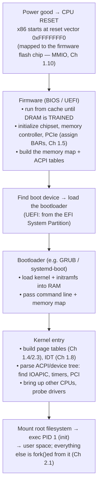

# PART 1 — Hardware Foundations (extension)

## Chapter 1.17 — Boot and Firmware: From a Silent Pile of Silicon to a Running Kernel

### 🧠 One-Sentence Mental Model
> At power-on **no operating system exists and not even RAM works yet**; a chain of ever-smarter programs — firmware, bootloader, kernel, init — each prepares just enough of the machine for the next one, ending with the first user process (PID 1) — and the thing they hand forward is mostly **a map**: which physical addresses are RAM, which are devices, and where the device tables live.

### 🧒 Explain Like I'm Five
Waking up a computer is like opening a theater. First the night watchman (firmware) turns on the lights and checks that the seats and stage exist. Then the stage manager (bootloader) fetches the show (the kernel) from storage and gives it a floor plan. The director (kernel) learns the building from that plan, switches on all the equipment, and finally lets the actors (programs) in.

### 🌍 Real-World Analogy
A relay of increasingly capable runners where each one can only start the next: the first runner can barely run (no RAM, tiny code in a flash chip), but wakes up a stronger one, who wakes up a stronger one — until the full operating system is running.

### ❓ The Problem
Everything in Chapters 1.1–1.16 (page tables, interrupt tables, devices, DMA) must be *set up* by somebody before any program can run. But setting things up takes a program — and a program needs RAM, which needs configuring. Who goes first, and how does the kernel even know what hardware it has?

### 🔥 Why This Problem Matters
Boot explains where the **physical address map** (Chapter 1.10), the **interrupt controller** (Chapter 1.8), the **timers** (Chapter 1.13) and the **PCIe devices** (Chapter 1.5) *come from* — and why `/proc/iomem`, `/proc/interrupts` and `dmesg` look the way they do. It's also where the first process, PID 1, is born (Chapter 2.1) — the root of the process tree every later chapter's fork/exec story hangs from.

### 🕰 Historical Context
The original PC **BIOS** ran in 16-bit real mode, found a boot sector (the MBR) on disk, and jumped to it. Modern machines use **UEFI** firmware, which understands filesystems (it loads a bootloader from a small FAT **EFI System Partition**) and starts in 64-bit mode. Embedded and ARM systems often describe hardware with a **device tree** instead of ACPI tables. Virtual machines may skip firmware entirely.

### 💡 The Naive Solution
"The CPU just starts running the operating system from the disk."

### ❌ Why the Naive Solution Fails
At reset the CPU has no idea where an OS is; the **memory controller isn't configured** (DRAM must be trained — timings measured and set — before it can be used); the disk controller isn't initialized; and a disk is far too complex for a CPU with no software to read. A tiny, always-present, hard-wired starting program is needed.

### ✅ The Better Solution
A staged chain:



### 🧠 Core Concept
> **Each stage's real output is a prepared machine plus a description of it.** Firmware leaves RAM working and hands over a **physical memory map** and **ACPI tables** (the hardware inventory: interrupt controllers, timers, devices); the kernel *re-discovers and takes over* the hardware using those descriptions and its own drivers.

---

### 📐 Deep Technical Explanation

#### 1. Why the first instruction fetch works
At reset an x86 CPU fetches from `0xFFFFFFF0` — 16 bytes below the 4 GiB line — where the chipset routes accesses to the **SPI flash chip holding the firmware**. That is Chapter 1.10's idea in its most primitive form: a physical address range that isn't RAM at all, but a *different chip* answering loads. Early firmware often runs **before any DRAM is usable**, using the CPU's own cache as scratch memory while it performs **DRAM training** (probing the DIMMs and tuning timings). Only after that does "real" memory exist.

#### 2. What firmware leaves behind

- **The physical memory map** (BIOS "e820" / UEFI memory map): which ranges are usable RAM and which are reserved for firmware, device windows or legacy areas.
- **ACPI tables** (or a device tree): the machine's inventory — the interrupt-controller layout (the **MADT/APIC** table), timers, power management, PCIe configuration space location.
- **Enumerated PCIe devices** with their BARs assigned (Chapter 1.5).

#### 3. The kernel takes over (Linux, x86, abridged)
It decompresses itself; sets up its own **page tables** (Chapter 2.3) and **interrupt descriptor table** (Chapter 1.8); reads the memory map and the ACPI tables; calibrates the **TSC** and selects clocksource/clockevent devices (Chapter 1.13); starts the other CPU cores; walks the PCIe bus and **binds drivers** to devices; mounts the root filesystem (often via a temporary **initramfs**); and finally executes **PID 1**.

---

## 🔬 Lab: read this machine's boot-time artifacts (real output, this sandbox)

**What's different here:** this sandbox is a **micro-VM** — a virtual-machine monitor loads the kernel *directly*, so there is no UEFI, no bootloader stage (`/sys/firmware/efi` does not exist), and the monitor itself plays firmware's role by supplying the memory map and ACPI tables. Everything *after* that — the kernel's behavior — is the same as on real hardware.

**1. The firmware-provided memory map (`dmesg`):**
```
BIOS-e820: [mem 0x0000000000000000-0x000000000009fbff] usable
BIOS-e820: [mem 0x000000000009fc00-0x00000000000fffff] reserved
BIOS-e820: [mem 0x0000000000100000-0x00000000bfffffff] usable
BIOS-e820: [mem 0x00000000eec00000-0x00000000febfffff] reserved
BIOS-e820: [mem 0x0000000100000000-0x000000023fffffff] usable
```
**2. The kernel's view of the *physical address space* (`/proc/iomem`, root):**
```
00001000-0009fbff : System RAM            ← "conventional memory" below 1 MiB
0009fc00-000fffff : Reserved              ← legacy BIOS/video area (incl. "System ROM" 000f0000-000fffff)
00100000-bfffffff : System RAM            ← main RAM below 3 GiB
  01000000-021e0c9f : Kernel code         ← the kernel image sits INSIDE ordinary RAM
  02200000-02bfefff : Kernel rodata
c0001000-eebfffff : PCI Bus 0000:00       ← 32-bit window where PCI device BARs (MMIO) live
eec00000-eecfffff : PCI ECAM              ← PCI configuration space, memory-mapped
fec00000-fec003ff : IOAPIC 0              ← the interrupt controller's registers (MMIO)
100000000-23fffffff : System RAM          ← more RAM above 4 GiB
4000000000-7fffffffff : PCI Bus 0000:00   ← 64-bit window for big BARs
  4000000000-400007ffff : 0000:00:01.0    ← a device's registers: 512 KiB at 0x4000000000
```
**This one table is Chapter 1.10 made literal:** the physical address space is a *map* — some ranges answer with RAM, others with device registers, the interrupt controller or the firmware ROM — and ordinary loads/stores reach all of them.

**3. Legacy I/O-port devices still present (`/proc/ioports`):** `0020 pic1`, `0040–0043 timer0` (PIT), `0060` and `0064 keyboard` (i8042), `0070–0071 rtc_cmos`, `03f8 serial`, `0cf8 PCI conf1` — the 1980s PC, still enumerated.

**4. ACPI and timing, from early kernel messages:**
```
tsc: Detected 2100.000 MHz processor                      (0.000155 s: calibration happens almost immediately)
ACPI: RSDP 0x00000000000E0000 ... (v02 FIRECK)            (the ACPI root pointer, supplied by the VM monitor)
ACPI: APIC 0x00000000000A0DAB ...                         (the MADT table: where the interrupt controllers are)
IOAPIC[0]: apic_id 0, version 17, address 0xfec00000, GSI 0-23
```
**5. The command line and the first process:**
```
/proc/cmdline : console=ttyS0 quiet ... rdinit=/process_api -- --firecracker-init ...
PID 1         : /process_api --firecracker-init ...       (a custom init instead of systemd)
```

**6. A sanity check you can run on any Linux box** — does the memory map add up to the RAM the kernel reports?
```python
import re
tot = 0
for l in open("/proc/iomem"):
    m = re.match(r"([0-9a-f]+)-([0-9a-f]+) : System RAM", l)     # top-level entries only (no leading spaces)
    if m: tot += int(m.group(2), 16) - int(m.group(1), 16) + 1
print(f"System RAM ranges in /proc/iomem sum to {tot/1048576:.1f} MiB")
print("MemTotal:", [l.split()[1] for l in open('/proc/meminfo') if l.startswith('MemTotal')][0], "kB")
```
**Measured here:** the ranges sum to **8191.6 MiB (8,388,219 kB)** while `MemTotal` reports **8,215,296 kB**. The ~169 MiB difference is memory the kernel reserved early for itself (its image and boot-time structures) before counting what it hands to the allocator — an honest reminder that "installed RAM" ≠ "usable RAM." (Run it as root; non-root users see zeroed addresses.)

**Predict on your own machine:** where does your kernel image sit in `/proc/iomem`, and which range hosts your GPU's big BAR? (`sudo cat /proc/iomem`; look for `Kernel code` and a `PCI Bus` window containing your GPU's entry from `lspci`.)

### ❌ Common Misconceptions
- ❌ **"BIOS/UEFI is the operating system."** — It only prepares the machine and loads the next stage; once the kernel runs, it re-discovers and drives the hardware itself.
- ❌ **"RAM is ready at power-on."** — DRAM must be trained first; early firmware runs from the CPU cache.
- ❌ **"The kernel starts at power-on."** — It is the *fourth* stage or so (reset vector → firmware → bootloader → kernel).
- ❌ **"Reboot = clean slate for everything."** — Some state survives (firmware settings in NVRAM/CMOS; devices with their own firmware).
- ❌ **"The firmware's device list is what the kernel uses."** — The kernel uses ACPI/device-tree *descriptions* but probes PCIe/USB and loads its own drivers.
- ❌ **"MemTotal equals installed RAM."** — Firmware-reserved ranges and early kernel reservations are subtracted (169 MiB difference measured above).

### 🧙 Wizard Insight
Boot teaches the most reusable idea in systems software: **bootstrapping by progressive capability**. Each stage is deliberately dumber than the next, and each exists only to build the environment its successor assumes. You'll see the same pattern in compilers (self-hosting), in a process's startup (`ld.so` → `libc` → `main`), and in a thread pool coming online. And note what is *handed forward*: not code, but **descriptions of the hardware** (maps and tables) — which is why a kernel can run unchanged on thousands of different machines.

### 🧠 Quiz
**Q1.** How can the CPU execute its very first instruction when RAM isn't working?
<details><summary>Answer</summary>The reset vector address (0xFFFFFFF0 on x86) is routed by the chipset to the firmware flash chip, which acts as read-only memory; early firmware uses the CPU cache as temporary scratch space while it trains DRAM.</details>

**Q2.** What two main things does firmware hand to the kernel?
<details><summary>Answer</summary>A physical memory map (usable vs reserved ranges) and hardware descriptions (ACPI tables / device tree) — e.g., where the interrupt controller and timers are — plus a machine with PCIe devices enumerated.</details>

**Q3.** In `/proc/iomem`, why is the kernel image listed *inside* a "System RAM" range?
<details><summary>Answer</summary>The kernel is loaded into ordinary RAM; the entries nested under System RAM are regions of that RAM claimed by the kernel's code, read-only data, data and bss.</details>

**Q4.** Why does a VM like this sandbox show no UEFI and no bootloader, yet otherwise boot a normal-looking kernel?
<details><summary>Answer</summary>The VM monitor loads the kernel directly and acts as firmware, supplying the memory map and ACPI tables. From the kernel entry onward the process is the same as on real hardware.</details>

### 📌 Short Notes (Quick Reference)
- Boot chain: reset vector (flash-backed, `0xFFFFFFF0`) → firmware (train DRAM, enumerate PCIe, build maps/ACPI) → bootloader (load kernel + initramfs, pass cmdline) → kernel (page tables, IDT, ACPI, drivers, SMP) → PID 1.
- Firmware's real output = a **physical memory map** + **hardware tables**.
- `/proc/iomem` = the physical address space (RAM, kernel image, PCI windows, IOAPIC, ECAM); `/proc/ioports` = legacy port devices (PIT, i8042, RTC, serial).
- `MemTotal` < installed/mapped RAM (measured: 8191.6 MiB mapped vs ~8023 MiB `MemTotal`).
- PID 1 is the root of the process tree; here `/process_api`, on most PCs `systemd`/init.
- A micro-VM can skip firmware and bootloader entirely.

### 🔗 What This Connects To Next
**Previous:** Part 1, Chapter 1.16 — Audio
**Current:** Part 1, Chapter 1.17 — Boot and Firmware
**Next:** Part 1, Chapter 1.18 — The Complete Computer: one key press traced from switch to pixel, with every device we've met
