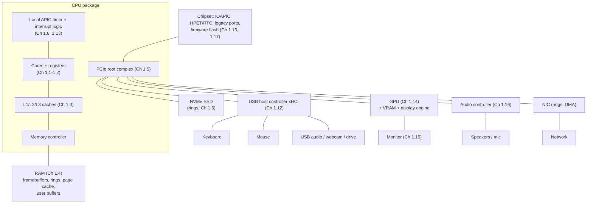

# PART 1 — Hardware Foundations (extension)

## Chapter 1.18 — The Complete Computer: One Key Press, from Switch to Pixel

### 🧠 One-Sentence Mental Model
> A whole computer is **a CPU and RAM in the middle, surrounded by devices that all speak the same five-part dialect** — *registers as memory (MMIO), work queues in RAM (rings + doorbells), data moved by DMA, news delivered by interrupts (or polling where the rate is high), and time supplied by timers* — so once you can trace one event through that dialect, you can trace any of them.

### 🧒 Explain Like I'm Five
Press a letter on the keyboard and a tiny chain reaction runs through the whole machine: the keyboard whispers to the front desk, the front desk rings the CPU's bell, the CPU tells the program, the program asks the painter (the GPU) to draw the letter, and the painter hands the finished picture to the screen's projector, which shows it. Every helper does only one small job and passes the baton.

### 🌍 Real-World Analogy
A busy restaurant: host (USB controller), kitchen (CPU + RAM), prep stations (GPU, SSD, NIC), the pass-through window where finished dishes wait (buffers), the dining-room clock that paces service (timers), and a conveyor of plates delivering each course on a fixed schedule (display). No single person does everything; plates move through hand-offs, and the meal is only as fast as its slowest hand-off.

### ❓ The Problem
You now know each part. But can you say, end to end, what *physically happens* between pressing a key and seeing the letter — which hardware does each step, which of the five mechanisms it uses, and where the milliseconds go?

### 🔥 Why This Problem Matters
Every later part of this course (`epoll`, event loops, `io_uring`, zero-copy, performance engineering) is a way of optimizing **one hop in a chain like this one**. Seeing the whole chain first tells you *which hop* is worth optimizing — and shows that most of the latency you feel is **waiting**, not computing.

### 🕰 Historical Context
Early PCs did all of this by hand: the CPU polled the keyboard port, wrote pixels directly to video memory, and bit-banged the speaker. Each subsequent decade moved one more job out of the CPU into a dedicated, DMA-capable, interrupt-raising controller — until the CPU's role became *coordination*, exactly as Chapter 1.7 predicted.

### 💡 The Naive Solution
"The CPU reads the keyboard and draws the letter."

### ❌ Why the Naive Solution Fails
It leaves out 90 % of the machine: the keyboard is polled by a *USB controller*, not the CPU; the CPU never touches pixels on their way to the screen; and the screen is refreshed by yet another controller on a clock the CPU doesn't control. The CPU only **coordinates**.

### ✅ The Better Solution
Trace one event through every component, naming the mechanism at each hop.

### 🧠 Core Concept
> **Computers are pipelines of hand-offs between independent controllers, each decoupled by a buffer and a notification.** Throughput questions ask "which stage has the lowest bandwidth?"; latency questions ask "which stages *wait*, and for how long?" — and for human-facing I/O the biggest waits are fixed clocks (poll intervals, refresh periods), not computation.

---

### 📐 Deep Technical Explanation

#### 1. The whole machine (generic)



#### 2. Every device, in the same five columns

| Device | How the CPU controls it | How data moves | How CPU learns of events | Data rate | What dominates |
|---|---|---|---|---|---|
| **Keyboard / mouse** (1.11) | Via the USB host controller | Tiny reports DMA'd by xHCI | Controller polls → MSI-X | KB/s | **Latency** (poll interval) |
| **USB controller** (1.12) | MMIO regs + doorbell + TRB rings | DMA | Event ring + MSI-X (moderated) | up to Gb/s | Mixed |
| **Timers** (1.13) | MMIO/MSR (LAPIC timer), TSC read | — | Timer interrupt (`LOC`) | — | **Deadlines** |
| **GPU** (1.14) | BARs (MMIO) + command ring + doorbell | DMA + its own VRAM | Fence + MSI-X | tens of GB/s via PCIe | Bridge + parallelism |
| **Display** (1.15) | Plane/CRTC regs (MMIO) | **Continuous DMA read**, fixed clock | **vblank** interrupt | 0.5–5 GB/s | **Fixed schedule** |
| **Audio** (1.16) | Controller regs, ring | DMA ring on its own clock | Period interrupt | ~0.2 MB/s | **Hard deadline** |
| **NVMe SSD** | Doorbells + submission/completion rings | DMA | MSI-X (or polling) | GB/s | Throughput |
| **NIC** | Rings + doorbells | DMA | MSI-X / NAPI polling | up to 100+ Gb/s | Throughput + latency |
| **Firmware / boot** (1.17) | Flash at the reset vector (MMIO) | CPU reads | — | — | One-time |

Notice what repeats: **MMIO** for control, **rings + doorbells** for work, **DMA** for bytes, **interrupts/polling** for news, **timers** for deadlines. Devices differ mainly in **data rate** and in **how hard the deadline is**:

| Class | Examples | Cares about |
|---|---|---|
| Bulk | Disk, network transfer | Throughput |
| Interactive | Keyboard, mouse, GPU frame | Latency |
| Isochronous / fixed-clock | Audio, display scanout | **Never missing the deadline** |

#### 3. The trace — pressing `A` in a text editor

```mermaid
sequenceDiagram
    participant Key as Keyboard MCU
    participant HC as xHCI (USB host)
    participant K as Kernel
    participant Comp as Compositor
    participant App as Editor
    participant GPU as GPU
    participant Disp as Display engine
    Key->>Key: 1. switch closes; scan + debounce (ms)
    HC->>Key: 2. host POLLS (every 1-8 ms)
    Key-->>HC: report 00 00 04 ...
    HC->>K: 3. DMA report to RAM, event ring, MSI-X IRQ (Ch 1.7, 1.8)
    K->>K: 4. usbhid -> input core -> evdev: input_event KEY_A (Ch 1.11)
    K->>Comp: 5. wake_up() the reader blocked in epoll_wait (Ch 4.5)
    Comp->>App: 6. send key event over a Unix socket (Ch 4.7, Part 8)
    App->>App: 7. keymap -> 'a'; update text; build frame commands
    App->>GPU: 8. submit command buffer + doorbell (Ch 1.14)
    GPU->>K: 9. render into buffer; fence + MSI-X
    App->>Comp: 10. hand buffer over (dma-buf fd via SCM_RIGHTS, Ch 3.2)
    Comp->>GPU: 11. composite desktop (GPU) into the scanout buffer
    Comp->>K: 12. page-flip request: new scanout address (MMIO, Ch 1.15)
    Disp->>Disp: 13. at next VBLANK latch it; scan top-to-bottom
    Disp-->>K: 14. vblank interrupt -> flip event on the DRM fd
    Disp->>Disp: 15. pixels streamed over HDMI/DP; panel updates
```

Every arrow is one of the five mechanisms. And note the I/O course appearing inside the machine: step 5 is a **blocking wait woken by an interrupt** (Part 4), step 6 uses a **Unix domain socket** with an **`epoll` loop** (Parts 4, 8, 11), step 10 **passes a file descriptor** (Part 3), steps 8–9 and 12–14 are **ring + completion** (Part 14's ancestor).

#### 4. Where the time goes — *illustrative estimates, not measurements*

| Hop | Typical contribution | Why |
|---|---:|---|
| Key switch + matrix scan + debounce | ~1–5 ms (keyboard-dependent) | microcontroller firmware |
| Wait for the USB poll | avg ~0.5 ms (1000 Hz) to ~4 ms (125 Hz) | fixed poll interval (Ch 1.11) |
| IRQ → kernel input path → wake the reader | tens to a few hundred µs | interrupt + wakeup (this VM's measured wakeups: ~110–125 µs, Ch 5.4; sleep overshoot +60–110 µs, Ch 1.13) |
| Compositor/app wake, process, build frame | ~0.2–2 ms | scheduler + code |
| Render (CPU/GPU) | ~1–8 ms | depends on the app |
| Wait for the next vblank | **avg 8.3 ms** at 60 Hz (0–16.7) | fixed refresh period (Ch 1.15) |
| Scan-out position (top → bottom) | 0–16.7 ms (avg ~8) | line-by-line scanning |
| Panel pixel response | ~1–10 ms | physics of the panel |

**Total: very roughly 20–60 ms at 60 Hz, and low tens of ms on a high-refresh gaming setup.** (Ranges are ballpark estimates assembled from the earlier chapters; only the two small software-hop figures come from my own measurements in this sandbox, and they're from a VM.) The striking part: **the two biggest items are *waiting on fixed clocks*** — the poll interval at the front and the refresh period at the back — not CPU work. That is why higher poll rates and higher refresh rates "feel" snappier even though the CPU did nothing different.

---

## 🔬 Lab: decode *your own* machine

The best way to cement this chapter is to read the real map. Commands for any Linux machine (the first four I ran here; the rest need hardware this sandbox lacks):

```bash
cat /proc/interrupts          # every interrupt source: timers, IPIs, device MSI-X vectors
cat /proc/iomem; cat /proc/ioports      # the physical address space and legacy ports (root)
ls /sys/bus/virtio/devices /sys/bus/pci/devices    # attached devices (here: virtio; on a PC: real PCIe)
cat /proc/cmdline; ps -p 1 -o comm,args            # how we were booted, and PID 1
lspci -tv ; lsusb -t ; cat /proc/bus/input/devices ; ls /sys/class/drm ; cat /proc/asound/cards   # not available here
```

**Worked example — this sandbox, a micro-VM with only virtio devices** (real output, collected earlier in this session):

| Virtio device | Driver | Interrupt vectors (from `/proc/interrupts`) | What it corresponds to |
|---|---|---|---|
| virtio0 | `virtio_balloon` | config, inflate, deflate, stats, reporting | memory ballooning |
| virtio1–virtio6 | `virtio_blk` (six disks) | `config` + `req.0` each | **a request queue = a descriptor ring (Ch 1.6)**, one interrupt vector for completions |
| virtio7 | `virtio_net` | `config`, `input.0` (RX), `output.0` (TX) | NIC with separate RX and TX rings |
| virtio8 | `vsock` | config, rx, tx, event | VM ↔ host channel |
| virtio9 | `virtio_rng` | config, `input` | hardware random numbers |

Every one has its own **MSI-X vectors** (`PCI-MSIX-...`) — the Chapter 1.8 mechanism — and its registers live in a **BAR in the 64-bit PCI window at `0x4000000000`** (Chapter 1.17's `/proc/iomem`). **virtio's "virtqueue" is the same descriptor-ring-plus-doorbell idea as NVMe, a NIC, a GPU command queue, and `io_uring`** — which is why it's a good model device: the pattern from Chapter 1.6 is literally the standard for virtual hardware.

**Where this machine's interrupts went** (counts since boot, top lines, collected here — heavily inflated by the spin experiments in Chapters 1.13 and 5.4, so read the *ratio*, not the absolute numbers):

| Interrupt | Count | Meaning |
|---|---:|---|
| `LOC` | 169,525 | Local timer (Chapter 1.13) — dominates |
| `CAL` | 12,316 | Function-call IPIs (one CPU asking another to run something) |
| `virtio1-req.0` | 2,687 | Disk request completions (a virtqueue) |
| `RES` | 2,399 | Rescheduling IPIs (wake a thread on another CPU, Ch 4.5) |
| `virtio3-req.0` | 1,202 | Another disk |
| `TLB` | 650 | TLB shootdowns (Chapter 1.4) |
| `virtio7-input.0` / `virtio7-output.0` | 401 / 398 | Network RX / TX |

**Predict, then check:** on a desktop, which line do you expect to grow fastest while you *move the mouse*? (The USB host controller's — `xhci_hcd` — and, a little later, the GPU's, as frames are produced.) Which line is *always* growing even when you do nothing? (The local timer `LOC`.)

### ❌ Common Misconceptions
- ❌ **"The CPU does the work of every device."** — It coordinates; controllers with DMA do the data movement.
- ❌ **"A faster CPU makes input feel faster."** — The largest latencies are fixed clocks (poll interval, refresh period) and panel response.
- ❌ **"Each device has its own special protocol so nothing is shared."** — Nearly all high-throughput devices share the ring + doorbell + DMA + MSI-X pattern; only the *commands* differ.
- ❌ **"Interrupts mean no polling anywhere."** — USB polls in hardware; NAPI/DPDK poll in software; the display runs on a clock; polling lives at many layers.
- ❌ **"Software is the slow part."** — Software hops cost microseconds to a millisecond or two; clocks and panels cost many.

### 🧙 Wizard Insight
Look at the machine as **a set of clocks and queues**. Every device has a clock (poll interval, refresh rate, sample rate, DMA rate, timer tick) and every boundary between devices has a queue (ring, buffer, wait queue, socket buffer). Performance work is nothing more than finding **which clock or queue is the bottleneck** — a clock that's too slow (poll rate), a queue that's too short (underrun) or too long (bufferbloat, latency), or a hand-off that blocks when it shouldn't. The next ten-plus Parts of this course are the software side of exactly that analysis.

### 🧠 Quiz
**Q1.** In the key-press trace, name two steps where the CPU *isn't* involved at all.
<details><summary>Answer</summary>The USB host controller polling the keyboard (step 2), and the display engine scanning the framebuffer out to the monitor (steps 13–15) — both run on their own hardware clocks; the CPU is only interrupted afterward.</details>

**Q2.** Why does a 144 Hz monitor feel more responsive than a 60 Hz one even for a program that renders instantly?
<details><summary>Answer</summary>Fewer milliseconds waiting on the fixed refresh clock: the average wait for the next vblank drops from ~8.3 ms to ~3.5 ms, and the scan-out is faster, regardless of CPU work.</details>

**Q3.** Which five mechanisms recur across every device?
<details><summary>Answer</summary>MMIO registers; rings with doorbells; DMA; interrupts (or polling); timers/clocks.</details>

**Q4.** Which parts of the trace correspond to topics the course covers later?
<details><summary>Answer</summary>Step 5 (blocking wait woken by an interrupt — Part 4), steps 5–6 (`epoll` loop with a Unix socket — Parts 8 and 11), step 10 (fd passing/dma-buf — Parts 3 and 16), the ring-based submissions (Part 14), and the timing analysis (Parts 22–23).</details>

### 📌 Short Notes (Quick Reference)
- Five recurring mechanisms: **MMIO, rings + doorbells, DMA, interrupts/polling, timers.**
- Three device classes: **bulk** (throughput), **interactive** (latency), **fixed-clock/isochronous** (deadline: audio, display).
- Key → pixel chain: key scan → USB poll → DMA + MSI-X → input core → wake reader → compositor → app → GPU → page flip at vblank → scanout → panel. Rough total 20–60 ms at 60 Hz; the biggest items are fixed-clock waits.
- virtio queues = descriptor rings; every device above has MSI-X vectors; BARs map into `/proc/iomem`'s PCI windows.
- Performance analysis = find the slowest **clock** or the wrong-sized **queue**.

---

## 🗂 Part 1 Extension — Short Notes (Chapters 1.11–1.18, Fast Revision)

| Ch | One-line takeaway |
|---|---|
| **1.11** Keyboard & mouse | Keys are usage codes, mouse motion is relative; the host polls the device, the CPU is interrupted; kernel exposes 24-byte `input_event`s on an fd; poll interval sets the latency floor (125 Hz → 4 ms avg, 1000 Hz → 0.5 ms). |
| **1.12** USB | Host-driven polled tree with self-describing devices; four transfer types; "interrupt transfer" = host polling; xHCI is a ring + doorbell device. |
| **1.13** Timers & clocks | Read a counter (TSC, vDSO ~23–33 ns); get interrupted by LAPIC timer; tick runs only on busy CPUs (~250/s vs ~21–35/s idle, measured); sleep = request + 50 µs slack + wakeup latency. |
| **1.14** GPU | Throughput machine behind a command ring: command buffer → doorbell → DMA → fence + MSI-X; PCIe is the bottleneck (x16: 15.8/31.5/63 GB/s for gen 3/4/5); offload pays only with high arithmetic intensity. |
| **1.15** Display | Framebuffer scanned out by DMA on a fixed clock (1080p60 ≈ 0.5 GB/s forever); single buffer tears, double buffer + flip at vblank doesn't; vblank interrupt + DRM fd event. |
| **1.16** Audio | Tiny rate (187.5 KiB/s), hard deadline; ring + periods; latency ≈ buffer ÷ rate; underruns from late wakeups; small buffers need real-time priority — and SCHED_FIFO is inherited by new threads. |
| **1.17** Boot | Reset vector → firmware (train DRAM, enumerate, map) → bootloader → kernel → PID 1; the handoff is a physical memory map + hardware tables; `/proc/iomem` shows RAM, kernel image, PCI BARs, IOAPIC in one address space. |
| **1.18** Capstone | Every device = MMIO + rings/doorbells + DMA + interrupts/polling + timers; the key→pixel chain; latency is dominated by fixed clocks, not CPU work. |

**The Part 1 story, complete:** the CPU executes instructions and knows nothing of the world (1.1–1.4); it reaches devices over PCIe by treating them as memory (1.5–1.10, 1.17); devices move bytes by DMA and announce events by interrupts or are polled (1.7–1.9, 1.12); time and fixed-clock devices set the deadlines (1.13, 1.15, 1.16); and a GPU is just one more ring-driven device (1.14). Everything after Part 1 is **software** deciding how to wait for, schedule, and batch those events.

### 🔗 What This Connects To Next
**Previous:** Part 1, Chapter 1.17 — Boot and Firmware
**Current:** Part 1, Chapter 1.18 — The Complete Computer (end of the Part 1 extension)
**Next:** Back to the main track — **Part 6: `select()`**, the first answer to "which of my file descriptors is ready?"
