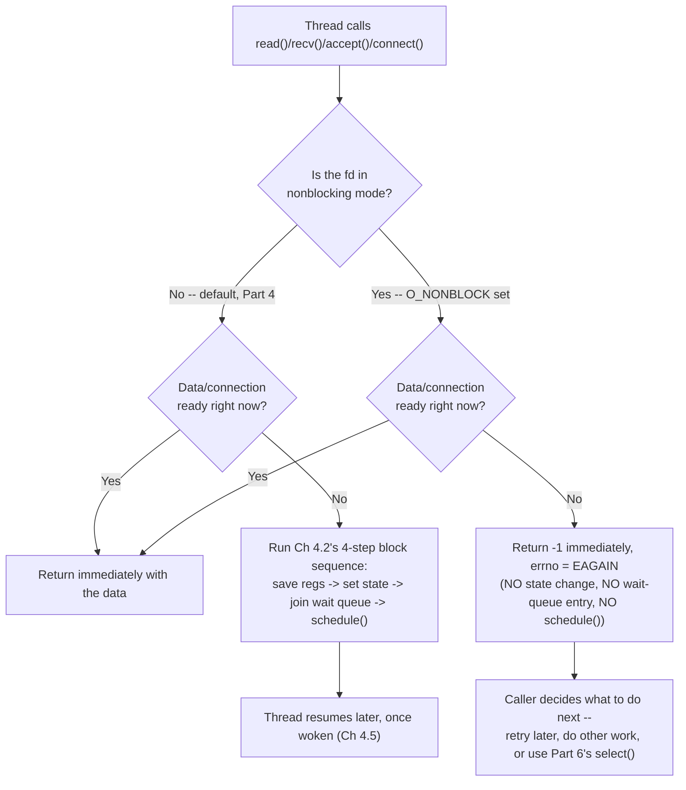

# PART 5 — Nonblocking I/O

## Chapter 5.1 — What "Nonblocking" Actually Means

### 🧠 One-Sentence Mental Model
> Nonblocking I/O changes exactly one thing about a syscall's CONTRACT: instead of putting your thread to sleep when the answer isn't ready yet (Chapter 4.2's four-step sequence), the kernel returns to you IMMEDIATELY with "nothing to report yet" (`EAGAIN`/`EWOULDBLOCK`) — the work the kernel is doing underneath (waiting for a NIC interrupt, a disk completion) is completely unchanged; only who does the waiting changes.

### 🧒 Explain Like I'm Five
Blocking is like standing at the mailbox until the mail truck arrives, however long that takes. Nonblocking is like checking the mailbox, seeing it's empty, and walking away — you can check again in five minutes, or go do something else entirely. The mail truck arrives on the exact same schedule either way; only your own behavior changed.

### 🌍 Real-World Analogy
A chef who blocks: stands at the oven staring at the roast until the timer goes off, unable to prep anything else. A chef who goes nonblocking: pokes the roast, finds it's not ready, goes and chops vegetables, comes back and pokes it again later. Same roast, same oven, same cook time — the ONLY difference is whether the chef is frozen in place while waiting.

### ❓ The Problem
Part 4 established that blocking calls are simple and correct, but tie up one whole thread per in-flight operation — Chapters 4.8/4.9 showed this cost concretely (one thread or process per connection). Before this course can get to `select`/`poll`/`epoll` (Parts 6-8), which manage MANY operations from ONE thread, there has to be a way for a single thread to even ASK a file descriptor "are you ready?" without committing to wait. That's what nonblocking mode provides — it is the prerequisite primitive every later multiplexing mechanism is built on top of.

### 🔥 Why This Problem Matters
Every high-performance server (nginx, Redis, Node.js's event loop, this course's eventual io_uring chapters) is, underneath, a single thread (or a small, fixed pool) repeatedly asking many file descriptors "are you ready yet?" instead of spawning a thread per connection. None of that is possible until individual syscalls can return "not ready" instead of sleeping — which is exactly this chapter's subject.

### 🕰 Historical Context
Nonblocking mode (`O_NONBLOCK`) has existed since early Unix, originally mostly used for terminal and pipe I/O where a program genuinely couldn't afford to block (e.g., a shell managing job control). It only became the backbone of mainstream network server design once `select()` (BSD, 1983) gave programs an efficient way to ask "which of these many descriptors is ready?" rather than polling each one in a tight, wasteful loop (Chapter 5.4 names this cost precisely) — Part 6 picks up that story.

### 💡 The Naive Solution
If blocking ties up a thread, "just" make every call return immediately regardless of readiness, and have the APPLICATION repeatedly re-try the call until it succeeds.

### ❌ Why the Naive Solution Fails (if done carelessly)
Called in a tight loop with no pacing, this becomes **busy-waiting**: the thread spins at 100% CPU continuously asking "ready yet? ready yet? ready yet?" thousands or millions of times a second, most of which are wasted work — Chapter 5.4 measures this cost directly. Nonblocking mode by itself is not a complete solution; it's a building block that needs to be paired with an efficient "tell me when something changes" mechanism (Part 6 onward) to avoid this trap.

### ✅ The Better Solution
Understand nonblocking mode as precisely what it is — a readiness CHECK, not a wait — and use it correctly: either with sensible pacing for simple cases (this chapter's and 5.5/5.6's demos), or, for real applications, paired with a readiness-notification mechanism so the thread only re-checks when the kernel has actually signaled something changed (Parts 6-8).

### 🧠 Core Concept
> **A file descriptor's blocking/nonblocking mode is a per-OPEN-FILE-DESCRIPTION property (Chapter 3.3 — shared across `dup()`'d fds, independent across separate `open()`/`socket()` calls on the same file), not a property of the syscall you call on it. Set it once with `fcntl(fd, F_SETFL, O_NONBLOCK)` (Chapter 5.2), and `read()`/`recv()`/`write()`/`send()`/`accept()`/`connect()` on that fd all change behavior consistently: instead of running Chapter 4.2's four-step block sequence when the resource isn't ready, the syscall returns `-1` immediately with `errno` set to `EAGAIN` (or `EWOULDBLOCK` — the same value on Linux) and does NOTHING else — no registers saved, no wait-queue entry, no `schedule()` call at all.**

### 📐 Deep Technical Explanation



The kernel-side check is the SAME readiness check either way (Chapter 4.6/4.7's underlying mechanism — "does `files_struct`'s buffer have data," "has the TCP handshake completed") — nonblocking mode doesn't change what counts as ready, it only changes what the kernel does when the answer is NO. In C terms, the kernel's dispatch roughly looks like:

```c
// pseudocode inside the kernel's read() implementation
ssize_t do_read(struct file *f, char *buf, size_t len) {
    if (!data_available(f)) {
        if (f->f_flags & O_NONBLOCK) {
            return -EAGAIN;            // <-- the ONLY difference nonblocking mode makes
        }
        block_until_ready(f);          // Ch 4.2's 4-step sequence
    }
    return copy_data_to_user(f, buf, len);
}
```

This single `if` is the entire mechanism. Everything else about the file (its `file_operations` dispatch from Chapter 3.4, its underlying hardware wait from Part 1) is completely unaffected.

### ❌ Common Misconceptions
- ❌ **"Nonblocking I/O makes the operation itself faster."** — No; the disk still takes however long it takes, the network packet still arrives on its own schedule (Part 1). Nonblocking mode only changes what your THREAD does while waiting — it never shortens the wait itself.
- ❌ **"EAGAIN means something went wrong."** — It's not an error in the normal sense; it's the correct, expected signal "not ready yet, try again later" — distinguishable from a real error (`errno` would be something else, e.g. `ECONNRESET`) by checking specifically for `EAGAIN`/`EWOULDBLOCK`.
- ❌ **"Nonblocking mode is a flag you pass to each individual read()/recv() call."** — It's a property of the file descriptor itself (set via `fcntl()`, Chapter 5.2), not an argument to each call — though Chapter 4.7's `MSG_DONTWAIT` flag is the one exception, overriding the mode for a single `recv()`/`send()` call without changing the fd's general setting.
- ❌ **"A tight retry loop on EAGAIN is a legitimate design."** — It technically works but burns CPU uselessly (Chapter 5.4 measures exactly how much) — real applications pair nonblocking mode with a notification mechanism (`select`/`poll`/`epoll`, Parts 6-8) instead of spinning.

### 🧙 Wizard Insight
Nonblocking mode is deliberately a tiny, almost boring-looking change at the syscall level — one `if` statement in the kernel. Its entire significance comes from what it UNLOCKS: once a single syscall can ask "ready?" without committing to wait, you can ask that question of hundreds of file descriptors from one thread, which is the entire architectural idea behind every scalable I/O multiplexing mechanism this course covers from here through io_uring. Understanding this chapter deeply is understanding the hinge the rest of Part 5 and all of Parts 6-20+ swing on.

### 🧠 Quiz
**Q1.** What specifically does the kernel do differently when O_NONBLOCK is set and data isn't ready, compared to the blocking case?
<details><summary>Answer</summary>It returns -1 with errno=EAGAIN immediately and does nothing else -- no register save, no TASK_INTERRUPTIBLE state change, no wait-queue insertion, no schedule() call. The blocking case runs all four of those steps (Ch 4.2); the nonblocking case skips them entirely.</details>

**Q2.** Does setting O_NONBLOCK on a socket change how quickly data can arrive on it?
<details><summary>Answer</summary>No. The underlying hardware/network timing (Part 1's NIC/DMA/interrupt chain) is completely unaffected -- nonblocking mode only changes what the calling thread does while the data isn't yet available, never the data's actual arrival time.</details>

**Q3.** Is a tight loop that calls recv() repeatedly on EAGAIN, with no pause, a good design?
<details><summary>Answer</summary>No -- it works correctly but wastes CPU continuously re-asking a question whose answer hasn't changed (Ch 5.4 quantifies this). Nonblocking mode is meant to be paired with a readiness-notification mechanism (select/poll/epoll, Parts 6-8) so the thread only re-checks when the kernel signals something actually changed.</details>

### 📌 Short Notes (Quick Reference)
- Nonblocking mode changes ONE thing: what the kernel does when the resource isn't ready — return EAGAIN immediately vs. run Ch 4.2's 4-step block sequence. The readiness check itself is identical either way.
- It's a per-open-file-description property (set via fcntl(), shared across dup()'d fds), not a per-call argument — except MSG_DONTWAIT, which overrides it for one recv()/send() call only.
- EAGAIN/EWOULDBLOCK (same value on Linux) = "not ready yet," not an error — distinguish it from real errors by checking errno specifically.
- Nonblocking mode never changes how fast the underlying hardware/network event happens — only who waits for it and how.
- Used alone with a naive retry loop, it causes busy-waiting (Ch 5.4); its real power comes from pairing it with select/poll/epoll (Parts 6-8).

### 🔗 What This Connects To Next
**Previous:** Part 4, Chapter 4.9 — Process-per-Connection (end of Part 4)
**Current:** Part 5, Chapter 5.1 — What "Nonblocking" Actually Means
**Next:** Part 5, Chapter 5.2 — Setting Nonblocking Mode: `fcntl()` and `O_NONBLOCK` in practice
