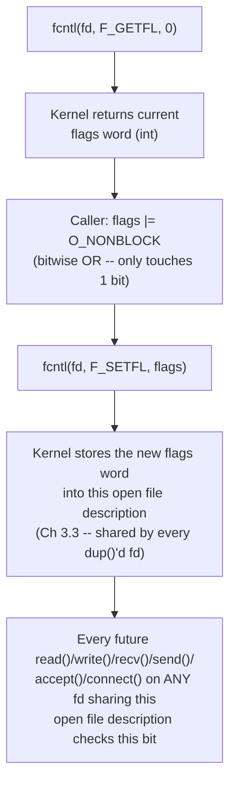

# PART 5 — Nonblocking I/O

## Chapter 5.2 — Setting Nonblocking Mode: `fcntl()` and `O_NONBLOCK` in Practice

### 🧠 One-Sentence Mental Model
> `fcntl(fd, F_SETFL, flags | O_NONBLOCK)` flips one bit in the kernel's per-open-file-description flags word (Chapter 3.3) — everything downstream (Chapter 5.1's `if` in `do_read()`) reads that same bit on every call, so setting it once changes the behavior of every future `read()`/`write()`/`recv()`/`send()`/`accept()`/`connect()` on that fd (and every fd that shares the same open file description via `dup()`).

### 🧒 Explain Like I'm Five
It's like flipping a switch labeled "don't make me wait" on a vending machine. Flip it once, and from then on, every time you press a button and the snack isn't there, it just says "not available" right away instead of you standing there until it's restocked.

### 🌍 Real-World Analogy
A restaurant pager system: by default, your pager vibrates (blocks) silently until your table is ready, however long that takes. Asking the host "has anything changed yet?" is the nonblocking equivalent — you get an instant, honest answer ("not yet") instead of a vibration you have to wait for. `fcntl()` is the one conversation with the host where you say "from now on, just tell me immediately whenever I ask" instead of waiting on the pager.

### ❓ The Problem
Chapter 5.1 established WHAT nonblocking mode changes conceptually. This chapter answers the purely mechanical question: what line of code actually turns it on, what are all the ways to do it (including at `socket()`/`accept()` creation time), and how do you correctly read the current flags without clobbering others you didn't mean to touch?

### 🔥 Why This Problem Matters
Every nonblocking program in this course (from here through Part 20's `io_uring`) starts with exactly this one setup step. Getting the flag-combining pattern wrong (a classic beginner bug) silently disables unrelated flags like `O_APPEND` or `FD_CLOEXEC` — worth doing correctly, once, so it's never a bug source again.

### 🕰 Historical Context
`fcntl()` ("file control") is one of the oldest and most overloaded syscalls in Unix — besides getting/setting file status flags (this chapter's use), it also duplicates fds, manages file locks, and sets `FD_CLOEXEC` (Chapter 3.10). Linux later added convenience shortcuts — `SOCK_NONBLOCK` on `socket()` and `accept4()` — specifically to avoid a subtle race condition in the original two-step "create, then fcntl()" pattern (covered below).

### 💡 The Naive Solution
`fcntl(fd, F_SETFL, O_NONBLOCK);` — just set the flags to `O_NONBLOCK` directly and move on.

### ❌ Why the Naive Solution Fails
`F_SETFL` REPLACES the entire flags word, not just the bit you named. If the fd already had other flags set (e.g. `O_APPEND` on a log file, or flags a library set for you), this naive call silently wipes them out — a bug that often isn't noticed until much later, intermittently, when that other flag's behavior was actually needed.

### ✅ The Better Solution
Always READ the current flags first with `F_GETFL`, OR in the new bit, and write the combined result back — the read-modify-write pattern below, which is the only correct way to add a single flag without disturbing the others.

### 🧠 Core Concept
> **`fcntl()`'s `F_GETFL`/`F_SETFL` commands read and write the open file description's flags word as a whole bitmask (Chapter 3.3 — this is why the operation must be read-modify-write, not a blind overwrite). `O_NONBLOCK` is just one bit in that word, alongside things like `O_APPEND`; setting it is a kernel-side flip of that bit, checked by the exact `if (f->f_flags & O_NONBLOCK)` test from Chapter 5.1's pseudocode on every subsequent syscall against that fd.**

---

## 🔌 Syscalls / APIs — Syntax First

### 1. The read-modify-write pattern — the ONE correct way to set it

```c
int flags = fcntl(fd, F_GETFL, 0);     // step 1: read the CURRENT flags
if (flags < 0) { perror("fcntl(F_GETFL)"); /* handle error */ }

flags |= O_NONBLOCK;                    // step 2: OR in just the bit you want

if (fcntl(fd, F_SETFL, flags) < 0) {    // step 3: write the COMBINED flags back
    perror("fcntl(F_SETFL)");
}
```

To turn it back OFF later (useful for debugging, or temporarily reverting to blocking for a specific operation):
```c
flags &= ~O_NONBLOCK;                   // AND with the inverted bit -- clears just this one
fcntl(fd, F_SETFL, flags);
```

**`fcntl(int fd, int cmd, ...)`** — a variadic, "Swiss army knife" syscall whose third argument's type depends on `cmd`:

| `cmd` | Third argument | What it does |
|---|---|---|
| `F_GETFL` | (none) | Returns the current file status flags (`O_NONBLOCK`, `O_APPEND`, `O_ASYNC`, access mode bits) as an `int` |
| `F_SETFL` | `int flags` | REPLACES the file status flags with the given value — hence the read-modify-write requirement above |
| `F_GETFD` / `F_SETFD` | (none) / `int` | Gets/sets the SEPARATE per-fd flag word that holds `FD_CLOEXEC` (Chapter 3.10) — a different flag word from `F_GETFL`/`F_SETFL`, easy to confuse |
| `F_DUPFD` | `int min_fd` | Duplicates the fd (like `dup()`) but guarantees the new fd is `>= min_fd` — out of scope here, mentioned for completeness |

### 2. Setting it at creation time instead — `SOCK_NONBLOCK` and `accept4()`

For sockets specifically, Linux lets you skip the separate `fcntl()` call entirely by requesting nonblocking mode AT creation time:

```c
// instead of: socket(AF_INET, SOCK_STREAM, 0) + a separate fcntl() call --
int fd = socket(AF_INET, SOCK_STREAM | SOCK_NONBLOCK, 0);   // one flag, one call

// and for accept(), which otherwise returns a BRAND NEW fd that would need
// its OWN separate fcntl() call every single time a connection arrives:
int client_fd = accept4(listen_fd, nullptr, nullptr, SOCK_NONBLOCK);
```

**Why this exists (the race this avoids):** the two-step pattern — `fd = socket(...)` then `fcntl(fd, F_SETFL, ...)` — has a brief window between the two calls where the fd exists in its DEFAULT (blocking) mode. In a multi-threaded program, another thread could use that fd during that tiny window before the flag is set. `SOCK_NONBLOCK`/`accept4()`'s combined form closes that window completely — the fd is born already in nonblocking mode, with no gap at all. This is a real, if narrow, correctness fix, not just a convenience shortcut — prefer it whenever you're setting nonblocking mode immediately after creation.

### 3. For files opened with `open()` — the analogous `O_NONBLOCK` creation flag

```c
int fd = open("/some/fifo", O_RDONLY | O_NONBLOCK);   // set at open() time directly
```
Works the same way for regular `open()` calls — pass `O_NONBLOCK` alongside your other flags (`O_RDONLY`/`O_CREAT`/etc. from Chapter 4.6) rather than calling `fcntl()` afterward, whenever you know at `open()` time that you want it.

---

### 📐 Deep Technical Explanation



A crucial, often-missed detail: because `O_NONBLOCK` lives on the **open file description**, not the per-process fd table entry (Chapter 3.2 vs. 3.3's distinction), setting it on one fd affects every OTHER fd that refers to the SAME open file description — e.g., an fd you `dup()`'d, or one inherited across `fork()`. It does NOT affect a fd from a completely separate `open()`/`socket()` call on the same file/address, even though that might feel surprising:

```cpp
int fd1 = open("file.txt", O_RDWR);
int fd2 = dup(fd1);                      // fd2 shares fd1's OPEN FILE DESCRIPTION

int fd3 = open("file.txt", O_RDWR);      // fd3 is a SEPARATE open file description

fcntl(fd1, F_SETFL, O_NONBLOCK);
// fd2 is now ALSO nonblocking (same open file description) -- Ch 3.3
// fd3 is STILL blocking (independent open file description, same file)
```

**Project: confirm this experimentally.**

```cpp
// nonblock_scope_demo.cpp
// Compile: g++ -O2 -std=c++20 nonblock_scope_demo.cpp -o nonblock_scope_demo
// Run:     ./nonblock_scope_demo

#include <fcntl.h>
#include <unistd.h>
#include <cstdio>

void print_mode(const char* label, int fd) {
    int flags = fcntl(fd, F_GETFL, 0);
    printf("%s: %s\n", label, (flags & O_NONBLOCK) ? "NONBLOCKING" : "blocking");
}

int main() {
    int fd1 = open("/tmp/nb_demo.txt", O_RDWR | O_CREAT, 0644);
    int fd2 = dup(fd1);                          // shares fd1's open file description
    int fd3 = open("/tmp/nb_demo.txt", O_RDWR);  // independent open file description

    print_mode("fd1 (before)", fd1);
    print_mode("fd2 (before)", fd2);
    print_mode("fd3 (before)", fd3);

    int flags = fcntl(fd1, F_GETFL, 0);
    fcntl(fd1, F_SETFL, flags | O_NONBLOCK);     // set nonblocking ONLY via fd1

    printf("--- after setting O_NONBLOCK on fd1 ---\n");
    print_mode("fd1 (after)", fd1);   // NONBLOCKING
    print_mode("fd2 (after)", fd2);   // NONBLOCKING too -- shares fd1's open file description
    print_mode("fd3 (after)", fd3);   // still blocking -- independent open() call

    close(fd1); close(fd2); close(fd3);
    return 0;
}
```

**Predict before running:** which of fd1/fd2/fd3 print "NONBLOCKING" after the single `fcntl()` call on `fd1`?
<details><summary>Click to reveal the answer</summary>
fd1 and fd2 both print NONBLOCKING — they share the same open file description (Chapter 3.3), created via `dup()`. fd3 stays "blocking" — it came from its OWN separate `open()` call, which allocated an entirely independent open file description, even though it points at the same underlying file. This is the single most common source of confusion when debugging "why isn't my fcntl() call having any effect" bugs — the fix is always to check whether you're operating on the fd you actually think you are, versus a fresh one from a separate `open()`/`socket()`/`accept()` call.
</details>

### ❌ Common Misconceptions
- ❌ **"`fcntl(fd, F_SETFL, O_NONBLOCK)` is a safe way to turn on nonblocking mode."** — It silently clears every OTHER flag that was set (like `O_APPEND`) because `F_SETFL` replaces the whole word — always read-modify-write (Section 1).
- ❌ **"Nonblocking mode is a per-fd-table-entry setting."** — It's a property of the open file description (Chapter 3.3), so it's shared across every `dup()`'d or `fork()`-inherited fd pointing at the same open file description — but NOT across independent `open()`/`socket()` calls on the same file.
- ❌ **"`SOCK_NONBLOCK` and a separate `fcntl()` call afterward are equivalent in every way."** — They produce the same end state, but the combined form avoids a real (if narrow) race window where another thread could touch the fd while it was still in its default blocking mode.
- ❌ **"`F_SETFD` and `F_SETFL` control the same flags."** — They're two entirely separate flag words: `F_SETFD` holds only `FD_CLOEXEC` (Chapter 3.10, per-fd-table-entry); `F_SETFL` holds `O_NONBLOCK`/`O_APPEND`/etc. (per-open-file-description). Confusing the two is a classic bug.

### 🧙 Wizard Insight
The read-modify-write pattern here is a tiny instance of a much bigger systems-programming principle you'll see again and again: whenever a "set" operation REPLACES a whole shared state blob rather than patching one field, you must read-modify-write or you risk silently destroying state you didn't know was there. The exact same caution applies later to things like process resource limits (`setrlimit`), terminal settings (`termios`, Chapter 3.9), and CPU affinity masks — `fcntl(F_SETFL)` is simply your first encounter with the pattern.

### 🧠 Quiz
**Q1.** Why is `fcntl(fd, F_SETFL, O_NONBLOCK)` dangerous to call directly, without reading flags first?
<details><summary>Answer</summary>F_SETFL replaces the ENTIRE flags word, not just one bit -- so any other flag that was previously set (O_APPEND, for instance) gets silently cleared. The safe pattern is always F_GETFL, OR in the new bit, then F_SETFL with the combined value.</details>

**Q2.** You call fcntl() to set O_NONBLOCK on an fd that you got via dup() from another fd. Does the ORIGINAL fd become nonblocking too?
<details><summary>Answer</summary>Yes -- dup()'d fds share the same open file description (Ch 3.3), and O_NONBLOCK lives there, not in the per-process fd table entry. Setting it through either fd affects both.</details>

**Q3.** What specific problem does SOCK_NONBLOCK / accept4()'s combined flag solve that a separate socket()-then-fcntl() call doesn't?
<details><summary>Answer</summary>It closes the brief race window between fd creation and the fcntl() call, during which the fd exists in default blocking mode and could be used by another thread before nonblocking mode is actually set. Setting the flag at creation time means the fd is never observably blocking.</details>

### 📌 Short Notes (Quick Reference)
- Always read-modify-write: `flags = fcntl(fd, F_GETFL, 0); flags |= O_NONBLOCK; fcntl(fd, F_SETFL, flags);` — never pass `O_NONBLOCK` alone to `F_SETFL`.
- `F_GETFL`/`F_SETFL` = file status flags (`O_NONBLOCK`, `O_APPEND`...), per OPEN FILE DESCRIPTION (Ch 3.3) — shared across `dup()`/`fork()`-shared fds.
- `F_GETFD`/`F_SETFD` = a DIFFERENT flag word, holding only `FD_CLOEXEC` (Ch 3.10), per fd-table-entry — don't confuse the two.
- Shortcuts that set it at creation time, avoiding a race: `socket(..., SOCK_STREAM | SOCK_NONBLOCK, 0)`, `accept4(fd, addr, len, SOCK_NONBLOCK)`, `open(path, flags | O_NONBLOCK)`.
- Setting nonblocking mode on one fd affects every OTHER fd sharing the same open file description — but not an independently-opened fd on the same file.

### 🔗 What This Connects To Next
**Previous:** Part 5, Chapter 5.1 — What "Nonblocking" Actually Means
**Current:** Part 5, Chapter 5.2 — Setting Nonblocking Mode: `fcntl()` and `O_NONBLOCK` in Practice
**Next:** Part 5, Chapter 5.3 — `EAGAIN`/`EWOULDBLOCK`: Reading and Handling the "Not Ready" Signal Correctly
