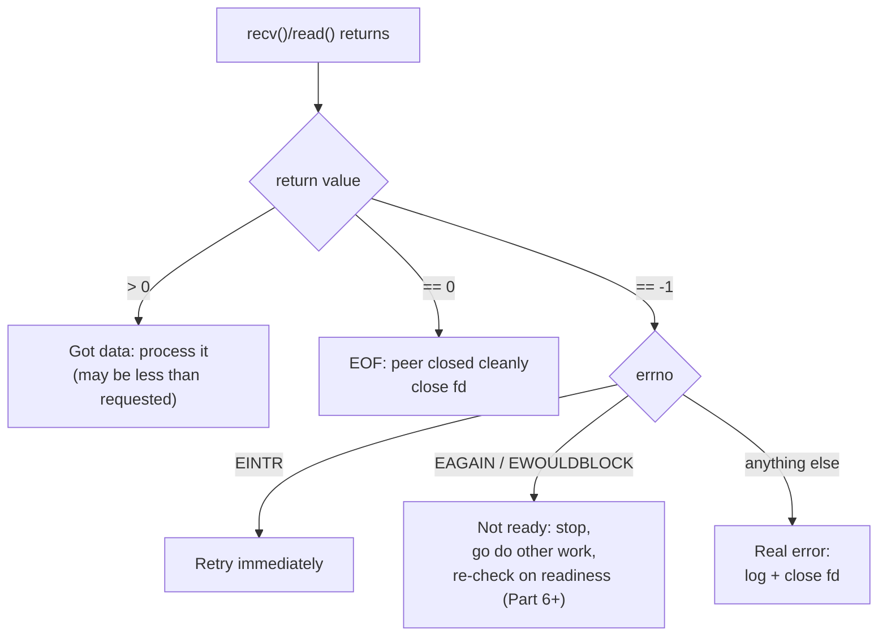

# PART 5 — Nonblocking I/O

## Chapter 5.3 — `EAGAIN` / `EWOULDBLOCK`: Reading and Handling the "Not Ready" Signal Correctly

### 🧠 One-Sentence Mental Model
> In nonblocking mode, every I/O call has THREE possible outcomes, not two — it succeeded (`n > 0`), the peer is gone (`n == 0` on reads), or it failed (`-1`) — and the `-1` case splits again into "not ready, retry later" (`EAGAIN`/`EWOULDBLOCK`, also `EINTR`) versus "genuinely broken" (everything else); correct nonblocking code is mostly the discipline of telling those apart.

### 🧒 Explain Like I'm Five
Imagine asking a friend "do you have the answer yet?" They can say "here it is!", "I'm leaving, bye forever", "not yet, ask again later", or "something exploded". "Not yet" isn't bad news — it's just a status. A beginner treats "not yet" like "something exploded" and gives up. A wizard knows the difference.

### 🌍 Real-World Analogy
A bakery counter: "Is my order ready?" → "Not yet" (EAGAIN: come back later, nothing wrong), "Here you go" (success), "We closed permanently" (read returns 0), or "The oven caught fire" (real error, e.g. `ECONNRESET`). You'd never walk out of the bakery forever just because the answer was "not yet."

### ❓ The Problem
Chapter 5.1 said nonblocking calls return `-1`/`EAGAIN` when not ready. But `-1` is ALSO how every real failure is reported. If you handle `-1` as "error → close the connection", your server will drop healthy connections the first time data isn't there yet. If you handle every `-1` as "retry", you'll spin forever on a dead socket. Correct classification of `errno` is the whole game.

### 🔥 Why This Problem Matters
This is the single most common source of bugs in nonblocking servers: dropped healthy connections (treating EAGAIN as fatal), infinite loops on dead sockets (treating everything as retryable), and — subtler — losing data because a short write wasn't resumed. Every `epoll` server in Parts 8+ is built on exactly this classification logic.

### 🕰 Historical Context
`EAGAIN` ("try again") came from System V Unix; `EWOULDBLOCK` ("operation would block") came from BSD. Early systems gave them DIFFERENT numeric values, so portable code had to check both. On Linux (and POSIX permits it) they have the SAME value — but portable code still writes `errno == EAGAIN || errno == EWOULDBLOCK` because the standard doesn't guarantee equality everywhere.

### 💡 The Naive Solution
```c
ssize_t n = recv(fd, buf, sizeof buf, 0);
if (n < 0) { perror("recv"); close(fd); }   // any -1 = fatal
```

### ❌ Why the Naive Solution Fails
In nonblocking mode this closes the connection every time the peer simply hasn't sent anything yet — i.e., constantly. The opposite naive fix, `while ((n = recv(...)) < 0) { }`, spins at 100% CPU forever when the real cause is `ECONNRESET`.

### ✅ The Better Solution
Classify the result into exactly four buckets and act on each differently (the table and template below).

### 🧠 Core Concept
> **`-1` is a family, not a single outcome. `EAGAIN`/`EWOULDBLOCK` = "valid, nothing to do right now — go do something else and come back." `EINTR` = "a signal interrupted the call before it did anything — just retry immediately." Everything else = real error, close the fd. And separately, a return of `0` from `recv()`/`read()` is NOT an error and NOT "not ready" — it's the peer's orderly shutdown (EOF).**

---

## 🔌 Syscalls / APIs — Syntax First

### 1. `errno` — how the failure reason is reported

```c
#include <cerrno>
ssize_t n = recv(fd, buf, len, 0);
if (n < 0) {
    int e = errno;      // COPY it immediately: any other libc call (even printf) may overwrite errno
    ...
}
```
`errno` is a per-thread integer set by a failing syscall. It's only meaningful RIGHT AFTER a call returned `-1`; it is never reset to 0 on success. Save it into a local before calling anything else.

### 2. The classification table

| Call | Return | errno | Meaning | What you do |
|---|---|---|---|---|
| `read`/`recv` | `n > 0` | — | got `n` bytes (maybe fewer than asked) | process them; may loop for more |
| `read`/`recv` | `0` | — | peer closed (EOF) | close fd, clean up |
| `read`/`recv` | `-1` | `EAGAIN`/`EWOULDBLOCK` | nothing available *right now* | stop reading; wait for readiness (Part 6+) |
| `read`/`recv` | `-1` | `EINTR` | signal interrupted before data | retry immediately |
| `read`/`recv` | `-1` | `ECONNRESET` etc. | real error | log, close fd |
| `write`/`send` | `n >= 0` | — | wrote `n` bytes — **possibly fewer than requested** | advance buffer by `n`; keep the rest |
| `write`/`send` | `-1` | `EAGAIN`/`EWOULDBLOCK` | kernel send buffer full | keep unsent data; wait until writable |
| `write`/`send` | `-1` | `EPIPE` | peer closed; (SIGPIPE if not suppressed — Ch 4.7 §12) | close fd |
| `accept`/`accept4` | `fd >= 0` | — | new connection | register it |
| `accept`/`accept4` | `-1` | `EAGAIN`/`EWOULDBLOCK` | accept queue empty | done for now |
| `accept`/`accept4` | `-1` | `ECONNABORTED` | client gave up before we accepted | ignore, keep accepting |
| `accept`/`accept4` | `-1` | `EMFILE`/`ENFILE` | out of fds | real resource problem — see Part 24 |
| `connect` | `-1` | `EINPROGRESS` | handshake started, not finished | **normal** for nonblocking connect — Ch 5.7 |

### 3. The portable "would block" test

```c
static inline bool would_block(int e) {
    return e == EAGAIN || e == EWOULDBLOCK;   // same value on Linux; both checked for portability
}
```

### 4. The correct template for reads

```c
for (;;) {
    ssize_t n = recv(fd, buf, sizeof buf, 0);
    if (n > 0)  { handle(buf, n); continue; }   // maybe more waiting: keep draining
    if (n == 0) { close_connection(fd); break; }// EOF
    int e = errno;
    if (e == EINTR)        continue;            // interrupted, retry
    if (would_block(e))    break;               // drained everything for now
    perror("recv"); close_connection(fd); break;// real error
}
```
Note `continue` after `n > 0`: draining until EAGAIN is the pattern edge-triggered epoll (Part 8) REQUIRES; with level-triggered it's optional but common.

### 5. The correct template for writes (the partial-write rule)

```c
// returns bytes still unsent; caller keeps them and retries when fd is writable
size_t send_some(int fd, const char* data, size_t len) {
    size_t off = 0;
    while (off < len) {
        ssize_t n = send(fd, data + off, len - off, MSG_NOSIGNAL);
        if (n > 0) { off += n; continue; }
        int e = errno;
        if (n < 0 && e == EINTR) continue;
        if (n < 0 && would_block(e)) break;      // kernel buffer full: STOP, keep the rest
        return (size_t)-1;                       // real error
    }
    return len - off;                            // remaining
}
```
In nonblocking mode, `send()` can accept only PART of your buffer (kernel send buffer almost full) and return a smaller count with no error. Treating that as "all sent" silently truncates your data. You MUST keep the remainder (in a per-connection output buffer) and send it later.

---

### 📐 Deep Technical Explanation



**Why does `send()` return partial counts?** The kernel copies into the socket's send buffer (Chapter 3.8). If only 3 KB of space is free and you offer 10 KB, a blocking `send()` would sleep until all 10 KB fit (Chapter 4.7); a nonblocking `send()` copies the 3 KB that fit and returns 3072 — "I took this much, the rest is your problem." Only when the buffer is COMPLETELY full does it return `-1`/`EAGAIN`.

**Why can `EAGAIN` appear on `accept()`?** The listening socket's accept queue (Chapter 4.7, `backlog`) is empty — "no new connection yet" is the exact analog of "no data yet."

**Project: provoke every outcome yourself with a pipe** (a pipe is the simplest fd where you control both ends — Chapter 3.7).

```cpp
// eagain_lab.cpp
// Compile: g++ -O2 -std=c++20 eagain_lab.cpp -o eagain_lab
// Run:     ./eagain_lab

#include <fcntl.h>
#include <unistd.h>
#include <cerrno>
#include <cstdio>
#include <cstring>

static void set_nonblock(int fd) {
    int fl = fcntl(fd, F_GETFL, 0);          // Ch 5.2: read-modify-write
    fcntl(fd, F_SETFL, fl | O_NONBLOCK);
}

int main() {
    int p[2];
    pipe(p);                 // p[0] = read end, p[1] = write end
    set_nonblock(p[0]);
    set_nonblock(p[1]);

    char buf[128];

    // 1) Read from an EMPTY pipe whose write end is still open -> EAGAIN
    ssize_t n = read(p[0], buf, sizeof buf);
    printf("1) empty pipe read: n=%zd errno=%s\n", n, n < 0 ? strerror(errno) : "-");

    // 2) Write something, then read it -> n > 0
    write(p[1], "hello", 5);
    n = read(p[0], buf, sizeof buf);
    printf("2) after write, read: n=%zd (\"%.*s\")\n", n, (int)n, buf);

    // 3) Fill the pipe until write would block -> partial writes then EAGAIN
    char chunk[4096]; memset(chunk, 'x', sizeof chunk);
    size_t total = 0; int calls = 0;
    for (;;) {
        ssize_t w = write(p[1], chunk, sizeof chunk);
        if (w < 0) {
            printf("3) pipe full after %zu bytes (%d writes): errno=%s\n",
                   total, calls, strerror(errno));
            break;
        }
        total += w; ++calls;
    }

    // 4) Drain it completely, then close the write end -> read returns 0 (EOF)
    while ((n = read(p[0], buf, sizeof buf)) > 0) {}
    printf("4a) drained: last read n=%zd errno=%s\n", n, n < 0 ? strerror(errno) : "-");
    close(p[1]);
    n = read(p[0], buf, sizeof buf);
    printf("4b) after closing writer: read n=%zd  (0 == EOF, NOT an error)\n", n);

    close(p[0]);
    return 0;
}
```

**Predict before running:** (a) what does step 1 print for `errno`? (b) roughly how many bytes does step 3 accept before blocking on a default Linux pipe? (c) what's different between step 4a and 4b, given both "have nothing to read"?

<details><summary>Click to reveal the answer</summary>

(a) `Resource temporarily unavailable` — that's the `strerror` text for `EAGAIN`/`EWOULDBLOCK`. The write end is still open, so "empty" means "might get data later" → not ready, not EOF.

(b) Typically 65,536 bytes (Linux's default pipe capacity: 16 pages × 4 KB) — you'll usually see ~16 successful 4096-byte writes, then `EAGAIN`. The exact number can differ on your system/kernel settings (`fcntl(F_GETPIPE_SZ)` shows it) — measure yours.

(c) 4a: empty pipe, writer still open → `-1` + `EAGAIN` ("nothing yet"). 4b: empty pipe, writer closed → `0` ("nothing EVER again"). Same observable emptiness, completely different meaning — which is exactly why `0` and `EAGAIN` must never be conflated.
</details>

### ❌ Common Misconceptions
- ❌ **"`-1` means error, close the fd."** — In nonblocking mode `-1`+`EAGAIN` is the *normal, expected* "not ready" signal; only other errno values are real errors.
- ❌ **"`recv()` returning 0 means no data right now."** — It means orderly EOF from the peer. "No data right now" is `-1`/`EAGAIN`.
- ❌ **"A successful `send()` sent everything."** — Nonblocking `send()` may accept only part of your buffer; you must track and resend the remainder.
- ❌ **"EAGAIN and EWOULDBLOCK are different errors."** — Same value on Linux; check both only for portability.
- ❌ **"I can read `errno` any time later."** — It's overwritten by any subsequent failing call (even inside `printf`/`perror`). Copy it first.
- ❌ **"EINTR can't happen in nonblocking mode."** — It's rarer (the call doesn't sleep), but signals can still interrupt it; handle it or use `SA_RESTART`.

### 🧙 Wizard Insight
All of event-driven programming reduces to a loop of "try the operation; if the kernel says EAGAIN, remember where I was and go serve someone else." The state you must remember — how many bytes of this message have I read, how many of this response have I sent — is exactly what makes nonblocking code harder than blocking code: with blocking I/O the *call stack itself* remembered your place; with nonblocking I/O you must store it explicitly per connection. That per-connection state machine is the real cost of leaving threads behind, and Chapter 5.6 builds one.

### 🧠 Quiz
**Q1.** A nonblocking `recv()` returns `-1` with `errno == EAGAIN`. Should you close the connection?
<details><summary>Answer</summary>No. It means no data is available yet; the connection is healthy. Stop reading for now and wait until the fd becomes readable again.</details>

**Q2.** `recv()` returns `0`. What does it mean, and how does it differ from `EAGAIN`?
<details><summary>Answer</summary>The peer performed an orderly shutdown (EOF); no more data will ever arrive, so you should close your side. EAGAIN means more data may arrive later.</details>

**Q3.** You call nonblocking `send(fd, buf, 10000, 0)` and it returns 3000. What must you do?
<details><summary>Answer</summary>Keep the remaining 7000 bytes in a per-connection output buffer and resend them (from offset 3000) when the socket becomes writable. Assuming everything was sent loses data.</details>

**Q4.** Why copy `errno` into a local immediately after a failed call?
<details><summary>Answer</summary>Any later library/syscall (including printing) can overwrite the thread's errno, so checking it afterward may classify the wrong error.</details>

### 📌 Short Notes (Quick Reference)
- Four outcomes per call: success (`>0`), EOF (`0` on read), would-block (`-1` + `EAGAIN`/`EWOULDBLOCK`), real error (`-1` + other errno); `EINTR` = retry.
- Test both macros: `e == EAGAIN || e == EWOULDBLOCK`. Copy `errno` immediately.
- `read()==0` is EOF, never "not ready".
- Nonblocking `send()` can be partial → keep an output buffer per connection and resend the remainder on writability.
- `accept()` gets `EAGAIN` when the queue is empty; `connect()` returns `EINPROGRESS` (normal, Ch 5.7).
- Reading until `EAGAIN` ("drain") is mandatory for edge-triggered epoll (Part 8).
- Blocking code keeps your place on the call stack; nonblocking code needs explicit per-connection state.

### 🔗 What This Connects To Next
**Previous:** Part 5, Chapter 5.2 — `fcntl()` and `O_NONBLOCK`
**Current:** Part 5, Chapter 5.3 — `EAGAIN` / `EWOULDBLOCK`
**Next:** Part 5, Chapter 5.4 — The Busy-Wait Problem: what happens when you just retry in a loop (with measurements)
