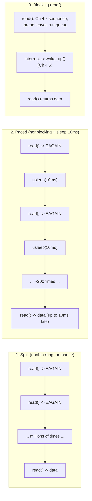

# PART 5 — Nonblocking I/O

## Chapter 5.4 — The Busy-Wait Problem: What Happens When You Just Retry in a Loop

### 🧠 One-Sentence Mental Model
> A nonblocking call in a retry loop turns "wait" into "ask the same question millions of times per second" — the data arrives at exactly the same moment, but your CPU burns ~100% of a core the whole time; blocking wastes zero CPU but ties up a thread, spinning wastes a whole core but frees the thread — and neither is what you actually want, which is *sleep until something changes* for MANY fds at once (Parts 6-8).

### 🧒 Explain Like I'm Five
Imagine waiting for a pizza. Blocking: you sit on the couch and the doorbell wakes you. Spinning: you run to the door, look, run back, run to the door, look, run back — a million times — until the pizza shows up. The pizza arrives at the same time either way, but spinning leaves you exhausted and unable to do anything else.

### 🌍 Real-World Analogy
A child in the back seat asking "Are we there yet? Are we there yet? Are we there yet?" Each question is a (cheap) syscall; the answer is "no" almost every time; the car arrives exactly when it was going to. Pacing ("ask every 10 minutes") is quieter but means you may learn about arrival up to 10 minutes late.

### ❓ The Problem
Chapter 5.1 warned that a naive retry loop is a trap; Chapter 5.3 showed how to recognize "not ready". This chapter measures the actual cost, and shows why the two obvious fixes — sleep between retries, or go back to blocking — each give up something important.

### 🔥 Why This Problem Matters
Every instinct a beginner has for "make it nonblocking, then loop" lands in this trap. Quantifying it (below) is what makes `select`/`poll`/`epoll` feel *necessary* rather than like extra complexity — they exist to give you blocking's zero CPU cost with nonblocking's ability to watch many fds from one thread.

### 🕰 Historical Context
Early network programs on systems without `select()` did exactly this — poll every descriptor in a loop, sometimes with a `sleep(1)` — and the pattern was widely known as "polling" or "busy-waiting". The CPU waste on single-core machines was severe: a spinning process competes with every other process for the only CPU (Chapter 2.8's scheduler has no idea you're not doing useful work). Readiness-notification APIs (`select`, 1983) were the answer.

### 💡 The Naive Solution
```c
while ((n = read(fd, &c, 1)) < 0 && errno == EAGAIN) { /* try again */ }
```

### ❌ Why the Naive Solution Fails
It is *correct* (Chapter 5.3's classification is right) but each iteration is a full syscall (Chapter 2.6: ring 3→0→3) whose answer almost never changes. The thread stays `TASK_RUNNING` the entire time, so the scheduler keeps handing it CPU, stealing time from threads that have real work. With N spinning threads on a machine with fewer than N cores, they just starve each other.

### ✅ The Better Solution
Don't poll. Ask the **kernel** to sleep you until *any* of your fds changes state — `select()`/`poll()`/`epoll_wait()` (Parts 6-8). That keeps blocking's cost model (sleeping thread ≈ 0 CPU, Chapter 4.3) while letting ONE thread watch thousands of fds.

### 🧠 Core Concept
> **Spinning trades CPU for latency; sleeping-with-polling trades latency for CPU; blocking gets both right but only for one fd per thread. The fundamental insight: the *kernel already knows* when an fd becomes ready (Part 1's interrupt → wake_up chain, Chapter 4.5). Busy-waiting makes you rediscover, by brute force, a fact the kernel learned for free. The goal is to let the kernel tell you.**

---

### 📐 Deep Technical Explanation

Three strategies for "wait for one byte that arrives after 2 seconds":



**Cost model per strategy**

| Strategy | CPU while waiting | Wake-up latency | Threads needed for N fds |
|---|---|---|---|
| Spin | ~100% of one core | tiny (next iteration, ~µs) | 1 thread per fd is even worse; 1 thread can poll N fds but burns a core |
| Paced (sleep T) | tiny, ~ (syscalls)/T | up to **T** (average T/2) | 1 thread can poll N fds |
| Blocking | ~0 | ~ one wakeup (Ch 4.5) | **1 per fd** (the Part 4 problem) |
| `epoll_wait` (Part 8) | ~0 | ~ one wakeup | **1 for all fds** ← the goal |

The paced loop is a *latency/CPU dial*, and both ends are bad: shrink T and CPU climbs back toward spin; grow T and your server feels sluggish. No setting of T gets you "instant and free" — only kernel notification does.

---

## 🔬 Project: measure all three yourself

Wait for 1 byte, written by another thread after 2 seconds, through a pipe. Measure the *reader thread's own CPU time* (`CLOCK_THREAD_CPUTIME_ID`) against wall time, count `read()` calls, and measure wake latency (time from the writer's `write()` to the reader seeing the byte).

```cpp
// busywait_lab.cpp
// Compile: g++ -O2 -std=c++20 -pthread busywait_lab.cpp -o busywait_lab
// Run:     ./busywait_lab

#include <fcntl.h>
#include <unistd.h>
#include <time.h>
#include <cerrno>
#include <cstdio>
#include <thread>
#include <chrono>

using Clock = std::chrono::steady_clock;

static double thread_cpu_ms() {                 // CPU time burned by THIS thread only
    timespec ts; clock_gettime(CLOCK_THREAD_CPUTIME_ID, &ts);
    return ts.tv_sec * 1e3 + ts.tv_nsec / 1e6;
}
static void set_nonblock(int fd) {
    int fl = fcntl(fd, F_GETFL, 0);
    fcntl(fd, F_SETFL, fl | O_NONBLOCK);
}

enum class Mode { Spin, Paced, Blocking };

static void run(Mode mode, const char* name) {
    int p[2];
    if (pipe(p) != 0) { perror("pipe"); return; }
    if (mode != Mode::Blocking) set_nonblock(p[0]);

    const int DELAY_MS = 2000;                  // data arrives after 2 seconds
    Clock::time_point sent_at;
    std::thread writer([&] {
        std::this_thread::sleep_for(std::chrono::milliseconds(DELAY_MS));
        sent_at = Clock::now();
        if (write(p[1], "x", 1) != 1) perror("write");
    });

    long attempts = 0, eagains = 0;
    char c;
    double cpu0 = thread_cpu_ms();
    auto t0 = Clock::now();
    for (;;) {
        ++attempts;
        ssize_t n = read(p[0], &c, 1);
        if (n == 1) break;
        if (n < 0 && errno == EAGAIN) {
            ++eagains;
            if (mode == Mode::Paced) usleep(10'000);   // sleep 10 ms between checks
            continue;
        }
        perror("read"); break;
    }
    auto t1 = Clock::now();
    double cpu_ms  = thread_cpu_ms() - cpu0;
    double wall_ms = std::chrono::duration<double, std::milli>(t1 - t0).count();
    double lat_us  = std::chrono::duration<double, std::micro>(t1 - sent_at).count();
    writer.join();

    printf("%-9s wall=%7.1f ms  cpu=%7.1f ms (%5.1f%%)  read() calls=%-10ld EAGAIN=%-10ld wake latency=%8.1f us\n",
           name, wall_ms, cpu_ms, 100.0 * cpu_ms / wall_ms, attempts, eagains, lat_us);
    close(p[0]); close(p[1]);
}

int main() {
    run(Mode::Spin,     "spin");
    run(Mode::Paced,    "paced10ms");
    run(Mode::Blocking, "blocking");
}
```

**Predict before running:** (a) What CPU % will `spin` show? (b) Roughly how many `read()` calls will `paced10ms` make in 2 s? (c) Which strategy has the *best* wake latency — and is it also the cheapest?

### 📊 Measured output (this sandbox: 2 vCPU Linux VM, two runs)

```
spin      wall= 2001.4 ms  cpu= 1947.0 ms ( 97.3%)  read() calls=8728768    EAGAIN=8728767    wake latency=    71.4 us
paced10ms wall= 2009.9 ms  cpu=    7.1 ms (  0.4%)  read() calls=199        EAGAIN=198        wake latency=  9752.5 us
blocking  wall= 2000.3 ms  cpu=    0.0 ms (  0.0%)  read() calls=1          EAGAIN=0          wake latency=   113.1 us

spin      wall= 2000.2 ms  cpu= 1977.8 ms ( 98.9%)  read() calls=8797162    EAGAIN=8797161    wake latency=    18.8 us
paced10ms wall= 2009.5 ms  cpu=    6.8 ms (  0.3%)  read() calls=199        EAGAIN=198        wake latency=  9334.6 us
blocking  wall= 2000.4 ms  cpu=    0.0 ms (  0.0%)  read() calls=1          EAGAIN=0          wake latency=   125.0 us
```

> ⚠️ These are numbers from *one* virtualized sandbox, not universal constants (Part 22-23's rule: **always measure your own hardware**). Absolute syscall counts and latencies will differ on your machine; the *shape* — spin ≈ 100% CPU, paced ≈ 0.3% CPU but ~T late, blocking ≈ 0% CPU and fast — is what to expect.

<details><summary>Click to reveal the answers</summary>

(a) ≈ **97–99%** of the thread's wall time was CPU — it never slept. (b) **~199** — 2000 ms ÷ ~10 ms per sleep. (c) **Spin** had the best *latency* in run 2 (18.8 µs) and was noisy in run 1 (71.4 µs), but it's by far the most expensive: ~8.7 *million* syscalls (~230 ns each here) to learn one fact. **Blocking** had nearly the same latency (113–125 µs) at **0 CPU** — the wake-up costs a scheduler pass (Chapter 4.5's "woken ≠ running" gap), which is the small price of sleeping. Paced showed latency ≈ 9.3–9.8 ms: the data arrived at a random point inside a 10 ms sleep, so it waited most of one sleep interval.
</details>

### 🧮 What the numbers mean

- **Spin did ~8.7 million `read()` syscalls to deliver one byte.** 8,728,767 of them returned `EAGAIN` — each one a full ring 3→0→3 transition (Chapter 2.6) for the same "no". Roughly 2 s ÷ 8.7 M ≈ 230 ns per attempt on this VM.
- **Paced traded 97% of the CPU for ~10 ms of latency** — a fine deal for a background task, a bad one for a latency-sensitive server.
- **Blocking is the best single-fd answer** — but it needs a thread *per fd*, which is exactly Part 4's cost wall (Chapters 4.8-4.9).
- On a 2-core box, **two** spinning threads would consume *everything* — any other process (including the writer!) would compete for the remaining CPU. Spinning scales negatively.

### ❌ Common Misconceptions
- ❌ **"Nonblocking I/O is faster than blocking I/O."** — The *data* arrives at the same time; the spin loop's wake latency can be a few microseconds better, but it costs ~100% of a core. Nonblocking is about *what the thread can do while waiting*, not speed.
- ❌ **"Adding `sleep(0)` / `sched_yield()` fixes it."** — `sched_yield()` politely lets other runnable threads go first, but if nothing else is runnable you still spin at ~100% CPU; it only helps fairness, not waste.
- ❌ **"A short sleep (1 ms) is basically free."** — 1 ms pacing = ~1000 wasted syscalls/second *per fd*; with 10,000 fds that's 10 million syscalls/second doing nothing useful.
- ❌ **"Spinning is always bad."** — It is *sometimes* right: when latency matters more than CPU and the wait is expected to be microseconds (e.g., kernel spinlocks, DPDK/busy-polling NICs on dedicated cores — Part 21). Choosing to spin deliberately, on a dedicated core, is engineering; spinning because you didn't know better is the bug.
- ❌ **"Paced polling gives me many-fd handling for free."** — It handles many fds from one thread, but every fd costs a syscall every T ms regardless of whether anything happened — O(N) work per tick even if only one fd is active (the same cost `select`/`poll` still pay, and the reason `epoll` exists, Part 8).

### 🧙 Wizard Insight
Notice the three columns of the cost table: CPU, latency, thread count. Blocking wins two of three; spinning wins latency; paced wins neither cleanly. The entire history of Unix I/O multiplexing (`select` → `poll` → `epoll` → `io_uring`) is the search for the row that wins *all three*: ~0 CPU, ~minimum latency, ONE thread for N fds. Every later Part is a more refined answer to the problem this lab exposes.

### 🧠 Quiz
**Q1.** In the lab, spin made ~8.7 million `read()` calls while blocking made 1. Did spin get the data any earlier?
<details><summary>Answer</summary>No — the data arrives when the writer thread writes it, regardless of strategy. Spin may notice it a few to tens of microseconds sooner, but it burned ~97–99% of a core to gain that; blocking noticed it in ~0.1 ms using ~0% CPU.</details>

**Q2.** Why does paced polling's wake latency average roughly half its sleep interval, and worst case a full interval?
<details><summary>Answer</summary>The data can arrive at any moment within a sleep; the thread only looks at the end of the sleep. On average it waits half an interval; at worst, the data arrives just after a check and waits a full interval.</details>

**Q3.** Why doesn't `sched_yield()` in the loop solve busy-waiting?
<details><summary>Answer</summary>It only gives other *runnable* threads a turn. If none are runnable, the yielding thread is immediately scheduled again and keeps burning CPU. The thread stays TASK_RUNNING (Ch 4.3), never leaving the run queue.</details>

**Q4.** What does blocking have that neither spin nor paced polling has, and what does it lack that they have?
<details><summary>Answer</summary>It has near-zero CPU while waiting plus a prompt kernel wakeup (the thread is off the run queue, Ch 4.3-4.5). It lacks the ability to watch many fds from one thread — one blocked thread waits on exactly one fd.</details>

### 📌 Short Notes (Quick Reference)
- Busy-wait = nonblocking call in a tight retry loop: correct but burns ~100% of a core; measured here: ~8.7 M `read()` calls / 2 s for ONE byte.
- Pacing (`usleep(T)`) cuts CPU to ~0.3% but adds up to T latency (≈ T/2 average) — a dial, never a solution.
- Blocking: ~0 CPU, prompt wakeup, but 1 thread per fd.
- The kernel already knows when an fd is ready (interrupt → `wake_up()`, Ch 4.5) — ask it to tell you instead of polling: `select`/`poll`/`epoll` (Parts 6-8).
- `sched_yield()` ≠ sleeping; the thread stays on the run queue.
- Spinning is sometimes correct on purpose (dedicated cores, µs waits — Part 21); never by accident.
- Always measure your own hardware; numbers above are from one 2-vCPU VM.

### 🔗 What This Connects To Next
**Previous:** Part 5, Chapter 5.3 — `EAGAIN` / `EWOULDBLOCK`
**Current:** Part 5, Chapter 5.4 — The Busy-Wait Problem
**Next:** Part 5, Chapter 5.5 — Nonblocking File I/O (project) — and the surprising fact that regular files *don't really support* `O_NONBLOCK` the way sockets and pipes do
