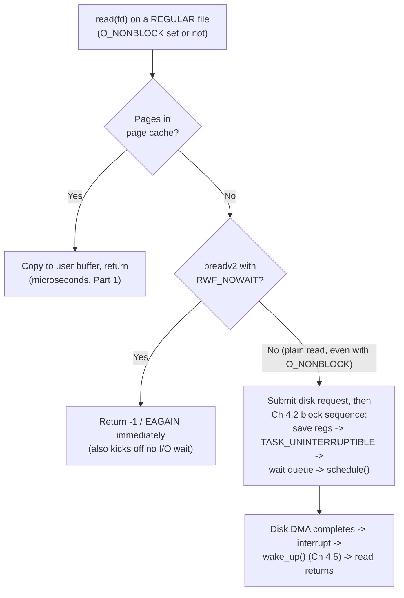

# PART 5 — Nonblocking I/O

## Chapter 5.5 — Nonblocking File I/O: The Surprise That Regular Files Ignore `O_NONBLOCK`

### 🧠 One-Sentence Mental Model
> `O_NONBLOCK` means "return `EAGAIN` instead of sleeping until the *peer* produces data" — and a regular file has no peer: the data is already "there" on disk, so the kernel considers it always ready, and a `read()` that misses the page cache simply sleeps for the disk (Chapter 4.6) no matter what flags you set; the only way to refuse that sleep is a *per-call* opt-in (`RWF_NOWAIT`), and the real answers are thread pools and `io_uring`.

### 🧒 Explain Like I'm Five
Pipes and sockets are like waiting for a friend to *tell* you something — if they haven't spoken yet, "not ready" makes sense. A regular file is like a book on a shelf in the basement: it's always "there," it's just slow to fetch. Saying "don't make me wait" doesn't make the book come faster; the librarian has no way to say "not ready" about a book that exists. You just wait while she fetches it.

### 🌍 Real-World Analogy
Chapter 4.6's library: the **page cache** is the books on your desk (instant); the **disk** is the basement. A socket's "not ready" is "the author hasn't written the next page yet." A file's "not ready" is "it's in the basement" — but the librarian doesn't consider that *not ready*, only *slow*. `RWF_NOWAIT` is you telling her: "only hand me things already on my desk; if it's in the basement, say so and I'll send someone else."

### ❓ The Problem
Chapters 5.1-5.4 treated nonblocking as a universal switch. A natural next step: use it for file reads so a single-threaded server can read files without stalling. On Linux this **does not work** — and silently so: no error, no warning, the thread just sleeps on the disk anyway.

### 🔥 Why This Problem Matters
A single-threaded event loop (nginx, Node.js, Redis, Part 11) that does one "harmless" `read()` of a cold file freezes **every other connection** for the length of that disk access — milliseconds on SSD, tens of milliseconds on spinning disks, far worse under load. This is *the* classic way event-driven servers accidentally turn into blocking servers, and why every serious one has a separate path (thread pool, `io_uring`) for file I/O.

### 🕰 Historical Context
`O_NONBLOCK` was designed around terminals, pipes and sockets, where data availability depends on an external party. For regular files, POSIX leaves the behavior unspecified and Linux ignores it. Linux's first file-async answer, POSIX AIO (`libaio`), only worked well with `O_DIRECT` (bypassing the page cache). glibc's POSIX AIO is just a hidden thread pool. Real kernel-level async file reads arrived with `io_uring` (Linux 5.1, Part 14), and `RWF_NOWAIT` (Linux 4.14) gave a cheap "is it cached?" probe.

### 💡 The Naive Solution
```c
int fd = open("data.bin", O_RDONLY | O_NONBLOCK);
// "now read() will return EAGAIN instead of blocking on the disk"
```

### ❌ Why the Naive Solution Fails
Measured in this chapter's lab: with `O_NONBLOCK` set and the file evicted from cache, `read()` returned **all 64 MiB** after ~21–26 ms of sleeping on the disk. It never returned `EAGAIN`. The flag was accepted and ignored. Worse, `poll()` reports regular files as *always* readable, and `epoll_ctl` **refuses** to register them (`EPERM`), so the readiness-notification tools of Parts 6-8 can't help either.

### ✅ The Better Solution
Treat file I/O as something that *can't* be made nonblocking by a flag, and pick the right workaround:

| Approach | Idea | Where in this course |
|---|---|---|
| **Thread pool for file reads** | Event loop hands the `read()` to a worker thread (it blocks there, Ch 4.2), worker signals completion | libuv/Node/nginx `aio threads`; Parts 11, 15, 27 |
| **`RWF_NOWAIT` probe + fallback** | Try cached read with `preadv2(..., RWF_NOWAIT)`; on `EAGAIN` send to the thread pool | This chapter |
| **`io_uring`** | Submit the read; kernel does it asynchronously; get a completion | Part 14 |
| **Readahead / prefetch** (`posix_fadvise(WILLNEED)`, `readahead`) | Warm the cache ahead of time | Part 15, 17 |

### 🧠 Core Concept
> **Readiness is a property of the *source*. Sockets/pipes/ttys have a remote producer, so "no data yet" is a real state the kernel can report with `EAGAIN`. A regular file has no producer — its bytes exist; only *fetching* them is slow. Linux therefore treats regular files as always ready, ignores `O_NONBLOCK` for them, and sleeps the caller in the page-cache-miss path (Chapter 4.6) regardless. Nonblocking file reads are only possible as a *per-call request* (`RWF_NOWAIT`, `io_uring`), never as a property of the fd.**

---

## 🔌 Syscalls / APIs — Syntax First

### 1. `preadv2()` and `RWF_NOWAIT`

```c
#define _GNU_SOURCE
#include <sys/uio.h>

ssize_t preadv2(int fd, const struct iovec *iov, int iovcnt, off_t offset, int flags);
```
- Like `preadv()` (read into several buffers — vectored I/O, Part 18 — at an explicit `offset`, without moving the file position), plus a **`flags`** argument.
- `iov` points to an array of `struct iovec { void *iov_base; size_t iov_len; }` — use one entry for a plain buffer.
- **`RWF_NOWAIT`** (Linux 4.14+): *"don't block on data that isn't already in memory."* If the pages are in the page cache → normal success. If the kernel would have to wait for the disk → returns **`-1` / `EAGAIN`** immediately without starting the wait. (Support depends on filesystem and kernel; if unsupported you get `EOPNOTSUPP` — then fall back to your thread pool.)
- Other flags: `RWF_HIPRI` (polled, low-latency I/O), `RWF_DSYNC`/`RWF_SYNC` (write durability), `RWF_APPEND`.

```c
iovec iov{ buf, 4096 };
ssize_t n = preadv2(fd, &iov, 1, /*offset=*/0, RWF_NOWAIT);
if (n >= 0)                      { /* cache hit: have n bytes now */ }
else if (errno == EAGAIN)        { /* cold: hand off to a worker thread */ }
else if (errno == EOPNOTSUPP)    { /* fs/kernel can't do NOWAIT: use the worker path always */ }
```

### 2. `posix_fadvise()` — hinting the cache (used in the lab to make the file "cold")

```c
int posix_fadvise(int fd, off_t offset, off_t len, int advice);   // len 0 = "to end of file"
```
| `advice` | Meaning |
|---|---|
| `POSIX_FADV_DONTNEED` | "I won't need these pages" → kernel may drop clean cached pages (dirty pages must be flushed first — hence the `fsync()` in the lab). A *hint*, best-effort. |
| `POSIX_FADV_WILLNEED` | "I'll need these soon" → start reading them in the background (cheap prefetch) |
| `POSIX_FADV_SEQUENTIAL` / `RANDOM` | Tune readahead for the access pattern |
Returns `0` on success or an error number (not `-1`/`errno`).

### 3. `poll()` quick preview (full coverage in Part 7)

```c
int poll(struct pollfd *fds, nfds_t nfds, int timeout_ms);   // timeout 0 = don't wait
struct pollfd { int fd; short events; short revents; };
```
Asks "which of these fds are ready?"; `POLLIN` = readable. We use it with timeout `0` only to *observe* what it claims about a regular file.

### 4. `epoll_ctl()` quick preview (full coverage in Part 8)

`epoll_ctl(epfd, EPOLL_CTL_ADD, fd, &ev)` registers an fd with an epoll instance. For regular files (and directories) it fails with **`EPERM`** — the kernel is telling you "this fd has no readiness concept; I can't wait on it."

---

### 📐 Deep Technical Explanation



Why the kernel doesn't just return `EAGAIN` for the cold case when `O_NONBLOCK` is set: file systems have complex, multi-step paths (journal, locks, metadata reads, readahead) in which sleeping is baked in at many layers; making every one of them "nonblocking-aware" was never done for the generic `read()` path. `RWF_NOWAIT` and `io_uring` were built *later* with explicit support for "bail out instead of waiting" at the points that matter.

Why `poll()` says "ready": for a regular file, the kernel's poll implementation has no wait queue to report on; it returns `POLLIN|POLLOUT` unconditionally. Why `epoll` says `EPERM`: epoll needs a real wait queue to attach to (Chapter 4.10/2.10), and regular files don't provide one.

---

## 🔬 Project: watch regular files ignore `O_NONBLOCK`

Creates a 64 MiB file, flushes and evicts it from the page cache, then tries five things.

```cpp
// nonblock_file_lab.cpp
// Compile: g++ -O2 -std=c++20 nonblock_file_lab.cpp -o nonblock_file_lab
// Run:     ./nonblock_file_lab

#ifndef _GNU_SOURCE
#define _GNU_SOURCE
#endif
#include <fcntl.h>
#include <unistd.h>
#include <poll.h>
#include <sys/epoll.h>
#include <sys/uio.h>
#include <cerrno>
#include <chrono>
#include <cstdio>
#include <cstdlib>
#include <cstring>
#include <vector>

#ifndef RWF_NOWAIT
#define RWF_NOWAIT 0x00000008
#endif

using Clock = std::chrono::steady_clock;
static double ms_since(Clock::time_point t) {
    return std::chrono::duration<double, std::milli>(Clock::now() - t).count();
}

int main() {
    const char* path = "nb_file_lab.dat";
    const size_t SIZE = 64u << 20;                       // 64 MiB test file

    // --- create the file, make sure it is on disk, then evict it from the page cache ---
    {
        int w = open(path, O_WRONLY | O_CREAT | O_TRUNC, 0644);
        std::vector<char> chunk(1 << 20, 'a');
        for (size_t i = 0; i < SIZE; i += chunk.size())
            if (write(w, chunk.data(), chunk.size()) < 0) { perror("write"); return 1; }
        fsync(w);
        posix_fadvise(w, 0, 0, POSIX_FADV_DONTNEED);     // drop its cached pages
        close(w);
    }

    int fd = open(path, O_RDONLY | O_NONBLOCK);          // ask for nonblocking on a REGULAR file
    std::vector<char> buf(SIZE);

    // 1) poll(): is a regular file ever "not ready"?
    pollfd pfd{fd, POLLIN, 0};
    int pr = poll(&pfd, 1, 0);
    printf("1) poll() on cold regular file: ret=%d revents=%s\n",
           pr, (pfd.revents & POLLIN) ? "POLLIN (claims READY)" : "none");

    // 2) epoll: can a regular file even be registered?
    int ep = epoll_create1(0);
    epoll_event ev{}; ev.events = EPOLLIN; ev.data.fd = fd;
    int er = epoll_ctl(ep, EPOLL_CTL_ADD, fd, &ev);
    printf("2) epoll_ctl(ADD) on regular file: ret=%d errno=%s\n", er, er < 0 ? strerror(errno) : "-");

    // 3) preadv2(RWF_NOWAIT) on COLD data -> should refuse to touch the disk
    iovec iov{buf.data(), 4096};
    auto t = Clock::now();
    ssize_t n = preadv2(fd, &iov, 1, 0, RWF_NOWAIT);
    printf("3) preadv2(RWF_NOWAIT), cold: n=%zd errno=%s (%.3f ms)\n",
           n, n < 0 ? strerror(errno) : "-", ms_since(t));

    // 4) ordinary read() with O_NONBLOCK on COLD data -> does it return EAGAIN?
    t = Clock::now();
    n = read(fd, buf.data(), SIZE);
    printf("4) read() with O_NONBLOCK, cold: n=%zd errno=%s (%.3f ms)  <-- it blocked on the disk anyway\n",
           n, n < 0 ? strerror(errno) : "-", ms_since(t));

    // 5) preadv2(RWF_NOWAIT) on WARM data (just read it, so it is cached)
    iov = {buf.data(), 4096};
    t = Clock::now();
    n = preadv2(fd, &iov, 1, 0, RWF_NOWAIT);
    printf("5) preadv2(RWF_NOWAIT), warm: n=%zd errno=%s (%.3f ms)\n",
           n, n < 0 ? strerror(errno) : "-", ms_since(t));

    close(fd); close(ep); unlink(path);
}
```

**Predict before running:** (1) What does `poll()` say about a *cold* file? (2) Does `epoll_ctl` accept a regular file? (3) What does `RWF_NOWAIT` return on cold data? (4) Does plain `read()` with `O_NONBLOCK` return `EAGAIN`? (5) And on warm data with `RWF_NOWAIT`?

### 📊 Measured output (this sandbox: ext4 on a virtual disk, two runs)

```
1) poll() on cold regular file: ret=1 revents=POLLIN (claims READY)
2) epoll_ctl(ADD) on regular file: ret=-1 errno=Operation not permitted
3) preadv2(RWF_NOWAIT), cold: n=-1 errno=Resource temporarily unavailable (0.100 ms)
4) read() with O_NONBLOCK, cold: n=67108864 errno=- (26.538 ms)  <-- it blocked on the disk anyway
5) preadv2(RWF_NOWAIT), warm: n=4096 errno=- (0.011 ms)
----
1) poll() on cold regular file: ret=1 revents=POLLIN (claims READY)
2) epoll_ctl(ADD) on regular file: ret=-1 errno=Operation not permitted
3) preadv2(RWF_NOWAIT), cold: n=-1 errno=Resource temporarily unavailable (0.092 ms)
4) read() with O_NONBLOCK, cold: n=67108864 errno=- (21.414 ms)  <-- it blocked on the disk anyway
5) preadv2(RWF_NOWAIT), warm: n=4096 errno=- (0.008 ms)
```

> ⚠️ Absolute times are from one virtualized sandbox with a fast virtual disk (64 MiB in ~21–26 ms ≈ 2.5–3 GB/s — likely backed by host cache). On a real SATA SSD or spinning disk the blocked `read()` in step 4 would be slower, and eviction via `posix_fadvise` is a best-effort hint, so your cold timings and even step 3 may differ. **Measure your own hardware.** The *behaviors* (poll claims ready, epoll `EPERM`, `RWF_NOWAIT` → `EAGAIN` cold, `O_NONBLOCK` ignored) are what to look for.

<details><summary>Click to reveal the answers</summary>

(1) `POLLIN` — "ready", always; poll has nothing to wait on. (2) No — `EPERM` ("Operation not permitted"). (3) `-1`/`EAGAIN` in ~0.1 ms — it declined to wait, which is exactly the signal an event loop wants ("send this to a worker thread"). (4) **No.** It returned all 64 MiB after ~21–26 ms of sleeping on the disk; `O_NONBLOCK` had zero effect. (5) Success, 4096 bytes in ~0.01 ms — warm data is a memory copy (Chapter 4.6's cache-warm case).
</details>

### 🧪 A pattern you can build from this (sketch)

```cpp
// in an event-loop thread -- NEVER block here
ssize_t try_cached_read(int fd, void* buf, size_t len, off_t off) {
    iovec iov{buf, len};
    ssize_t n = preadv2(fd, &iov, 1, off, RWF_NOWAIT);
    if (n >= 0) return n;                       // fast path: served from page cache
    if (errno == EAGAIN || errno == EOPNOTSUPP)
        return submit_to_thread_pool(fd, buf, len, off);   // slow path: worker blocks, loop stays free
    return -1;                                  // real error
}
```
Hit rate matters: if 95% of reads are cached, 95% never touch the thread pool at all.

### ❌ Common Misconceptions
- ❌ **"`O_NONBLOCK` makes file reads nonblocking."** — Ignored for regular files on Linux; a cold `read()` sleeps on the disk (measured above).
- ❌ **"I can put file fds in epoll."** — `epoll_ctl` returns `EPERM` for regular files and directories.
- ❌ **"`poll()` returning `POLLIN` means `read()` won't block."** — True for sockets/pipes; for regular files it's always "ready" even when the read will sleep on the disk.
- ❌ **"A fast SSD makes this a non-issue."** — A cache miss on NVMe is ~100 µs: a thousand times a cache hit. In a single-threaded loop serving 100k req/s, 100 µs stalls everybody; with hundreds of concurrent misses it's catastrophic.
- ❌ **"`RWF_NOWAIT` makes the file read asynchronous."** — It only *refuses to wait*; it doesn't *start* the read in the background. Cold data still needs another mechanism (thread pool / `io_uring`) to get fetched.
- ❌ **"Writes to files are safe in an event loop."** — Buffered `write()` usually just copies into the page cache (fast) but can block on dirty-page throttling, journal commits, or full disks (Chapter 4.6, Part 15). Same caution applies.

### 🧙 Wizard Insight
This chapter explains an entire design pattern: why Node.js has the `UV_THREADPOOL_SIZE` knob, why nginx has `aio threads`, why every "single-threaded" event loop secretly owns a handful of worker threads. The kernel can tell you "not ready" only about things that *have a producer*. For storage there's no producer, only latency — and latency can't be reported as readiness. The two honest fixes are *move the waiting to another thread* (cheap, works everywhere) or *give the kernel the whole operation and wait for a completion* (`io_uring`, Part 14). This is the first, concrete motivation for **completion-based** I/O (Part 13) as distinct from **readiness-based** I/O (Parts 6-8).

### 🧠 Quiz
**Q1.** You set `O_NONBLOCK` on a regular file and `read()` a cold range. What happens?
<details><summary>Answer</summary>The flag is ignored. The read sleeps in TASK_UNINTERRUPTIBLE while the disk fetches the pages (Ch 4.6/4.2) and then returns the data. No EAGAIN.</details>

**Q2.** Why does `epoll_ctl(ADD)` fail with `EPERM` on a regular file?
<details><summary>Answer</summary>epoll needs the file to expose a pollable wait queue that signals readiness changes. Regular files have no producer and no such queue (they are "always ready"), so the kernel rejects registration.</details>

**Q3.** What does `preadv2(..., RWF_NOWAIT)` return on a cache miss, and how should an event loop react?
<details><summary>Answer</summary>-1 with errno EAGAIN, without waiting for the disk. The loop should hand the read to a worker thread (or io_uring) and continue serving other fds. On EOPNOTSUPP, always use the worker path.</details>

**Q4.** Name two mechanisms that give a single-threaded loop non-stalling file reads, and the key difference between them.
<details><summary>Answer</summary>Thread pool: a worker thread blocks on the read and notifies the loop (readiness-style, emulated). io_uring: the kernel performs the read asynchronously and posts a completion (true completion-based I/O, Part 13-14).</details>

### 📌 Short Notes (Quick Reference)
- `O_NONBLOCK` is **ignored** for regular files on Linux; a page-cache miss always sleeps the thread (Ch 4.6).
- `poll()` reports regular files always ready; `epoll_ctl(ADD)` fails with `EPERM`.
- Readiness exists only where there's a producer (sockets, pipes, ttys). Files have **latency**, not readiness.
- `preadv2(fd, iov, n, off, RWF_NOWAIT)` → data if cached, else `-1/EAGAIN` immediately (`EOPNOTSUPP` if unsupported).
- Pattern: try `RWF_NOWAIT`; on `EAGAIN` → thread pool; or use `io_uring` (Part 14).
- `posix_fadvise(DONTNEED)` best-effort evicts cache (after `fsync` for dirty pages); `WILLNEED` prefetches.
- Single-threaded event loops need a worker thread pool for file I/O — that's why Node/nginx have one.
- Measured here (one sandbox, 64 MiB): cold `read()` ≈ 21–26 ms; `RWF_NOWAIT` cold ≈ 0.1 ms; warm ≈ 0.01 ms — measure yours.

### 🔗 What This Connects To Next
**Previous:** Part 5, Chapter 5.4 — The Busy-Wait Problem
**Current:** Part 5, Chapter 5.5 — Nonblocking File I/O
**Next:** Part 5, Chapter 5.6 — Nonblocking Socket I/O (project): the nonblocking echo server, per-connection state machines, and (deliberately) a loop that still has to poll — setting up exactly why `select()` is needed in Part 6
