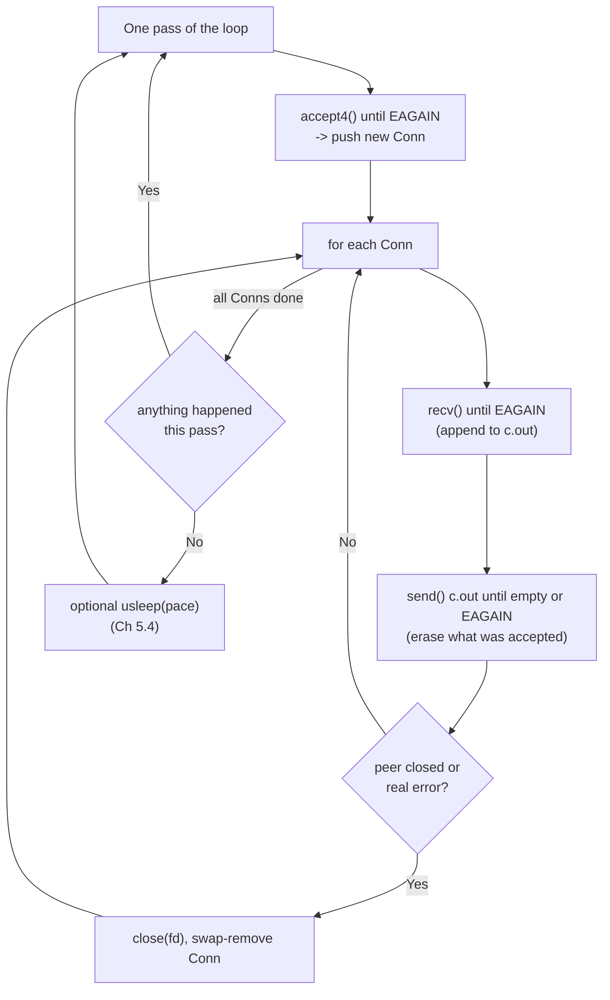

# PART 5 — Nonblocking I/O

## Chapter 5.6 — Nonblocking Socket I/O: One Thread, Many Clients (and the Wall It Hits)

### 🧠 One-Sentence Mental Model
> A nonblocking server replaces "the call stack remembers where each client is" (Chapters 4.7-4.9) with "an explicit `Conn` struct per client remembers where it is," and one thread sweeps over all of them asking each "anything for me?" — it finally serves many clients from one thread, but the sweep costs O(number of connections) syscalls per pass even when nothing is happening, which is *precisely* the wall that `select()` (Part 6) is built to knock down.

### 🧒 Explain Like I'm Five
Chapter 4.7's toll booth served one car at a time. Now one operator walks along a row of 1,000 booths, peeks into each ("anyone here? anything to say?"), helps if so, and moves on. It works — everyone gets served by one person! — but the walk takes longer the more booths there are, even if all 1,000 are empty. What the operator really wants is a bell that rings only at booths that need help. (That bell is Part 6.)

### 🌍 Real-World Analogy
A waiter with 20 tables who never stands still: lap around the room, glance at each table, refill/take-order/clear as needed, repeat. No table waits behind another table's long conversation (the blocking-server flaw), and no extra waiters are hired (the thread-per-connection cost). But with 1,000 tables, a lap takes forever, and most glances find nothing.

### ❓ The Problem
Chapter 4.7's server could only serve one client at a time. Chapters 4.8/4.9 fixed that with one thread/process per client. Can *one* thread serve *many* clients, using only what Part 5 has given us: `O_NONBLOCK`, `EAGAIN` handling, and a loop?

### 🔥 Why This Problem Matters
This is the first server in the course whose *architecture* is "event loop": a single thread, a table of connections, nothing ever blocks. Every later server (`select`, `poll`, `epoll`, `io_uring`, Parts 6-14, and nginx/Redis/Node in the real world) keeps this exact skeleton and only swaps out *how the thread finds out which connections need attention*.

### 🕰 Historical Context
Before `select()` (BSD, 1983) this loop was the only way to multiplex in one process. The C10K essay (Dan Kegel, 1999) catalogued the next steps: first `select`/`poll`, then readiness APIs that scale (`epoll`, `kqueue`). The scaling problem was never the loop itself — it was the cost of asking *every* connection *every time*.

### 💡 The Naive Solution
Keep Chapter 4.7's server and just add `O_NONBLOCK`, hoping `recv()` returning `EAGAIN` makes it "handle everyone".

### ❌ Why the Naive Solution Fails
Chapter 4.7's server holds one client in an inner `while(recv…)` loop. Flip it nonblocking and that inner loop either exits on the first `EAGAIN` and **forgets the client** (a leak), or spins on it and starves everyone else. Nonblocking needs a data structure that outlives a single pass: the connection table.

### ✅ The Better Solution
A table of `Conn { fd, out-buffer }`. Each pass: (1) `accept4` until `EAGAIN`; (2) for every `Conn`: `recv` until `EAGAIN`, then `send` until the buffer's empty or `EAGAIN`; (3) remove dead connections; (4) if the whole pass did nothing, optionally sleep a little (Chapter 5.4's dial).

### 🧠 Core Concept
> **Nonblocking turns *control flow* into *data*. With blocking I/O, "this client has sent half a request and I'm waiting for the rest" is encoded in *which line of code the thread is paused on*. With nonblocking I/O, no thread is ever paused, so that same fact must be stored in a per-connection struct (input so far, output not yet sent, state). Every nonblocking server is a state machine per connection driven by a loop.**

---

## 🔌 Syscalls / APIs — Syntax First

### 1. `accept4()` — accept with flags, atomically

```c
#define _GNU_SOURCE
#include <sys/socket.h>
int accept4(int sockfd, struct sockaddr *addr, socklen_t *addrlen, int flags);
```
- Same as `accept()` (Chapter 4.7) plus `flags`: `SOCK_NONBLOCK` (new fd is nonblocking from birth) and/or `SOCK_CLOEXEC` (close-on-exec, Chapter 3.10). No window where the new fd is blocking (Chapter 5.2).
- With a nonblocking **listening** socket: returns `-1/EAGAIN` when the accept queue is empty.
- Errors worth *ignoring and retrying*: `EINTR`, `ECONNABORTED` (client gave up between handshake and accept). Errors worth *noticing*: `EMFILE`/`ENFILE` (out of fds — if you do nothing, the loop spins because the pending connection never leaves the queue; Part 24).

### 2. Nonblocking `recv()` / `send()` (recap of Chapter 5.3, applied)

```c
ssize_t n = recv(fd, buf, sizeof buf, 0);
//  n > 0  : bytes received (<= requested)           -> keep looping to drain
//  n == 0 : peer closed                             -> close(fd)
//  n < 0  : EAGAIN/EWOULDBLOCK -> drained, move on
//           EINTR              -> retry
//           other              -> close(fd)

ssize_t s = send(fd, p, len, MSG_NOSIGNAL);
//  s > 0  : accepted s bytes (maybe fewer than len!) -> advance p, keep going
//  s < 0  : EAGAIN -> buffer full: STOP, keep unsent data, retry next pass
```
`MSG_NOSIGNAL` avoids `SIGPIPE` on a closed peer (Chapter 4.7 §12).

### 3. Per-connection output buffer

```cpp
struct Conn { int fd; std::string out; };
c.out.append(buf, n);        // bytes to echo back, not yet accepted by the kernel
c.out.erase(0, sent);        // drop the part the kernel took
```
(`erase(0, n)` shifts the remaining bytes — O(size). Fine for a teaching server; a real one keeps an offset or a ring buffer, Part 17.)

### 4. Backpressure — don't read what you can't echo

```cpp
while (c.out.size() < HIGH_WATER) { recv(...) ... }   // stop reading while backlog >= 1 MiB
```
If a client sends faster than it reads our echoes, `out` would grow without limit and eat all memory. Not reading lets the kernel's receive buffer fill, so TCP tells the *sender* to slow down (Chapter 3.8's backpressure). This is the single most important production habit in a nonblocking server: **bound every buffer**.

### 5. Swap-remove from a vector

```cpp
conns[i] = std::move(conns.back()); conns.pop_back();   // O(1) removal; do NOT ++i afterwards
```

---

### 📐 Deep Technical Explanation



**Syscalls per pass** with N connections: 1 `accept4` + ≥ N `recv` (+ some `send`). If 999 of 1,000 are idle, that's ~1,000 syscalls that all return `EAGAIN` — the same waste as Chapter 5.4, multiplied by N.

**What each blocking-era problem became:**

| Part 4 issue | Part 5.6 version |
|---|---|
| "Second client waits behind the first" (4.7) | Gone: nobody blocks; all clients progress each pass |
| "1 thread / 1 process per client" (4.8/4.9) | Gone: one thread total |
| "Call stack remembers my place" | Replaced by `Conn` structs (+ buffers) |
| "send() may block if the peer is slow" | Replaced by `out` buffer + `EAGAIN` handling + backpressure |
| CPU ~0 while waiting | **Lost** — we're spinning or polling (5.4) |

---

## 🔬 Project: a single-threaded nonblocking echo server

```cpp
// nonblocking_echo_server.cpp
// Compile: g++ -O2 -std=c++20 nonblocking_echo_server.cpp -o nonblocking_echo_server
// Run:     ./nonblocking_echo_server <port> <run_seconds> <pace_us>
//          pace_us = 0   -> pure busy loop (spin)
//          pace_us = 1000 -> sleep 1 ms whenever a whole pass found nothing to do

#include <sys/socket.h>
#include <netinet/in.h>
#include <arpa/inet.h>
#include <unistd.h>
#include <time.h>
#include <cerrno>
#include <csignal>
#include <cstdio>
#include <cstdlib>
#include <cstring>
#include <chrono>
#include <string>
#include <vector>

struct Conn {
    int         fd;
    std::string out;      // bytes received but not yet echoed back (per-connection state!)
};

static bool would_block(int e) { return e == EAGAIN || e == EWOULDBLOCK; }   // Ch 5.3

static double process_cpu_ms() {
    timespec ts; clock_gettime(CLOCK_PROCESS_CPUTIME_ID, &ts);
    return ts.tv_sec * 1e3 + ts.tv_nsec / 1e6;
}

int main(int argc, char** argv) {
    if (argc < 4) { fprintf(stderr, "usage: %s <port> <run_seconds> <pace_us>\n", argv[0]); return 1; }
    int  port    = atoi(argv[1]);
    int  run_s   = atoi(argv[2]);
    int  pace_us = atoi(argv[3]);

    signal(SIGPIPE, SIG_IGN);

    int lfd = socket(AF_INET, SOCK_STREAM | SOCK_NONBLOCK, 0);      // Ch 5.2: born nonblocking
    int yes = 1;
    setsockopt(lfd, SOL_SOCKET, SO_REUSEADDR, &yes, sizeof yes);
    sockaddr_in a{}; a.sin_family = AF_INET; a.sin_port = htons(port); a.sin_addr.s_addr = htonl(INADDR_ANY);
    if (bind(lfd, (sockaddr*)&a, sizeof a) < 0) { perror("bind"); return 1; }
    if (listen(lfd, 128) < 0) { perror("listen"); return 1; }
    fprintf(stderr, "listening on %d for %d s, pace=%d us\n", port, run_s, pace_us);

    std::vector<Conn> conns;
    long passes = 0, idle_passes = 0, accepted = 0;
    double cpu0 = process_cpu_ms();
    auto start  = std::chrono::steady_clock::now();
    const size_t HIGH_WATER = 1 << 20;     // stop reading from a conn whose unsent backlog exceeds 1 MiB

    while (std::chrono::steady_clock::now() - start < std::chrono::seconds(run_s)) {
        ++passes;
        bool progress = false;

        // 1) accept everything pending (drain until EAGAIN)
        for (;;) {
            int cfd = accept4(lfd, nullptr, nullptr, SOCK_NONBLOCK);   // Ch 5.2: client born nonblocking
            if (cfd >= 0) { conns.push_back({cfd, {}}); ++accepted; progress = true; continue; }
            if (errno == EINTR || errno == ECONNABORTED) continue;
            if (!would_block(errno)) perror("accept4");
            break;
        }

        // 2) service every connection: read what's there, write what we can
        for (size_t i = 0; i < conns.size(); ) {
            Conn& c = conns[i];
            bool dead = false;

            // 2a) READ until EAGAIN (unless the peer isn't draining our echoes: backpressure)
            char buf[16384];
            while (!dead && c.out.size() < HIGH_WATER) {
                ssize_t n = recv(c.fd, buf, sizeof buf, 0);
                if (n > 0)  { c.out.append(buf, n); progress = true; continue; }
                if (n == 0) { dead = true; break; }                       // EOF
                if (errno == EINTR) continue;
                if (!would_block(errno)) dead = true;                      // real error
                break;                                                     // EAGAIN: drained
            }

            // 2b) WRITE as much as the kernel will take (partial writes are normal!)
            while (!dead && !c.out.empty()) {
                ssize_t n = send(c.fd, c.out.data(), c.out.size(), MSG_NOSIGNAL);
                if (n > 0)  { c.out.erase(0, n); progress = true; continue; }
                if (n < 0 && errno == EINTR) continue;
                if (n < 0 && would_block(errno)) break;                    // send buffer full: keep the rest
                dead = true;                                               // real error
            }

            if (dead) { close(c.fd); conns[i] = std::move(conns.back()); conns.pop_back(); progress = true; }
            else ++i;
        }

        if (!progress) {
            ++idle_passes;
            if (pace_us > 0) usleep(pace_us);          // Ch 5.4's "paced" dial
        }
    }

    double wall = std::chrono::duration<double>(std::chrono::steady_clock::now() - start).count();
    double cpu  = process_cpu_ms() - cpu0;
    fprintf(stderr, "STATS wall=%.2fs cpu=%.1fms (%.1f%%) passes=%ld idle_passes=%ld accepted=%ld\n",
            wall, cpu, 100.0 * cpu / (wall * 1000.0), passes, idle_passes, accepted);
    for (auto& c : conns) close(c.fd);
    close(lfd);
}
```

**A test client** — N blocking client threads, each sends several messages and checks the echo; client 0 also pushes a large blob (exercising partial writes + backpressure):

```cpp
// nb_test_client.cpp  -- N concurrent blocking clients, one thread each, to exercise the server
// Compile: g++ -O2 -std=c++20 -pthread nb_test_client.cpp -o nb_test_client
// Run:     ./nb_test_client <port> <clients> <msgs_per_client> <gap_ms> <big_bytes>

#include <sys/socket.h>
#include <netinet/in.h>
#include <arpa/inet.h>
#include <unistd.h>
#include <atomic>
#include <chrono>
#include <cstdio>
#include <cstdlib>
#include <cstring>
#include <string>
#include <thread>
#include <vector>

static int connect_to(int port) {
    int fd = socket(AF_INET, SOCK_STREAM, 0);
    sockaddr_in a{}; a.sin_family = AF_INET; a.sin_port = htons(port);
    inet_pton(AF_INET, "127.0.0.1", &a.sin_addr);
    if (connect(fd, (sockaddr*)&a, sizeof a) < 0) { perror("connect"); exit(1); }
    return fd;
}
static bool read_exact(int fd, std::string& dst, size_t n) {
    char buf[65536];
    while (dst.size() < n) {
        ssize_t r = recv(fd, buf, std::min(sizeof buf, n - dst.size()), 0);
        if (r <= 0) return false;
        dst.append(buf, r);
    }
    return true;
}

int main(int argc, char** argv) {
    int port = atoi(argv[1]), clients = atoi(argv[2]), msgs = atoi(argv[3]), gap_ms = atoi(argv[4]);
    size_t big = (size_t)atol(argv[5]);
    std::atomic<int> ok{0}, bad{0};
    std::atomic<double> max_rtt_ms{0};
    std::vector<std::thread> th;
    for (int id = 0; id < clients; ++id) th.emplace_back([&, id] {
        int fd = connect_to(port);
        bool good = true;
        for (int m = 0; m < msgs && good; ++m) {
            std::string msg = "client" + std::to_string(id) + "-msg" + std::to_string(m) + "\n";
            auto t0 = std::chrono::steady_clock::now();
            send(fd, msg.data(), msg.size(), 0);
            std::string back;
            if (!read_exact(fd, back, msg.size()) || back != msg) good = false;
            double rtt = std::chrono::duration<double, std::milli>(std::chrono::steady_clock::now() - t0).count();
            double cur = max_rtt_ms.load(); while (rtt > cur && !max_rtt_ms.compare_exchange_weak(cur, rtt)) {}
            std::this_thread::sleep_for(std::chrono::milliseconds(gap_ms));
        }
        if (good && big > 0 && id == 0) {                    // client 0 also sends a big blob, sent then read back
            std::string blob(big, 'z');
            std::thread w([&] { size_t off = 0; while (off < blob.size()) { ssize_t s = send(fd, blob.data() + off, blob.size() - off, 0); if (s <= 0) break; off += s; } });
            std::string back; good = read_exact(fd, back, big) && back == blob;
            w.join();
        }
        close(fd);
        (good ? ok : bad)++;
    });
    for (auto& t : th) t.join();
    printf("CLIENTS ok=%d bad=%d max_msg_rtt=%.2f ms\n", ok.load(), bad.load(), max_rtt_ms.load());
    return bad ? 1 : 0;
}
```

**Run it:**
```bash
./nonblocking_echo_server 9101 4 0 &          # spin mode, run 4 s
./nb_test_client 9101 20 8 200 8000000         # 20 clients, 8 msgs each, 200 ms apart, + one 8 MB blob
wait                                           # server prints STATS to stderr when its 4 s are up
# repeat with pace_us=1000
```

**Predict before running:** (a) Will all 20 clients and the 8 MB blob be echoed correctly by *one* thread? (b) What CPU % will spin mode (`pace_us=0`) show? (c) What CPU % will `pace_us=1000` show — and does it hurt message latency? (d) With *no clients at all*, what will each mode show?

### 📊 Measured output (this sandbox: 2 vCPU Linux VM)

```
=== pace_us=0 ===
CLIENTS ok=20 bad=0 max_msg_rtt=3.23 ms
STATS wall=4.00s cpu=3921.0ms (98.0%) passes=1334990 idle_passes=1334814 accepted=20
=== pace_us=1000 ===
CLIENTS ok=20 bad=0 max_msg_rtt=1.33 ms
STATS wall=4.00s cpu=183.4ms (4.6%) passes=3502 idle_passes=3466 accepted=20

=== no clients, 3 s ===
pace_us=0:    cpu=2935.5ms (97.8%)  passes=1235003
pace_us=1000: cpu= 112.5ms ( 3.7%)  passes=2632
```

<details><summary>Click to reveal the answers</summary>

(a) **Yes** — all 20 clients echoed correctly (`ok=20 bad=0`), including the 8 MB blob (which forced partial `send()`s, `EAGAIN` on write, the per-connection `out` buffer, and the 1 MiB backpressure cap). One thread, no blocking, no per-client thread. (b) **~98%** of a core — doing 1.3 million passes to serve 20 clients, 1.33 M of which found nothing to do. (c) **~4.6%** — about 21× less CPU. With 1 ms pacing the worst message round-trip stayed small (1.33 ms here; the spin run's 3.23 ms max was noise from the VM sharing 2 cores with the 20 client threads + the spinning server). Pacing's cost is *latency floor* ≈ the sleep, not a visible slowdown at this load. (d) Spin burns ~98% of a core serving **nobody**; paced ~3.7% (mostly timer wakeups).
</details>

### 🧱 The wall: cost grows with *connections*, not *activity*

Same paced (1 ms) server, but with N completely **idle** connected clients (they connect and say nothing):

| Idle connections | Server CPU (4 s run, `pace_us=1000`) |
|---:|---:|
| 0 | 3.7 % |
| 100 | 6.5 % |
| 1,000 | **28.8 %** |

Nothing is happening — no data, no work — yet CPU climbs with every idle connection, because each pass still asks all of them. (And note the pass count: 1,000 idle connections dragged the server from ~3,400 passes to ~2,850 — each pass now takes longer, so the *latency* to notice a real message grows too.) At 10,000 or 100,000 connections this design collapses. This is **the** motivating measurement for `select()`.

> ⚠️ One sandbox, one run each; absolute numbers will differ on your machine. The *trend* (CPU ∝ connections even when idle) is the lesson. Reproduce it: open N idle sockets with a few lines of Python (`socket.create_connection(("127.0.0.1", port))` in a loop, then sleep) and read the server's STATS line.

### ❌ Common Misconceptions
- ❌ **"Nonblocking sockets make the server scale."** — They make *one thread serve many clients*, but per-pass cost is O(connections) regardless of activity (measured above: 3.7% → 28.8% CPU with 1,000 *idle* clients).
- ❌ **"On `EAGAIN` I should close the connection."** — `EAGAIN` just means "drained / buffer full — come back next pass" (Chapter 5.3).
- ❌ **"If `send()` returned success, I can drop my buffer."** — Only the bytes it *reported* are gone; keep the rest in `out` and retry (partial writes).
- ❌ **"I can read as fast as the client sends."** — Without a cap like `HIGH_WATER`, a client that never reads can make you buffer unlimited data. Not reading is how you push back (TCP flow control, Ch 3.8).
- ❌ **"Removing a connection in the middle of the loop is easy."** — Swap-remove then **don't** increment `i`; incrementing skips the connection you just moved into slot `i`.
- ❌ **"Sleeping between passes is free."** — It trades CPU for latency (≈ the sleep) for *every* connection (Chapter 5.4).

### 🧙 Wizard Insight
Look at what changed and what didn't between this server and every future one. **Unchanged:** the `Conn` table, the drain-until-`EAGAIN` reads, the keep-the-remainder writes, the backpressure cap, the swap-remove. **Changed in Parts 6-8:** only step "for each Conn: try recv/send" becomes "ask the kernel *which* Conns are ready, and touch only those." The whole architecture of epoll servers is this file with one function replaced. So everything you learned here — per-connection buffers, partial I/O, bounded memory — transfers 1:1; what Part 6 adds is *knowing who to ask*.

### 🧠 Quiz
**Q1.** Why does this server need a per-connection `out` buffer when Chapter 4.7's didn't?
<details><summary>Answer</summary>Blocking `send()` sleeps until all bytes are accepted, so the call stack holds the "unsent" state. Nonblocking `send()` may accept only part and return, and the thread moves on to other clients — so the unsent remainder must be stored in the connection's own state and retried later.</details>

**Q2.** What is the purpose of `HIGH_WATER`?
<details><summary>Answer</summary>Backpressure and memory bounding: if a client doesn't read its echoes, `out` would grow without limit. Stopping reads from that client lets its receive buffer fill so TCP flow control slows the sender, capping our memory per connection.</details>

**Q3.** Why does CPU use rise with idle connections even though no data flows?
<details><summary>Answer</summary>Each pass calls `recv()` on every connection to discover it has nothing. N idle connections ⇒ N useless `EAGAIN` syscalls per pass — cost is proportional to connections, not to activity.</details>

**Q4.** After swap-removing `conns[i]`, why must the loop not increment `i`?
<details><summary>Answer</summary>The last connection was moved into slot `i` and hasn't been serviced this pass; incrementing would skip it.</details>

**Q5.** What single piece of this program will `select()`/`poll()`/`epoll()` replace?
<details><summary>Answer</summary>The blind "try every connection" sweep — they let the kernel report which fds are ready so the loop only touches those.</details>

### 📌 Short Notes (Quick Reference)
- Nonblocking server skeleton: `accept4(SOCK_NONBLOCK)` until `EAGAIN` → for each `Conn`: `recv` until `EAGAIN`, `send` until empty/`EAGAIN` → remove dead → (optional) sleep when idle.
- State that blocking code kept on the call stack must now live in `Conn` (input so far, `out` buffer).
- Partial `send()` is normal: keep the remainder, retry later.
- Bound buffers (`HIGH_WATER`): stop reading when the echo backlog is big → TCP backpressure.
- Swap-remove (`conns[i]=move(back); pop_back`) and don't `++i`.
- Spin = ~98% CPU even with zero clients; 1 ms pacing ≈ 4% CPU (measured) at the cost of ~1 ms latency floor.
- Cost per pass ∝ number of connections, even idle: 0/100/1,000 idle conns → 3.7/6.5/28.8% CPU (measured, paced 1 ms).
- This is the architecture of every event loop; Parts 6-8 only replace "try everyone" with "kernel says who's ready."

### 🔗 What This Connects To Next
**Previous:** Part 5, Chapter 5.5 — Nonblocking File I/O
**Current:** Part 5, Chapter 5.6 — Nonblocking Socket I/O
**Next:** Part 5, Chapter 5.7 — Nonblocking `connect()` (`EINPROGRESS`, completing a handshake without waiting) and the Part 5 short notes — then **Part 6: `select()`**, the first answer to "who is ready?"
