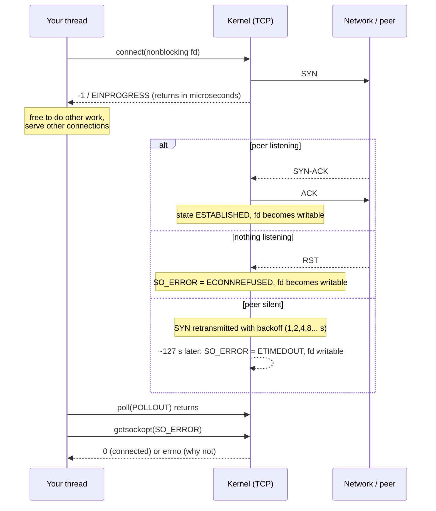

# PART 5 — Nonblocking I/O

## Chapter 5.7 — Nonblocking `connect()`: `EINPROGRESS` and Finishing a Handshake Without Waiting

### 🧠 One-Sentence Mental Model
> A nonblocking `connect()` *starts* the TCP handshake and returns immediately with `EINPROGRESS` ("normal — I'm working on it"); the connection is finished when the socket becomes **writable**, and the *result* (success or which error) is read once, afterwards, with `getsockopt(SO_ERROR)` — never by calling `connect()` again.

### 🧒 Explain Like I'm Five
Blocking `connect()` is phoning a friend and staying on the line, listening to it ring, until they answer. Nonblocking `connect()` is dialing, hanging the phone on the cradle with the ringing already underway, and doing other things; later a light on the phone turns on ("writable") meaning *something happened* — and then you check *what*: did they pick up, was the line busy, or did nobody answer?

### 🌍 Real-World Analogy
Mailing a registered letter that needs a signed reply. Blocking: you wait at the post office counter for the receipt. Nonblocking: you hand the letter over (`connect` returns `EINPROGRESS`), go about your day, and when the postal service notifies you (writable) you open the notice (`SO_ERROR`): "delivered", "recipient refused", or "address unreachable".

### ❓ The Problem
Chapters 5.1-5.6 made `read`/`write`/`accept` nonblocking. But a client or proxy also **creates** connections, and `connect()` blocks for at least one network round trip — and for *unreachable hosts*, typically **minutes** (see below). A single-threaded program that opens outbound connections (a web crawler, a load balancer talking to backends, a database client pool, a proxy) cannot afford to freeze on each one.

### 🔥 Why This Problem Matters
One dead backend with a blocking `connect()` can freeze an entire event loop for ~2 minutes on Linux defaults — every client of that process stalls. Nonblocking `connect` is how proxies like nginx, HAProxy, Envoy and every browser open hundreds of connections at once from a few threads, with their own timeouts.

### 🕰 Historical Context
The `EINPROGRESS` + "wait for writable" + `SO_ERROR` protocol dates to 4.2BSD sockets and is specified by POSIX. It's awkward — success and failure *both* show up as "writable" — which is why `getsockopt(SO_ERROR)` exists as the disambiguator, and why higher-level libraries (Happy Eyeballs implementations, libuv, Asio) all wrap exactly this dance.

### 💡 The Naive Solution
```c
fcntl(fd, F_SETFL, flags | O_NONBLOCK);
if (connect(fd, ...) < 0) { perror("connect"); close(fd); }   // "-1 means failed"
```

### ❌ Why the Naive Solution Fails
In nonblocking mode `connect()` returns `-1` with `EINPROGRESS` **almost every time — even to localhost** (measured below). Treating that as failure aborts a handshake that was going to succeed. The opposite mistake — calling `connect()` again to "check" — gets `EALREADY` while in progress and `EISCONN` after success, which is confusing and wrong; the failure reason after completion is **not** returned by a second `connect()`; it's only in `SO_ERROR`.

### ✅ The Better Solution
Four steps: (1) create the socket nonblocking; (2) call `connect()`: `0` ⇒ done now, `EINPROGRESS` ⇒ pending, any other errno ⇒ failed now; (3) wait until the fd is **writable** (`POLLOUT`/`select` writefds/`EPOLLOUT`) **or your own deadline expires**; (4) read `getsockopt(SOL_SOCKET, SO_ERROR)` — `0` ⇒ connected, otherwise the errno of the failure.

### 🧠 Core Concept
> **`connect()` is the one syscall where "writable" does not mean "you can write" — it means "the attempt has *finished*," successfully or not. Success and failure look identical to the readiness mechanism; `SO_ERROR` is the tie-breaker, and it is *consume-once* (reading it clears it). And the kernel's own timeout for a silent peer is long (~2 minutes by default), so a real program needs an application-level deadline.**

---

## 🔌 Syscalls / APIs — Syntax First

### 1. Starting the connection

```c
int fd = socket(AF_INET, SOCK_STREAM | SOCK_NONBLOCK, 0);   // Ch 5.2
int rc = connect(fd, (sockaddr*)&addr, sizeof addr);        // Ch 4.7 §9 syntax, now nonblocking
```

| Result | Meaning | Next step |
|---|---|---|
| `rc == 0` | Connected immediately (rare; can happen for some local cases) | use the socket |
| `rc == -1`, `errno == EINPROGRESS` | **Handshake started; still running.** The *normal* case. | wait for writable |
| `rc == -1`, `errno == EINTR` | Interrupted by a signal, but the handshake continues | treat like `EINPROGRESS`; **don't** call `connect` again |
| `rc == -1`, other (`ENETUNREACH`, `EADDRNOTAVAIL`, `EACCES`…) | Failed immediately | close the fd, report |

### 2. Waiting for "done"

Wait until the fd is writable: `POLLOUT` with `poll()` (Part 7), writefds with `select()` (Part 6), `EPOLLOUT` with `epoll` (Part 8). Always combine with **your own timeout**.

### 3. Getting the verdict — `getsockopt(SO_ERROR)`

```c
int soerr = 0;
socklen_t len = sizeof soerr;
if (getsockopt(fd, SOL_SOCKET, SO_ERROR, &soerr, &len) < 0) { /* getsockopt itself failed */ }
if (soerr == 0)              { /* CONNECTED: start using the socket */ }
else if (soerr == ECONNREFUSED) { /* peer reachable, nothing listening (RST received) */ }
else if (soerr == ETIMEDOUT)    { /* no answer; kernel gave up retrying SYNs */ }
else if (soerr == EHOSTUNREACH || soerr == ENETUNREACH) { /* routing problem */ }
```
- `SO_ERROR` returns the pending socket error **and clears it** — read it once and keep the value.
- `getsockopt(int fd, int level, int optname, void *optval, socklen_t *optlen)` — note `optlen` is **in/out** (a pointer, initialized to the buffer size).
- Error values you'll meet: `ECONNREFUSED` (RST: nothing listening), `ETIMEDOUT` (no reply after SYN retries), `EHOSTUNREACH`/`ENETUNREACH` (ICMP/routing), `ECONNRESET` (reset mid-handshake).

### 4. Things *not* to do

- Don't call `connect()` again to "poll" it: `EALREADY` while pending, `EISCONN` once connected, and it won't tell you why it failed.
- Don't reuse a socket whose connect failed — `close()` it and create a new one.
- Don't test "writable ⇒ connected" without `SO_ERROR`: a refused connection is *also* writable (measured below: `POLLOUT` fired for the refused port too).

### 5. Your own deadline (the kernel's is far too long)

Default Linux SYN retries (`net.ipv4.tcp_syn_retries = 6`) give up after roughly **127 seconds** (1+2+4+8+16+32+64 s of exponential backoff). Real programs track `Clock::now() + budget` per attempt and `close(fd)` when it's exceeded (the lab shows this). For connections already established, `TCP_USER_TIMEOUT` (setsockopt, `IPPROTO_TCP`) bounds how long unacknowledged data may sit before the kernel drops the connection.

---

### 📐 Deep Technical Explanation



**Why "writable" for both outcomes?** Readiness APIs report *state transitions the application should react to*. A finished connect (good or bad) is such a transition. `POLLERR`/`POLLHUP` may *also* be set on failure; a robust loop treats any event on a connecting fd as "check `SO_ERROR` now."

**Blocking connect = the same thing, hidden.** Blocking `connect()` is exactly this sequence with Chapter 4.2's block-until-writable done inside the kernel for you.

---

## 🔬 Project: three connects, one thread, no waiting

One thread starts three nonblocking connects at once — a listening server, a closed port, and an address that should never answer — then waits (with `poll`, previewing Part 7) and reports what each did.

```cpp
// nb_connect_lab.cpp
// Compile: g++ -O2 -std=c++20 nb_connect_lab.cpp -o nb_connect_lab
// Run:     ./nb_connect_lab

#include <sys/socket.h>
#include <netinet/in.h>
#include <arpa/inet.h>
#include <poll.h>
#include <unistd.h>
#include <cerrno>
#include <chrono>
#include <cstdio>
#include <cstring>
#include <string>
#include <vector>

using Clock = std::chrono::steady_clock;
static double ms_since(Clock::time_point t) {
    return std::chrono::duration<double, std::milli>(Clock::now() - t).count();
}

struct Attempt {
    const char* label;
    int  fd = -1;
    bool done = false;
    Clock::time_point t0;
};

static sockaddr_in make_addr(const char* ip, int port) {
    sockaddr_in a{}; a.sin_family = AF_INET; a.sin_port = htons(port);
    inet_pton(AF_INET, ip, &a.sin_addr);
    return a;
}

// Start a nonblocking connect. Returns true if finished instantly (success or failure),
// false if it is still in progress (EINPROGRESS).
static bool start_connect(Attempt& at, const char* ip, int port, int& immediate_err) {
    at.fd = socket(AF_INET, SOCK_STREAM | SOCK_NONBLOCK, 0);          // Ch 5.2
    sockaddr_in a = make_addr(ip, port);
    at.t0 = Clock::now();
    int rc = connect(at.fd, (sockaddr*)&a, sizeof a);
    if (rc == 0) { immediate_err = 0; return true; }                    // connected instantly
    if (errno == EINPROGRESS) return false;                             // normal! handshake running
    immediate_err = errno; return true;                                 // failed instantly
}

int main() {
    // A real listening server on loopback so one target succeeds
    int lfd = socket(AF_INET, SOCK_STREAM, 0);
    int yes = 1; setsockopt(lfd, SOL_SOCKET, SO_REUSEADDR, &yes, sizeof yes);
    sockaddr_in la = make_addr("127.0.0.1", 9300);
    bind(lfd, (sockaddr*)&la, sizeof la); listen(lfd, 16);

    struct Target { const char* label; const char* ip; int port; };
    Target targets[] = {
        {"listening server  127.0.0.1:9300", "127.0.0.1", 9300},
        {"nothing listening 127.0.0.1:9301", "127.0.0.1", 9301},
        {"black hole        10.255.255.1:80", "10.255.255.1", 80},
    };

    std::vector<Attempt> at(3);
    std::vector<pollfd>  pfds;
    std::vector<int>     idx;      // pfds[i] belongs to at[idx[i]]

    // Fire all three connects from ONE thread without waiting for any of them
    for (int i = 0; i < 3; ++i) {
        at[i].label = targets[i].label;
        int err = 0;
        bool instant = start_connect(at[i], targets[i].ip, targets[i].port, err);
        if (instant) {
            printf("%-38s connect() returned instantly: %s\n", at[i].label, err ? strerror(err) : "connected");
            at[i].done = true;
        } else {
            printf("%-38s connect() -> EINPROGRESS (returned in %.3f ms; handshake continues in kernel)\n",
                   at[i].label, ms_since(at[i].t0));
            pfds.push_back({at[i].fd, POLLOUT, 0});     // writable == "connect finished (either way)"
            idx.push_back(i);
        }
    }

    // Wait up to 3 s for ANY of them (poll is Part 7; here it just stands in for "wait for writable")
    auto wait_start = Clock::now();
    while (!pfds.empty() && ms_since(wait_start) < 3000) {
        int r = poll(pfds.data(), pfds.size(), 200);
        if (r <= 0) continue;
        for (size_t k = 0; k < pfds.size(); ) {
            if (pfds[k].revents == 0) { ++k; continue; }
            Attempt& a = at[idx[k]];
            int soerr = 0; socklen_t sl = sizeof soerr;
            getsockopt(a.fd, SOL_SOCKET, SO_ERROR, &soerr, &sl);      // THE completion check
            printf("%-38s POLLOUT after %7.1f ms -> SO_ERROR=%d (%s)\n",
                   a.label, ms_since(a.t0), soerr, soerr ? strerror(soerr) : "connected OK");
            a.done = true;
            pfds.erase(pfds.begin() + k); idx.erase(idx.begin() + k);
        }
    }
    for (auto& a : at)
        if (!a.done) printf("%-38s still pending after 3000 ms -> we give up (app-level timeout)\n", a.label);

    for (auto& a : at) if (a.fd >= 0) close(a.fd);
    close(lfd);
}
```

**Predict before running:** (a) Does connecting to *localhost* return `0` or `EINPROGRESS`? (b) For the refused port, will the fd become writable — and what will `SO_ERROR` say? (c) What should the black-hole address do on an ordinary network?

### 📊 Measured output (this sandbox, two runs)

```
listening server  127.0.0.1:9300       connect() -> EINPROGRESS (returned in 0.604 ms; handshake continues in kernel)
nothing listening 127.0.0.1:9301       connect() -> EINPROGRESS (returned in 0.266 ms; handshake continues in kernel)
black hole        10.255.255.1:80      connect() -> EINPROGRESS (returned in 0.231 ms; handshake continues in kernel)
listening server  127.0.0.1:9300       POLLOUT after     1.2 ms -> SO_ERROR=0 (connected OK)
nothing listening 127.0.0.1:9301       POLLOUT after     0.9 ms -> SO_ERROR=111 (Connection refused)
black hole        10.255.255.1:80      POLLOUT after     0.6 ms -> SO_ERROR=0 (connected OK)
   (second run: same outcomes; times 0.2-0.4 ms; connect() returns in 0.02-0.15 ms)
```

> ⚠️ **Honest caveat about the third row.** On my sandbox the "black hole" address *connected successfully in under a millisecond* — the sandbox's network layer intercepts outbound TCP and answers for any address, so I **could not demonstrate the timeout case here**. Do not read that row as "unroutable addresses connect." On an ordinary network, a non-answering address stays `EINPROGRESS` with the fd *not* writable until the kernel gives up (~127 s on default settings) and then reports `ETIMEDOUT` — the lab's 3-second guard would print the "still pending… give up" line. Try it on your own machine/network and tell me what you see. Also: times are from one VM; measure your own hardware.

<details><summary>Click to reveal the answers</summary>

(a) **`EINPROGRESS` — even for localhost** (measured: all three returned `-1/EINPROGRESS` in 0.02–0.6 ms). Never assume an instant `0`. (b) **Yes, writable** (`POLLOUT` fired in ~0.2–0.9 ms) **and `SO_ERROR=111`, `ECONNREFUSED`** — proof that "writable" ≠ "connected"; only `SO_ERROR` tells you. (c) It should *not* complete: the fd stays unwritable while SYNs are retransmitted with exponential backoff, until the kernel reports `ETIMEDOUT` after ~2 minutes (default `tcp_syn_retries=6`). That's why you need your own deadline. (Not reproduced in this sandbox — see the caveat.)
</details>

### 🧪 What the one thread achieved
All three connects were **in flight simultaneously**, started within ~1 ms of each other, completing independently as their results arrived. With blocking `connect()` the same work needs 3 threads, or 3 sequential waits — and if the black hole were real, the other two would have to wait behind a ~2-minute stall.

### ❌ Common Misconceptions
- ❌ **"`connect()` returning `-1` means the connection failed."** — With `O_NONBLOCK`, `EINPROGRESS` is the *normal* "started" signal (measured even on loopback).
- ❌ **"Writable means connected."** — Writable means *finished*; the refused-port fd was writable too. Always read `SO_ERROR`.
- ❌ **"Call `connect()` again to check."** — You'll get `EALREADY`/`EISCONN`, not the failure reason; the reason is only in `SO_ERROR` (and reading it clears it).
- ❌ **"The kernel will time out quickly."** — ~127 s by default for a silent peer. Use your own per-attempt deadline.
- ❌ **"A nonblocking `connect()` is faster."** — The handshake takes one RTT either way. What improves is that your thread isn't frozen during it, so you can overlap many.
- ❌ **"Reuse the same socket after a failed connect."** — Close it and create a new one; its state is undefined for retry on many systems.

### 🧙 Wizard Insight
`connect()` completes the symmetry of Part 5: *every* syscall that could wait for the outside world — `read`, `write`, `accept`, `connect` — now has a "start it, tell me later" form, with one rule: **"started" is not "finished," and "finished" is not "succeeded."** `EINPROGRESS` = started; writable = finished; `SO_ERROR == 0` = succeeded. That three-state ladder reappears in `io_uring`'s completion queue (Part 14), where submit = started, a CQE = finished, `cqe->res` = succeeded. Learn the ladder here and `io_uring` will feel familiar.

### 🧠 Quiz
**Q1.** A nonblocking `connect()` to a healthy server on the same machine returns `-1`. Is that an error?
<details><summary>Answer</summary>Almost certainly `errno == EINPROGRESS`, which just means the handshake was started and hasn't been reported finished yet. Wait for writability, then check `SO_ERROR`. Only other errnos mean immediate failure.</details>

**Q2.** The fd became writable. How do you know whether the connection succeeded?
<details><summary>Answer</summary>`getsockopt(fd, SOL_SOCKET, SO_ERROR, &err, &len)`: `0` means connected; any other value is the errno of the failure (e.g., `ECONNREFUSED`, `ETIMEDOUT`).</details>

**Q3.** Why must a program implement its own connect timeout?
<details><summary>Answer</summary>For a silent peer the kernel keeps retransmitting SYNs with exponential backoff and only reports `ETIMEDOUT` after about 127 seconds (default). An event loop needs to give up sooner, closing the fd after its own deadline.</details>

**Q4.** What's wrong with calling `connect()` again on the same fd after `EINPROGRESS` to see whether it finished?
<details><summary>Answer</summary>It returns `EALREADY` while pending and `EISCONN` after success, never telling you *why* a failure occurred; the failure reason is only available once via `SO_ERROR`.</details>

### 📌 Short Notes (Quick Reference)
- Nonblocking `connect()` → `0` (done) / `-1`+`EINPROGRESS` (started — the normal case, even on localhost) / other errno (failed now).
- Wait for **writable** (`POLLOUT`/`EPOLLOUT`/`select` writefds) **or your own deadline**.
- Then `getsockopt(SOL_SOCKET, SO_ERROR)`: `0` = connected; else errno (`ECONNREFUSED`, `ETIMEDOUT`, `EHOSTUNREACH`…). It's consume-once.
- Writable = *finished*, not necessarily *succeeded* (refused ports are writable too — measured).
- Never re-call `connect()` to poll; never reuse a failed socket.
- Kernel timeout for a silent peer ≈ 127 s (default `tcp_syn_retries=6`) → set app-level timeouts.
- One thread can run many connects concurrently; ladder: started (`EINPROGRESS`) → finished (writable) → succeeded (`SO_ERROR==0`).

---

## 🗂 Part 5 — Short Notes (Fast Revision)

| Ch | One-line takeaway |
|---|---|
| **5.1** What nonblocking means | Nonblocking changes one `if` in the kernel: not ready ⇒ return `EAGAIN` instead of running Ch 4.2's block sequence. Same readiness check, same hardware timing; only who waits changes. |
| **5.2** `fcntl()` / `O_NONBLOCK` | Read-modify-write the flags (`F_GETFL`, `|= O_NONBLOCK`, `F_SETFL`). It's a property of the *open file description* (shared by `dup()`/`fork()`), not a per-call argument. Prefer `SOCK_NONBLOCK`/`accept4()` to avoid the creation race. |
| **5.3** `EAGAIN`/`EWOULDBLOCK` | Four outcomes: data / EOF (`0`) / would-block / real error; `EINTR` ⇒ retry. Partial `send()` is normal ⇒ keep the remainder. Copy `errno` first. |
| **5.4** Busy-wait | Spin = ~98% CPU (8.7 M `read()`s for one byte, measured); pacing trades CPU for latency (~0.3% CPU, ~T late); blocking = ~0% but one thread per fd. The kernel already knows readiness — ask it (Parts 6-8). |
| **5.5** Nonblocking files | Regular files ignore `O_NONBLOCK`; `poll` says always ready; `epoll_ctl` ⇒ `EPERM`. Use `preadv2(RWF_NOWAIT)` + thread pool, or `io_uring`. Files have latency, not readiness. |
| **5.6** Nonblocking server | One thread, `Conn` table, drain-to-`EAGAIN`, per-connection `out` buffer, backpressure cap, swap-remove. Works — but cost per pass ∝ connections, even idle (3.7 → 28.8% CPU for 0 → 1,000 idle, measured). |
| **5.7** Nonblocking `connect()` | `EINPROGRESS` is normal; writable = finished; `SO_ERROR` = verdict; add your own timeout. |

**The Part 5 story in three sentences:** Nonblocking mode gives a single thread the *ability* to ask "ready?" without sleeping on any one fd. But asking blindly — spinning or sweeping — wastes CPU in proportion to the number of connections. What's missing is a way to hand the kernel the *whole set* of fds and sleep until **any** is ready: that is `select()`, Part 6.

### 🔗 What This Connects To Next
**Previous:** Part 5, Chapter 5.6 — Nonblocking Socket I/O
**Current:** Part 5, Chapter 5.7 — Nonblocking `connect()` (end of Part 5)
**Next:** **Part 6 — `select()`**: one syscall that sleeps until *any* of many fds is ready — the first fix for the O(N) polling wall
