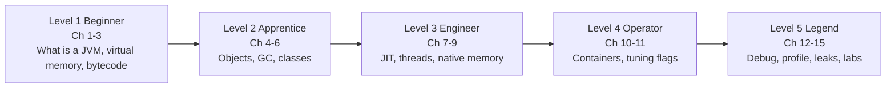

# JVM: From Zero to Legend (for C/C++ programmers)

You already know: pointers, `malloc/free`, stack vs heap, virtual memory, threads, `gcc`.
**This course reuses all of that.** Every JVM idea is first explained as "what would *you* write in C/C++?" and only then given its Java name.

## The one-sentence truth
> **The JVM is a big C++ program.** Your Java code is just *data* it reads and runs.
> `java -jar app.jar` starts a normal Linux process, exactly like any C++ binary. Nothing magic.

## How to read (interactive rules)
| Symbol | Meaning |
|---|---|
| 🧠 **Predict** | Stop. Guess the answer in your head, *then* open the answer. |
| 🔬 **Try it** | Run the command/code. Seeing it beats reading it. |
| 🧩 **C++ view** | The same idea in C/C++ terms. |
| ⚠️ **Trap** | Common beginner mistake. |
| ✅ | Checkbox. Tick when done. |
| `
` | Click to reveal answers. |

Jargon rule: **every new word is defined in a "Words you'll meet" table at the top of the chapter**, and again in the glossary (chapter 15).

## Roadmap (levels)

| Ch | File | You will be able to... |
|---|---|---|
| 1 | [01-java-is-a-cpp-program](01-java-is-a-cpp-program.md) | Explain what `java` does at startup; design a mini-JVM on paper |
| 2 | [02-virtual-memory-and-the-heap](02-virtual-memory-and-the-heap.md) | Explain "Java heap = reserved virtual memory" with real `mmap` code |
| 3 | [03-bytecode-and-interpreter](03-bytecode-and-interpreter.md) | Read bytecode; write a tiny interpreter |
| 4 | [04-objects-and-allocation](04-objects-and-allocation.md) | Draw an object in memory byte by byte; know why `new` is fast |
| 5 | [05-garbage-collection](05-garbage-collection.md) | Write mark-sweep; understand G1/ZGC and read GC logs |
| 6 | [06-class-loading-and-metaspace](06-class-loading-and-metaspace.md) | Explain class loading as `dlopen` + vtables |
| 7 | [07-jit-compiler](07-jit-compiler.md) | Explain interpreter to C1 to C2, inlining, deopt |
| 8 | [08-threads-and-memory-model](08-threads-and-memory-model.md) | Map Java threads/volatile/synchronized to pthread/atomic/mutex |
| 9 | [09-native-and-offheap-memory](09-native-and-offheap-memory.md) | Find memory the heap tools can't see (Netty, malloc arenas) |
| 10 | [10-memory-accounting-and-containers](10-memory-accounting-and-containers.md) | Budget a Kubernetes pod; know why pods get OOMKilled |
| 11 | [11-tuning-flags](11-tuning-flags.md) | Choose every important flag with reasons, pros, cons |
| 12 | [12-debugging-tools](12-debugging-tools.md) | Use jcmd, heap dumps, MAT, NMT like gdb/valgrind |
| 13 | [13-profiling](13-profiling.md) | JFR, async-profiler, flame graphs, JMH |
| 14 | [14-leaks-and-case-study](14-leaks-and-case-study.md) | Solve the "0.95 to 1.0 memory creep" mystery step by step |
| 15 | [15-labs-quiz-glossary](15-labs-quiz-glossary.md) | Labs, quizzes, A-Z glossary, cheat sheet |

## C/C++ to Java Rosetta stone (keep open while reading)

| You know (C/C++) | Java/JVM equivalent | Chapter |
|---|---|---|
| `gcc` produces machine code | `javac` produces **bytecode**; JVM turns hot parts into machine code at runtime (**JIT**) | 3, 7 |
| `main()` in an ELF binary | `java` launcher loads `libjvm.so`, which runs your `main` | 1 |
| `mmap`/`brk` | JVM calls `mmap` to reserve the **Java heap** | 2 |
| `malloc` | `new` (bump pointer in a per-thread buffer) | 4 |
| `free`/destructor | **Garbage collector** finds unreachable objects | 5 |
| `struct` | object = header + fields | 4 |
| vtable / RTTI | **Klass** structure in Metaspace | 6 |
| `dlopen`/`dlsym` | **ClassLoader**; `System.loadLibrary` | 6 |
| `std::thread` / `pthread` | `Thread` (1:1 with pthread) | 8 |
| `std::atomic`, memory_order | `volatile`, `Atomic*`, **JMM** | 8 |
| `std::mutex` | `synchronized` / `ReentrantLock` | 8 |
| `valgrind --leak-check` | heap dump + **MAT** | 12 |
| `gdb attach` + `bt` | `jcmd Thread.print` | 12 |
| `perf record` + flamegraph | **async-profiler** / **JFR** | 13 |
| cgroup memory limit, OOM killer | same! JVM must fit inside it | 10 |

## Progress tracker
- [ ] Level 1 (Ch 1-3)  - [ ] Level 2 (Ch 4-6)  - [ ] Level 3 (Ch 7-9)
- [ ] Level 4 (Ch 10-11)  - [ ] Level 5 (Ch 12-15)

## What you need installed (for 🔬 Try it)
- JDK 21 (`java -version`), Linux/macOS/WSL, `gcc`, optional: Docker, Eclipse MAT, async-profiler.
- Notes target **JDK 17/21 + HotSpot** (the JVM from OpenJDK/Oracle/Temurin).
