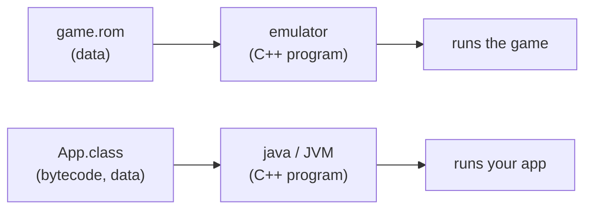
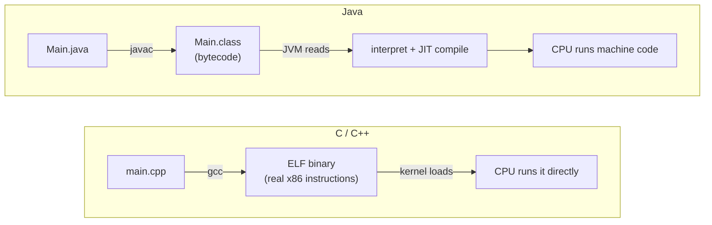
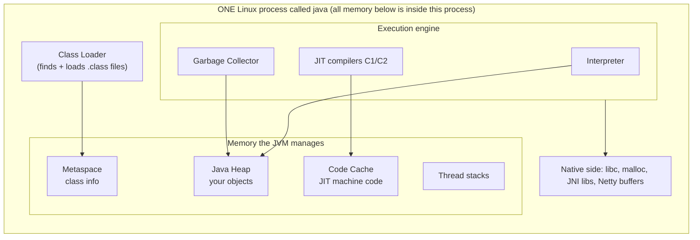
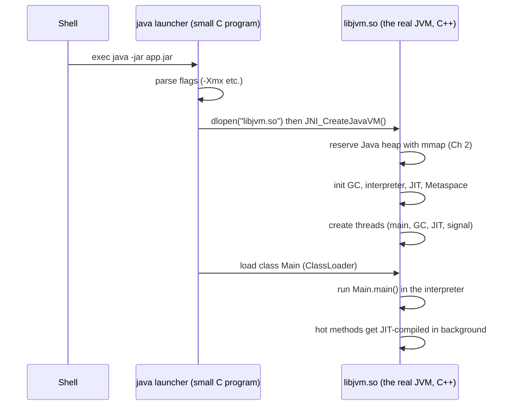

# Chapter 1 — The JVM Is Just a C++ Program

## Words you'll meet
| Word | Plain meaning |
|---|---|
| **Bytecode** | A made-up machine language (instructions for an imaginary CPU). `javac` writes it into `.class` files. |
| **JVM** (Java Virtual Machine) | The program that *pretends to be* that imaginary CPU and runs bytecode. |
| **HotSpot** | The most common JVM (from OpenJDK/Oracle). Written in C++. When people say "JVM" they usually mean this. |
| **JRE / JDK** | JRE = JVM + standard library. JDK = JRE + tools (`javac`, `jcmd`, ...). |
| **Runtime** | Code that helps your program while it runs (memory, threads, loading). C has a tiny one (`libc`); Java has a big one. |
| **Managed** | The runtime manages memory for you (no `free`). |
| **JIT** | Just-In-Time compiler: turns bytecode into real machine code *while the program runs*. |
| **GC** | Garbage Collector: automatic `free`. |

---

## 1.1 The big idea: an emulator

You know game console emulators: a program (the emulator) reads a ROM file (the game) and *pretends* to be the console's CPU.



| Console world | Java world |
|---|---|
| ROM file | `.class` / `.jar` file |
| Emulator | JVM (`libjvm.so`) |
| Fake console CPU | Bytecode instruction set |
| Works on PC/Mac/Linux | `.jar` runs on any OS that has a JVM |

Why did Sun (Java's creators) do this? **So the same `.jar` runs everywhere**, and so the runtime could add safety (no wild pointers) and automatic memory.

## 1.2 C++ vs Java: what gets shipped



🧩 **C++ view:** A C++ binary *is* the program. A Java `.class` is *input* to another program.

## 1.3 Design it yourself (this is how the JVM's parts were born)

**Task:** you must build a machine that runs portable programs. What problems appear, and what would you build?

🧠 **Predict:** list the problems before opening the table.

<details><summary>Reveal the design table</summary>

| # | Problem | Your solution | C/C++ analog | JVM's name for it |
|---|---|---|---|---|
| 1 | Programs must run on any CPU | Define a fake CPU + a loop that executes its instructions | a `switch` interpreter loop | **Interpreter** |
| 2 | Interpreting is 10–50× slow | Watch which code is hot, compile it to real machine code at runtime | `gcc` but at runtime, into memory | **JIT compiler** (C1, C2) |
| 3 | Users forget `free` | Find objects nobody points to, reuse their memory | write mark-sweep | **Garbage collector** |
| 4 | Don't load the whole program upfront | Load code on first use | `dlopen` on demand | **ClassLoader** |
| 5 | Untrusted code could crash/hack | Check bytecode before running; check array bounds | static analysis + runtime checks | **Bytecode verifier**, bounds checks |
| 6 | Programs want threads | Use OS threads | `pthread_create` | **Java threads** (1:1 with pthreads) |
| 7 | Need OS and C libraries | A bridge to native code | FFI / `dlsym` | **JNI** |
| 8 | Need type info at runtime (virtual calls, `instanceof`) | Keep per-class metadata | vtable + RTTI | **Klass** in **Metaspace** |
| 9 | Debugging live systems | Built-in inspection hooks | `gdb`, `/proc` | **JMX, JFR, jcmd** |

</details>

That table *is* the architecture. Every later chapter zooms into one row.

## 1.4 The architecture, in one picture



Memorize: **Heap (objects) · Metaspace (class info) · Code cache (JIT output) · Stacks · Native.** Out-of-memory bugs always live in one of these five.

## 1.5 What happens when you type `java -jar app.jar`



🔬 **Try it:** watch the real system calls.
```bash
cat > Hello.java <<'EOF'
public class Hello { public static void main(String[] a) throws Exception { System.out.println("hi"); Thread.sleep(60000);} }
EOF
javac Hello.java
strace -f -e trace=mmap,openat -o /tmp/st.txt java Hello &   # Linux; on macOS use dtruss
sleep 3; grep -c mmap /tmp/st.txt; grep libjvm /tmp/st.txt | head -2
```
You will see `openat(... "libjvm.so")` and hundreds of `mmap` calls. It's an ordinary process.

## 1.6 A JVM in 40 lines of C++ (thought model)

```cpp
// Pseudocode of "what the JVM does", stripped to bones
int main(int argc, char** argv) {
  parse_flags(argc, argv);                       // -Xmx4g ...
  void* heap = mmap(NULL, xmx, PROT_NONE, ...);  // reserve address space (Ch 2)
  init_gc(heap); init_jit(); init_threads();
  Class* c = load_class("Main");                 // read Main.class from disk
  Method* m = c->find_method("main");
  run(m);      // interpreter loop; counts calls; hands hot code to the JIT
  wait_for_all_non_daemon_threads();
  return 0;
}
```
Everything else in this course is detail inside those lines.

## 1.7 Pros and cons of this design

| | Pros | Cons |
|---|---|---|
| Bytecode + VM | One build runs everywhere; safe; runtime can optimize using *real* behavior | Startup cost; extra memory for the VM itself |
| GC | No `free`, no use-after-free, no double-free | Pauses; needs spare memory; tuning |
| JIT | Can beat static `gcc -O2` on long-running servers | Warm-up time; CPU/memory used by compiler |
| Big runtime | Great tooling (heap dumps, profilers) | Memory isn't just "heap" (this causes OOMKills) |

## 1.8 Check yourself

- [ ] I can say why `java` is "just a process".
- [ ] I can list the 5 memory areas.

<details><summary>Q1. A Java program has a bug that would be a use-after-free in C++. What happens?</summary>
It can't happen: an object stays alive as long as any reference points to it. The GC only frees *unreachable* objects. (The Java-world bug is the opposite: objects that stay reachable too long = memory leak.)
</details>

<details><summary>Q2. Why can't the JVM be written in Java itself?</summary>
The GC, memory manager and JIT must touch raw memory and run *below* the Java object world. They need pointers and OS calls, so HotSpot uses C++ (plus generated assembly). (Graal, a newer JIT, is written in Java, but it runs on top of HotSpot.)
</details>

<details><summary>Q3. Same .jar on Linux x86 and macOS ARM: who adapts?</summary>
The JVM binary is different per platform (compiled C++); the bytecode is identical. The JVM translates bytecode into that CPU's machine code.
</details>

Next: [Chapter 2 — Virtual Memory and the Heap](02-virtual-memory-and-the-heap.md)
