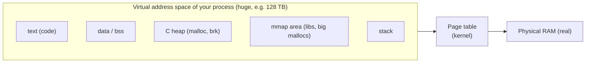
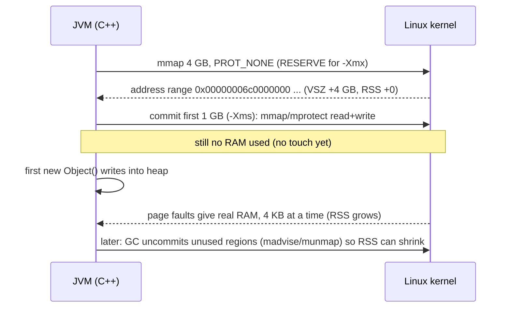
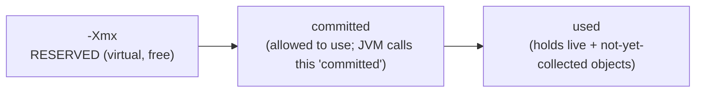
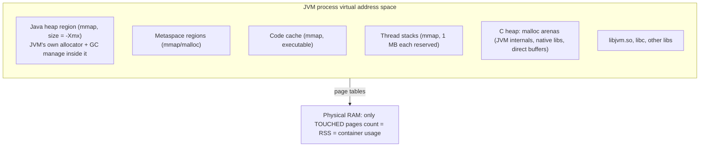

# Chapter 2 — Virtual Memory and "The Java Heap"

This chapter answers the question: **"Is the Java heap real memory or virtual memory?"**
Short answer: *both*, depending on which layer you look at. By the end you will see exactly why.

## Words you'll meet
| Word | Plain meaning |
|---|---|
| **Virtual address** | The address your pointers hold. Not a real RAM location. |
| **Physical memory (RAM)** | The actual chips. |
| **Page** | A 4 KB block. The OS maps virtual pages to physical pages. |
| **Page table** | OS table: virtual page → physical page. |
| **Page fault** | CPU trap when you touch a virtual page that has no RAM behind it yet. The OS then gives it a RAM page. |
| **Reserve** | Claim a range of addresses (costs nothing, no RAM). |
| **Commit** | Make that range usable (allowed to read/write). |
| **Touch** | Actually write/read it, causing a page fault → RAM is used. |
| **VSZ / VmSize** | Total *virtual* size of the process (includes reserved, untouched). |
| **RSS / VmRSS** | *Resident* set size = pages actually in RAM right now. **This is what containers are limited on.** |
| **cgroup** | Linux feature that limits memory/CPU for a group of processes (what Docker/Kubernetes use). |

---

## 2.1 Refresher: what you already know about C/C++ memory



- Your pointers are **virtual**. `malloc(1 GB)` on Linux usually *succeeds instantly* and uses almost no RAM. RAM is only used when you **touch** pages.
- Proof (🔬 try it):

```c
// vm.c   gcc vm.c -o vm && ./vm
#include <stdio.h>
#include <stdlib.h>
#include <string.h>
#include <sys/mman.h>
int main() {
  size_t RESERVE = 64UL << 30;                        // 64 GB of ADDRESS SPACE
  char* heap = mmap(NULL, RESERVE, PROT_NONE,         // PROT_NONE = cannot even read it
                    MAP_PRIVATE|MAP_ANONYMOUS|MAP_NORESERVE, -1, 0);
  puts("--- after reserve ---");  system("grep -E 'VmSize|VmRSS' /proc/self/status");

  mprotect(heap, 1UL << 30, PROT_READ|PROT_WRITE);    // COMMIT first 1 GB (now allowed to use)
  puts("--- after commit ---");   system("grep -E 'VmSize|VmRSS' /proc/self/status");

  memset(heap, 1, 100UL << 20);                       // TOUCH 100 MB -> page faults -> real RAM
  puts("--- after touching 100MB ---"); system("grep -E 'VmSize|VmRSS' /proc/self/status");
}
```
🧠 **Predict:** which of VmSize / VmRSS changes at each step?
<details><summary>Answer</summary>

| Step | VmSize (virtual) | VmRSS (real RAM) |
|---|---|---|
| reserve 64 GB | **+64 GB** | ~0 |
| commit 1 GB | unchanged | ~0 (still no RAM!) |
| touch 100 MB | unchanged | **+100 MB** |

Reserve → commit → touch are three different things. Remember this table; the JVM uses exactly this trick.
</details>

## 2.2 The JVM does the same thing for the Java heap

When the JVM starts with `-Xmx4g -Xms1g`:



So the statement **"the Java heap is just a big region of virtual memory"** is literally true:

> **Java heap = one (or a few) big `mmap`'d regions inside the JVM process's virtual address space. The JVM is the allocator that hands out pieces of it as objects.**

### Two different "heaps" (the confusion!)
| | C heap (a.k.a. native heap) | Java heap |
|---|---|---|
| Managed by | `libc` (`malloc`/`free`, ptmalloc/jemalloc) | The JVM's GC |
| Used by | JVM's *own* C++ code, native libs, direct buffers | Your Java objects |
| Size limit | none except the container | `-Xmx` |
| How freed | `free()` | GC |
| Visible in heap dump? | No | Yes |

A JVM process therefore contains **both**: a malloc heap (for the JVM's internals) and the Java heap (a private region the JVM carved out with `mmap` and manages itself).

🧩 **C++ view:** it's like writing your own **arena allocator** on top of `mmap` — which is exactly what the JVM does. `new` in Java = "bump a pointer in my arena." (Chapter 4.)

## 2.3 Reserved vs committed vs used (three numbers you'll see everywhere)



| Number | Where you see it | Means | Costs RAM? |
|---|---|---|---|
| `max` | `jvm_memory_max_bytes`, `-Xmx` | reserved range | no |
| `committed` | `jvm_memory_committed_bytes` | committed range | only for pages touched |
| `used` | `jvm_memory_used_bytes` | bytes occupied by objects | yes (subset of touched) |

⚠️ **Trap:** after GC, `used` drops but `committed` often stays high and RSS stays high. The JVM keeps the pages (like `malloc` rarely returns memory to the OS). That's *not* a leak. (Ch 14.)

### Flags that control this
| Flag | Plain effect | Reserve / commit / touch |
|---|---|---|
| `-Xmx` | max heap | sets **reserve** size |
| `-Xms` | initial heap | sets initial **commit** |
| `-XX:+AlwaysPreTouch` | touch every page at startup | forces RSS = committed immediately (slow start, predictable memory) |
| `-XX:+UseTransparentHugePages` | use 2 MB pages | fewer page faults; can bloat RSS |

## 2.4 Why does the JVM reserve the full `-Xmx` up front?
Because a heap must be one **contiguous address range** (pointers inside it are compared and shifted; compressed pointers need it). You can't ask the OS to grow a range in place later (another mapping might be next to it). So: reserve big now (free), commit as needed.

Compressed pointers bonus (details in Ch 4): the JVM tries to place the heap so that all addresses fit in 32 bits after shifting, which is why heaps under ~32 GB get smaller (4-byte) references.

## 2.5 🔬 Watch it on a real JVM

```java
// HeapWatch.java
public class HeapWatch {
  static void show(String s) throws Exception {
    System.out.println("== " + s);
    new ProcessBuilder("sh","-c","grep -E 'VmSize|VmRSS' /proc/"+ProcessHandle.current().pid()+"/status")
        .inheritIO().start().waitFor();
  }
  public static void main(String[] a) throws Exception {
    show("startup");
    byte[][] keep = new byte[300][];
    for (int i = 0; i < 300; i++) keep[i] = new byte[1<<20];   // allocate 300 MB (touches pages)
    show("after allocating 300MB");
    keep = null; System.gc();
    show("after releasing + GC");
  }
}
```
```bash
javac HeapWatch.java
java -Xms64m -Xmx4g HeapWatch              # G1 default
java -Xms64m -Xmx4g -XX:+AlwaysPreTouch HeapWatch
```
Observe: VmSize is large from the start (reserved 4 GB + other stuff). VmRSS jumps by ~300 MB, and after GC it may **not** drop back fully.

Look at the mapping itself:
```bash
java -Xmx4g -Xms64m Hello &     # from chapter 1
pid=$!
pmap -x $pid | sort -k3 -n | tail -5       # biggest RSS mappings
grep -A3 -i "^7\|^0000" /proc/$pid/smaps | head   # heap mapping: Size (virtual) vs Rss (real)
```
In `/proc/<pid>/smaps` every region shows **Size** (virtual) vs **Rss** (real). The heap region has large Size, smaller Rss.

## 2.6 Who enforces the container limit?
The kernel's **cgroup** counts **RSS (touched pages)** + some page cache, not virtual size.
- Reserving 64 GB virtual in a 6 GiB pod: fine.
- Touching 6.1 GiB: **OOM killer** → `SIGKILL` → `OOMKilled` (exit 137).

So for pods, "how much heap is *touched*" and "how much *other* memory the JVM touches" matter, not `-Xmx` itself. (Ch 10.)

## 2.7 Recap diagram



## 2.8 Check yourself
- [ ] I can explain reserve vs commit vs touch.
- [ ] I know VSZ ≠ RSS and containers use RSS.
- [ ] I know the JVM has two heaps (C heap and Java heap).

<details><summary>Q1. `-Xmx64g` on a 4 GB machine. Does the JVM start?</summary>
Usually yes: it only reserves virtual space (with overcommit settings allowing it). It fails only when it tries to touch more RAM than exists/allowed.
</details>

<details><summary>Q2. Why can't I read `-Xmx` as "how much memory my pod needs"?</summary>
`-Xmx` is only the **reserve size for objects**. The pod also holds Metaspace, code cache, thread stacks, native/direct buffers, GC bookkeeping and malloc overhead (Ch 9, 10).
</details>

<details><summary>Q3. After a big spike and GC, `kubectl top` still shows high memory. Leak?</summary>
Not necessarily. Pages were touched and the JVM didn't give them back (committed stays). Check heap `used` after GC (the floor); if the floor is flat it's not a leak.
</details>

Prev: [01](01-java-is-a-cpp-program.md) · Next: [Chapter 3 — Bytecode and the Interpreter](03-bytecode-and-interpreter.md)
