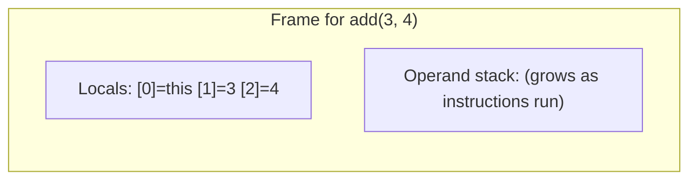
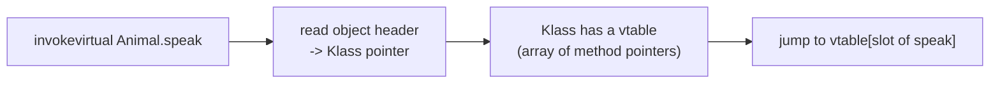

# Chapter 3 — Bytecode and the Interpreter

## Words you'll meet
| Word | Plain meaning |
|---|---|
| **Opcode** | One instruction number, e.g. `iadd` = add two ints. |
| **Operand stack** | A small stack where instructions push/pop values (instead of CPU registers). |
| **Local variable array** | Slots for a method's parameters and locals (like stack-frame variables). |
| **Frame** | One method call's workspace = locals + operand stack (+ return info). |
| **Stack machine** | CPU model where instructions work on a stack. JVM is one. x86 is a *register machine*. |
| **Interpreter** | A loop that reads one bytecode, does it, moves to the next. |
| **Constant pool** | Per-class table of strings, numbers, method names that bytecode refers to by index. |

---

## 3.1 What `javac` produces

```java
int add(int a, int b) { return a + b; }
```
🔬 `javac X.java && javap -c -p X`
```
int add(int, int);
  0: iload_1     // push local #1 (a)
  1: iload_2     // push local #2 (b)
  2: iadd        // pop two, push their sum
  3: ireturn     // pop and return it
```
(Local #0 is `this` for instance methods.)

🧩 **C++ view (x86 -O0 for the same function)**
```asm
mov eax, edi
add eax, esi
ret
```
x86 uses **registers** (`eax`, `edi`). Bytecode uses an **operand stack**. Why? A stack machine needs no knowledge of how many registers the real CPU has → portable. The JIT later maps stack slots to real registers.

## 3.2 A frame, drawn


Step by step for `add(3,4)`:

| pc | instruction | operand stack after |
|---|---|---|
| 0 | `iload_1` | [3] |
| 1 | `iload_2` | [3, 4] |
| 2 | `iadd` | [7] |
| 3 | `ireturn` | returns 7 |

## 3.3 Write your own interpreter (the heart of a JVM)

Program we run (pseudo-Java): `sum=0; i=1; while (i <= 10) { sum += i; i++; } print(sum);`

```cpp
// mini_jvm.cpp   g++ -O2 mini_jvm.cpp -o mini && ./mini     (prints 55)
#include <cstdio>
enum Op { ICONST, ILOAD, ISTORE, IADD, IF_ICMPGT, GOTO, PRINT, HALT };

int code[] = {
  ICONST,0, ISTORE,1,                   //  0: sum = 0
  ICONST,1, ISTORE,0,                   //  4: i = 1
  /* 8 */  ILOAD,0, ICONST,10, IF_ICMPGT,30,   // if (i > 10) goto 30
  /*14 */  ILOAD,1, ILOAD,0, IADD, ISTORE,1,   // sum = sum + i
  /*21 */  ILOAD,0, ICONST,1, IADD, ISTORE,0,  // i = i + 1
  /*28 */  GOTO,8,
  /*30 */  ILOAD,1, PRINT, HALT
};

int main() {
  int stack[64], sp = 0;     // operand stack
  int locals[8];             // local variables
  int pc = 0;                // program counter (index into code[])
  for (;;) {
    switch (code[pc++]) {                       // FETCH + DECODE
      case ICONST:    stack[sp++] = code[pc++]; break;                 // EXECUTE
      case ILOAD:     stack[sp++] = locals[code[pc++]]; break;
      case ISTORE:    locals[code[pc++]] = stack[--sp]; break;
      case IADD:      { int b = stack[--sp], a = stack[--sp]; stack[sp++] = a + b; break; }
      case IF_ICMPGT: { int t = code[pc++]; int b = stack[--sp], a = stack[--sp]; if (a > b) pc = t; break; }
      case GOTO:      pc = code[pc]; break;
      case PRINT:     printf("%d\n", stack[--sp]); break;
      case HALT:      return 0;
    }
  }
}
```
🧠 **Predict:** what does it print? What is `pc` right after the first `ISTORE`?
<details><summary>Answer</summary>Prints `55`. After `ICONST,0, ISTORE,1` pc = 4 (the next instruction).</details>

**This `for/switch` loop is conceptually the whole interpreter.** HotSpot's version differs in two ways:
1. **Template interpreter:** at JVM startup it *generates machine code* for each opcode (a tiny assembly snippet) and dispatches by jump table. Faster than a C++ `switch`.
2. It counts how often methods and loops run, to decide what the JIT should compile (Ch 7).

## 3.4 How a method call works (`invokevirtual`)

Java: `animal.speak()` where `animal` may be Dog or Cat.


🧩 **C++ view:** identical to a C++ virtual call: `obj->vptr[i]()`. The JVM's `Klass` plays the role of the vtable + RTTI (Ch 6). Interfaces use a slightly slower table (`itable`).

## 3.5 Other bytecode ideas worth knowing
| Concept | Bytecode | C++ analog |
|---|---|---|
| Allocate | `new`, `newarray` | `operator new` |
| Field access | `getfield`/`putfield` | `obj->field` |
| Static | `getstatic`/`putstatic` | global variable |
| Array bounds | checked in `iaload` etc. → `ArrayIndexOutOfBoundsException` | none (UB if you overrun) |
| Null check | implicit; `NullPointerException` | segfault |
| Exceptions | **exception table** per method, no setjmp | C++ unwinding tables |
| Locks | `monitorenter`/`monitorexit` | `mutex.lock()/unlock()` |
| Lambdas | `invokedynamic` | closure objects / `std::function` |

⚠️ **Trap:** Java "safe" checks (bounds, null, casts) cost a little. The JIT removes most of them when it can prove they're unnecessary.

## 3.6 The verifier (safety before running)
When a class is loaded the JVM **verifies** its bytecode: stack never underflows, types match (you can't treat an int as an object pointer), jumps land on instruction boundaries.
🧩 C++ analog: there is none. This is why Java has no wild pointers: the language has no pointer arithmetic, and the verifier prevents hand-crafted bytecode from doing it.

## 3.7 Pros and cons of interpreting
| | Pros | Cons |
|---|---|---|
| Interpreter | Starts instantly, simple, portable | ~10–50× slower than native code |
| Fix | **JIT** compiles hot code (Ch 7) | needs warm-up |

## 3.8 Exercises
- [ ] Run the mini JVM. Add an `ISUB` and `IMUL` opcode; compute 10! (factorial).
- [ ] `javap -c -p` a loop (`for` sum). Find the backward `goto`.
- [ ] Use `javap -c` on a method that calls an interface method; find `invokeinterface`.

<details><summary>Q1. Why is the JVM a stack machine and not a register machine?</summary>
Portability and compact bytecode: no assumption about register count; the JIT assigns registers later.
</details>

<details><summary>Q2. Where does the "virtual call" cost go in Java?</summary>
Same as C++ (a vtable lookup), but the JIT often removes it by guessing the real class (devirtualization, Ch 7), so many Java virtual calls become direct calls or inlined code.
</details>

Prev: [02](02-virtual-memory-and-the-heap.md) · Next: [Chapter 4 — Objects and Allocation](04-objects-and-allocation.md)
