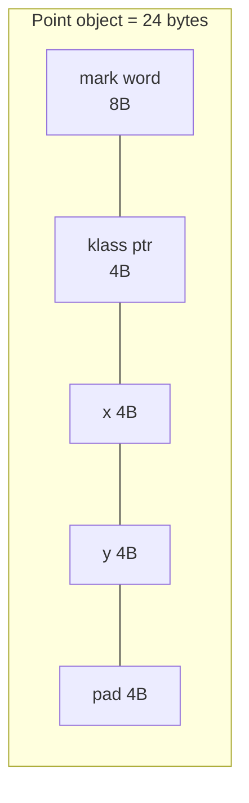
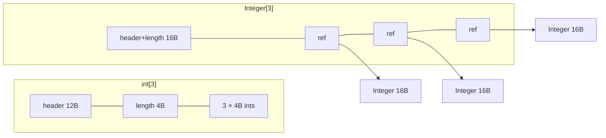
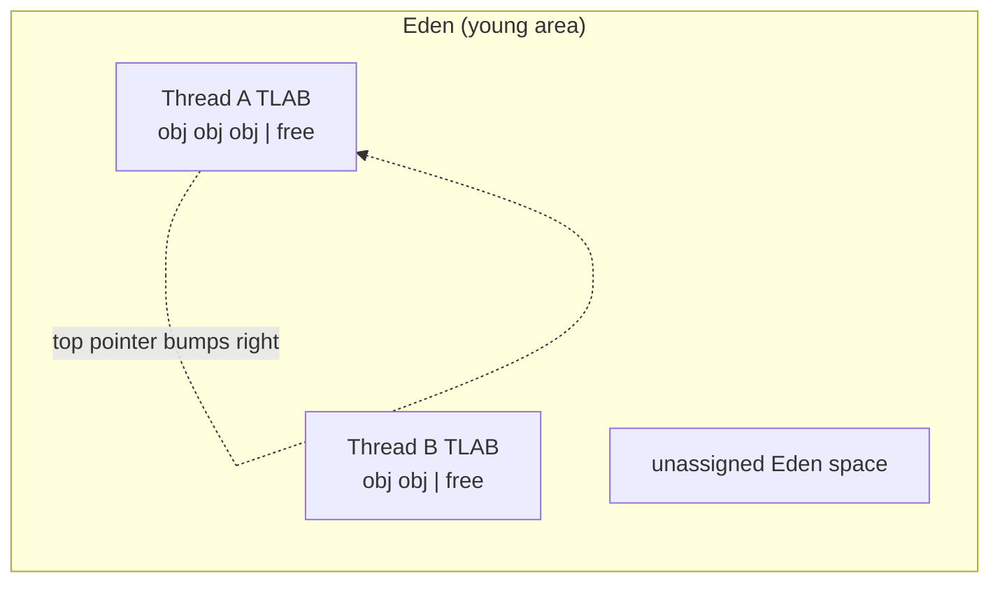
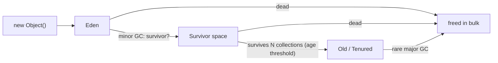

# Chapter 4 — Objects, References and Allocation

## Words you'll meet
| Word | Plain meaning |
|---|---|
| **Object header** | Hidden bytes at the start of every Java object (metadata). |
| **Mark word** | 8-byte part of header: hash, lock state, GC age. |
| **Klass pointer** | Header part that points to the class description (like a vptr). |
| **Reference** | A Java "pointer" to an object. You can't do arithmetic on it. |
| **Compressed oops** | Storing references in 4 bytes instead of 8 (works for heaps up to ~32 GB). |
| **TLAB** | Thread-Local Allocation Buffer: a private slice of the heap per thread, so `new` needs no lock. |
| **Eden / Survivor / Old** | Heap areas by object age (young objects → old objects). |
| **Boxing** | Wrapping a primitive in an object (`int` → `Integer`). |

---

## 4.1 A Java object is a C struct with a hidden header

Java:
```java
class Point { int x; int y; }
Point p = new Point();
```
C++ equivalent *as the JVM lays it out in memory*:
```cpp
struct Point {
  uint64_t mark;      // mark word  (hash, lock bits, GC age)        8 bytes
  uint32_t klass;     // compressed pointer to class info (Ch 6)     4 bytes
  int32_t  x;         //                                              4 bytes
  int32_t  y;         //                                              4 bytes
};                    // total 20 -> padded to 24 (objects are 8-byte aligned)
```


🧠 **Predict:** size of `class Empty {}` instance? Of `int[0]`? Of `Integer`?
<details><summary>Answer</summary>

| Object | Bytes |
|---|---|
| `new Object()` (12B header, pad to 8) | **16** |
| `Integer` (12 header + 4 int) | **16** (vs 4 bytes for a C `int`!) |
| `int[0]` (12 header + 4 length) | **16** |
| `int[100]` (16 + 400) | **416** |
</details>

🔬 **See real sizes** with JOL (Java Object Layout):
```bash
# add dependency org.openjdk.jol:jol-core, then:
System.out.println(org.openjdk.jol.info.ClassLayout.parseClass(Point.class).toPrintable());
```

### Mark word: what's inside (simplified)
Identity hashcode (if requested) · GC age (0–15) · lock state (unlocked/thin lock/inflated monitor). Same word is reused for different purposes, like a union.

### Why a header at all?
- **Klass pointer** = type info at runtime (virtual calls, `instanceof`, GC needs to know field layout to find references).
- **Mark word** = every Java object can be a lock (`synchronized`) and has an identity hash. C++ objects don't pay this per object.

🧩 **C++ cost comparison:** a C++ `struct Point {int x,y;}` is 8 bytes. Java: 24. That's why `ArrayList<Integer>` of 1M uses ~20 MB vs `vector<int>` 4 MB.

## 4.2 References are pointers you can't see

```java
Point p = new Point();   // p holds an address into the Java heap
```
- A reference is a pointer value (internally an address or compressed offset).
- You **cannot**: cast to integer, add to it, point into the middle of an object, point at stack variables.
- Why? Because the **GC may move objects** (compaction). If you could keep raw addresses, they'd break. The JVM updates every reference when it moves things.

🧩 **C++ view:** a Java reference is like a `T*` that's always valid-or-null, never dangling, never arithmetic'd. Closest C++ spelling: a pointer managed by a *moving* GC library.

### Compressed oops (why heaps ≤ 32 GB are special)
Objects are 8-byte aligned, so addresses are multiples of 8 → the lowest 3 bits are always 0 → store `addr >> 3` in 32 bits:
```
real_address = heap_base + ((uint64_t)ref32 << 3)       // 32 bits × 8 = 32 GB reachable
```
- Saves 4 bytes per reference, improves cache use (~10–20% less memory).
- Above ~32 GB heap this stops working → refs become 8 bytes → a 33 GB heap can hold *less* than a 31 GB heap.
Flag: `-XX:+UseCompressedOops` (default on if heap < 32 GB).

## 4.3 Arrays, Strings, boxing


- `int[]` = contiguous like C. `Integer[]`/`List<Integer>` = array of pointers to separate little objects → more memory, cache misses.
- `String` ("abc") = `String` object (~24B) → `byte[]` (~24B). ~48 bytes for 3 chars.
- Integer cache: `Integer.valueOf(-128..127)` reuses objects.
- ⚠️ **Trap:** `long total = 0; Long x = ...; total += x` in a hot loop allocates objects (boxing). Use primitives.

## 4.4 How `new` works (and why it's fast)

In C++, `malloc` searches free lists, may lock, may call `brk/mmap`. Java's heap has no free lists in the fast path:

```c
// Per-thread allocation buffer (TLAB): a slice of Eden given to this thread
char *top, *end;                     // thread-local variables

void* java_new(size_t n) {
  n = (n + 7) & ~7;                  // align to 8
  if (top + n <= end) {              // FAST PATH: ~3 instructions, no lock
    void* p = top;
    top += n;                        // "bump the pointer"
    // zero memory + write header
    return p;
  }
  return slow_path(n);               // get a new TLAB, or trigger GC
}
```

**Why it works:** allocation is just pointer arithmetic, and freeing is done later in bulk by the GC (cost ∝ *surviving* objects, not dead ones). Dead objects cost nothing to free.

🧩 **C++ analog:** an **arena / bump allocator** (`char* top`), which C++ game engines use for per-frame allocation. Java's heap *is* a huge arena with a collector behind it.

## 4.5 Heap areas: generations

Observation (the **generational hypothesis**): *most objects die young* (request objects, temp strings), few live long (caches, singletons).


Why split? Collect the small young area often and cheaply; collect the big old area rarely.

Modern collectors (G1, ZGC) divide the heap into **regions** instead of fixed Young/Old blocks, but the idea (young vs old) stays. (Ch 5.)

## 4.6 Escape analysis: sometimes `new` never allocates
```java
int dist(int x, int y) { Point p = new Point(x, y); return p.x*p.x + p.y*p.y; }
```
If the JIT proves `p` never leaves the method ("doesn't escape"), it replaces the object with two local variables in registers (**scalar replacement**). No heap object at all. (Ch 7.) 🧩 This is Java doing what a C++ programmer does by default (stack struct).

## 4.7 Pros and cons

| | Pros | Cons |
|---|---|---|
| Header + references | Safe, lockable, type-checked objects | 12–16 byte overhead per object |
| Bump allocation | Very fast `new` | Needs GC; memory can't be returned to C++ style per-object |
| Compressed oops | Less memory | Cliff at ~32 GB |
| Reference-only world | No dangling pointers | Pointer chasing: arrays of objects aren't contiguous |

## 4.8 Exercises
- [ ] Use JOL to print layouts of `Object`, `Integer`, `String`, your own DTO. Calculate bytes per instance.
- [ ] Compute: `List<Long>` of 10M elements — how many MB? (Hint: array of refs + 10M `Long` objects.)
- [ ] Run `java -XX:+PrintFlagsFinal -version | grep -E "UseCompressedOops|ObjectAlignment"`.

<details><summary>Q1. Why is Java `new` often faster than C `malloc`?</summary>
Fast path is a pointer bump in a thread-private buffer, no lock, no free-list search; the cost of freeing is paid in bulk by the GC and only for survivors.
</details>

<details><summary>Q2. Why can't Java expose raw pointers?</summary>
The GC moves objects; raw addresses would dangle. Also pointer arithmetic breaks memory safety.
</details>

<details><summary>Q3. 10M `Long` in a list: size?</summary>
Backing array: 10M × 4B refs = 40 MB. Each `Long` = 16B → 160 MB. ~200 MB total vs 80 MB in C++ `vector<int64_t>`.
</details>

Prev: [03](03-bytecode-and-interpreter.md) · Next: [Chapter 5 — Garbage Collection](05-garbage-collection.md)
