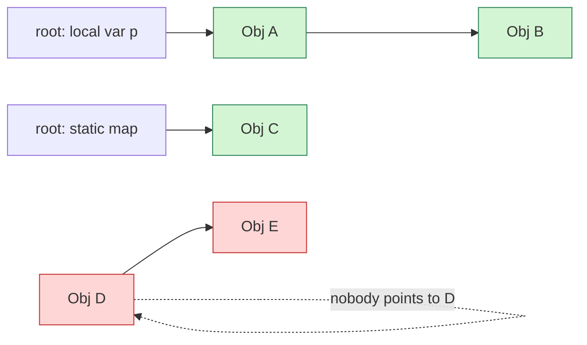
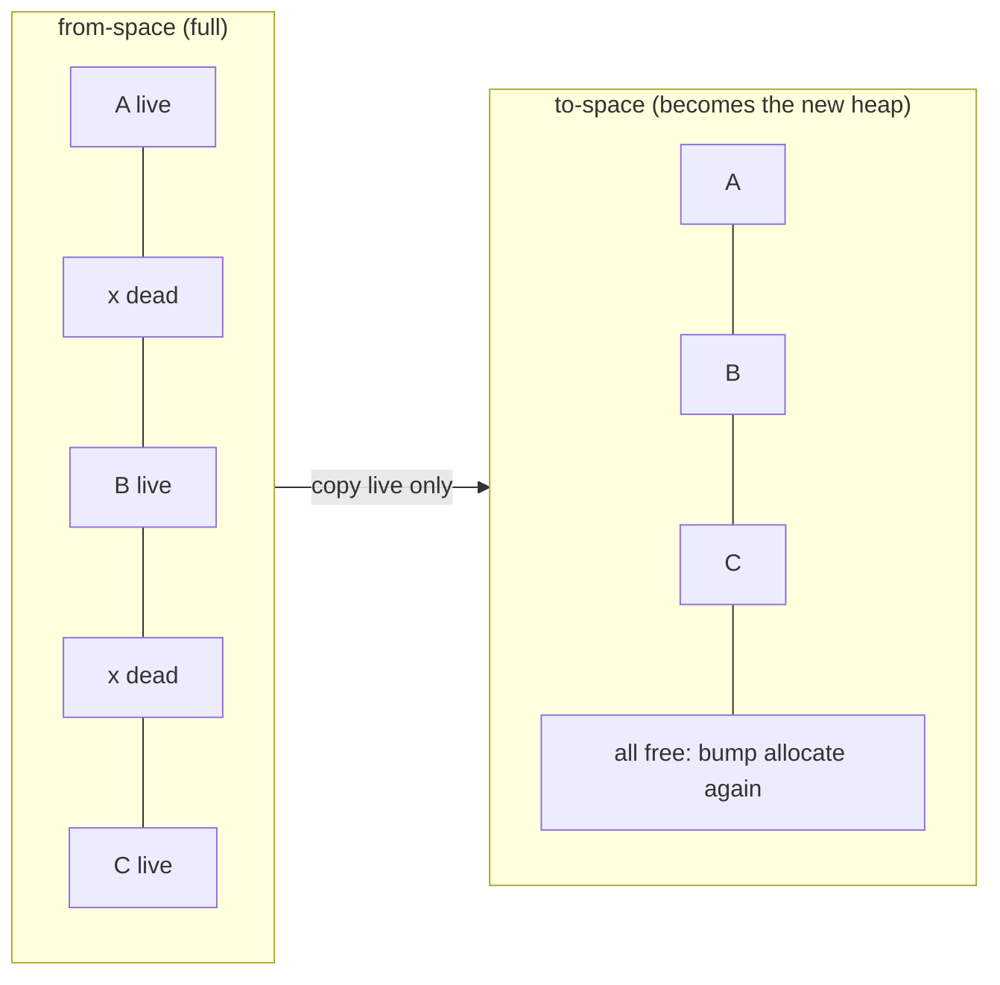
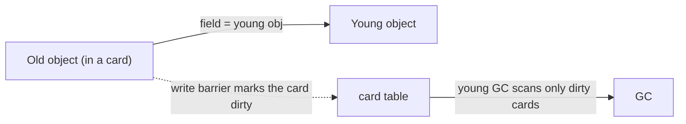
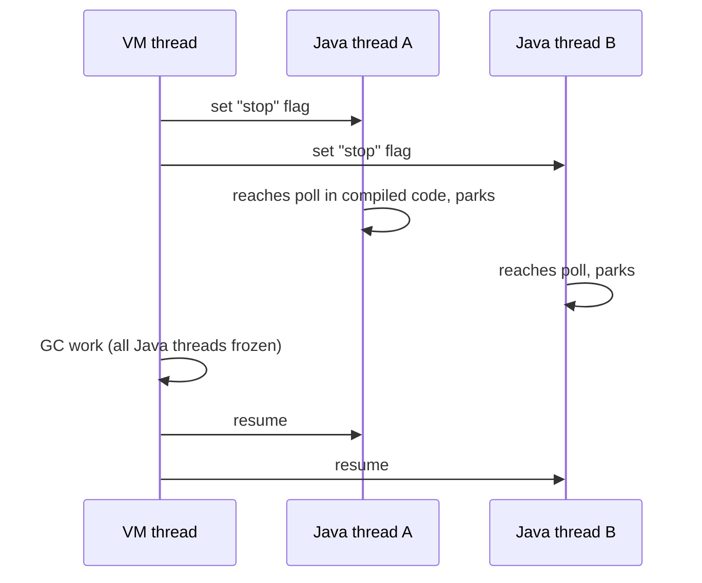
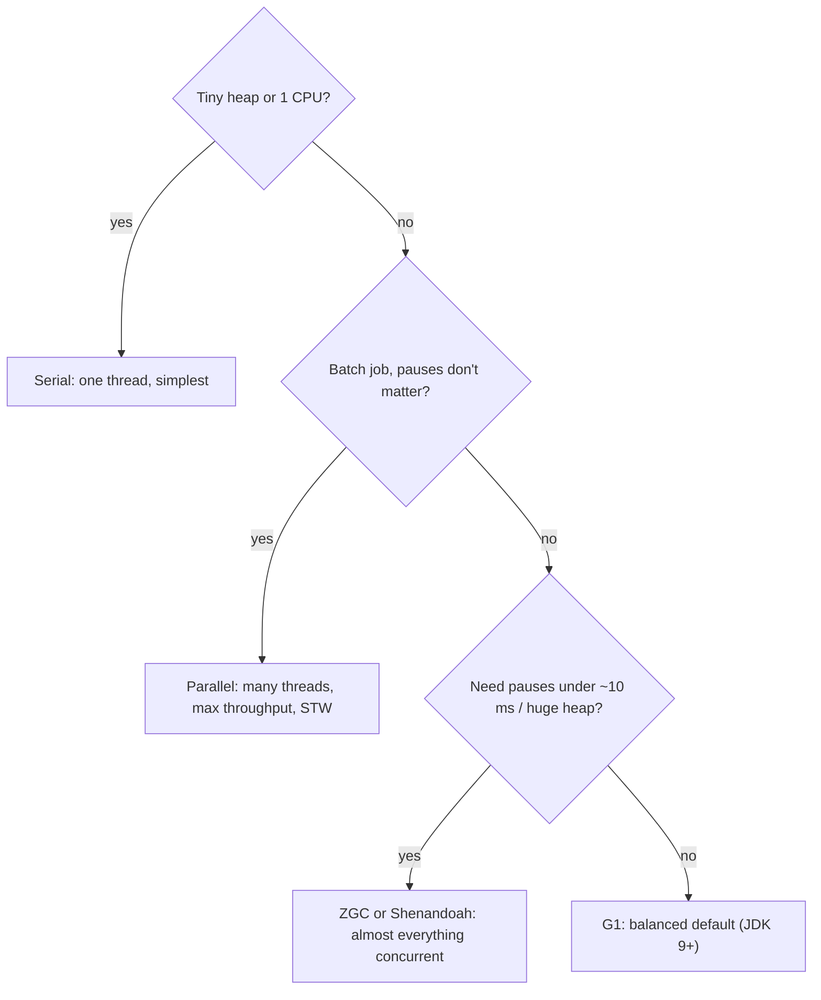
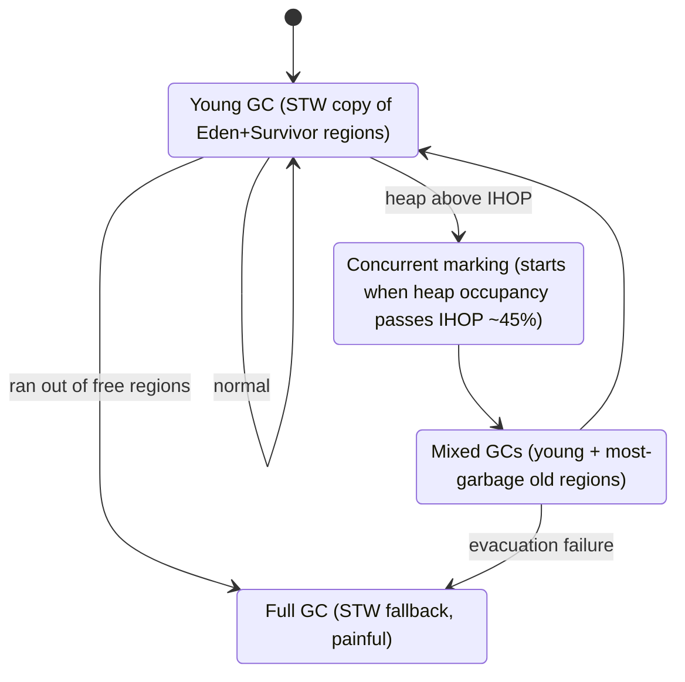

# Chapter 5 — Garbage Collection (build one yourself first)

## Words you'll meet
| Word | Plain meaning |
|---|---|
| **GC root** | A starting point the program can reach directly: local variables on thread stacks, static fields, JNI handles. |
| **Reachable / live** | You can get to the object by following references from a root. |
| **Garbage** | Not reachable. Nobody can ever use it again. |
| **Mark** | Walk from the roots and flag every live object. |
| **Sweep** | Free everything not flagged. |
| **Compact** | Slide live objects together to remove holes. |
| **Copying collector** | Copy live objects to a fresh area; the old area becomes entirely free. |
| **STW (stop-the-world)** | All Java threads paused while GC works. |
| **Safepoint** | A spot where a thread can be safely stopped (so GC sees a consistent state). |
| **Concurrent** | GC runs *while* your app runs. |
| **Write barrier** | A few extra instructions the JIT puts after every reference store, so the GC can track changes. |
| **Card table** | A byte array: 1 byte per 512 bytes of heap, marking "something here changed". |
| **Minor / Young GC** | Collect only the young area. |
| **Major / Full GC** | Collect everything. Usually slow. |
| **Promotion** | Moving a surviving object from young to old. |
| **Allocation rate** | How many MB/s your program creates. |

---

## 5.1 The problem GC solves
In C++ you write `delete`. Mistakes: leak (forgot), use-after-free, double-free. A GC finds garbage **automatically** by one rule:

> **If no chain of references from any root reaches an object, it is garbage.**


D and E point to each other maybe (even a cycle), but unreachable from roots → garbage. (C++ `shared_ptr` cycles *leak*; a tracing GC handles cycles.)

## 5.2 Write a GC: mark-sweep in 20 lines of C++

```cpp
#include <cstdlib>
#include <cstdio>
struct Obj { bool marked; Obj* refs[2]; Obj* next_all; };   // next_all links every allocated object
Obj* all = nullptr;                                          // list of all objects
Obj* roots[4]; int nroots = 0;                               // pretend these are stack variables

Obj* gc_new() {
  Obj* o = (Obj*)calloc(1, sizeof(Obj));
  o->next_all = all; all = o; return o;
}
void mark(Obj* o) {                       // PHASE 1: follow pointers from roots
  if (!o || o->marked) return;
  o->marked = true;
  for (int i = 0; i < 2; i++) mark(o->refs[i]);
}
void sweep() {                            // PHASE 2: free unmarked
  Obj** p = &all;
  while (*p) {
    if (!(*p)->marked) { Obj* dead = *p; *p = dead->next_all; free(dead); }
    else { (*p)->marked = false; p = &(*p)->next_all; }   // clear mark for next time
  }
}
void gc() { for (int i = 0; i < nroots; i++) mark(roots[i]); sweep(); }
```
🧠 **Predict:** allocate A, B, C; root → A; A.refs[0] → B; C unreferenced. After `gc()`, what's left?
<details><summary>Answer</summary>A and B. C is freed. Cost: mark ∝ number of **live** objects, sweep ∝ **all** objects.</details>

**Problem with plain mark-sweep:** it leaves holes → *fragmentation* (like `malloc` after months). Allocation then needs free-lists (slow). Java wanted bump allocation, so it uses compaction or copying.

## 5.3 Copying collector (the idea behind young GC)

Two equal areas: **from-space** and **to-space**.

- Cost ∝ **live** objects only. Garbage costs *zero*.
- Result is perfectly compact → bump allocation stays valid.
- Downside: needs a spare area (up to 2× space) → used only on the *young* area where survivors are few.
- Objects are moved, so every reference must be updated (that's why Java hides raw pointers).

## 5.4 Generational GC and the card table

Combine ideas (Ch 4): young area uses copying (most objects die → very cheap); old area uses mark-compact (rarely collected).

**Problem:** young GC must know "which young objects does an *old* object point to?" Scanning all of old defeats the point.

**Solution: write barrier + card table.**
```cpp
// The JIT inserts this after EVERY store of a reference into an object field:
obj->field = value;
card_table[ ((uintptr_t)obj - heap_base) >> 9 ] = DIRTY;   // 512-byte "cards"
```

So young GC roots = thread stacks + statics + **dirty old cards**. 🧩 C++ analog: a dirty-page bitmap in a custom allocator.

⚠️ **Trap:** this barrier is why Java reference stores cost slightly more than C++ pointer stores. ZGC/Shenandoah add barriers on *loads* too.

## 5.5 Stop-the-world and safepoints

GC needs a still picture of the heap. So it asks all threads to stop at a **safepoint**:


JIT-compiled code contains cheap **polls** (like checking a volatile flag/reading a special page) at loop ends and method returns. 🧩 C++ analog: cooperative cancellation checks in a long loop.
- **Time-to-safepoint (TTSP):** time until the *last* thread arrives. A long loop without a poll can delay everybody. Show it with `-Xlog:safepoint`.

## 5.6 Modern collectors in plain English



| GC | Idea | Pause | Cost |
|---|---|---|---|
| **Serial** | stop world, one thread, copy young / compact old | long | smallest footprint |
| **Parallel** | same, many threads | long (grows with heap) | best raw throughput |
| **G1** | heap = ~2000 equal **regions**; collect the regions with most garbage first ("garbage first") | tens–hundreds ms (target `MaxGCPauseMillis`, default 200) | extra memory for bookkeeping (~10–15%) |
| **ZGC** | marks and *moves objects while app runs*, using **load barriers** + colored pointers | typically < 1 ms, independent of heap size | more CPU and memory headroom |
| **Shenandoah** | similar concurrent compaction via forwarding pointers | few ms | CPU/memory |
| **Epsilon** | never frees | none | JVM dies when full (testing only) |

### G1 cycle

- **IHOP** = Initiating Heap Occupancy Percent: "when heap is this full, start marking old regions in the background."
- **Humongous object**: object larger than half a region; allocated directly in old regions, awkward for G1. Avoid giant arrays/buffers.

## 5.7 How GC relates to the virtual memory you learned (Ch 2)
- GC doesn't call `free`. It *reuses* addresses inside the heap range.
- After GC, `used` drops. `committed` (touched pages) stays unless the GC explicitly uncommits (G1 does this rarely; ZGC/Shenandoah more readily). That's why RSS can stay high after load drops.

## 5.8 Reading a GC log (the skill that finds leaks)

Enable (JDK 17/21):
```
-Xlog:gc*:file=/tmp/gc.log:time,uptime,level,tags
```
A line:
```
[12.345s][info][gc] GC(41) Pause Young (Normal) (G1 Evacuation Pause) 2048M->410M(4096M) 18.234ms
```
Decode: **before → after (total committed)**; **pause**.

Compute from logs:
| Metric | How | Healthy? |
|---|---|---|
| Allocation rate | growth between GCs ÷ time | lower is cheaper |
| Pause p99 | from pause lines | meets SLO |
| GC overhead | Σ pauses ÷ wall time | < 5% |
| **After-GC floor of Old gen** | heap after a mixed/full GC | **flat = healthy; rising = leak** |

```
Healthy:  floor  ▂▃▂▃▂▃▂▃   (sawtooth, no trend)
Leak:     floor  ▂▃▃▄▄▅▅▆▇  (staircase up → Full GCs → OOM)
```

Danger words in logs: `Pause Full`, `To-space exhausted`, `Evacuation Failure`, `Humongous`, `Allocation Stall` (ZGC).

## 5.9 Java GC vs C++ manual memory: honest comparison

| | Java GC | C/C++ |
|---|---|---|
| Free cost | zero for garbage; pay for survivors | `free` per object (+ destructors) |
| Alloc cost | pointer bump | allocator search (+ lock) |
| Pauses | yes (small with ZGC) | none from GC; but `free` of big graphs can stall |
| Memory use | needs spare heap (headroom) | closer to live data |
| Cycles | handled | `shared_ptr` leaks; need `weak_ptr` |
| Fragmentation | compaction fixes | allocator-dependent, grows over time |
| Determinism | destruction time unknown | RAII is exact |
| Non-memory resources (files, sockets) | **must** `close()` (try-with-resources) | RAII does it |

⚠️ **Trap:** Never rely on GC to close files/sockets/locks. `finalize()` is deprecated for removal. GC only knows *memory*.

## 5.10 Exercises
- [ ] Compile the mark-sweep code, add a `main` that builds a graph with a cycle and proves the cycle is freed after dropping the root.
- [ ] Run any Java app with `-Xlog:gc*` for 30 min under load; record: allocation rate, p99 pause, floor.
- [ ] Switch `-XX:+UseParallelGC` / `-XX:+UseZGC`; compare pause lines.

<details><summary>Q1. Why is copying GC cheap when most objects die?</summary>
It copies only survivors. If 1% survive, GC does 1% of the work; the dead 99% cost nothing.
</details>

<details><summary>Q2. What does the card table save us from?</summary>
Scanning the entire old generation during every young GC; only "dirty" cards (where an old object was changed to point somewhere) are scanned.
</details>

<details><summary>Q3. Old-gen floor rises 100 MB per hour. Leak?</summary>
Yes (or an unbounded cache). The floor is the live data after collection; a monotonic rise means objects stay reachable. Next step: heap dump diff (Ch 12/14).
</details>

Prev: [04](04-objects-and-allocation.md) · Next: [Chapter 6 — Class Loading and Metaspace](06-class-loading-and-metaspace.md)
