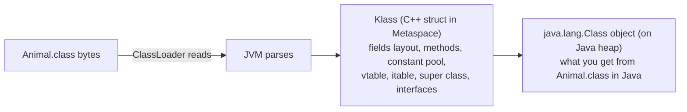
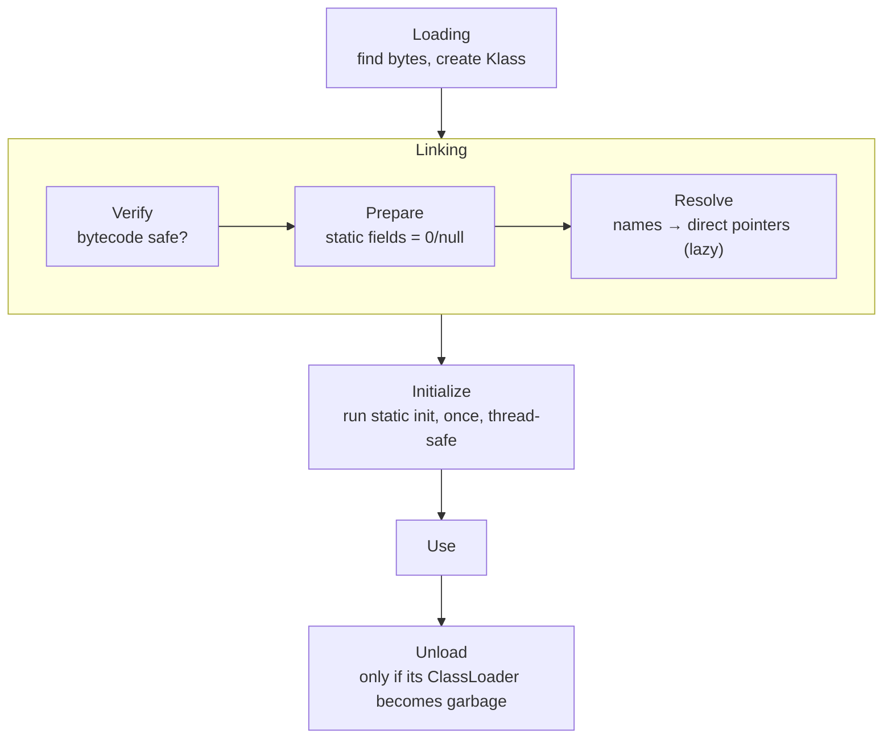
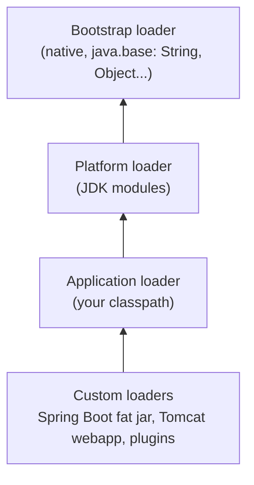

# Chapter 6 — Class Loading and Metaspace

## Words you'll meet
| Word | Plain meaning |
|---|---|
| **Class loading** | Reading a `.class` file and building an in-memory description of the class. |
| **ClassLoader** | The Java object that knows *where* to find class bytes (jar, folder, network). |
| **Klass** | The JVM's internal C++ structure describing a class (fields, methods, vtable). |
| **Metaspace** | Native (non-heap) memory where Klass structures live. |
| **Verification** | Checking bytecode is safe before use. |
| **Linking** | Verify → prepare statics → resolve names. |
| **Initialization** | Running static initializers (`static { }`) once. |
| **Parent delegation** | A loader first asks its parent before loading itself. |
| **CDS / AppCDS** | Class Data Sharing: a pre-built archive of loaded classes to start faster. |

---

## 6.1 The C++ picture

When you write C++:
```cpp
struct Animal { virtual void speak(); int age; };
```
the compiler produces: member layout, a **vtable** (array of virtual function pointers), **RTTI** (type info for `dynamic_cast`/`typeid`). All baked into the binary at build time.

Java can't do this at build time: classes are loaded **on demand at runtime**, possibly from the network, possibly generated on the fly. So the JVM builds those structures **at load time** and stores them in memory:


Every Java object's header holds a pointer to its Klass (Ch 4). That's the "vptr".

🧩 `dlopen("libfoo.so")` loads code on demand and returns handles; `ClassLoader.loadClass("Foo")` does the same job for classes.

## 6.2 Lifecycle


- **Lazy:** a class is loaded the first time it's needed (first `new`, first static call...). That's why the first request after startup is slow.
- **Initialization is thread-safe** (JVM holds a class-init lock) → possible *class-init deadlocks*.
- Classes are unloaded **only together with their ClassLoader**. Never individually.

## 6.3 Loader hierarchy and parent delegation


Rule: **ask your parent first.** Why? So nobody can replace `java.lang.String` with a malicious version.

**Class identity = (name, loader).** Same bytes loaded by two loaders = *two different types*. Famous error: `ClassCastException: com.X cannot be cast to com.X`. 🧩 Like loading the same `.so` twice with `RTLD_LOCAL`: two copies of every global.

## 6.4 Metaspace: where Klass lives

- Allocated from **native memory** (mmap/malloc), *outside* the Java heap.
- Organized as **per-ClassLoader arenas**: when a loader dies, its whole arena is freed in one go.
- Before Java 8 this was called **PermGen** (fixed size inside heap). Metaspace grows on demand.

🧩 **C++ view:** an arena allocator per loader. Freeing a loader = `arena_destroy()`.

| Flag | Meaning |
|---|---|
| `-XX:MaxMetaspaceSize=384m` | hard cap; exceeding → `OutOfMemoryError: Metaspace`. **Default: unlimited!** |
| `-XX:MetaspaceSize=256m` | NOT a limit: the size at which the first Metaspace-triggered GC happens |
| `-XX:CompressedClassSpaceSize` | cap for the region holding compressed Klass pointers |

**Pros of capping:** protects the pod from unlimited native growth; fails early. **Cons:** set too low and the app won't start; measure first (Spring apps: typically 100–250 MB).

What is *not* in Metaspace: your objects, static field **values**, interned strings (all on the heap).

## 6.5 Classloader leaks

A loader (and all its classes) can be freed only if **nothing reachable** points to the loader or to any of its classes.


One stray reference keeps *everything* alive. Typical causes:
- A `ThreadLocal` value (of an app class) stored in a long-lived pooled thread.
- JDBC driver registered in `DriverManager` by a webapp.
- Hot redeploy without cleanup (Tomcat).
- **Generating classes at runtime in a loop**: CGLIB/ByteBuddy proxies, Groovy/JS scripts, `Proxy.newProxyInstance` with a new loader, reflection "inflation" (`GeneratedMethodAccessor`).

🔬 **Detect:**
```bash
jcmd <pid> VM.metaspace                 # usage per loader
jcmd <pid> VM.classloaders              # loader tree
jcmd <pid> GC.class_histogram | head -30   # look for $$Lambda, $Proxy, GeneratedMethodAccessor, EnhancerBySpringCGLIB
jstat -gc <pid> 5s                      # MU column = Metaspace used; rising forever = suspect
```

## 6.6 Startup speed

| Technique | What it does | Pro | Con |
|---|---|---|---|
| Default CDS | JDK ships a pre-parsed archive of its own classes, mapped into memory | free | only JDK classes |
| **AppCDS** `-XX:ArchiveClassesAtExit=app.jsa` then `-XX:SharedArchiveFile=app.jsa` | archive *your* classes too | 20–40% faster start; classes shared between JVMs | must rebuild when classpath changes |
| Lazy bean init (Spring) | fewer classes loaded at boot | faster boot | first request slower |
| Fewer dependencies | fewer classes | smaller Metaspace | effort |

🧩 **C++ analog of CDS:** a prelinked/`prelink`ed binary, or a precompiled header.

## 6.7 Exercises
- [ ] `java -Xlog:class+load:file=/tmp/cl.log -jar app.jar`; count lines (`wc -l`) — how many classes does your service load?
- [ ] `jcmd <pid> VM.metaspace` before/after 10 000 requests.
- [ ] Build an AppCDS archive and measure start time.

<details><summary>Q1. Metaspace grows, heap flat. Top 3 suspects?</summary>
(1) Classloader leak, (2) runtime class generation per request (proxies/scripts), (3) reflection accessor classes. Verify with class histogram and `-Xlog:class+unload`.
</details>

<details><summary>Q2. Is `MetaspaceSize` a limit?</summary>
No. It's only where the first GC for Metaspace triggers. The limit is `MaxMetaspaceSize` (default unlimited).
</details>

<details><summary>Q3. Why does the first HTTP request after deploy take 10× longer?</summary>
Lazy class loading/initialization plus the interpreter running cold code (Ch 7 JIT warm-up).
</details>

Prev: [05](05-garbage-collection.md) · Next: [Chapter 7 — JIT Compiler](07-jit-compiler.md)
