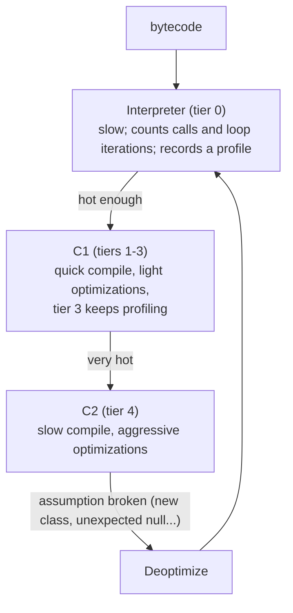
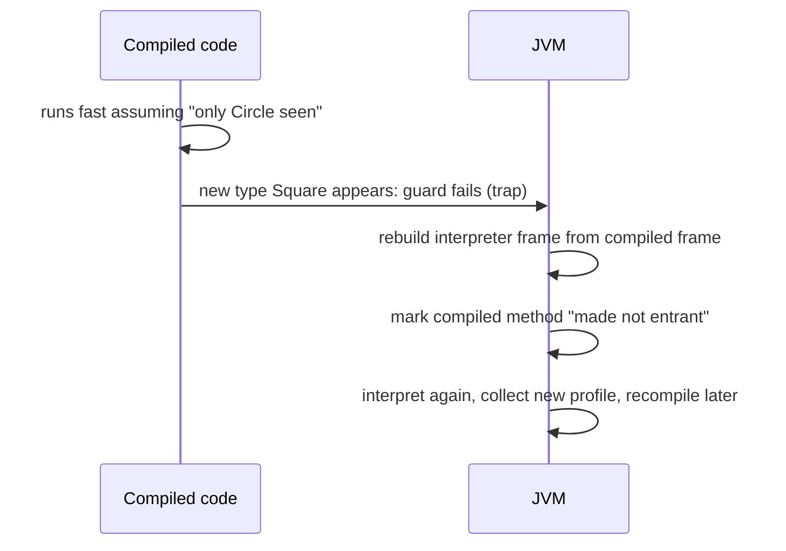

# Chapter 7 — The JIT Compiler

## Words you'll meet
| Word | Plain meaning |
|---|---|
| **JIT** | Just-In-Time compiler: compiles bytecode → machine code *while the program runs*. |
| **C1** | Fast, lightweight JIT (quick compile, modest speed-up). |
| **C2** | Slow, heavy JIT (long compile, big speed-up). |
| **Tiered compilation** | Interpreter → C1 → C2, moving up as code gets hotter. |
| **Hot** | Executed many times. |
| **Profile** | Facts collected while running: which branch is taken, which class is seen. |
| **Inlining** | Copy the callee's body into the caller. |
| **Deoptimization (deopt)** | Throw away compiled code (a guess was wrong), go back to the interpreter. |
| **OSR** | On-Stack Replacement: switch a running loop from interpreted to compiled code mid-loop. |
| **Code cache** | Memory region holding JIT output. |
| **Warm-up** | Time until hot code is compiled and the app reaches full speed. |

---

## 7.1 Why not just compile everything like `gcc`?
1. **Startup:** compiling the whole app first would delay start (and most code runs once).
2. **Information:** `gcc` guesses; the JVM can *watch the program run* and optimize for what actually happens.


Rough triggers: tier-3 after ~200 calls or ~2000 loop iterations; tier-4 after several thousand more. Compilation runs on **background compiler threads** (you'll see `C1 CompilerThre`, `C2 CompilerThre` in thread dumps; they use CPU in the first minutes).

## 7.2 What does "compile at runtime" mean physically?
The JIT writes machine code bytes into memory and then **jumps to them**. You can do that in C!

🔬 **Try it (x86-64 Linux):**
```c
// jit.c   gcc jit.c -o jit && ./jit     prints 42
#include <stdio.h>
#include <string.h>
#include <sys/mman.h>
int main() {
  unsigned char code[] = { 0xB8, 42,0,0,0,   // mov eax, 42
                           0xC3 };           // ret
  void* mem = mmap(NULL, 4096, PROT_READ|PROT_WRITE|PROT_EXEC,
                   MAP_PRIVATE|MAP_ANONYMOUS, -1, 0);   // memory that is allowed to EXECUTE
  memcpy(mem, code, sizeof code);
  int (*f)() = (int(*)())mem;                           // treat bytes as a function
  printf("%d\n", f());
}
```
That's the **Code cache**: an `mmap`'d executable region where the JVM drops generated functions, then redirects calls to them. 🧩 Same trick as LuaJIT, V8, game scripting engines.

## 7.3 What the optimizing compiler (C2) actually does

### (a) Inlining: the mother of all optimizations
```java
int sq(int x) { return x*x; }
int f(int a) { return sq(a) + sq(a+1); }
```
After inlining, `f` becomes `a*a + (a+1)*(a+1)` — no calls, and now other optimizations can see across the boundary. Limits: small methods (`MaxInlineSize` 35 bytecodes) or hot ones (`FreqInlineSize` 325).
🧩 C++ analog: `inline`/LTO. Difference: Java methods are **virtual by default**, so the JIT must prove (or guess) the target.

### (b) Devirtualization (guess + guard)
`shape.area()` — profile shows only `Circle` ever appears → compile:
```
if (shape.klass == Circle) { inline Circle.area }
else { deoptimize }          // guard failed: guess was wrong
```
Virtual calls become direct inlined code. C++ can't do this without PGO.

### (c) Escape analysis → scalar replacement (Ch 4)
`new Point(x,y)` that never escapes disappears (fields become registers). Also removes locks on non-escaping objects (**lock elision**).

### (d) Loop optimizations
Unrolling, hoisting invariants, **range-check elimination** (proves array index in bounds → removes check), auto-vectorization (SIMD).

### (e) Intrinsics
`System.arraycopy`, `Math.sqrt`, `String.indexOf`, CRC32, AES: replaced by hand-written assembly.

### (f) Dead-branch removal
A branch never taken in the profile becomes an *uncommon trap*: "if you ever get here, deopt."

## 7.4 Deoptimization: the safety net that enables guessing


Normal and healthy. **Deopt storms** (many in a row, e.g. traffic shape changes) cause CPU spikes/latency.

## 7.5 JIT (Java) vs `gcc` (C++)

| | gcc/clang AOT | HotSpot JIT |
|---|---|---|
| Knows | source code only (PGO optional) | real runtime behavior |
| Can speculate? | no (can't undo) | yes (deopt makes it safe) |
| Sees whole program? | with LTO | sees all loaded classes at runtime |
| CPU features | chosen at build (`-march`) | actual CPU at runtime (AVX etc.) |
| Startup | instant, full speed | slow, warm-up |
| Extra cost | none | CPU + memory (compiler threads, code cache) |
| Reproducible performance | yes | varies run to run |

Rule of thumb: for long-running servers, JIT ≈ or > `gcc -O2`; for short CLIs, AOT wins.

## 7.6 Warm-up problems and fixes

| Problem | Why | Fix |
|---|---|---|
| Slow first minutes after deploy | cold interpreter | warm-up requests before marking pod ready |
| CPU spike after start | C1/C2 compiling | give CPU headroom; stagger rollouts |
| Latency spike after traffic change | deopt/recompile | keep traffic shape steady; check `-Xlog:deoptimization` |
| Startup-critical (serverless) | everything cold | AppCDS, CRaC (checkpoint), GraalVM native-image |

| Flag | Effect | Pro | Con |
|---|---|---|---|
| `-XX:TieredStopAtLevel=1` | C1 only | fast start, low CPU/RAM | 30–50% lower peak speed |
| `-XX:-TieredCompilation` | C2 only | less profiling overhead | long warm-up |
| `-XX:CICompilerCount=n` | #compiler threads | bound CPU burst | too low = slow warm-up |
| `-XX:ReservedCodeCacheSize=256m` | code cache size | avoids "code cache full" | more memory |

⚠️ **Trap:** if the code cache fills, JVM prints `CodeCache is full. Compiler has been disabled` and speed falls off a cliff.

## 7.7 See it yourself
```bash
java -XX:+PrintCompilation Hello           # lines: time id flags tier method size
#   '%' = OSR compile, 'made not entrant' = deopt, 'n' = native wrapper
java -XX:+UnlockDiagnosticVMOptions -XX:+PrintInlining -XX:+PrintCompilation Hello
jcmd <pid> Compiler.codecache              # how full?
jcmd <pid> Compiler.queue                  # what's waiting to compile?
```
JITWatch (GUI) reads `-XX:+LogCompilation` output and shows inlining decisions.

## 7.8 Benchmarks lie unless you respect the JIT
- A loop with an unused result gets **deleted** (dead-code elimination).
- Constants are folded at compile time.
- Measuring before warm-up measures the interpreter.
→ Use **JMH** (Ch 13), never hand-rolled `nanoTime` loops.

## 7.9 Exercises
- [ ] Run the C `jit.c` above. Change 42 to another number.
- [ ] `-XX:+PrintCompilation` on a tiny hot loop; find tier transitions 3→4 and a `made not entrant`.
- [ ] Run the same loop with `-Xint`, then default, then `-XX:TieredStopAtLevel=1`; compare time.

<details><summary>Q1. Why can the JIT make a virtual call as fast as a direct call?</summary>
It speculates from the profile (e.g., only one receiver class seen), inlines that target behind a cheap guard, and deoptimizes if the guess fails.
</details>

<details><summary>Q2. CPU 3× higher for 5 minutes after a deploy, then normal. Bug?</summary>
Probably not: C1/C2 compiler threads are busy and code still runs interpreted. Mitigate with CPU headroom, warm-up, staggered rollout.
</details>

<details><summary>Q3. Why does Java sometimes allocate zero bytes for `new`?</summary>
Escape analysis found the object never escapes → scalar replacement: fields live in registers, no heap object.
</details>

Prev: [06](06-class-loading-and-metaspace.md) · Next: [Chapter 8 — Threads and the Memory Model](08-threads-and-memory-model.md)
