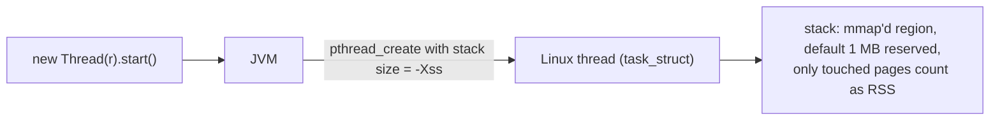
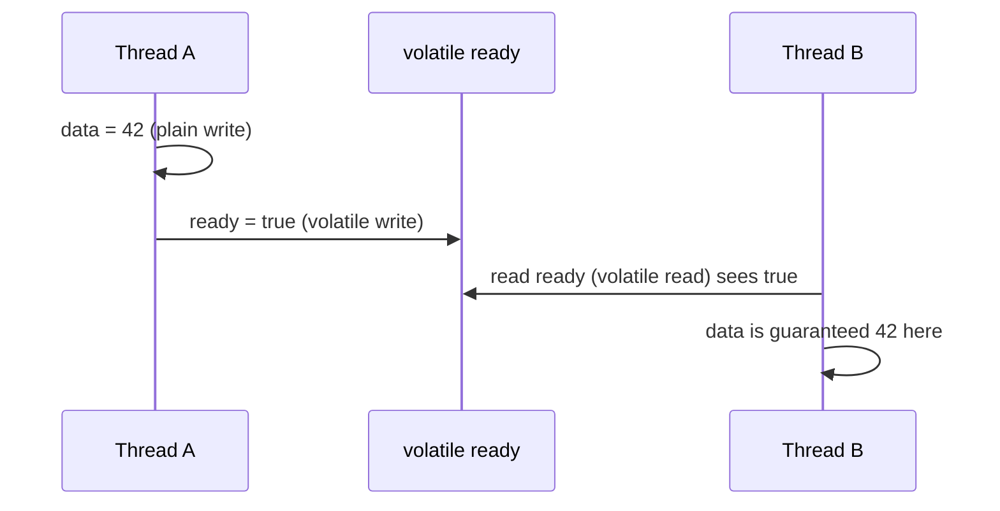
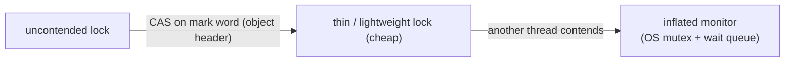
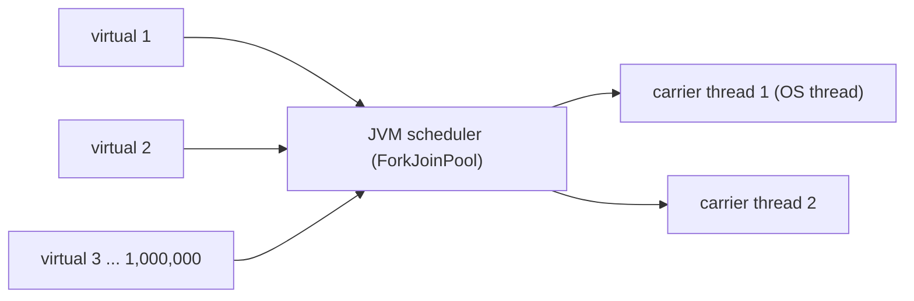
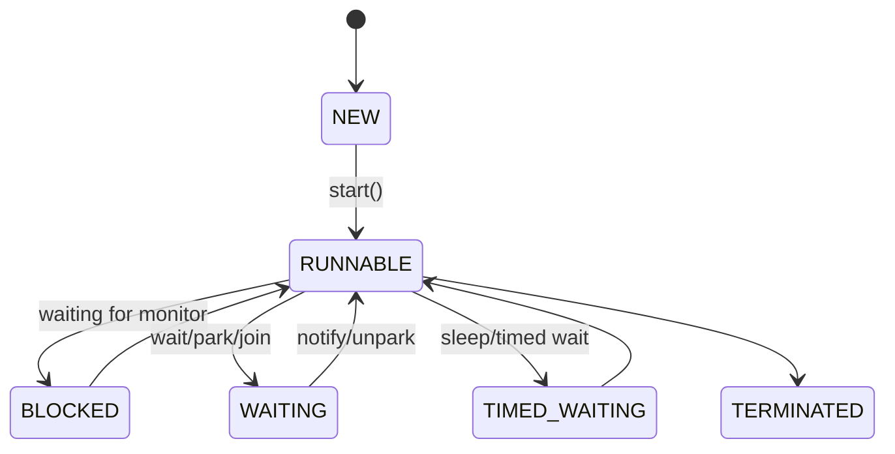

# Chapter 8 — Threads and the Java Memory Model

## Words you'll meet
| Word | Plain meaning |
|---|---|
| **Platform thread** | A normal Java `Thread` = one OS thread (`pthread`). |
| **Virtual thread** | (JDK 21) Cheap thread managed by the JVM, many per OS thread. |
| **Carrier thread** | The real OS thread a virtual thread runs on. |
| **Monitor** | The lock behind `synchronized` (every object has one). |
| **Volatile** | Field whose reads/writes are visible to all threads in order. |
| **Happens-before** | Rule that guarantees one thread sees another's earlier writes. |
| **JMM** | Java Memory Model: the rulebook for visibility and ordering. |
| **CAS** | Compare-And-Swap: atomic CPU instruction behind lock-free code. |
| **Thread dump** | Snapshot of every thread's stack (like `gdb` + `thread apply all bt`). |
| **Pinning** | A virtual thread stuck to its carrier (can't unmount). |

---

## 8.1 Java threads are pthreads


🧩 Identical to `std::thread`/`pthread_create`. The JVM also creates **its own threads** inside your process:

| Thread name (in dump) | What it is |
|---|---|
| `main` | runs `main()` |
| `VM Thread` | executes safepoint operations (GC pauses, deopt...) |
| `GC Thread#n`, `G1 Conc#n` | parallel/concurrent GC workers |
| `C1 CompilerThread`, `C2 CompilerThread` | JIT compilers (Ch 7) |
| `Signal Dispatcher` | handles `kill -3` |
| `Finalizer`, `Reference Handler` | cleanup of finalizable / weak refs |
| `Service Thread`, `Monitor Deflation Thread` | housekeeping |
| `pool-3-thread-1`, `http-nio-8080-exec-5`, `reactor-http-epoll-2` | **your** app's threads |

So "my app has 40 threads" often means 100+ in `ps -L`. Each costs stack + kernel memory.

## 8.2 The problem: CPUs and compilers reorder things

C++ taught you: without atomics/mutex, a data race is *undefined behavior*. Java defines it more gently, but the problem is the same: each core has caches/store buffers and compilers reorder instructions.

```java
// BROKEN: thread B may never see stop = true
boolean stop = false;
void worker() { while (!stop) { /* work */ } }
void halt()   { stop = true; }
```
Why? The JIT may hoist `stop` out of the loop (read it once). With **`volatile boolean stop`** the JVM must re-read it every time and ordering is guaranteed.

🧩 **C++ equivalents**

| Java | C++ |
|---|---|
| `volatile int x` | `std::atomic<int> x` (default `seq_cst`) |
| `AtomicInteger.incrementAndGet()` | `x.fetch_add(1)` |
| `synchronized(obj){...}` | `std::lock_guard<std::mutex>` |
| `ReentrantLock` | `std::recursive_mutex` / `unique_lock` |
| `Object.wait/notify` | `condition_variable` |
| `compareAndSet` | `compare_exchange_strong` |
| `VarHandle` acquire/release | `memory_order_acquire/release` |
| data race | UB in C++; in Java "defined" but results can be stale/surprising |

## 8.3 Happens-before in 6 rules
If A *happens-before* B, B sees everything A wrote.

| Rule | Example |
|---|---|
| Program order | within one thread, earlier statements before later ones |
| Monitor | `unlock(m)` → later `lock(m)` of same `m` |
| Volatile | write to `v` → later read of `v` |
| Thread start | `t.start()` → everything in `t` |
| Thread join | everything in `t` → after `t.join()` returns |
| Final fields | writes in constructor → visible after publication (if `this` doesn't escape) |


⚠️ **Trap 1:** `volatile int count; count++` is **not atomic** (read-modify-write). Use `AtomicLong`/`LongAdder`.
⚠️ **Trap 2:** Double-checked locking needs `volatile`.

## 8.4 How `synchronized` is built


- Every object header has lock bits (Ch 4) → any object can be a lock; no extra struct until contention.
- Contention = threads in **BLOCKED** state in thread dumps; `jdk.JavaMonitorEnter` events in JFR.

## 8.5 Virtual threads (JDK 21): why they matter

| | Platform thread | Virtual thread |
|---|---|---|
| Created by | OS (via JVM) | JVM only |
| Stack | MBs reserved, kernel structure | grows on the **heap** as small chunks |
| Blocking I/O | blocks the OS thread | **unmounts**; carrier runs another virtual thread |
| Count | thousands | millions |
| Pool them? | yes | **no** (create one per task) |


🧩 Like goroutines or user-space fibers: blocking-style code with epoll-style scalability.
⚠️ **Pinning:** `synchronized` around blocking calls pins the carrier (until JDK 24); native frames pin too. ⚠️ Unbounded virtual threads can overwhelm DB/HTTP downstreams: limit with a semaphore.

## 8.6 Thread states (read them in dumps)

⚠️ A thread idle in `epoll_wait` (Netty event loop) shows as **RUNNABLE**. RUNNABLE ≠ burning CPU.

🔬 **Thread dump = `gdb thread apply all bt` for Java:**
```bash
jcmd <pid> Thread.print -l > t1.txt
sleep 10; jcmd <pid> Thread.print -l > t2.txt
grep '^"' t1.txt | sed 's/[-#][0-9]*//g' | sort | uniq -c | sort -rn | head   # group by pool name
```
Growing counts of one pool name = thread leak (executor/client created per request).

## 8.7 Thread-pool rules (prevent most production fires)
- Bounded pool + bounded queue + rejection policy.
- Never `newCachedThreadPool()` on external load (unbounded threads).
- One shared `HttpClient`/`WebClient`/`ExecutorService` per purpose; close in `@PreDestroy`.
- `ThreadLocal` in pools: always `remove()` in `finally`.
- Size: CPU-bound ≈ cores; I/O-bound ≈ cores × (1 + wait/compute).

## 8.8 Memory cost of threads
`~1 MB virtual stack` each, but only touched pages are RSS (often 100–300 KB), plus kernel structures. 2000 threads ≈ hundreds of MB. Flag `-Xss512k` reduces reserve; too small → `StackOverflowError` in deep recursion.

## 8.9 Exercises
- [ ] Reproduce the `stop` flag bug: with and without `volatile`; run with `-Xint` and default.
- [ ] 1000 `synchronized` increments from 8 threads vs `AtomicLong` vs `LongAdder`; time them with JMH.
- [ ] Take two thread dumps of any service; list pools and counts.

<details><summary>Q1. `volatile` vs `synchronized`?</summary>
`volatile`: visibility + ordering for one variable, no atomic compound ops. `synchronized`: mutual exclusion + visibility for a whole block.
</details>

<details><summary>Q2. Why is `RUNNABLE` misleading?</summary>
It includes threads inside native blocking calls such as `epoll_wait`/socket read, which use no CPU.
</details>

<details><summary>Q3. What's the main memory benefit of virtual threads?</summary>
No big OS stack per task; stacks are small heap objects, so you can have far more concurrent tasks per GB.
</details>

Prev: [07](07-jit-compiler.md) · Next: [Chapter 9 — Native and Off-Heap Memory](09-native-and-offheap-memory.md)
