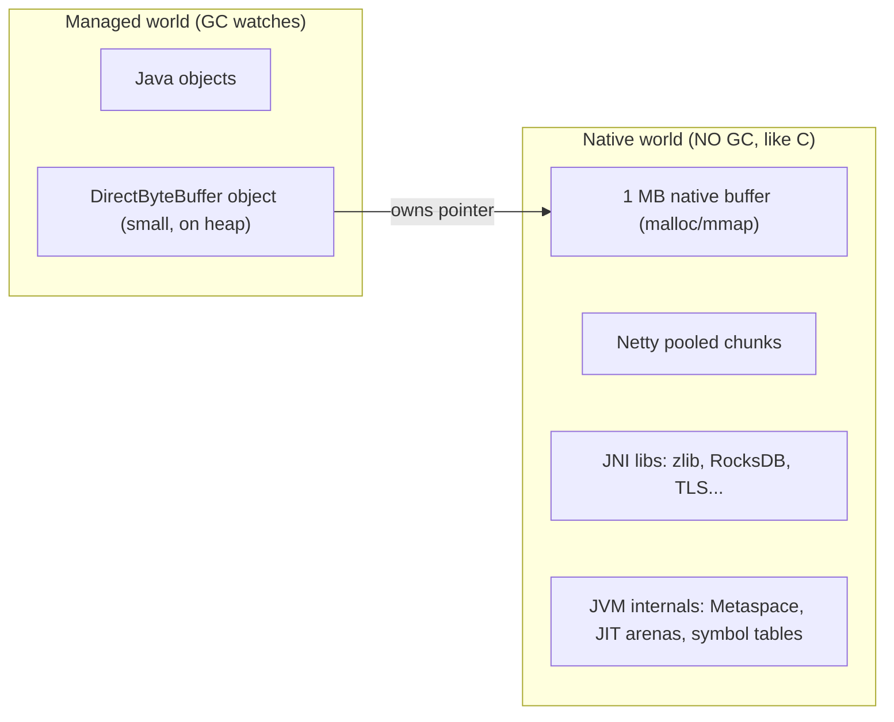
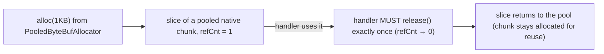
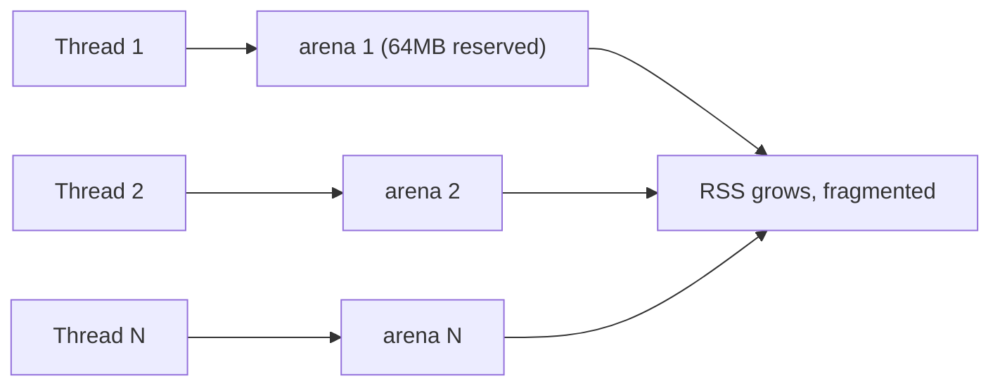
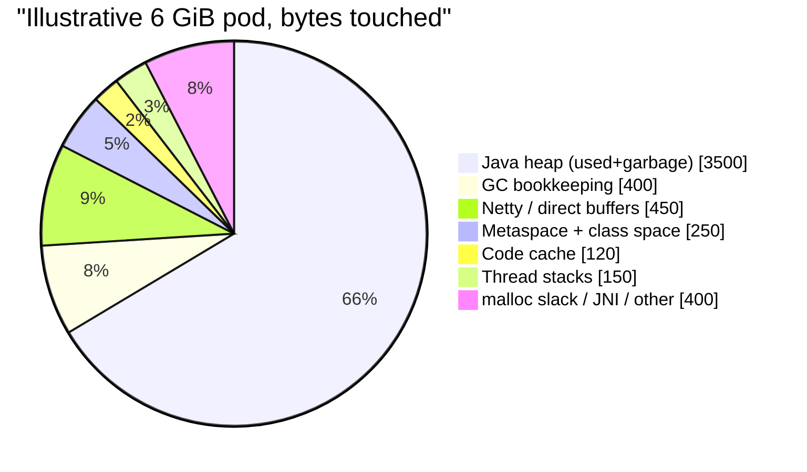

# Chapter 9 — Native and Off-Heap Memory (the memory GC can't see)

## Words you'll meet
| Word | Plain meaning |
|---|---|
| **Off-heap / native memory** | Memory outside the Java heap: plain `malloc`/`mmap` memory. The GC does not scan or free it. |
| **Direct buffer** | `ByteBuffer.allocateDirect`: a Java object that *owns* a chunk of native memory. |
| **Cleaner** | Java mechanism that frees native memory after the owning object is GC'd. |
| **Netty** | Popular async network library; allocates its own pooled native buffers. |
| **ByteBuf** | Netty's buffer type; manually **reference counted**. |
| **Reference counting** | Count of owners; memory freed when it hits 0 (like `shared_ptr`, but you call `release()` yourself). |
| **Arena** | A big chunk an allocator carves small pieces from. |
| **glibc malloc arenas** | Per-thread areas the C allocator uses; can bloat RSS. |
| **NMT** | Native Memory Tracking: JVM's own accounting of its native allocations. |
| **JNI** | Java Native Interface: calling C/C++ from Java. |
| **FFM API** | Foreign Function & Memory API (JDK 22): the modern safe replacement for JNI/Unsafe. |

---

## 9.1 The mental model: Java side = managed, native side = your good old C world


Everything in the right box behaves exactly like C/C++ memory: **if you leak it, nothing rescues you.** Heap dumps don't show it.

🧩 **C++ analogy:** `DirectByteBuffer` ≈ `std::unique_ptr<char[]>` held by a small Java wrapper; when the wrapper dies, a "cleaner" calls `free()`.

## 9.2 Direct ByteBuffers

```java
ByteBuffer b = ByteBuffer.allocateDirect(1 << 20);   // 1 MB of native memory
```
- Why exist? Network/file I/O needs a stable address (GC moves heap objects). With a heap buffer the JVM must copy into a temp native buffer first; direct buffers skip the copy (zero-copy I/O).
- Limit: `-XX:MaxDirectMemorySize` (default ≈ `-Xmx`). Exceed → `OutOfMemoryError: Direct buffer memory`.
- Freed only when the tiny wrapper object is **garbage collected** (Cleaner). If heap churn is low, wrappers live long → native memory lingers.
- ⚠️ **Trap:** `-XX:+DisableExplicitGC` removes JVM's last-resort `System.gc()` retry that reclaims direct memory. Avoid it when using NIO.

## 9.3 Netty: manual memory in a managed language

Netty allocates big **chunks** (4–16 MB) of native memory in **pooled arenas** (like jemalloc) and hands out slices as `ByteBuf`s.


Rules (like `shared_ptr` but manual):
```java
@Override public void channelRead(ChannelHandlerContext ctx, Object msg) {
  try { process((ByteBuf) msg); }
  finally { ReferenceCountUtil.release(msg); }   // you own it: release it
}
// If you pass it on (ctx.fireChannelRead(msg)) you transfer ownership: do NOT release.
// SimpleChannelInboundHandler releases automatically.
```
- **Leak** = path where nobody releases (exception path, ignored response body, stored slice). The pool then grows. Heap dump shows only tiny wrapper objects.
- **Leak detector** `-Dio.netty.leakDetection.level=`: `DISABLED | SIMPLE (default, samples ~1%) | ADVANCED | PARANOID (every buffer, canary only)`. It prints `LEAK: ByteBuf.release() was not called...` + where it was allocated.
- Useful switches: `-Dio.netty.maxDirectMemory`, `-Dio.netty.noPreferDirect=true` (use heap buffers: GC-visible, no off-heap surprise).
- Where you meet Netty: Spring WebFlux/Reactor Netty, gRPC-Java, Vert.x, Cassandra/Elasticsearch clients, AWS async SDK.
- Typical leak in WebFlux: response body never consumed (`retrieve()` without subscribing/consuming); `exchange()` without releasing.

🧩 **C++ view:** an intrusive ref-counted pointer where you must call `release()` yourself, with LSan-style detector sampling.

## 9.4 glibc malloc arenas (the sneaky one)

The C allocator under the JVM (and JNI libs) gives each thread its own **arena** (up to 8 × cores, each reserving 64 MB of virtual space). Freed memory in one arena can't be reused by another thread → **fragmentation** → RSS grows although "nothing leaks".


Fixes: `MALLOC_ARENA_MAX=2` (env var), or switch allocator with `LD_PRELOAD=libjemalloc.so`. 🧩 You already know this from C++ servers: `jemalloc`/`tcmalloc` exist for the same reason.

🔬 Detect: `pmap -x <pid>` showing many ~64 MB mappings (`[anon]`) with high RSS.

## 9.5 Other native consumers

| Source | Notes |
|---|---|
| JNI libs: zlib (`Inflater/Deflater/GZIP*`), Snappy, zstd, RocksDB, native TLS (tcnative/BoringSSL), image libs | allocate with `malloc`; always `close()`/`end()` |
| Memory-mapped files (`FileChannel.map`) | pages are page cache; unmapped only when GC'd (before FFM) |
| Thread stacks | Ch 8 |
| Code cache, Metaspace, GC data structures | JVM internal; visible in NMT |
| `Unsafe.allocateMemory` / FFM `Arena` | raw malloc; you free |

⚠️ **Trap:** `GZIPOutputStream` not closed leaks native zlib memory *outside* the heap.

## 9.6 NMT: the JVM's own native "ledger"

```bash
# start JVM with:
-XX:NativeMemoryTracking=summary         # ~5-10% overhead; use detail only for debugging
jcmd <pid> VM.native_memory summary
jcmd <pid> VM.native_memory baseline
# hours later:
jcmd <pid> VM.native_memory summary.diff
```
Sections: Java Heap · Class (Metaspace) · Thread · Code · GC · Compiler · Internal · Symbol · Arena Chunk · Other (direct buffers) · Shared class space.

Reading it:
- If NMT total **≈ RSS** → leak is inside the JVM's own accounting; see which section grows.
- If NMT total **≪ RSS** → memory is **outside JVM accounting**: JNI libs, glibc fragmentation, Netty pools (counted under direct only via the NIO path; Netty may use `Unsafe`), mapped files. Use `pmap`, Netty metrics, `MALLOC_ARENA_MAX`.

## 9.7 Visual summary: where the RSS of a typical pod goes


Only the first slice is visible to heap dumps and `-Xmx`.

## 9.8 Exercises
- [ ] Run Lab 3 from Ch 15 (direct memory OOM) and watch heap stay tiny.
- [ ] Start a service with NMT and `MALLOC_ARENA_MAX` unset vs `=2`; compare RSS after one hour of load.
- [ ] Enable Netty `PARANOID` on a canary under traffic replay; grep `LEAK`.
- [ ] Plot `jvm_buffer_memory_used_bytes{id="direct"}` against pod RSS.

<details><summary>Q1. Heap dump is 300 MB but process RSS is 5 GB. Where's the rest?</summary>
Off-heap: Metaspace, code cache, threads, direct/Netty buffers, GC structures, malloc arenas, JNI libs. Use NMT + pmap + Netty metrics.
</details>

<details><summary>Q2. Why do direct buffers sometimes hang around after you drop references?</summary>
They're freed by a Cleaner that runs only after the small wrapper object is garbage collected; with little heap churn that GC may be far away.
</details>

<details><summary>Q3. What is the C++ equivalent of forgetting `release()` on a ByteBuf?</summary>
Forgetting `free()` on a pooled allocation: the pool can never reuse the slice, so it keeps allocating new chunks.
</details>

Prev: [08](08-threads-and-memory-model.md) · Next: [Chapter 10 — Memory Accounting and Containers](10-memory-accounting-and-containers.md)
