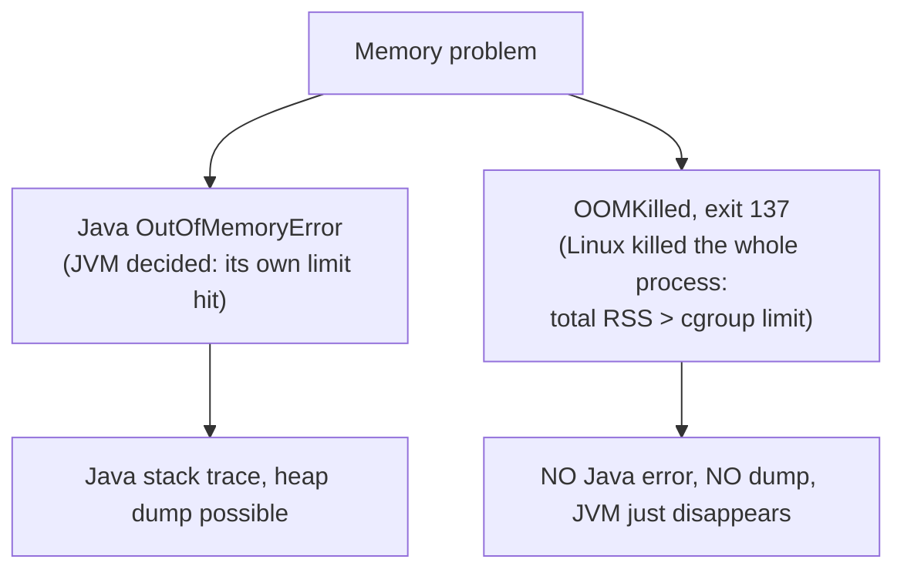
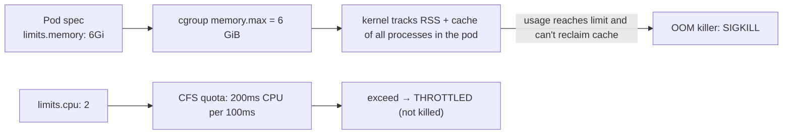

# Chapter 10 — Memory Accounting and Containers (why pods get OOMKilled)

## Words you'll meet
| Word | Plain meaning |
|---|---|
| **cgroup** | Linux group of processes with resource limits. Docker/Kubernetes pods = cgroups. |
| **memory.max / limit** | Max memory the cgroup may use. |
| **OOM killer** | Kernel component that kills a process when memory can't be found. |
| **OOMKilled / exit 137** | Container killed with SIGKILL (128+9) by the OOM killer. |
| **Working set** | `usage − inactive page cache`. The number Kubernetes uses for eviction decisions; closest to "OOM danger". |
| **Page cache** | RAM used to cache file contents. Reclaimable, but counted until reclaimed. |
| **Request / limit** | K8s: request = scheduling guarantee; limit = hard ceiling. |
| **CPU throttling** | CPU limit enforced by pausing your threads for part of each 100 ms period. |
| **Headroom** | Spare memory between normal use and the limit. |

---

## 10.1 Two different kinds of "out of memory"


Both happen in the same pod for different reasons. **Heap looking fine + pod OOMKilled** is the classic confusion: the heap is only one slice of RSS.

## 10.2 The formula you must memorize

```
Container usage (RSS) ≈ Java heap touched
                      + GC bookkeeping
                      + Metaspace + compressed class space
                      + Code cache
                      + Thread stacks (touched)
                      + Direct / Netty buffers
                      + malloc arenas, JNI libs, JVM internals
                      + (page cache, counted but reclaimable)
```
`-Xmx` bounds only the first line.

## 10.3 How Kubernetes limits translate to the kernel


- Memory is **incompressible**: over limit = kill. CPU is **compressible**: over limit = slow.
- Set `requests.memory == limits.memory` for stability.
- Check inside the container (cgroup v2):
```bash
cat /sys/fs/cgroup/memory.max            # limit
cat /sys/fs/cgroup/memory.current        # usage
grep -E "^(anon|file|kernel|slab|sock) " /sys/fs/cgroup/memory.stat
cat /sys/fs/cgroup/memory.events         # oom_kill counter
```
`anon` ≈ heap + native; `file` ≈ page cache.

## 10.4 How the JVM reads the container

Modern JVMs (container support on by default since JDK 10 / 8u191) read the cgroup file to set defaults:

| JVM decision | Based on |
|---|---|
| Default max heap | **25% of memory limit** (`MaxRAMPercentage=25`) |
| `availableProcessors()` | CPU quota (rounded up) |
| GC selection | `<2 CPUs` or `<~1.8 GB` → **Serial** (not G1!) |
| GC/compiler thread counts | from CPU count |

⚠️ **Traps**
1. Default 25% on a 6 GiB pod → heap only 1.5 GiB (surprise: *under*-using memory).
2. Setting `-Xmx` ≈ pod limit (e.g., 5.5 GiB of 6 GiB) → near-guaranteed OOMKill.
3. CPU limit of 1 → JVM chooses Serial GC and 1 GC thread.

## 10.5 Heap percentage guide

| App style | `MaxRAMPercentage` |
|---|---|
| Netty / gRPC / many threads / JNI / big Metaspace | 50–65 |
| Plain Spring MVC, modest off-heap | 65–75 |
| Batch, simple, tiny native use | up to 75–80 |
Never above ~80%; leave room for everything in 10.2.

## 10.6 Budget worksheet (fill this for your pod)

```
Pod limit L                                 = ______ MiB
Heap (Xmx)           55-65% of L            = ______
Metaspace (measured + 30%)                  = ______
Code cache                                  = ______
Threads: N × ~0.5-1 MB                      = ______
Direct / Netty (peak measured × 1.3)        = ______
GC overhead (G1: 10-15% of heap)            = ______
Native / malloc / JNI slack (10-15% of L)   = ______
Safety buffer (≥ 10% of L)                  = ______
-------------------------------------------------------
SUM must be ≤ L
```
Example, 6 GiB pod: heap 3.6 · GC 0.4 · Metaspace 0.25 · code 0.15 · threads 0.15 · direct 0.45 · slack 0.6 = 5.6 → thin. Lower heap to 3.3 or raise the limit.

## 10.7 Page cache vs anon (why `kubectl top` can look scary)

| Metric (cAdvisor/Prometheus) | Meaning |
|---|---|
| `container_memory_rss` | anonymous memory (heap + native) |
| `container_memory_cache` | file page cache |
| `container_memory_working_set_bytes` | what kubelet evicts on; **alert on this** |
| `container_memory_usage_bytes` | includes cache |

Heavy log writing/mmap'd jars inflate `cache` but the kernel drops it before killing. Real danger = **anon + kernel** approaching the limit.

## 10.8 Safe production defaults

```
-XX:MaxRAMPercentage=60 -XX:InitialRAMPercentage=60     # ≈ Xms = Xmx
-XX:MaxMetaspaceSize=384m  -XX:ReservedCodeCacheSize=192m
-XX:MaxDirectMemorySize=512m  -Xss512k
-XX:+ExitOnOutOfMemoryError  -XX:+HeapDumpOnOutOfMemoryError -XX:HeapDumpPath=/dumps
env MALLOC_ARENA_MAX=2
```
Why `ExitOnOutOfMemoryError`: a JVM after OOM can limp (half-broken). Let Kubernetes restart it cleanly.
Why a dump path: pod filesystem vanishes on kill; mount an `emptyDir`/PVC and ship dumps off the pod.

## 10.9 Alerts worth having
| Alert | Condition |
|---|---|
| Near OOM | `working_set / limit > 0.85` for 15 min **and** positive slope |
| Leak suspicion | `jvm_gc_live_data_size_bytes` (after-GC floor) rising 6 h |
| Thread leak | `jvm_threads_live_threads` rising |
| CPU throttling | `container_cpu_cfs_throttled_seconds_total` rate > 0 sustained |
| Restart loop | `kube_pod_container_status_last_terminated_reason{reason="OOMKilled"}` |

## 10.10 C++ vs JVM in a pod
- C++: RSS ≈ working data + allocator slack. Plateaus predictably.
- JVM: RSS ≈ 1.5–3× live data, because it needs GC headroom, class metadata, JIT, and thread/native overhead.
That overhead is the price of safety and portability; tune it, don't pretend it isn't there.

## 10.11 Exercises
- [ ] Fill the worksheet for your real service; compare with NMT total and `pmap`.
- [ ] Run `docker run -m 512m eclipse-temurin:21 java -XX:+PrintFlagsFinal -version | grep -E "MaxHeapSize|UseSerialGC|UseG1GC"`.
- [ ] Cause an OOMKill on purpose (Lab 7) and find the evidence in `docker inspect` / `memory.events`.

<details><summary>Q1. Pod limit 6 GiB, `-Xmx5g`, heap used 2.5 GiB, OOMKilled. Why?</summary>
Only ~1 GiB left for Metaspace, code cache, threads, direct buffers, GC structures, malloc. Bursts of native allocation exceed the limit. Lower heap %, cap direct/metaspace.
</details>

<details><summary>Q2. Why doesn't a Java OOM dump exist after OOMKilled?</summary>
The kernel sent SIGKILL: the JVM never got to run its OOM handler. Only `-XX:+HeapDumpOnOutOfMemoryError` for *Java* OOMs, or dumps you took earlier.
</details>

<details><summary>Q3. Which number should my alert watch?</summary>
`container_memory_working_set_bytes` against the limit (plus its slope), not virtual size and not `-Xmx`.
</details>

Prev: [09](09-native-and-offheap-memory.md) · Next: [Chapter 11 — Tuning Flags](11-tuning-flags.md)
