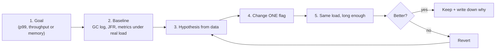

# Chapter 11 — Tuning Flags (every important one, explained in C/C++ terms)

## Words you'll meet
| Word | Plain meaning |
|---|---|
| **JVM flag** | Command-line switch for the JVM: `-Xmx4g`, `-XX:+UseG1GC`. |
| **`-X` / `-XX`** | `-X` = common options. `-XX` = advanced/tuning options. |
| **`+` / `-` prefix** | `-XX:+Flag` turns on, `-XX:-Flag` turns off. |
| **Throughput** | Work done per second. |
| **Latency** | Time one request takes (p99 = slowest 1% boundary). |
| **Footprint** | Memory used. |
| **Pause goal** | Target maximum GC stop time (a hint, not a promise). |
| **Baseline** | Measurements before you change anything. |

---

## 11.1 The golden method


🧩 **Same as C++ perf work:** profile first; `-O3` doesn't fix an O(n²) algorithm. In Java, **fix allocation hot-spots and leaks in code before touching flags.**

See all flags and current values: `java -XX:+PrintFlagsFinal -version`.

## 11.2 Heap flags

| Flag | In plain words | C/C++ analogy | Pro | Con |
|---|---|---|---|---|
| `-Xmx4g` | max Java heap = size of the reserved range (Ch 2) | size passed to the initial `mmap` of your arena | caps heap | too high → pod OOMKill; too low → GC thrash |
| `-Xms4g` | initial committed heap | pre-commit memory | no resize pauses; predictable | RSS rises sooner |
| `-XX:MaxRAMPercentage=60` | `-Xmx` as % of container limit | `limit * 0.6` | scales with pod size | must still leave off-heap room |
| `-XX:InitialRAMPercentage=60` | `-Xms` as % | | | |
| `-XX:+AlwaysPreTouch` | touch every heap page at start | `memset` the arena at startup | no page-fault latency later; RSS flat from t=0 | slow start, memory used immediately |
| `-XX:+UseCompressedOops` | 4-byte references (default for heaps < 32 GB) | 32-bit "pointers" scaled ×8 | ~10–20% less memory | n/a |
| `-XX:ActiveProcessorCount=n` | pretend CPU count | override `nproc` | fixes bad detection | manual |
| `-XX:+UseTransparentHugePages` | 2 MB pages | `madvise(MADV_HUGEPAGE)` | fewer TLB misses | RSS bloat, latency jitter |

Why `-Xms = -Xmx` in production: no resize pauses, and memory behavior is stable, so a creeping RSS isn't confused with normal warm-up growth.

## 11.3 Generation sizing (usually leave alone with G1)

| Flag | Meaning | Note |
|---|---|---|
| `-XX:NewRatio=2` | Old:Young = 2:1 (Parallel/Serial) | |
| `-Xmn` / `-XX:NewSize` | fix Young size | **Don't with G1**: disables adaptive sizing |
| `-XX:SurvivorRatio=8` | Eden:Survivor = 8:1 | |
| `-XX:MaxTenuringThreshold=15` | max survived GCs before promotion | lower → promote earlier |
| `-XX:G1NewSizePercent`, `G1MaxNewSizePercent` | G1 Young bounds (5–60%) | |

Trade-off: bigger Young = fewer GCs and fewer premature promotions, but each young GC may copy more.

## 11.4 Choosing the collector

| Flag | When |
|---|---|
| `-XX:+UseSerialGC` | < 1 vCPU or tiny heaps, CLIs |
| `-XX:+UseParallelGC` | batch, throughput matters, pauses OK |
| `-XX:+UseG1GC` | default for servers, balanced |
| `-XX:+UseZGC` (+ `-XX:+ZGenerational` in JDK 21) | p99 < ~10 ms, big heaps, spare CPU/RAM |
| `-XX:+UseShenandoahGC` | low pause, not in every vendor build |

## 11.5 G1 flags

| Flag | Default | Plain meaning | Pro | Con |
|---|---|---|---|---|
| `-XX:MaxGCPauseMillis=100` | 200 | pause target; G1 sizes Young to hit it | lower pauses | more frequent GCs, less throughput; unrealistic values (e.g. 10) just fail |
| `-XX:InitiatingHeapOccupancyPercent` | 45 (adaptive) | heap % at which concurrent marking starts | start earlier to avoid Full GC | more background CPU |
| `-XX:G1HeapRegionSize=16m` | auto 1–32 MB | region size | big regions help humongous objects | waste on small heaps |
| `-XX:G1ReservePercent=10` | 10 | free space kept for evacuation | avoids "to-space exhausted" | less usable heap |
| `-XX:ParallelGCThreads` | ~cores | STW worker threads | | too many → contention in small pods |
| `-XX:ConcGCThreads` | ~¼ parallel | concurrent worker threads | | steal CPU from app |
| `-XX:G1PeriodicGCInterval=ms` | off | periodic GC to return memory when idle | lets RSS shrink | extra CPU |

## 11.6 ZGC / Shenandoah

| Flag | Meaning |
|---|---|
| `-XX:SoftMaxHeapSize` (ZGC) | soft target below `-Xmx`; ZGC tries to stay under it |
| `-XX:ZUncommitDelay` | seconds before returning free memory to OS |
| `-XX:ConcGCThreads` | raise if logs show **Allocation Stall** (GC can't keep up) |
| `-XX:ShenandoahGCHeuristics=compact` | prefer lower footprint, more CPU |

⚠️ ZGC needs spare cores; on 2 vCPUs it competes with your app.

## 11.7 Non-heap flags (the ones that protect your pod)

| Flag | Meaning | Typical |
|---|---|---|
| `-XX:MaxMetaspaceSize=384m` | cap class metadata (default unlimited!) | measure first |
| `-XX:MetaspaceSize=256m` | first Metaspace GC trigger (not a limit) | |
| `-XX:ReservedCodeCacheSize=192m` | JIT output cache | |
| `-Xss512k` | per-thread stack reserve (default 1 MB) | smaller if many threads; too small → `StackOverflowError` |
| `-XX:MaxDirectMemorySize=512m` | cap NIO direct buffers | |
| `-Dio.netty.maxDirectMemory=…` | cap Netty direct memory | |
| `-XX:NativeMemoryTracking=summary` | JVM native ledger | ~5–10% overhead |
| `MALLOC_ARENA_MAX=2` (env) | fewer glibc arenas | slightly less malloc parallelism |

## 11.8 Safety/diagnostic flags (enable in every prod JVM)

```
-XX:+HeapDumpOnOutOfMemoryError -XX:HeapDumpPath=/dumps/
-XX:+ExitOnOutOfMemoryError
-XX:ErrorFile=/dumps/hs_err_%p.log
-Xlog:gc*,safepoint:file=/var/log/gc.log:time,uptime,level,tags:filecount=5,filesize=20m
-XX:StartFlightRecording=maxage=6h,maxsize=500m,dumponexit=true,filename=/dumps/rec.jfr,settings=default
```
🧩 `HeapDumpOnOutOfMemoryError` ≈ core dump on crash; `-Xlog` ≈ `-fsanitize` logs; JFR ≈ always-on `perf`.

## 11.9 Starter template (JDK 17/21, ~6 GiB pod, 2–4 vCPU, Netty/Spring)

```
JAVA_TOOL_OPTIONS="
 -XX:+UseG1GC
 -XX:InitialRAMPercentage=60 -XX:MaxRAMPercentage=60
 -XX:MaxMetaspaceSize=384m -XX:ReservedCodeCacheSize=192m
 -XX:MaxDirectMemorySize=512m -Xss512k
 -XX:MaxGCPauseMillis=100
 -XX:+HeapDumpOnOutOfMemoryError -XX:HeapDumpPath=/dumps -XX:+ExitOnOutOfMemoryError
 -XX:NativeMemoryTracking=summary
 -Xlog:gc*:file=/var/log/gc.log:time,uptime,level,tags:filecount=5,filesize=20m"
env: MALLOC_ARENA_MAX=2
```
It's a **starting point**: verify with the Ch 10 worksheet.

## 11.10 Recipes by symptom

| Symptom | First check | Likely fix |
|---|---|---|
| Frequent Full GC | after-GC floor, humongous allocations | more heap / fix leak / bigger region size / lower IHOP |
| Long young pauses | log phase breakdown (`Object Copy`, `Scan RS`) | lower pause goal, reduce survivors, more GC threads |
| GC eats CPU | allocation rate | cut allocations in hot paths (alloc profile, Ch 13) |
| Pauses with no GC | safepoint log, CPU throttling | fix cause; raise CPU limit |
| OOMKilled, heap fine | NMT, thread count, direct memory | lower heap %, cap non-heap, fix off-heap leak |
| Slow startup | class loading, JIT | AppCDS, lazy init, C1-only |
| RSS never shrinks | heap committed stays | `G1PeriodicGCInterval`, ZGC uncommit, or accept |
| `unable to create native thread` | thread count, pids limit | cap pools, reduce `-Xss` |

## 11.11 Anti-patterns
- Copy-pasting 30 flags from a 2014 blog (CMS flags are dead since JDK 14).
- `-Xmx` = pod limit.
- `-XX:+DisableExplicitGC` with direct buffers.
- Code calling `System.gc()`.
- Tuning without a baseline.
- Different flags in staging and prod.

## 11.12 Exercises
- [ ] Classify each flag your service uses: justified / equals default / harmful.
- [ ] Run staging with `MaxGCPauseMillis` 200 vs 50; compare throughput and p99.
- [ ] Compare start-up RSS curve with and without `-Xms=-Xmx` and with `AlwaysPreTouch`.

<details><summary>Q1. Why is a very low `MaxGCPauseMillis` often counter-productive?</summary>
G1 shrinks Young to meet it, causing many more collections and promotion, which lowers throughput and can trigger Full GCs.
</details>

<details><summary>Q2. When Parallel over G1?</summary>
Throughput-oriented batch jobs where hundreds of ms pauses are fine; slightly less overhead than G1.
</details>

<details><summary>Q3. Why cap Metaspace and direct memory?</summary>
They're unbounded by default and live outside `-Xmx`; caps turn silent pod-killing growth into a clear, early Java error.
</details>

Prev: [10](10-memory-accounting-and-containers.md) · Next: [Chapter 12 — Debugging Tools](12-debugging-tools.md)
