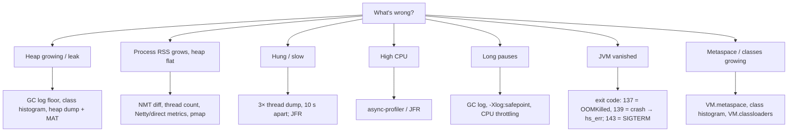
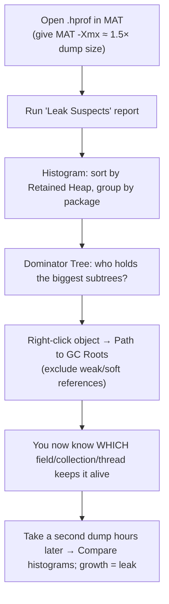
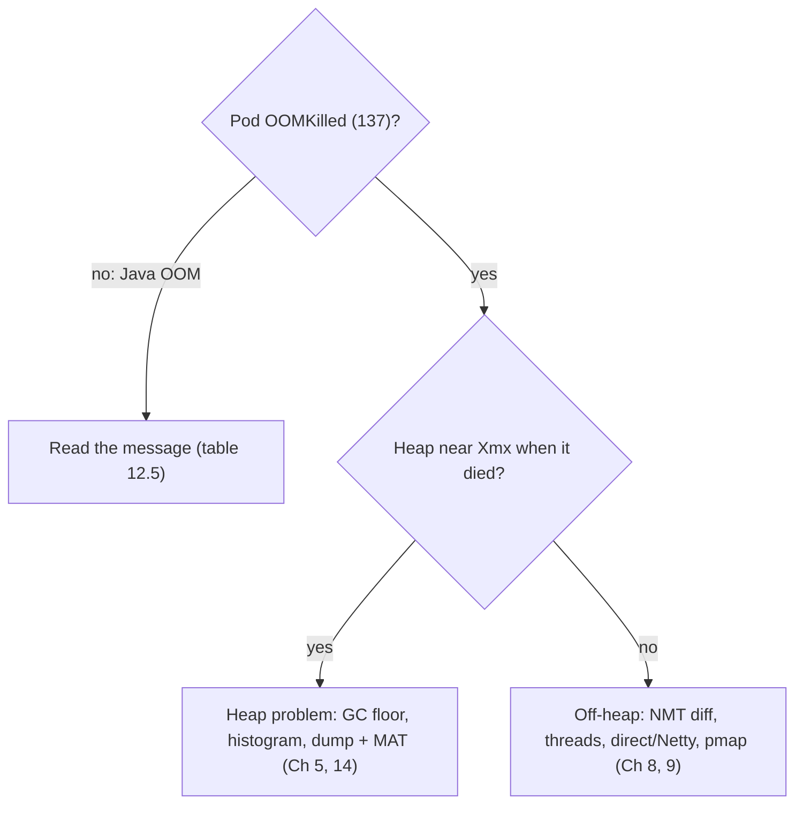

# Chapter 12 — Debugging Tools (your gdb/valgrind, JVM edition)

## Words you'll meet
| Word | Plain meaning |
|---|---|
| **`jcmd`** | One command to talk to a running JVM (dumps, flags, stats). The modern all-in-one. |
| **Heap dump (`.hprof`)** | Snapshot of every object in the Java heap. Like a core dump, but only the heap. |
| **MAT** | Eclipse Memory Analyzer: GUI to read heap dumps. |
| **Histogram** | Count + size per class. |
| **Shallow size** | Bytes of the object itself. |
| **Retained size** | Bytes that would be freed if this object died (its whole exclusive subtree). |
| **Dominator** | Object that is the only path keeping others alive. |
| **Thread dump** | Stack of every thread now. |
| **NMT** | Native Memory Tracking (Ch 9). |
| **hs_err file** | JVM crash report (like a core dump summary). |

---

## 12.1 Your tools, translated

| You used in C/C++ | JVM equivalent | Notes |
|---|---|---|
| `gdb -p PID` + `thread apply all bt` | `jcmd PID Thread.print` | no breakpoints needed, non-destructive |
| core dump + analysis | `jcmd PID GC.heap_dump file` / auto on OOM | heap only |
| `valgrind --leak-check` / LSan | heap dump + MAT (leak suspects); Netty leak detector | |
| `ltrace`/`ps`/`/proc` | `jcmd PID VM.flags`, `VM.system_properties`, `jstat` | |
| `pmap`, `/proc/PID/smaps` | same! + `VM.native_memory` | |
| ASan/UBSan | not needed (memory safe) | |
| `perf top` | async-profiler / JFR (Ch 13) | |
| `strace` | same | |

## 12.2 Pick the tool by symptom



## 12.3 jcmd cheat sheet (PID is usually 1 inside a container)

```bash
jcmd -l                                    # list JVMs
jcmd 1 help                                # available commands
jcmd 1 VM.version ; jcmd 1 VM.uptime ; jcmd 1 VM.command_line ; jcmd 1 VM.flags
jcmd 1 GC.heap_info                        # heap sizes per generation/region
jcmd 1 GC.class_histogram | head -30       # instances per class (does a GC first)
jcmd 1 GC.heap_dump /dumps/heap.hprof      # full dump (STW, disk >= heap size!)
jcmd 1 Thread.print -l                     # thread dump with lock info
jcmd 1 Thread.dump_to_file -format=json /dumps/t.json    # includes virtual threads
jcmd 1 VM.native_memory summary            # needs -XX:NativeMemoryTracking
jcmd 1 VM.native_memory baseline ; jcmd 1 VM.native_memory summary.diff
jcmd 1 VM.metaspace ; jcmd 1 VM.classloaders
jcmd 1 Compiler.codecache
jcmd 1 JFR.start name=r settings=profile duration=120s filename=/dumps/r.jfr
jstat -gcutil 1 5s                         # columns: S0 S1 E O M CCS YGC YGCT FGC FGCT GCT
```
⚠️ A heap dump **pauses the app** (seconds–minutes) and needs free disk ≥ heap size. Take it on a pod removed from the load balancer.

## 12.4 In Kubernetes

```bash
kubectl exec -it POD -- jcmd 1 GC.heap_info
kubectl cp POD:/dumps/heap.hprof ./heap.hprof
# Distroless image (no jcmd)? attach a debug container that shares the process namespace:
kubectl debug -it POD --image=eclipse-temurin:21-jdk --target=CONTAINER --share-processes
kubectl describe pod POD            # Last State: Terminated / Reason: OOMKilled / Exit Code: 137
kubectl top pod POD --containers
```
Persist dumps: mount an `emptyDir`/PVC at `/dumps` and copy out, because a killed pod's filesystem is gone.

## 12.5 The Java OOM message table

| Message | Meaning | Where to look |
|---|---|---|
| `Java heap space` | heap full even after GC | leak or undersized: dump + MAT |
| `GC overhead limit exceeded` | >98% time in GC reclaiming <2% | same; thrashing |
| `Metaspace` | class metadata cap hit | classloader leak / dynamic class gen |
| `Direct buffer memory` | NIO direct limit hit | buffers not released / limit too low |
| `unable to create native thread` | OS refused a thread | thread leak, pids limit, ulimit, RAM |
| `Requested array size exceeds VM limit` | absurd array size | bug / bad input |
| `Compressed class space` | class-space region full | raise `CompressedClassSpaceSize` |
| *(no message)* exit 137 / OOMKilled | kernel killed process | total RSS > limit (not a Java error) |

## 12.6 Heap dump + MAT, step by step


Useful OQL:
```sql
SELECT * FROM java.util.concurrent.ConcurrentHashMap WHERE size > 100000
SELECT toString(s.value) FROM java.lang.String s WHERE s.value.@length > 10000
```
Vocabulary again: **Shallow** = object's own bytes. **Retained** = what dies with it. A `HashMap` object is small (shallow) but may retain 2 GB (its entries).

Cheaper than a dump: **JFR Old Object Sample** (`jdk.OldObjectSample` with `path-to-gc-roots=true`): finds likely leak roots with low overhead.

## 12.7 Thread dump reading guide

| You see | Meaning |
|---|---|
| Many threads `BLOCKED ... waiting to lock <0x…>` | contention; find the thread that `locked <0x…>` |
| Pool threads all in same `SocketRead`/JDBC call | downstream slow, pool exhausted |
| Growing count of identical thread names | thread leak |
| `Found one Java-level deadlock` at bottom | classic deadlock; stacks show the cycle |
| Many threads in `Unsafe.park` | idle workers (normal) or waiting on futures |

Take **three dumps 5–10 s apart**: stuck threads show the same stack each time.

## 12.8 NMT workflow (Ch 9 recap)
```
start with -XX:NativeMemoryTracking=summary
jcmd 1 VM.native_memory baseline         # at steady state
... run 1-2 h ...
jcmd 1 VM.native_memory summary.diff     # which section grew?
```
Compare NMT total with real RSS (`ps -o rss`/`memory.current`). Big gap = native memory outside JVM accounting.

## 12.9 GC and safepoint debugging
```
-Xlog:gc*,safepoint*=info:file=/var/log/gc.log:time,uptime,level,tags
```
Look at: `Total time for which application threads were stopped: X seconds, Stopping threads took: Y seconds`. Big Y = time-to-safepoint problem (Ch 5).

## 12.10 Crash analysis (`hs_err_pidN.log`)
- Header: signal (SIGSEGV...), `Problematic frame:` — `C` native lib, `J` compiled Java, `V` JVM.
- `Out of Memory Error (os_linux.cpp:...)` = native allocation failed (container limit).
- Contains thread stacks, registers, memory map, loaded libs, flags.
🧩 It's the JVM's version of a tombstone/core summary. Native crashes mean bug in JVM or a JNI lib.

## 12.11 Remote debugger (breakpoints)
`-agentlib:jdwp=transport=dt_socket,server=y,suspend=n,address=*:5005` + IDE "attach". **Never expose in production**; use `kubectl port-forward` only in staging.

## 12.12 Memory debugging playbook



## 12.13 Exercises
- [ ] Take a heap dump of a staging service; list top 3 classes by retained size.
- [ ] Run NMT baseline → diff after 1 h; which category grew most?
- [ ] 3 thread dumps; group by pool name.
- [ ] Practise `kubectl debug` with a JDK ephemeral container.

<details><summary>Q1. Heap dump 300 MB, process RSS 5 GB. Meaning?</summary>
The dump holds only Java heap objects. ~4.7 GB is outside it: use NMT, `pmap`, Netty metrics.
</details>

<details><summary>Q2. What does exit code 137 prove?</summary>
That the process got SIGKILL (usually the cgroup OOM killer). Confirm with `kubectl describe` and `memory.events`. It does not say which region grew.
</details>

<details><summary>Q3. Why 3 thread dumps and not 1?</summary>
One dump is a photo; three show what *doesn't change*: stuck threads, held locks, leaking pools.
</details>

Prev: [11](11-tuning-flags.md) · Next: [Chapter 13 — Profiling](13-profiling.md)
