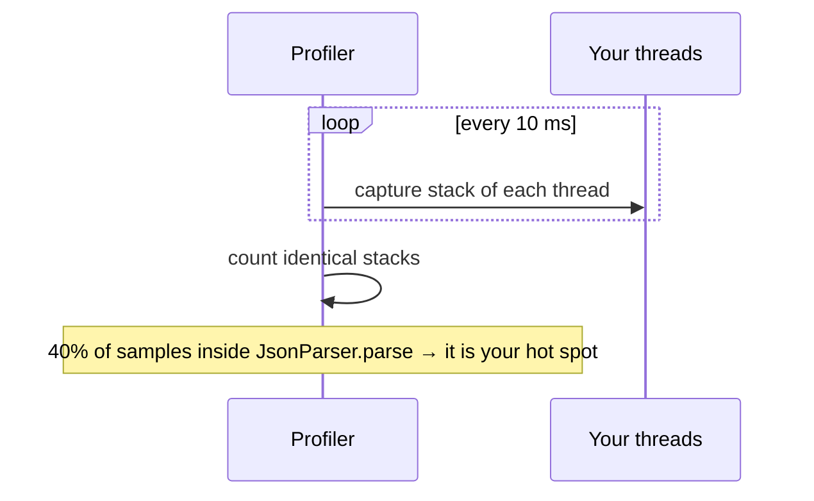
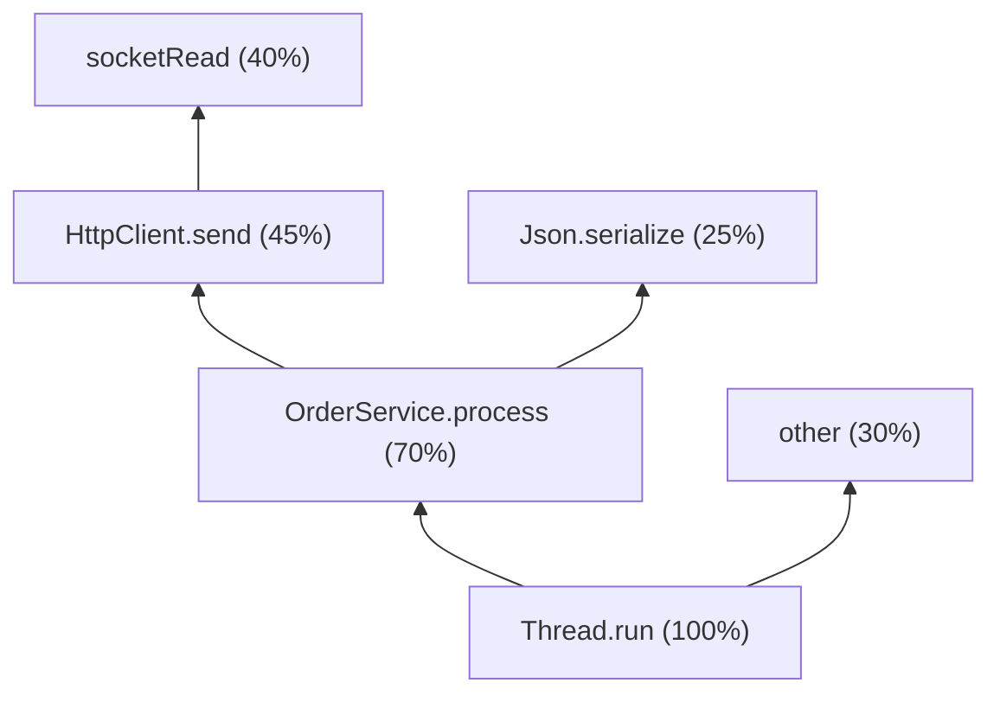

# Chapter 13 — Profiling

## Words you'll meet
| Word | Plain meaning |
|---|---|
| **Profiler** | Tool that shows where time/memory goes. |
| **Sampling** | Look at all stacks every few ms; the most-seen stacks are the hot spots. Cheap. |
| **Instrumenting** | Insert code to count/time every call. Exact but slow and distorts. |
| **Flame graph** | Chart of stacks: width = share of samples. |
| **JFR** | Java Flight Recorder: built-in, low-overhead event recorder. |
| **JMC** | JDK Mission Control: GUI for JFR files. |
| **async-profiler** | Popular sampling profiler using `perf_events`; no safepoint bias. |
| **Safepoint bias** | Profilers that sample only at safepoints blame the wrong code. |
| **JMH** | Java Microbenchmark Harness: the correct way to benchmark small code. |
| **Allocation profile** | Who creates the most objects. |
| **Wall-clock profile** | Samples all threads, including waiting ones. |

---

## 13.1 Which profile answers which question

| Question | Type | Tool |
|---|---|---|
| Where is CPU spent? | CPU | async-profiler `-e cpu`, JFR |
| Who allocates most (GC pressure)? | Allocation | `-e alloc`, JFR |
| Where do requests wait? | Wall-clock | `-e wall` |
| Lock contention? | Lock | `-e lock`, JFR `JavaMonitorEnter` |
| Native memory (malloc) growth? | Native | jemalloc profiler, async-profiler nativemem |
| Is my small function fast? | Microbenchmark | JMH |

🧩 **C++ equivalents:** `perf record -g` ↔ async-profiler; `heaptrack/massif` ↔ allocation profile; Google Benchmark ↔ JMH; helgrind ↔ lock profile.

## 13.2 Sampling in one picture


Overhead ~1–3% → safe in production. 🧩 This is `perf record -F 100 -g`.

## 13.3 JFR: built in, always-on friendly

```bash
# at start
-XX:StartFlightRecording=name=cont,settings=profile,maxage=6h,maxsize=500m,dumponexit=true,filename=/dumps/r.jfr
# on demand
jcmd 1 JFR.start name=x settings=profile duration=120s filename=/dumps/x.jfr
jcmd 1 JFR.dump  name=cont filename=/dumps/now.jfr
jfr summary /dumps/x.jfr
jfr print --events jdk.GCPhasePause /dumps/x.jfr | head
```
- `settings=default` ≈ <1% overhead; `profile` ≈ 2%.
- Open in **JMC** or IntelliJ.
- Great events: `ExecutionSample` (CPU), `ObjectAllocationSample`, `GarbageCollection`, `JavaMonitorEnter`, `ThreadPark`, `SocketRead`, `Deoptimization`, `Compilation`, `OldObjectSample` (leak candidates).

## 13.4 async-profiler

```bash
./asprof -d 60 -e cpu   -f /tmp/cpu.html    PID     # CPU flame graph
./asprof -d 60 -e alloc -f /tmp/alloc.html  PID     # who allocates
./asprof -d 60 -e wall -t -f /tmp/wall.html PID     # where threads wait (-t = per thread)
./asprof -d 60 -e lock  -f /tmp/lock.html   PID
```
Containers: needs `perf_event_paranoid ≤ 1` or capability `CAP_PERFMON`/`CAP_SYS_ADMIN`; else use `-e itimer`. Run from a debug container that shares the PID namespace.

## 13.5 How to read a flame graph

```
             [ socketRead0 ]
          [   HttpClient.send    ]
    [      OrderService.process        ]
[                Thread.run                       ]    ← bottom = entry point
        wider = more samples = more time
```

Reading rules:
1. Look for **wide boxes at the top** (plateaus): that's where the time really is.
2. Common culprits: JSON (de)serialization, logging, regex, `String.format`, reflection, `synchronized`, GC threads (`G1 Conc#`), JIT threads (`C2 CompilerThre`), `Unsafe.park`.
3. **CPU graph ≠ latency.** If the CPU graph is flat but latency is high, make a **wall** profile.
4. Compare before/after with a differential flame graph.

## 13.6 Allocation profile → fewer GCs

1. Capture alloc flame graph.
2. Typical top allocators: string concatenation, **boxing**, `ArrayList` growth, streams/lambdas, JSON trees, `byte[]` copies, logging with eager `toString`.
3. Fixes: pre-size collections; primitive collections; reuse `StringBuilder`/`ObjectMapper`/`Pattern` as singletons; `log.debug("x {}", x)`; avoid copying buffers.
Goal: lower **allocation rate** (MB/s) → fewer young GCs, less promotion, fewer pauses.

## 13.7 JMH: the only trustworthy microbenchmark

Why not `System.nanoTime()` loops? The JIT removes unused work, folds constants, and you'd measure the interpreter (Ch 7).

```java
@State(Scope.Thread) @BenchmarkMode(Mode.AverageTime) @OutputTimeUnit(TimeUnit.NANOSECONDS)
@Warmup(iterations = 5, time = 1) @Measurement(iterations = 5, time = 1) @Fork(2)
public class ParseBench {
  String json = "{\"a\":1}";
  @Benchmark public Object parse(Blackhole bh) throws Exception { return mapper.readValue(json, Dto.class); } // returning prevents dead-code removal
}
```
Run: `java -jar target/benchmarks.jar -prof gc` (shows **bytes allocated per op**) or `-prof async:output=flamegraph`.
Pitfalls: constant input folded; single fork; noisy laptop; forgetting `Blackhole`.

## 13.8 Production metrics (always on)

Spring Boot Actuator + Micrometer + Prometheus give:

| Metric | Use |
|---|---|
| `jvm_memory_used_bytes{area,id}` / `_committed_` / `_max_` | heap & non-heap pools |
| `jvm_gc_pause_seconds_{count,sum,max}` | GC pause frequency/length |
| `jvm_gc_memory_allocated_bytes_total` | **allocation rate** |
| `jvm_gc_memory_promoted_bytes_total` | promotion rate |
| `jvm_gc_live_data_size_bytes` | **old-gen floor after GC: the leak signal** |
| `jvm_buffer_memory_used_bytes{id="direct"}` | NIO direct memory |
| `jvm_threads_live_threads` | thread leak |
| `jvm_classes_loaded_classes` | classloader leak |
| `process_cpu_usage` | CPU |
| `container_memory_working_set_bytes` | OOM danger (cAdvisor) |
| `container_cpu_cfs_throttled_seconds_total` | CPU throttling |

**Dashboard panels to build:** heap used/committed/max · after-GC floor · alloc rate · GC pause p99 · threads · direct buffers · working set vs limit · CPU throttling.

⚠️ **High-cardinality tags** (`userId`, VPA, raw URIs with ids) create one `Meter` object per value → unbounded heap growth. Tag only by low-cardinality values (status, bank, type).

Continuous profiling (always on in prod): Pyroscope, Grafana Profiles, Parca, vendor APM; or JFR streaming.

## 13.9 Safepoint bias in one example
Old profilers ask threads for stacks only when they reach a safepoint, so time in a tight loop (no safepoint inside) gets blamed on the *loop end*. async-profiler samples via OS signals at arbitrary moments → real answer.

## 13.10 Exercises
- [ ] 2 minutes of JFR under staging load; open in JMC; list top 5 CPU methods and top 5 allocation sites.
- [ ] Make CPU, alloc and wall flame graphs for the same window; what differs?
- [ ] Write a JMH benchmark with `-prof gc` for your hottest serializer; lower B/op.
- [ ] Add the after-GC floor and alloc-rate panels to Grafana.

<details><summary>Q1. CPU flame graph shows nothing hot, latency is bad. Next?</summary>
Latency is waiting, not computing: wall-clock profile, thread dumps, lock events, tracing, CPU throttling metric.
</details>

<details><summary>Q2. Why trust async-profiler over a jstack-sampling profiler?</summary>
No safepoint bias: it samples at arbitrary points, so hot code is attributed correctly.
</details>

<details><summary>Q3. How do I know if GC pressure comes from my code?</summary>
Allocation rate (`jvm_gc_memory_allocated_bytes_total`) plus an alloc flame graph; then reduce top allocators.
</details>

Prev: [12](12-debugging-tools.md) · Next: [Chapter 14 — Leaks and Case Study](14-leaks-and-case-study.md)
