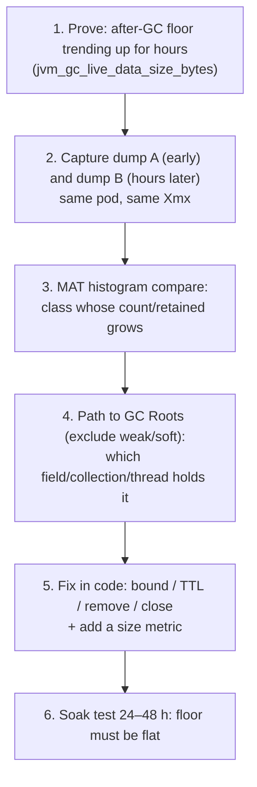
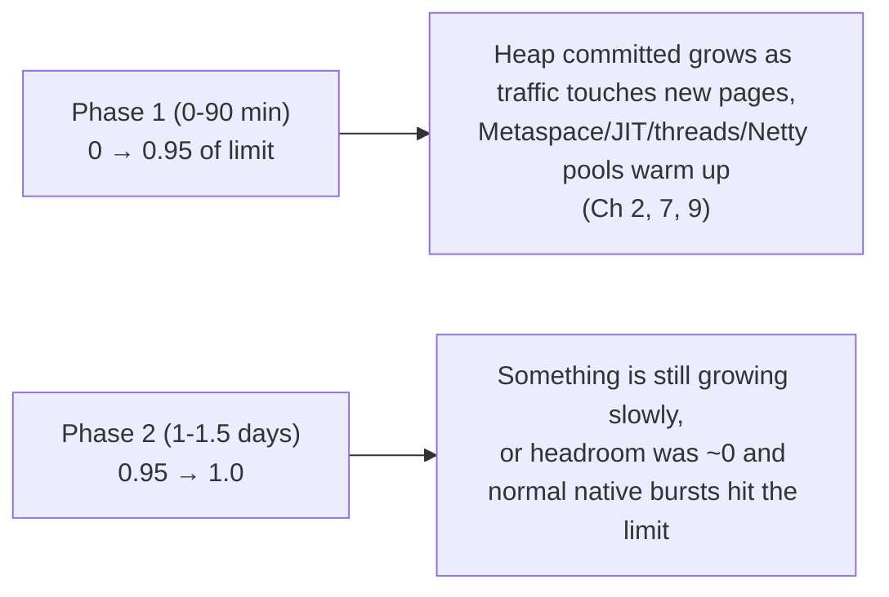
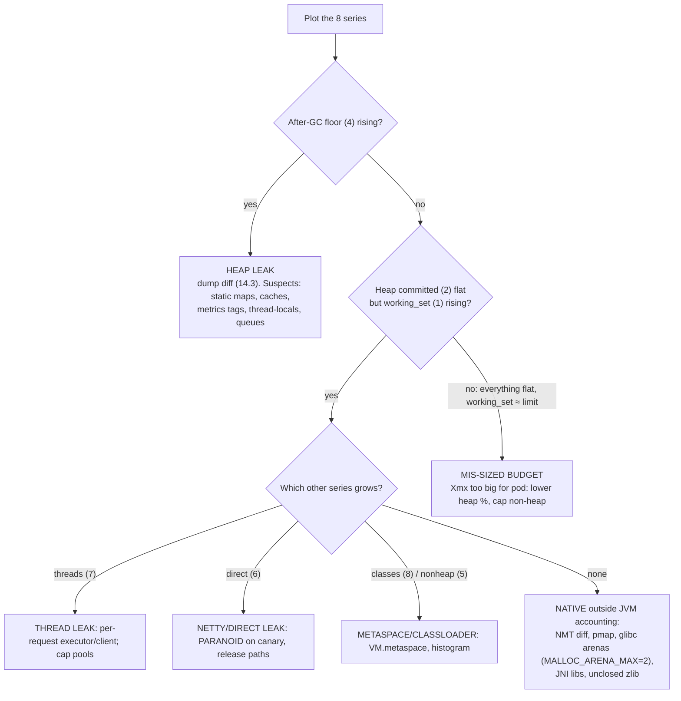

# Chapter 14 — Leaks and the "0.95 → 1.0" Case Study

## Words you'll meet
| Word | Plain meaning |
|---|---|
| **Memory leak (Java)** | Objects that are still *reachable* but will never be used again. |
| **Retention** | Something keeps an object alive. |
| **Unbounded** | No upper limit (cache/queue/pool that can grow forever). |
| **TTL** | Time-to-live: auto-expire entries after a time. |
| **High cardinality** | Huge number of distinct values (e.g. user IDs as metric tags). |
| **Soak test** | Run at steady load for 24–48 h to expose slow leaks. |
| **After-GC floor** | Heap in use right after a full/mixed GC = the real live data. |

---

## 14.1 Leaks: C++ vs Java

| | C/C++ leak | Java leak |
|---|---|---|
| Definition | allocated, **unreachable**, never freed | allocated, **reachable**, never used again |
| Cause | forgot `free`/`delete` | forgot to remove from a collection/cache/listener/thread-local |
| Dangling pointer | possible | impossible |
| Detection | valgrind/LSan (finds unreachable blocks) | heap dump + "path to GC roots" (reachable but useless) |
| Cure | free it | remove the reference |

Key insight: Java's GC can never find your leak for you, because the leaked objects are *reachable*: the program legitimately still points at them.

## 14.2 Leak pattern catalog (bad → good)

### 1. Unbounded static map
```java
// BAD
static final Map<String, Txn> PENDING = new ConcurrentHashMap<>();   // put on start, remove only on success
// GOOD
Cache<String,Txn> pending = Caffeine.newBuilder().maximumSize(100_000).expireAfterWrite(10, MINUTES).build();
```
Error/timeout paths forget `remove()`: always clean in `finally`.

### 2. Cache without eviction / key explosion
Keys with timestamps/request ids → grows forever. Bound size + TTL; expose size and hit-rate metrics.

### 3. ThreadLocal in thread pools
```java
static final ThreadLocal<Buf> TL = new ThreadLocal<>();
try { TL.set(buf); ... } finally { TL.remove(); }       // pooled threads live forever: remove!
```

### 4. Listeners / callbacks never deregistered
Event buses, shutdown hooks, `ChannelFutureListener`s capturing big objects. Remove in lifecycle.

### 5. Executor / client created per request
```java
// BAD: new threads, new connection pools, new Netty event loops per call
new RestTemplate(); HttpClient.newHttpClient(); Executors.newFixedThreadPool(8);
// GOOD: one singleton bean, closed in @PreDestroy
```

### 6. Unclosed resources
`InputStream`, JDBC `Connection/ResultSet`, HTTP response bodies, temp files. Use try-with-resources. Hikari: `leakDetectionThreshold`.

### 7. Netty/Reactor buffers not released (Ch 9)
Release on **every** path including exceptions; consume response bodies.

### 8. Unbounded queues
`LinkedBlockingQueue()` (capacity = 2³¹−1), `onBackpressureBuffer()` unbounded, Kafka prefetch, async log queue. Bound + backpressure.

### 9. ClassLoader leaks (Ch 6)
Metaspace growth from redeploys or per-request generated classes.

### 10. High-cardinality metrics / MDC
```java
// BAD: one Meter object per VPA
registry.counter("upi.txn", "vpa", vpa).increment();
// GOOD
registry.counter("upi.txn", "status", status, "bank", bank).increment();
```
Also clear MDC in pooled threads.

### 11. Inner class / lambda capturing `this`
Anonymous classes hold the outer instance; stored in async callbacks, they pin big request objects. Use static nested classes or capture only needed fields.

### 12. `subList`, `ByteBuffer.slice`, views
A small view keeps the whole backing store alive. Copy what you need.

### 13. In-memory idempotency/session/rate-limit stores without TTL
Move to Redis or bounded cache with TTL.

### 14. Native: `GZIPOutputStream`/`Inflater` not closed
Native zlib memory leaks outside the heap (Ch 9).

### 15. Finalizers
`finalize()` deprecated; slow finalizers back up and retain huge graphs.

## 14.3 Heap-leak hunting method


No time for dumps? Use `jcmd GC.class_histogram` twice (cheap) or JFR `OldObjectSample`.

---

# The Case Study: memory climbs to 0.95 in 1–1.5 h, then creeps to 1.0 over 1–1.5 days

You'll solve it like a detective. **Don't assume leak or healthy.**

## 14.4 Step 0: translate the two phases using what you know


Phase 1 is *expected*. The danger is Phase 2, and also the fact that a plateau at **0.95** means only 5% headroom.

## 14.5 Step 1: collect these 8 time series per pod (for ≥ 24 h)

| # | Metric | Tells you |
|---|---|---|
| 1 | `container_memory_working_set_bytes` | what the kernel sees |
| 2 | `jvm_memory_committed_bytes{area="heap"}` | heap touched (upper bound) |
| 3 | `jvm_memory_used_bytes{area="heap"}` | heap in use |
| 4 | `jvm_gc_live_data_size_bytes` | **after-GC floor** |
| 5 | `jvm_memory_used_bytes{area="nonheap"}` | Metaspace + code cache |
| 6 | `jvm_buffer_memory_used_bytes{id="direct"}` | NIO direct |
| 7 | `jvm_threads_live_threads` | thread leak |
| 8 | `jvm_classes_loaded_classes` | classloader leak |

## 14.6 Step 2: the decision tree



## 14.7 The "looks like a leak, isn't" suspects

| Suspect | Why it fakes a leak | How to tell |
|---|---|---|
| **G1 doesn't return memory** | committed stays high after each load peak | `used` saw-tooths, `committed` stays; floor flat |
| **Page cache** (logs, jars) | usage includes cache | `rss` flat, `cache` rising; working_set barely changes |
| **Heap sized ≈ 85–90% of limit** | heap alone eats the pod | budget worksheet (Ch 10) |
| **glibc arena fragmentation** | RSS grows w/o NMT growth | `pmap` many 64 MB regions; fix with `MALLOC_ARENA_MAX=2` |
| **JIT/compiler arena bursts** | temporary native spikes at low headroom | spikes near deploys/traffic changes |

## 14.8 Quick first fixes (apply while investigating)
1. Heap to 55–65% of limit (`MaxRAMPercentage=60`), `InitialRAMPercentage=60`.
2. Cap `MaxMetaspaceSize`, `MaxDirectMemorySize`, `ReservedCodeCacheSize`, `-Xss512k`.
3. `MALLOC_ARENA_MAX=2`.
4. `-XX:+ExitOnOutOfMemoryError` + heap dump path to a volume.
5. Alert on working_set/limit > 0.85 **and** slope > 0.
6. Canary pod with Netty `PARANOID` + NMT summary; compare with a control pod.
7. Restarts are a stopgap, never the fix.

## 14.9 Proving the fix
Same traffic, 24–48 h soak: working_set plateaus below 80% of limit; after-GC floor flat; threads/classes/direct flat.

## 14.10 Exercises
- [ ] Build the 8-panel dashboard for your service.
- [ ] Walk the decision tree with real data; write a one-paragraph conclusion.
- [ ] grep your code: `static .*Map`, `newFixedThreadPool`, `HttpClient.new`, `meterRegistry.counter(`, `ThreadLocal`.
- [ ] Add size gauges: `Gauge.builder("cache.size", map, Map::size)` for every in-memory collection.

<details><summary>Q1. Why can a leak take a day to hurt?</summary>
Per-request leakage is tiny, error paths are rare, and headroom absorbs it until the limit is reached; periodic jobs and rare failures amplify it.
</details>

<details><summary>Q2. Memory flat at 95% for days: safe?</summary>
Flat means stable, not safe. With ~5% headroom any native burst (JIT, TLS handshake storm, thread burst, Netty chunk) can cross the limit. Add headroom.
</details>

<details><summary>Q3. Floor flat, heap flat, working_set rising slowly. First suspect?</summary>
Off-heap: threads, direct/Netty, Metaspace, or native fragmentation. Use the series to pick, then NMT diff / pmap.
</details>

Prev: [13](13-profiling.md) · Next: [Chapter 15 — Labs, Quiz, Glossary](15-labs-quiz-glossary.md)
